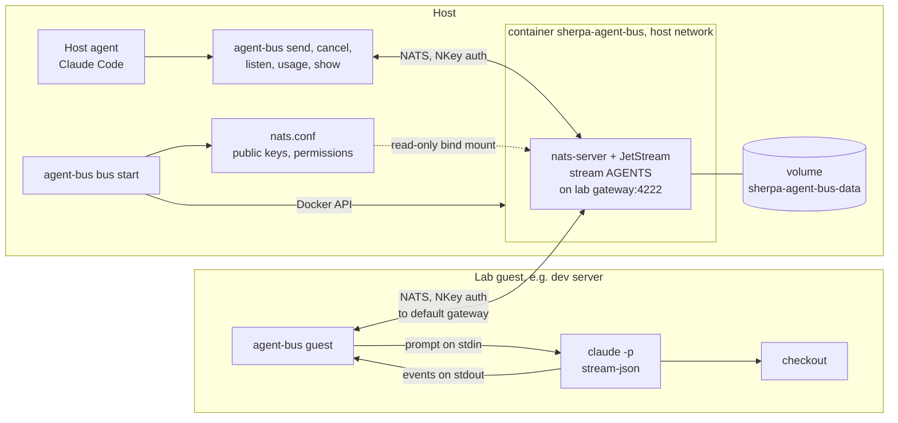
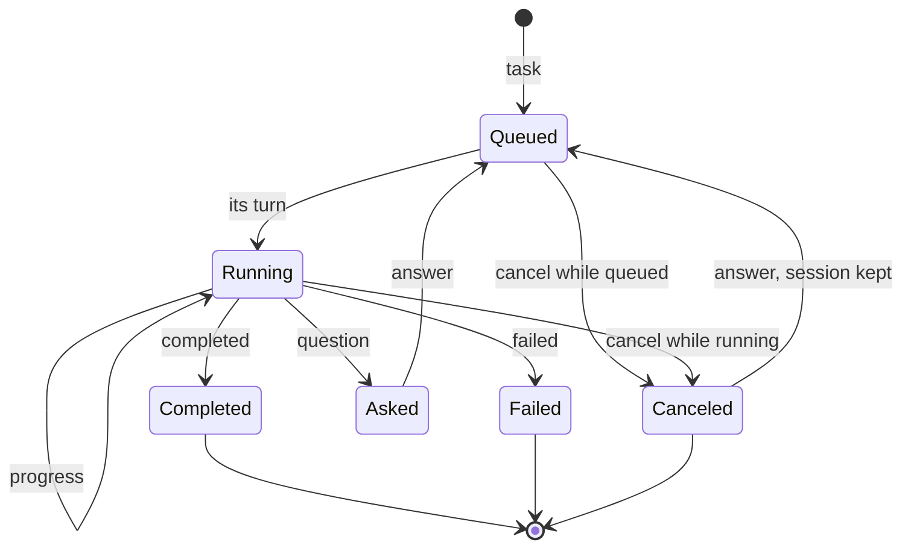
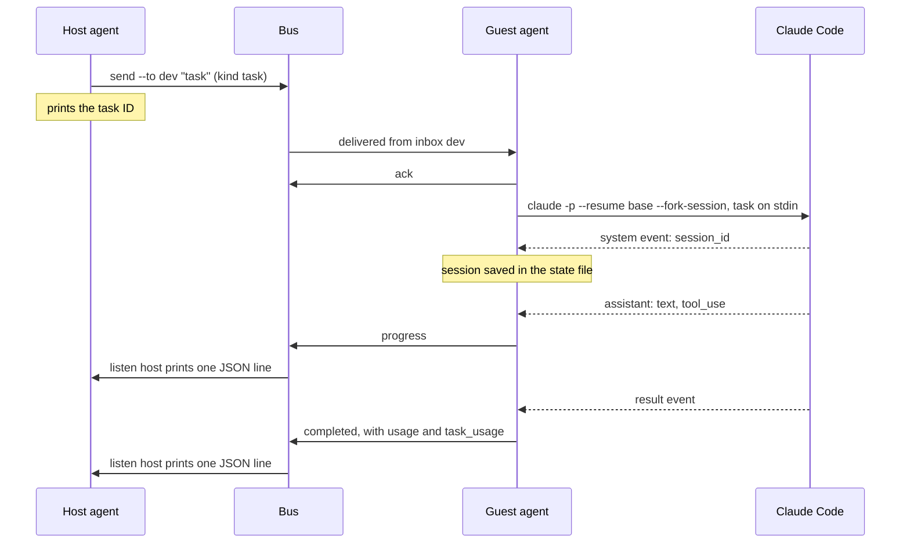
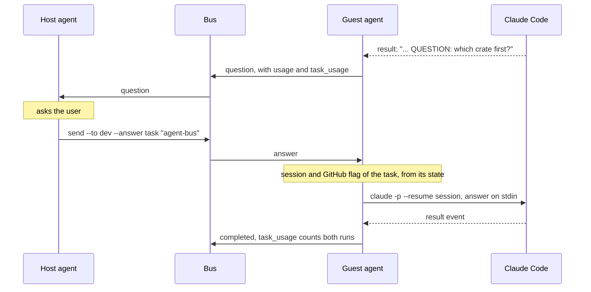
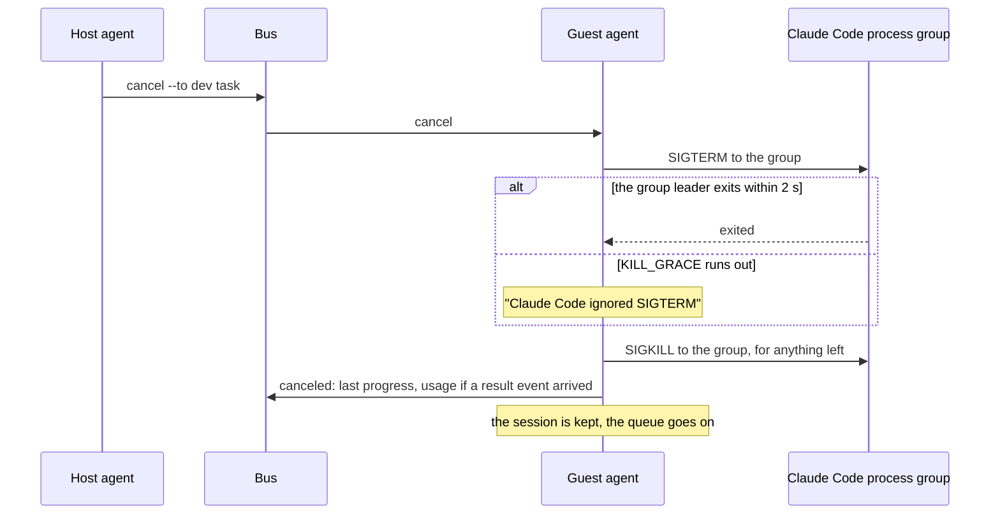
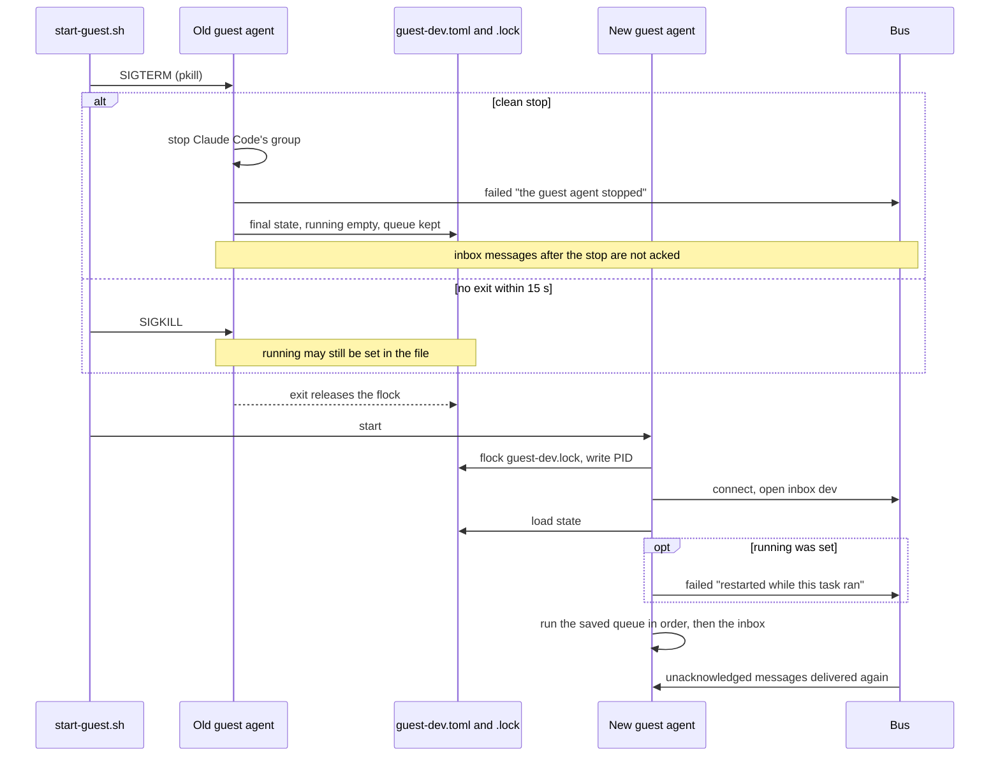
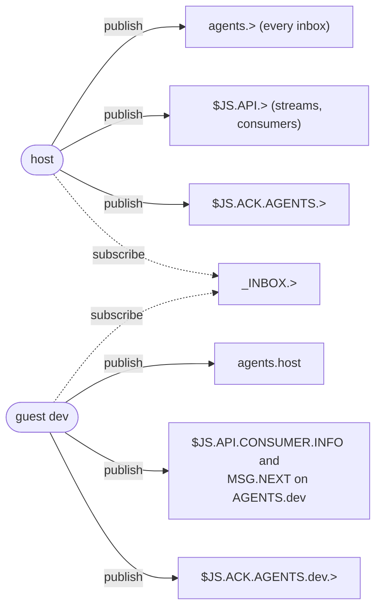
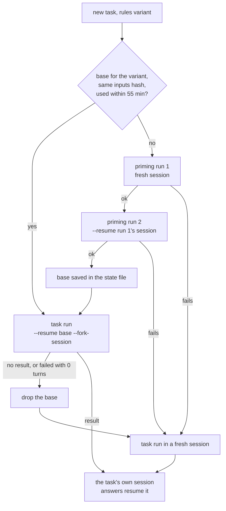

# Agent Bus

The agent bus is a message channel between the AI coding agent the user works with on the host
(the host agent) and agents running in lab guests (guest agents). The host agent hands a guest
agent a whole task, and gets back its progress, its questions for the user, and its outcome.

The code is the `agent-bus` crate, `crates/agent-bus`. The research behind it (what was tried and
measured) is in [`../investigations/agent-bus.md`](../investigations/agent-bus.md). Open work is
tracked in issue #494.

## Purpose and scope

- **A development tool, not released.** `agent-bus` has `publish = false`, is not installed by
  the install scripts, and is not part of `sherpad` or the `sherpa` CLI. It has no user-facing
  documentation in `../sherpa-docs`.
- **Two roles.** The host agent sends tasks, answers and cancels, and reads the replies. A guest
  agent (`agent-bus guest`), running in a lab guest such as the dev server
  (`tests/environments/dev`), takes each task to Claude Code in its checkout and replies.
- **What it replaces.** Before the bus, the host agent did the work itself over SSH, one command
  at a time, and every build log and test run landed in its context. With the bus the guest
  agent does the work, and the host agent sees only the progress lines and the outcome.
- **What it is not.** It is not A2A (#439). The message kinds are named after A2A's task states,
  but the protocol is plain JSON on NATS subjects.

## Components

| Part | What it is | Code |
|---|---|---|
| Bus container | `sherpa-agent-bus`, image `nats:2.15-alpine` pinned by digest (nats-server 2.15.2), run with JetStream on the host's network. It listens on one address, port 4222: with `--lab`, the lab's management gateway (`ipv4_gateway` in `lab-info.toml`), which is also each guest's default gateway. Restart policy `unless-stopped`. | `src/bus.rs` |
| Store | The Docker volume `sherpa-agent-bus-data`, mounted at `/data` (`--store_dir`). It outlives the container. | `src/bus.rs` |
| Server config | `nats.conf`, rendered from the agents file and bind-mounted read-only at `/etc/agent-bus/nats.conf` (`-c`). | `src/config.rs` |
| Stream | One JetStream stream, `AGENTS`, on `agents.>`, keeping messages for 7 days (`max_age`). | `src/channel.rs` |
| Inboxes | One durable pull consumer per agent, named after it, filtered on `agents.<name>`, with `max_waiting = 1`. A message waits until its agent reads and acknowledges it, and a restarted reader goes on where it stopped. | `src/channel.rs` |
| Host commands | `key new`, `bus start/stop/status`, `send`, `cancel`, `listen`, `usage`, `show`. | `src/main.rs` |
| Guest agent | `agent-bus guest`: reads its inbox, queues tasks, runs them one at a time through Claude Code, and replies. | `src/guest/` |
| Claude Code | `claude -p` with `stream-json` output, one process (and process group) per run, in the guest's checkout. | `src/guest/claude.rs` |

The flowchart shows the parts and how they connect. The only path between the host and a lab
guest is NATS on the lab's management bridge; nothing goes over SSH once the guest agent runs.



### Starting the bus

`agent-bus bus start --lab <lab dir> --agents <file>`, with the host's seed in `AGENT_BUS_SEED`.
Exactly one of `--lab` and `--listen <ipv4>` is required (`src/main.rs`, `src/state.rs`).

1. With `--lab`, read `lab-info.toml` in the lab directory; its `ipv4_gateway` is the listen
   address, and its `id` and `name` are recorded. A missing file, or one without a gateway, is an
   error naming the path.
2. Load and validate the agents file, and check that the seed's public key is the host's key.
3. Write `nats.conf` (see [Files and state](#files-and-state)).
4. Pull the pinned image if Docker does not have it, then replace the container: stop and remove
   any existing `sherpa-agent-bus`, create it, start it. An existing container is never just
   restarted, because the config may have changed. The messages are in the volume, so replacing
   the container loses nothing.
5. Connect as the host (20 attempts, 500 ms apart), create or check the `AGENTS` stream, and
   bring each agent's inbox, the host's included, to the wanted consumer config.
6. Record the URL (and the lab) in `bus.toml`, and print one `Inbox ready: <agent> (<change>)`
   line per agent.

Each inbox is reported as `created`, `updated`, `recreated from sequence N` or `unchanged`
(`Channel::ensure_inbox`). A missing consumer is created. A different filter subject is updated
in place. NATS cannot change `max_waiting` on an existing consumer, so a consumer that differs in
it is deleted and created again with `DeliverPolicy::ByStartSequence` at the old consumer's ack
floor stream sequence + 1, read before the delete: acknowledged messages stay gone, delivered but
unacknowledged and unread messages are delivered again. If the create fails after the delete,
the error names the sequence to create it from.

`bus stop` stops and removes the container and removes `bus.toml`; the volume and its messages
stay. `bus status` prints the container's state, the recorded URL and the lab.

Adding an agent means adding it to the agents file and running `bus start` again.

### Finding the bus

`send`, `cancel`, `listen`, `usage` and `show` take the first of: `--server <url>`, the
environment variable `AGENT_BUS_URL`, the URL in `bus.toml` (`state::find_server`). With none,
they fail and say to run `bus start` or set one. The guest agent runs in the lab guest, where
there is no `bus.toml`: it takes `--server` (or `AGENT_BUS_URL`), which `dev/agent-bus/start-guest.sh`
builds from the guest's default gateway.

### One reader per inbox

Readers of a durable consumer share its messages, so a second reader on one inbox would silently
take some of them. Inboxes are created with `max_waiting = 1`, and `Channel::inbox` refuses to
open an inbox whose consumer already has a pull waiting (`num_waiting > 0`), naming the likely
cause (an earlier `agent-bus listen <agent>` still running). A killed reader leaves no claim
behind.

## Messages

Every message is one JSON object, published to `agents.<to>` and stored by JetStream before
`send` returns (`src/message.rs`, `Channel::send`).

| Field | Type | Meaning |
|---|---|---|
| `task` | string | The task ID: 8 hex digits, made by `send` for a new task. Every message of a task carries it. |
| `from`, `to` | string | Agent names: 1 to 32 lowercase letters, digits and hyphens, so a name is one subject token. |
| `kind` | string | One of the kinds below, in snake case. |
| `text` | string | The task, the answer, the progress line or the outcome text. Empty for `cancel`. |
| `usage` | object, optional | What this run of Claude Code used. Only on outcome messages that had a `result` event. |
| `task_usage` | object, optional | What the task has used so far, this run included. Sent with `usage`. |
| `github` | bool, optional | Whether the task may use GitHub. Only `task` sets it. Left out of the JSON when false; a missing field reads as false. |

| Kind | Direction | Meaning |
|---|---|---|
| `task` | host to guest | Work to do. |
| `answer` | host to guest | The answer to a question; resumes the task's Claude session. |
| `cancel` | host to guest | Stop the task named in `task`, running or queued. |
| `progress` | guest to host | A text Claude said, or a tool call (`<tool>: <command, file_path, pattern or path>`), cut to 300 characters. |
| `question` | guest to host | The run's result has a line starting `QUESTION:`. |
| `completed` | guest to host | The run ended without an error and without a question. |
| `failed` | guest to host | The run ended with an error, Claude Code could not run, the guest agent stopped or restarted during the task, or a cancel named a task that is neither running nor queued. |
| `canceled` | guest to host | The task was canceled; the text holds the last progress. |

`usage` has `input`, `output`, `cache_creation`, `cache_read`, `num_turns`, `duration_ms`,
`duration_api_ms`, `cost_usd`, `session_cost_usd`, and `models`: one entry per model under Claude
Code's own field names (`model`, `inputTokens`, `outputTokens`, `cacheCreationInputTokens`,
`cacheReadInputTokens`, `costUSD`, `canonicalModel`, `costBasis`), left out when empty.
`task_usage` has `runs`, `cost_usd`, the four token counts, `num_turns`, `duration_ms` and
`duration_api_ms`. Their meaning is in [Usage and cost](#usage-and-cost).

An outcome message from a guest:

```json
{"task":"1a2b3c4d","from":"dev","to":"host","kind":"completed","text":"Clippy is clean; 9 of 9 tests pass.",
 "usage":{"input":4,"output":120,"cache_creation":37,"cache_read":22538,"num_turns":3,"duration_ms":9100,
          "duration_api_ms":7400,"cost_usd":0.0031,"session_cost_usd":0.0031},
 "task_usage":{"runs":1,"cost_usd":0.0031,"input":4,"output":120,"cache_creation":37,"cache_read":22538,
               "num_turns":3,"duration_ms":9100,"duration_api_ms":7400}}
```

### A task's lifecycle

The state diagram shows a task as the host sees it. The guest agent keeps no "waiting for an
answer" state: an `answer` is accepted for any task whose Claude session it knows, so an answer
after `completed`, `failed` or `canceled` also resumes the session. An answer for a task without
a session fails with "No session for task ...: an answer must follow a question". A cancel for a
task that is neither running nor queued gets a `failed` reply and changes nothing.



"Queued" covers a message in the inbox and one in the guest agent's local queue. "Canceled while
queued" replies "Canceled before it started", with no usage.

## Flows

### A task with progress and a result

The host sends a task, the guest agent runs it through Claude Code, and each line of Claude
Code's output that means something to the host becomes a message. Claude's last text is also
its result, so each text is held until the next update shows whether it was the last; the final
text is not sent twice (`stream::repeats_result`).



`agent-bus listen host`, run under Claude Code's Monitor on the host, prints each message as one
JSON line and acknowledges it, so each becomes a notification for the host agent. The guest
agent acknowledges each inbox message as soon as it reads it, before running it: a task runs far
longer than the bus waits for an acknowledgement, and must not be delivered twice.

### A question and its answer

A result with a line starting `QUESTION:` makes the outcome a `question`. The host agent asks the
user and sends the answer; the guest agent resumes the task's own session with it, with the
GitHub flag stored for that session.



### Cancelling a running task

While a task runs, the guest agent reads its inbox alongside Claude Code's output. Tasks and
answers that arrive wait in the local queue; a cancel for the running task is acted on at once.
Claude Code runs in its own process group, so the signals reach every command it started (cargo,
bash, sleep).



`canceled` carries `usage` and `task_usage` only if Claude Code's `result` event arrived before
the cancel; otherwise the text says the run's cost is unknown and the run is not counted. A
cancel for a queued task removes it from the queue and replies `canceled`. `Group` in
`src/guest/claude.rs` also sends SIGKILL to the group when it is dropped while still armed, so
no way out of a run leaves Claude Code behind.

### A guest restart

The guest agent is restarted on every deploy (`dev/agent-bus/start-guest.sh`). Its state file
and lock make the restart lose nothing and report an interrupted task exactly once: the old agent
reports it on a clean stop, and the new agent reports it only if the old one died without its
shutdown path.



The interrupted task's session is kept, so an answer still resumes it.

## Authentication and permissions

### NKeys

Every agent has an NKey user key pair (`src/keys.rs`). On connect, the server sends a nonce, the
client signs it with its seed, and the server checks the signature against the public keys in its
config. No password or token goes over the wire. NKeys authenticate; they do not encrypt, and
the bus has no TLS.

| Thing | Where it lives | Secret |
|---|---|---|
| Public key (`U...`) | The agents file, and the rendered `nats.conf` | No |
| Seed (`SU...`) | The user's secret store, then the one agent's environment as `AGENT_BUS_SEED` | Yes |

`agent-bus key new` generates a pair and is the only place a seed is printed. The seed is read
only from `AGENT_BUS_SEED` (trimmed, and checked to be a user seed), never from a command-line
flag or a file. It is never written to a file or a log, and no error repeats it: key errors say
what is wrong without quoting the value. The guest agent removes `AGENT_BUS_SEED` from Claude
Code's environment, because Claude Code runs commands from network messages with root.

On the host, the seed comes from the secret store into the environment of one command. In the
guest, `start-guest.sh` reads it from stdin (sent over SSH, never as an argument), exports it to
the agent process only, and unsets its own copy.

### The agents file

TOML, holding no secrets, passed with `bus start --agents <path>` (`src/agents.rs`). One
`[[agent]]` per agent:

```toml
[[agent]]
name = "host"
key = "UA..."
role = "host"

[[agent]]
name = "dev"
key = "UB..."
role = "guest"
```

Names follow the agent name rule, keys must be user public keys, names and keys are unique,
there is exactly one `host`, and unknown fields are refused. A TOML parse error gives the line
number and the parser's message with every word of 40 characters or more replaced by
`<hidden>`, so a seed pasted into the file is not echoed.

### The rendered config

`bus start` renders the nats-server config from the agents file as JSON, which nats-server
accepts, from serde structs (`src/config.rs`). It holds one `authorization.users` entry per agent:
its public key and its publish and subscribe allow lists. There is no field a seed could go in.
The bus has one account, so these lists are what separate the agents.

| Role | Publish allowed | Subscribe allowed |
|---|---|---|
| host | `agents.>`, `$JS.API.>`, `$JS.ACK.AGENTS.>` | `_INBOX.>` |
| guest `<name>` | `agents.<host>`, `$JS.API.CONSUMER.INFO.AGENTS.<name>`, `$JS.API.CONSUMER.MSG.NEXT.AGENTS.<name>`, `$JS.ACK.AGENTS.<name>.>` | `_INBOX.>` |

The diagram shows the same lists for a host and one guest, `dev`. Replies to requests, and pulled
messages, come back on `_INBOX.>`, which is why every agent may subscribe to it and to nothing
else.



So a guest can read and acknowledge its own inbox and send to the host, and nothing else: it
cannot send to another guest, read another inbox, or create or change a stream or consumer. Only
the host creates the stream and the consumers. A denied publish does not fail the call:
nats-server drops it and sends an asynchronous `Permissions Violation` error, and the call times
out. Every client prints the connection's events (`Channel::connect`), so a denial shows up as
`Bus connection event: server error: nats: Permissions Violation for Publish to ...`.

`usage` and `show` read the host's inbox history through an ephemeral pull consumer, which the
host's `$JS.API.>` already allows. An ordered push consumer would need `$JS.FC` publish rights for
flow control, so a pull consumer is used and nothing is widened.

## Guest execution

### Starting the guest agent

`agent-bus guest --server <url> --name <name> --workdir <checkout> [--model <id>] [--reply-to host]`
(`src/guest/run.rs`). In order, it:

1. checks the names, and takes the instance lock (see [Files and state](#files-and-state)); a
   second agent of the same name fails here with the holder's PID, before it touches the bus;
2. requires `CLAUDE_CODE_OAUTH_TOKEN` (from `claude setup-token`): guest agents use the Claude
   subscription, never API billing;
3. connects, and opens its inbox;
4. loads its state file, reports an interrupted task, and saves;
5. runs three loops together until the inbox closes or SIGTERM or SIGINT arrives: the inbox
   reader, the sender of replies, and the engine that runs tasks.

If no state directory can be found (neither `XDG_STATE_HOME` nor `HOME` is absolute), the agent
runs with its state in memory only and without the lock, and says so.

### How Claude Code is started

Each run is one Claude Code process (`claude::claude_command`):

```text
claude -p --output-format stream-json --verbose
       --model <model>
       --dangerously-skip-permissions
       --disallowedTools=<deny list>
       --append-system-prompt <rules>
       [--resume <base> --fork-session | --resume <session>]
```

- **Prompt.** The task or answer text goes in on stdin, which is then closed, so the tool lists
  cannot swallow it as an argument.
- **Model.** `claude-opus-5-5` unless `--model` is given (`start-guest.sh` passes
  `AGENT_BUS_MODEL` when it is set).
- **Process.** It runs in the checkout, in its own process group (`process_group(0)`), with
  `kill_on_drop`. Stdout is read line by line; stderr goes to the guest agent's log.
- **Environment.** `ANTHROPIC_API_KEY` and `AGENT_BUS_SEED` are always removed. Without GitHub
  access `GH_TOKEN`, `GITHUB_TOKEN` and `GH_ENTERPRISE_TOKEN` are removed too, so `curl` with the
  token cannot get round the deny list.
- **Permissions.** Permission checks are skipped, because the guest is a disposable lab VM and
  the agent has root in it. The deny list still refuses some commands.
- **Rules.** The appended system prompt says it is a guest agent, to follow `AGENTS.md`, not to
  add dependencies, to end with a `QUESTION:` line when it needs a decision and otherwise with a
  short summary, and that the git status in its context may be stale. A GitHub sentence follows
  (below).

The outcome is read from the `result` event: `is_error` true (or missing) is `failed`, a line
starting `QUESTION:` (after leading spaces) is `question`, anything else is `completed`. A run
that exits without a `result` event is reported `failed` with its exit status.

### GitHub access per task

`agent-bus send --github` sets `github` on the task. An answer cannot set it (`--github`
conflicts with `--answer`, and the guest ignores `github` on an answer): it uses the flag stored
with the task's session (`engine::task_github`).

| | Without `github` | With `github` |
|---|---|---|
| Tokens | `GH_TOKEN`, `GITHUB_TOKEN`, `GH_ENTERPRISE_TOKEN` removed | Kept |
| Denied | `git commit`, `git push`, `git reset`, `gh` | `gh pr merge`, `gh api`, `gh repo delete`, `gh release`, `git reset`, `git push` with `--force`, `-f`, `--delete`, `-d`, a `+` refspec or `:branch`, and `git branch -D` |
| Rules add | The task has no GitHub access: no commit, push, merge, pull request or `gh`. | Do only what the task asks; commit messages end with the Co-Authored-By line from its own attribution instructions, never one copied from the task; no session links or "Generated with" footers; never merge or delete. |

With the token present the deny list is a guardrail, not a security boundary: it matches command
text, so a command written another way (`curl` with the token, a script) is not caught. The
token's own scopes are the boundary.

### Base sessions and forking

Claude Code's last prompt cache breakpoint comes after the first user message, which holds the
task text. So every new session writes the whole prefix (system prompt, `AGENTS.md`, the
environment block) to the cache again. To avoid that, a new task forks a primed base session, and
its text comes after a prefix that is already cached (`src/guest/base.rs`, `Engine::fork_of_base`).

- **One base per rules variant**, GitHub and no-GitHub, because a fork keeps its base's system
  prompt.
- **Priming** is two runs, done lazily when a task needs a base: a fresh session with "You are a
  guest agent. Tasks will follow, one per session. Reply with exactly: ready.", then a resume of
  it with "Confirm once more: reply with exactly: ready." The base is the session the second run
  ends in. A fork is then the third turn, after Claude Code's context has settled.
- **Inputs.** A base records a hash of its inputs: the rules text, `AGENTS.md`, the git branch,
  `HEAD`, the model and the UTC day. It is rebuilt when the hash differs, or when it has not been
  used for 55 minutes, inside the cache's 1 hour lifetime. Each fork counts as a use.
- **Tasks** start with `--resume <base> --fork-session`. A base is never resumed directly by a
  task. Answers resume the task's own forked session.
- **Accounting.** Both priming runs are counted in the `task_usage` of the task that needed them
  (`runs` includes them), the guest log has a "priming run" line for each, and `results.jsonl`
  records them as run 0 of that task.
- **Fallback.** If priming fails, or the fork produces no `result` event or a failed one with no
  turns (for example, the base session is gone), the guest agent logs it, drops the base, and
  runs the task in a fresh session.

The flowchart shows how a new task gets its session.



Measured API-equivalent figures (see the investigation for the runs). The Sonnet rows are from
before guests moved to Opus 5.5:

| Start of a new task | Model | Cache written | Cache read | Cost of a small task |
|---|---|---|---|---|
| Fresh session | Sonnet | about 9,150 tokens | | about $0.038 |
| Fork of a base primed with one turn | Sonnet | about 3,770 tokens | | about $0.017 |
| Fork of a base primed with two turns | Sonnet | about 35 tokens | | about $0.0025 |
| Fork of a base primed with two turns | Opus 5.5 | 32 to 39 tokens | 22,691 tokens | about $0.005 |

Priming costs about one fresh session and one resume, once per base per inputs change or idle
hour. Priming a new Opus 5.5 base cost about $0.13, once (task c9488976). The git status in a base's context is from when it was primed, which is why the rules tell
Claude to run `git status` itself when it matters.

## Usage and cost

The figures come from Claude Code's `result` event (`stream::interpret`). Some of its fields
cover the run, and some the whole session so far, across resumes:

| Event field | Scope | Used as |
|---|---|---|
| `usage.input_tokens`, `output_tokens`, `cache_creation_input_tokens`, `cache_read_input_tokens` | this run | `input`, `output`, `cache_creation`, `cache_read` |
| `num_turns`, `duration_ms` | this run | `num_turns`, `duration_ms` |
| `model_usage_since_last_result.<model>` | this run, per model | `models`; their `costUSD` summed is `cost_usd` |
| `duration_api_ms` | session so far | minus the session's previous run's: `duration_api_ms` |
| `total_cost_usd` | session so far | `session_cost_usd`, not the run's cost |
| `modelUsage` | session so far | not used |

- **A run's API time** is the event's `duration_api_ms` minus the figure after the session's
  previous run (`message::api_time_of_run`). The first run of a session, and a figure that went
  down, are taken as reported. The guest keeps the last figure per task and session (`api` in the
  state file); a fork is a new session, so its first run is taken as reported.
- **A task's totals** (`task_usage`) are the sum of its counted runs (`TaskUsage::add`, saturating):
  the priming runs it triggered, its first run, and every answer. A run with no `result` event is
  not counted.
- **Cost is not billed.** Guest agents run on the subscription; `cost_usd` is what the run would
  cost at list prices (`costBasis` `list`). Use it to compare tasks, not as money spent.
- **Cache hit** is `cache_read / (input + cache_creation + cache_read)`, in tenths of a percent
  rounded down, shown as `89.9%`, or `n/a` with no input (`message::cache_hit_permille`).

The guest log has one line per finished run with the run's figures and the task's so far, and
one line per priming run. Every `result` event line is also appended unchanged to
`results.jsonl` (see [Files and state](#files-and-state)), to check what the figures mean.

`agent-bus usage [--agent <guest>] [--host <name>] [--all]` reads every message the stream still
holds for the host's inbox (7 days) through an ephemeral pull consumer with no acknowledgement
(`Channel::history`: deliver all, 256 per fetch, removed after use or after 30 s idle), so the
host's inbox is neither consumed nor changed. It prints one row per task that had an outcome
(`question`, `completed`, `failed`, `canceled`): task, agent, runs, cost, cache hit, tokens (the
four kinds added) and the kind of its last outcome, then a total row, as a `tabled` modern table
(`src/report.rs`). A task's figures are the `task_usage` of its last outcome that carried one.
Tasks with no usage are left out unless `--all` is given. `agent-bus show <task>` prints every
kept message of one task, oldest first, one JSON line each, the same way; it is how the host
catches up on an outcome its listener missed.

## Files and state

The state directory is `$XDG_STATE_HOME/agent-bus/`, or `~/.local/state/agent-bus/` when
`XDG_STATE_HOME` is unset or relative. The host and the guest each have their own.

| Where | File | Mode | Contents | Written by |
|---|---|---|---|---|
| Host | `<state>/nats.conf` | 0644, directory 0755 | The rendered server config as JSON: public keys and allow lists. Rewritten on every `bus start`. Readable by the container's user. | `config::write` |
| Host | `<state>/bus.toml` | default (umask) | `url`, and `[lab]` with `id` and `name` when started with `--lab`. Written to `bus.toml.<pid>.tmp` and renamed. Removed by `bus stop`. | `state::write` |
| Host | the agents file | the user's | Names, public keys, roles. Only read. | the user |
| Host | Docker volume `sherpa-agent-bus-data` | Docker's | JetStream's store: the `AGENTS` stream and the consumers. | nats-server |
| Guest | `<state>/guest-<name>.toml` | 0600, directory 0700 | The guest agent's state (below). Written to `guest-<name>.toml.tmp`, synced, renamed over the file, then the directory synced. A file that cannot be read or parsed is moved to `guest-<name>.toml.corrupt-<unix seconds>` and the agent starts fresh. | `guest::state` |
| Guest | `<state>/guest-<name>.lock` | 0600, directory 0700 | The PID of the agent holding the lock. Never removed. | `guest::lock` |
| Guest | `<state>/results.jsonl` | 0600, directory 0700 | One JSON line per `result` event: `task`, `session`, `run` (0 for priming, then 1, 2, ...), `at_ms`, and `raw`, the event line unchanged. Append only; nothing prunes it. | `guest::record` |
| Guest | `~/agent-bus-<name>.log` | default (umask) | The guest agent's stdout and stderr, Claude Code's stderr included. Truncated on each start. | `start-guest.sh` |

Claude Code keeps its sessions in its own files; the guest agent only records which session is
whose.

### The guest state file

TOML. It holds no secrets; the only message text is that of the queued tasks and answers, which
they need to run. Times are milliseconds since the Unix epoch. The inputs hash is a `u64`, which
a TOML integer (signed) cannot always hold, so it is kept as 16 hex digits.

| Key | Contents |
|---|---|
| `running` | The task Claude Code was working on, if any. |
| `[[queue]]` | The waiting tasks and answers, in order: `task`, `from`, `kind`, `github`, `text`. |
| `[[bases]]` | Each primed base: `github`, `session`, `inputs` (hash), `primed_at_ms`, `last_used_ms`. |
| `[tasks.<id>]` | Each task: `runs` (for `results.jsonl`), `finished_at_ms`, `session` (`id`, `github`), `api` (`session`, `api_ms`), and `usage`, its `task_usage` totals. |

It is written after every change: a task queued, started, finished or canceled, a session
recorded, a base primed, used or dropped, a run counted. A failed write is logged and the agent
goes on with its state in memory.

- **Start.** A missing file is a fresh start. A `running` task means the previous agent died
  without its shutdown path (SIGKILL, a crash, power loss): it is reported `failed` with "The
  guest agent restarted while this task ran", and its session is kept. The saved queue runs
  first, in order, before new inbox messages. Bases come back and are checked at the next fork as
  usual.
- **Shutdown.** On SIGTERM or SIGINT the running group is stopped and the task reported `failed`
  ("The guest agent stopped: the task was interrupted"); messages that reached the agent but not
  its queue are queued; the final state, with `running` empty, is written. Once stopping, the
  inbox reader acknowledges nothing more, so the bus delivers those messages again after the
  restart.
- **Cleanup.** Tasks whose last run ended more than 7 days ago (the stream's retention) are
  dropped on start and after each task, unless one of their messages is queued.

### The instance lock

Two agents of one name would each write their own view over the other's state. Before it
connects to the bus, subscribes to its inbox or loads the state, the guest agent takes an
exclusive, non-blocking `flock` on `guest-<name>.lock`, writes its PID into it and holds it for
its lifetime. If the lock is held, it exits with "Another guest agent of this name is running
(PID n holds ...)". The kernel drops the lock however the holder exits, so a file left by a dead
agent does not block. The file is never removed, as removing it would let two agents lock two
files of one name. The descriptor is close-on-exec, so Claude Code does not inherit it.

`start-guest.sh` also waits for the old agent: SIGTERM, up to 15 s (the agent's own kill grace is
2 s), then SIGKILL and 5 s more, and it refuses to start a second agent if one is still there.

## Operating it

The host keeps `mise` tasks for these steps in its own mise configuration, outside this
repository; they load the seeds and the Claude token from the user's secret store (a `pass-cli`
env file) into the one command that needs them, so no secret is typed or written down. They
live in the user's own mise config, not in the repo, and each one injects its seed itself:

| Task | What it does |
|---|---|
| `agent-bus:bus` | `agent-bus bus start --lab` with the dev lab and the agents file |
| `agent-bus:send` | `agent-bus send`: a task, or an answer with `--answer` |
| `agent-bus:listen` | `agent-bus listen host` |
| `agent-bus:cancel` | `agent-bus cancel` |
| `agent-bus:usage` | `agent-bus usage` |
| `agent-bus:show` | `agent-bus show <task>` |
| `agent-bus:guest` | pipes the Claude token and the dev guest's seed over SSH stdin into `start-guest.sh` |

In order:

1. **Keys, once.** `agent-bus key new` for the host and for each guest. Store each seed in the
   secret store straight away; it is not shown again. Write the agents file with the public keys.
2. **The lab.** Bring up the dev lab (`tests/environments/dev/README.md`).
3. **The bus.** `agent-bus bus start --lab <lab dir> --agents <file>` with the host's seed. The
   guest's inbox exists only after this, so it comes before the guest agent and the listener.
4. **The guest agent.** Pipe two lines, the Claude token then the guest's seed, over the lab's
   SSH config to `dev/agent-bus/start-guest.sh [name]` in the guest. It builds the release
   binary, stops any agent of that name, and starts `agent-bus guest` in the background with
   `--server nats://<default gateway>:4222`. Starting it needs the user: Claude Code's auto mode
   does not let the host agent start an agent that runs commands from network messages unless a
   permission rule allows that one command.
5. **The listener.** `agent-bus listen host` with the host's seed, under Claude Code's Monitor.
   Run only one: a second is refused.
6. **Tasks.** `agent-bus send --to dev "<task>"`, `send --to dev --answer <task> "<answer>"`,
   `agent-bus cancel --to dev <task>`.

Checking health:

- `agent-bus bus status`: the container's state, the recorded URL and the lab.
- The `bus start` output: one `Inbox ready` line per agent.
- `agent-bus usage`: what each recent task cost, and its last outcome.
- `agent-bus show <task>`: every kept message of one task, for an outcome the listener missed.
- The guest log, `~/agent-bus-<name>.log` in the guest: the lock and state paths, each task and
  answer taken, one usage line per run, priming lines, and any `Bus connection event`, such as a
  permission violation.

The `nats` CLI (in the dev server's mise tools) can inspect the bus with `--nkey <seed file>`,
but that puts a seed on disk; prefer `agent-bus listen` and `show`.

## Limits and next steps

- **The host is all-powerful.** The host key can read and write every inbox and is the only key
  that can change the stream. A guest key reaches that guest's inbox and the host's, so a
  compromised guest can flood the host's inbox.
- **No transport encryption.** The bus is reachable only on one lab's management bridge.
- **One lab per bus.** One container, one address, one state file. Serving several labs needs a
  bus per lab or a bus on several addresses.
- **One task at a time per guest.** The rest wait in its queue.
- **Removing an agent** from the agents file and running `bus start` drops its access; its
  consumer and messages stay in the stream.
- **Windows left.** A message is acknowledged before it reaches the state file's queue, so a
  crash between the two loses it. The inputs hash uses Rust's `DefaultHasher`, which is not
  promised to be stable across Rust releases; a change costs one rebuild of each base.
  `results.jsonl` grows without limit.
- **Host and guest on one machine** would share the state directory name, and the host sets it to
  0755 while the guest sets it to 0700. They run on different machines.

Open work, including more than one task at a time and more guests, starting the guest agent from
provisioning, several labs, and whether A2A belongs on top of the bus (#439), is tracked in issue
#494.
