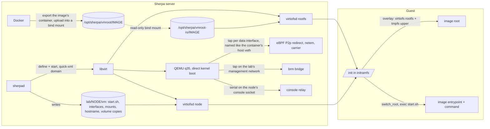

# Container VMs

The built-in container models that need root-like privileges to boot run as the root
filesystem of their own QEMU guest, not on the server's kernel. Their capabilities, sysctls,
mounts, devices and BPF then act on that guest's kernel. A lab user with a shell on such a node
gets root in a VM, not on the server.

`ModelKind::runs_in_vm` (`crates/shared/src/data/model_kind.rs`) names the models:
`arista_ceos` and `nokia_srlinux`. Every other container runs on Docker as before.

## Design

A container VM is still a container node: the database, the manifest, the scanner and the web
UI all see a container. Only the runtime differs. The domain has the container's name,
`<node>-<lab_id>`, so:

- `Runtimes::runtime_of` (`crates/server/src/services/node_lifecycle.rs`) reads a container's
  state from libvirt when a domain of its name exists, and from Docker otherwise. The scanner
  and inspect therefore follow the domain.
- Destroy removes the domain with the lab's other domains (`destroy_vms_and_disks`), since its
  name carries the lab ID. Rollback after a failed `up` goes the same way.

## Root filesystem

`container::unpack_image_rootfs` (`crates/container/src/image/rootfs.rs`) has Docker unpack the
image as root:

1. create an unstarted container of the image, with the target folder bind-mounted at
   `/.sherpa-rootfs`;
2. export the container;
3. upload the export into the bind mount;
4. remove the container.

Docker's archive code keeps owners, modes and `security.capability`. SR Linux needs the file
capabilities, and refuses to start its apps without them. `sherpad` needs no new privilege for
this, because Docker does the writing.

The store is `/opt/sherpa/vmroot/<first 16 hex digits of the image ID>`, unpacked once per
image and shared by every node of that image (`container_vm::ensure_rootfs`):
- the unpack goes to a folder of the node's own and is renamed into place, so no node boots a
  half-unpacked root;
- the store is `0700 sherpa`, because a root filesystem holds setuid-root binaries that no host
  user may reach.

**Guests see the store read-only, through `/opt/sherpa/vmroot-ro`,** a read-only bind mount the
installer adds to `/etc/fstab`. libvirt 10.0 refuses `<readonly/>` on virtio-fs, and its
AppArmor profile refuses a wrapper that adds virtiofsd's `--readonly`. With the read-only mount,
virtiofsd cannot write to the store, even for a guest that is root. One user's node therefore
cannot change a root filesystem another user's node boots.

A disk image per image is the alternative. It would need an unprivileged ext4 build with xattrs,
which is what option 2 of #683 needed a builder VM for. virtio-fs avoids that build, and it
shares one unpack between nodes with no copy.

## Domain

`libvirt::ContainerVm` (`crates/libvirt/src/container_vm.rs`) writes the domain XML with
`quick-xml`:

- **Machine:** q35, `host-passthrough` CPU, no video and no balloon. QEMU's `microvm` machine is
  not used, because libvirt does not support it with virtio-fs.
- **Memory:** `memfd` shared memory, which vhost-user virtio-fs needs. Its size is the node's
  memory, or 4096 MiB when the node records none. The vCPUs are the node's CPU count, or 2.
- **Boot:** `<kernel>`, `<initrd>` and `<cmdline>` boot `/opt/sherpa/vmboot/vmlinuz` and
  `initramfs.img` directly.
- **Shares:** two virtio-fs shares with `xattr` on, tag `rootfs` (the image) and tag `node` (the
  node's share).
- **Management interface:** `type='network'` on the lab's management network, which is the
  `brm` bridge Docker's management network also uses.
- **Data interfaces:** one `type='ethernet'` tap per P2p, bridge or unused data interface, named
  exactly like the container's host veth (`ContainerVeth::host_veth`). A disabled one has
  `<link state='down'/>`. This is why the eBPF redirect, netem, carrier and link re-attach work
  on a container VM's ends unchanged: they act on the host interface of that name, which is a
  tap here and a veth on Docker. A bridge end's tap is joined to its bridge after start.
- **Console:** the serial port is on the node's console socket
  (`console::console_sockets`), so the console relay serves it as it serves a VM's. Its output
  is also kept in `/var/log/libvirt/qemu/<domain>-serial.log`.
- **Lifecycle:** `on_poweroff`, `on_reboot` and `on_crash` are all `destroy`. A guest whose
  entrypoint ends stops its domain, as an exited container stops. Readiness then reports it
  failed.

Every interface is on the domain when it is defined, and none is hotplugged. cEOS does not adopt
a NIC added after it boots (#683, option 2). A lab's links are known before its nodes start, so
this costs nothing.

## Guest init

The initramfs holds busybox-static and `/init`, a shell script. `scripts/sherpa_install.sh`
builds it in `setup_container_vms`. The init:

1. mounts the `rootfs` share read-only and the `node` share;
2. builds an overlay with the rootfs as its lower layer and guest tmpfs as its upper layer, so
   every permission and ACL check happens in the guest kernel (SR Linux needs POSIX ACLs, which
   virtio-fs does not pass);
3. waits up to 30 s for every NIC in `interfaces` to appear, since virtio-net probes them
   asynchronously, then renames them by MAC in two phases so no names clash. `sherpad` writes
   the MACs in lowercase, as the guest kernel reports them;
4. mounts `proc`, `sysfs`, a read-write `cgroup2` (systemd in cEOS needs it), `devtmpfs` (which
   gives cEOS its `/dev/net/tun`), `devpts` and `/dev/shm`;
5. bind-mounts each volume copy from `mounts` where Docker would mount it, read-only when the
   volume is;
6. writes the hostname and `/etc/hosts`;
7. `switch_root`s into `start.sh`.

`start.sh` exports the image's environment with the node's over it, changes to the image's
working directory, and `exec`s the image's entrypoint with the node's command (or the image's).
`container_vm::start_script` writes it the way Docker builds a container's process.

## Kernel

The guest kernel needs these built in:
- virtio-pci, virtio-net, virtio-fs and FUSE;
- overlayfs and tmpfs with POSIX ACLs;
- tun;
- netfilter with the `xt_HL` target (cEOS loads it on demand);
- cgroup v2 with BPF;
- hugetlbfs, debugfs and configfs;
- the 8250 serial console.

Kata Containers' guest kernel (`vmlinuz.container` from the Kata static release, 6.18 here) has
all of them and no modules. It is the kernel the investigation and the live test used. The
installer expects it at `/opt/sherpa/vmboot/vmlinuz` and warns when none is there.

Shipping the kernel is not done yet. It should be a Sherpa release artifact, built in CI from
Kata's kernel config, pinned and checksummed like the other downloads. That needs a CI change.

## Security boundary

- The container's root is root in the guest only. `/proc/sys`, `/sys`, `/dev` and every module
  or BPF load act on the guest kernel.
- The guest reaches the host through:
  - its virtio devices;
  - two virtiofsd processes, which libvirt runs as root and sandboxes to the shared folder. The
    image share is read-only at the mount, and the node share is the node's own folder.
- A guest can write files with any owner and mode in its node share,
  `/opt/sherpa/labs/<lab>/<node>/vm`, setuid-root binaries included. The lab folder is `2750
  sherpa` and the node folder is `0700`, so no host user but `sherpa` and root can reach them.

## Cost

Measured on a nested-virtualization dev guest, so the numbers are indicative only.

- Each node has one QEMU process, whose RSS is the guest memory it has touched, and two
  virtiofsd processes.
- virtiofsd shows the guest's RAM in its RSS, because it maps that RAM for vhost-user. That is
  `RssShmem`. Its own memory (`RssAnon`) is about 7 MB.
- The unpack runs once per image: 38 s for SR Linux 26.7.2 and 55 s for cEOS 4.35.1F.

## Not yet done

- `down` and resume of a container VM. The domain is persistent, so a shutdown and a start
  would do, but `down.rs` and `resume.rs` still call Docker.
- The scanner's repair of a missing end. `repair_node` makes a container's veth in its network
  namespace, which a container VM does not have.
- Removing an image's root filesystem when the image is deleted.
- A persistent upper layer, for example a qcow2 disk per node, so changes survive a domain
  restart.
- Shipping the kernel, and `sherpa_update.sh`.
- The `sonic_linux` container, which needs a SONiC image to test with.
- A login on the serial console. The console relay reaches the guest's serial port and shows
  the kernel and init output, but neither image runs a getty on `ttyS0`.
