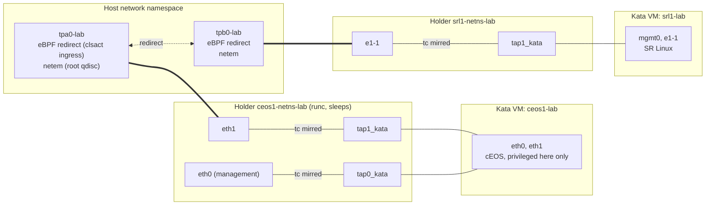

# Containers in their own VM

The `arista_ceos` and `nokia_srlinux` containers need root-like privileges: `CAP_SYS_ADMIN`, a
writable `/proc/sys` and `/sys`, and for cEOS systemd's cgroup tree. On the host's kernel any of
these is host root. Sherpa runs each of these containers in its own lightweight VM, so the
privileges reach that VM's kernel and nothing else.
`ModelKind::runs_in_vm` (`crates/shared/src/data/model_kind.rs`) names the models; every other
model runs on runc as before.

## The runtime

The VM is a [Kata Containers](https://katacontainers.io/) sandbox on Cloud Hypervisor, run by
Kata's Rust runtime (`containerd-shim-kata-v2` from `runtime-rs`). Docker knows it as the runtime
`sherpa-kata` (`shared::konst::CONTAINER_VM_RUNTIME`), registered in `/etc/docker/daemon.json`
by `scripts/sherpa_install.sh` (`install_kata`), with Sherpa's own Kata config,
`/etc/kata-containers/sherpa-clh.toml`. Sherpa drives it through bollard as any other container:
the create body sets `HostConfig.runtime`.

A VM-run container is not `--privileged`. Docker's `--privileged` lists every host device in the
OCI spec, and Kata tries to pass each one into the VM and fails. Sherpa gives it instead what
`--privileged` gives without the devices: every capability, AppArmor and seccomp unconfined, and
no masked or read-only `/proc` paths (`container::create_body`). The VM's own kernel and devices
are all it sees.

The container's root filesystem reaches the VM over virtio-fs, which differs from a local
filesystem in three ways that matter here:

- File capabilities are extended attributes. virtiofsd passes them only with `--xattr`, which
  Sherpa's Kata config sets; without it SR Linux's apps start with no capabilities.
- virtiofsd creates a file as its caller's user on the host, so a guest process's
  `CAP_DAC_OVERRIDE` does not apply to it.
- It keeps no POSIX ACLs: `setfacl` fails.

SR Linux's apps run as the `srlinux` user and reach their directories through ACLs its boot
script sets, so SR Linux runs in a guest overlay (`node_ops::GUEST_OVERLAY_SCRIPT`): an overlay
of `/` whose writes land on the VM's tmpfs, with every other mount bound in again, entered with
`chroot`. The guest kernel then checks every permission itself. Its start command runs the
image's entrypoint again in the overlay, so the boot script runs twice: once on virtio-fs, where
its ACLs fail, and once in the overlay.

cEOS's start command remounts `/sys` and the cgroup tree read-write for systemd, and makes
`/dev/net/tun`, which its forwarding agent `Etba` needs: a container that is not `--privileged`
gets no tun device.

## The network namespace holder

A Kata VM reads the interfaces of its network namespace once, when it boots, and wires each one
that has carrier to a tap with a tc `mirred` redirect. A veth made in the namespace afterwards
never reaches the VM. Sherpa makes a container's P2p veths after it has started, so a VM-run
container joins the namespace of a holder instead: a runc container of the same image that only
sleeps, named `<node>-netns-<lab>` (`node_ops::netns_holder_name`), with no capabilities. The
holder has the management address and the hostname.

`up` (`up::readiness::start_container`) and redeploy (`redeploy::container`) start the holder
(`container::start_netns_holder`), make the node's veths in its namespace and attach its links,
and only then start the VM-run container with `NetworkMode: container:<holder>`. The eBPF
redirect and netem stay on the host ends, as for every container, so a link and its impairment
work as before; Kata's tc redirect inside the namespace is the only extra hop.

A holder's namespace serves one VM: Kata leaves its ingress qdiscs behind when its VM goes, and
a second VM in the same namespace fails to start. A redeploy removes the holder with the
container (`node_ops::destroy_container_node`), and a lab's destroy removes it with the lab's
other containers, as its name ends in the lab ID.

## Limits

- A disabled interface is down at both ends, has no carrier, and so is not in the VM.
- A VM-run container takes no Docker data networks: an enabled one is refused
  (`ContainerError::VmDataNetworks`), and the disabled ones a container on no link would get
  are left out (`container::create::vm_data_networks`).
- `docker exec` into cEOS fails: Kata's agent cannot add a process to the cgroup that systemd
  has made a parent. Sherpa does not exec into cEOS.
- Its hostname is the container's ID; the NOS sets its own from its config.
- A cold start of a stopped VM-run container, as resume does after a host reboot, and scanner
  repair of its veths make the veths after the VM has booted, so they do not reach it.
