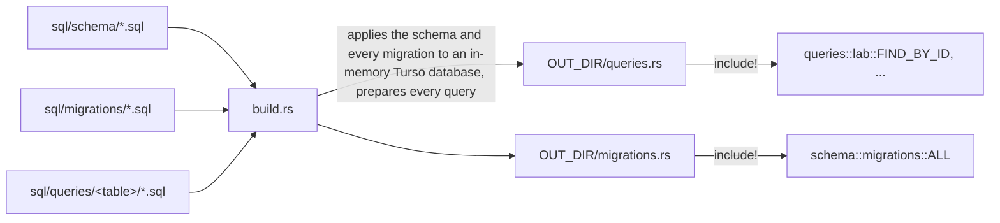

# Database

Sherpa's records (users, node images, labs, nodes, links, bridges) live in an embedded
[Turso](https://github.com/tursodatabase/turso) database inside `sherpad`: the `turso` crate,
pinned to an exact pre-1.0 version with default features off, because they install mimalloc as the
process's global allocator. The file is `SHERPA_DB_FILE_PATH`
(`/opt/sherpa/db/sherpa.sqlite`), in SQLite's format, with a write-ahead log. Everything is in
`crates/db`; no other crate depends on Turso. Outside the crate, records are the `shared::data`
types and ids are the database-neutral `shared::data::RecordId`.

Releases before 0.5.0 used a SurrealDB container. The spike that chose Turso, and its measurements,
are in [`../investigations/turso-migration.md`](../investigations/turso-migration.md).

## The `Database` handle

`db::open(path)` and `db::open_in_memory()` return a `Database` (`crates/db/src/connect.rs`). It is
`Clone`; `AppState` holds one and every task shares it.

- **A connection per operation.** A Turso `Connection` cannot be used by two tasks at once: a
  second concurrent use fails with `Misuse("concurrent use forbidden")`. So the handle holds the
  `turso::Database`, and each operation takes a fresh connection from `reader()` or `writer()`.
  Every connection gets a busy timeout (`SHERPA_DB_BUSY_TIMEOUT_SECS`) and
  `PRAGMA foreign_keys = ON`, which SQLite leaves off by default.
- **One writer at a time.** `writer()` also takes the handle's write lock, a `tokio::sync::Mutex`,
  and returns a `Writer` holding both until it is dropped. Turso's busy timeout works for a single
  waiter, but under contention its busy wait does not serve waiters in order: with 64 writing
  tasks, about 0.5% of transactions waited past the timeout and failed with `Busy`. The tokio mutex
  is fair, so writers queue in arrival order instead, with no loss of throughput. Reads take no
  lock.
- **Whole operations under the lock.** A write that reads before it writes, such as an update that
  checks an immutable field, does both under one `Writer`, so nothing changes between the check
  and the write. Statements that must succeed together run in one transaction
  (`writer.conn.transaction()`, committed explicitly; dropping it rolls back).
- **Exclusive file.** While `sherpad` has the file open, no other process can open it, including
  the `sqlite3` command; Turso's multi-process mode is experimental. `sherpad migrate-db` and any
  inspection therefore run with `sherpad` stopped.
- **Backups.** `Database::backup(path)` runs `VACUUM INTO` under the write lock, so the copy is
  consistent and writes wait for it. It refuses a destination that exists. The `server.backup`
  RPC (`crates/server/src/services/backup.rs`) writes to `SHERPA_DB_BACKUP_PATH`.
- **Tests.** `open_in_memory()` gives each test its own database; connections to one in-memory
  database share its data. The db and server integration tests need no database server.

## Queries and row mapping

Every statement the crate runs is a plain SQL file under `crates/db/sql/queries/<table>/`, one
statement per file, complete and readable. The tables as first created are
`crates/db/sql/schema/<table>.sql`, which the schema code includes with `include_str!`; each later
schema change is a file in `crates/db/sql/migrations/` (see [Versions](#versions)).

- **Checked at build time.** `crates/db/build.rs` applies the schema files, then each migration in
  order, to an in-memory Turso database, so it has the schema a running server has, and prepares
  each query file against it. Preparing checks the syntax and every table and
  column a statement names, so a statement that does not fit the schema fails the build, naming the
  file and Turso's message. It reruns only when a file under `sql/` changes, and takes about a
  second; Cargo shares the `turso` build with the crate, so a cold build compiles Turso once and
  the script adds about 14 seconds.
- **Constants.** The build script generates one constant per file, holding the file with
  `include_str!`, in a module per directory: `sql/queries/lab/find_by_id.sql` is
  `queries::lab::FIND_BY_ID`. A statement used by more than one module, such as
  `queries::node::COUNT_BY_LAB`, is one file. The rule triggers and `PRAGMA user_version` stay in
  `schema/`.
- **Not checked.** Preparing does not compare a statement's result columns or parameter count with
  the mapper that reads them; the mappers below still read and write by position.

`crates/db/src/sql.rs` has the three query helpers: `query_optional`, `query_all` and
`query_count`. The first two take a mapper, a plain `fn(&Row) -> Result<T>`.

`crates/db/src/persistence.rs` maps rows to records:

- **Column order.** Statements list a table's columns in its `CREATE TABLE` order, and the mappers
  read and write them in that order.
- **Reading.** `Cells` reads a row's columns in order and names the field in every error.
  `*_from_row` builds a record; `*_values` gives a record's values in column order, for
  positional parameters (`?1`, `?2`, ...). SQL never contains formatted values.
- **Types.** Unit enums are stored as text, by their serde names (`enum_text`). Lists such as
  `ssh_keys` and `cpu_pinning` are JSON text. Timestamps are RFC 3339 text from `jiff`, which keeps
  nanoseconds. Booleans are `0` and `1`. A link's impairments are flattened into `a_to_b_*` and
  `b_to_a_*` columns, and a bridge's members are rows of `bridge_member`, ordered by `position`.
- **Record keys.** A column holds only a record's key; the table is implied by the column, and
  `Cells::record(table, field)` rebuilds the `RecordId`. `key_of` refuses an id from another table.
  New keys are 20 random characters from `SHERPA_DB_KEY_CHARSET`, the length and alphabet
  SurrealDB used, so imported keys and new ones look alike.

## Schema

`crates/db/src/schema/` has one file per table. Tables are `STRICT`. Ranges are `CHECK`
constraints; uniqueness is `UNIQUE` constraints; references are foreign keys:

- `lab.user` and `node.image` are `ON DELETE RESTRICT`: an owner with labs, or an image in use,
  cannot be deleted.
- `node.lab`, `link.lab`, `link.node_a`, `link.node_b`, `bridge.lab`, `bridge_member.bridge` and
  `bridge_member.node` are `ON DELETE CASCADE`. Deleting a lab is one `DELETE`.

### Versions

`apply_schema` (`schema/apply.rs`) runs on every start and in `sherpad init`, in one transaction.
The database's `PRAGMA user_version` is its schema version. Version 1 is the tables in
`sql/schema/` (`TABLES` in `apply.rs`). Each file in `sql/migrations/` takes the schema up one
version; its name is the version it takes the schema to, four digits, then a name:
`0002_fix_data_interface_counts.sql`. The build script refuses a gap or a misnumbered file, and
generates `schema::migrations`: a constant per file, named without the number
(`FIX_DATA_INTERFACE_COUNTS`), and `ALL`, every migration in order. `SCHEMA_VERSION` is
`1 + ALL.len()`.
A database with a newer version than the build knows is refused, so a downgrade cannot write to a
schema it does not understand.

A version never changes once released, including `sql/schema/`. To change the schema, add the
next migration file, and change the queries that use it; the build checks them against the new
schema. New columns come last, so the mappers in `persistence.rs` read and write them last. SQLite
cannot alter
most constraints in place, so a change to a column's constraints is a table rebuild: create the new
table, copy the rows, drop the old one, rename.

| Version | Change |
|---|---|
| 1 | Every table (`sql/schema/<table>.sql`) |
| 2 | `0002_fix_data_interface_counts.sql`: `cisco_csr1000v` and `cisco_iosvl2` images stored with more than 15 data interfaces (the old default was 16, one more than they have after the management interface) are set to 15 |
| 3 | `0003_lab_source.sql`: `lab.client_host` and `lab.client_folder`, where `sherpa up` ran (see below) |

A migration can correct data as well as change the schema; it runs once, when a database reaches that
version.

### Where a lab was started

`lab.client_host` and `lab.client_folder` record the hostname of the machine `sherpa up` ran on
and the folder it ran in. The CLI sends them in the `up` request (`client_host`, `client_folder`);
`server::validate::validate_lab_origin` refuses an empty value, one over its length limit (253 and
4096 characters) or one with control characters, and `create_lab` stores them through
`db::LabOrigin`. Labs started from the web UI or the API, and labs created before version 3, have
neither (`NULL`). `inspect` reads them from the record into `LabInfo`, so the CLI's lab table and
the web UI's lab page show them.

### Rule triggers

Two kinds of rule are triggers, dropped and created again by every `apply_schema` rather than
versioned:

- **Enum columns.** The set of values comes from the Rust enums (`NodeModel::to_vec()` and so on),
  which grow with every new node model. A `CHECK` constraint would need a table rebuild each time,
  so each table with enum columns gets `<table>_rules_insert` and `<table>_rules_update` triggers,
  built by `schema::helpers::enum_rule` and `rule_triggers`. A value outside the list fails with
  `Invalid value for <table>.<column>`.
- **The built-in admin account** (`schema/user.rs`). Triggers refuse deleting, renaming or demoting
  `admin`, and an `admin` row without the admin flag, with `ADMIN_PROTECTED_MESSAGE`. They apply to
  any statement, not only the application's.

## Importer

`crates/db/src/import/` moves a pre-0.5.0 server's data. `sherpad migrate-db`
(`crates/server/src/migrate.rs`) calls `import_from_surrealdb(&SurrealSource, &Database)`, and
`scripts/sherpa_update.sh` runs it on the first update to 0.5.0.

`migrate-db` takes the SurrealDB password and port only from its flags or the environment;
`sherpad` never parses `/opt/sherpa/env/sherpa.env` itself. The update script runs it with
`systemd-run` as the `sherpa` user and with the service's `EnvironmentFile=`, so systemd reads the
password exactly as it did for the old `sherpad` (quotes, escapes, the last of repeated keys). The
port comes from the host port Docker records for the `sherpa-db` container, passed as `--db-port`.

- `source.rs` connects to the old SurrealDB container over WebSocket and reads every table.
- `rows.rs` holds the rows as SurrealDB stored them, and their conversion to Sherpa's records,
  including the old link impairment and bridge member layouts.
- `write.rs` applies the schema, then in one transaction under the writer refuses a target that
  already has a user or a lab, inserts every record with its original key in dependency order, and
  compares each table's row count with what it read. Any failure rolls back. The schema is applied
  before the rows exist, so data corrections in later migrations do not reach imported rows; the
  importer runs `FIX_DATA_INTERFACE_COUNTS` itself after writing the node images.

The importer is the only user of the `surrealdb` crate and of the `SHERPA_DB_SERVER`,
`SHERPA_DB_PORT`, `SHERPA_DB_NAMESPACE`, `SHERPA_DB_NAME` and `SHERPA_DB_USER` constants. They go
when the importer is removed.
