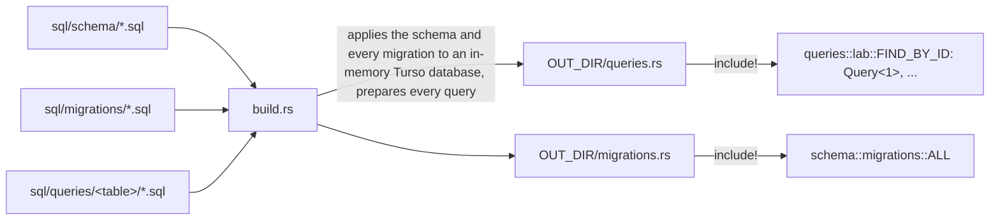

# Database

Sherpa's records (users, node images, labs, nodes, links, bridges, and each lab's definition)
live in an embedded
[Turso](https://github.com/tursodatabase/turso) database inside `sherpad`: the `turso` crate,
pinned to an exact pre-1.0 version with default features off, because they install mimalloc as the
process's global allocator. The file is `SHERPA_DB_FILE_PATH`
(`/opt/sherpa/db/sherpa.sqlite`), in SQLite's format, with a write-ahead log. Everything is in
`crates/db`; the only other crate that depends on Turso is the `agent-bus` development tool, for
its own file, the host's record (see [`AGENT_BUS.md`](AGENT_BUS.md), "The record"), which shares
only the workspace pin. Outside the crate, records are the `shared::data`
types and ids are the database-neutral `shared::data::RecordId`.

Releases before 0.5.0 used a SurrealDB container. The spike that chose Turso, and its measurements,
are in [`../investigations/turso-migration.md`](../investigations/turso-migration.md).

## The `Database` handle

`db::open(path)` and `db::open_in_memory()` return a `Database` (`crates/db/src/connect.rs`). It is
`Clone`; `AppState` holds one and every task shares it.

- **A connection per operation.** A Turso `Connection` cannot be used by two tasks at once: a
  second concurrent use fails with `Misuse("concurrent use forbidden")`. So the handle holds the
  `turso::Database`, and each operation takes a fresh connection from `reader()` or `writer()`.
  Every connection gets a busy timeout (`SHERPA_DB_BUSY_TIMEOUT_SECS`) and
  `PRAGMA foreign_keys = ON`, which SQLite leaves off by default.
- **One writer at a time.** `writer()` also takes the handle's write lock, a `tokio::sync::Mutex`,
  and returns a `Writer` holding both until it is dropped. Turso's busy timeout works for a single
  waiter, but under contention its busy wait does not serve waiters in order: with 64 writing
  tasks, about 0.5% of transactions waited past the timeout and failed with `Busy`. The tokio mutex
  is fair, so writers queue in arrival order instead, with no loss of throughput. Reads take no
  lock.
- **Whole operations under the lock.** A write that reads before it writes does both under one
  `Writer`, so nothing changes between the check and the write. Statements that must succeed
  together run in one transaction (`writer.conn.transaction()`, committed explicitly; dropping it
  rolls back); a test checks that a transaction that fails after DDL and a `user_version` change
  leaves neither.
- **Narrow updates.** An update writes only the columns it is for: `update_lab_phase_from`,
  `update_lab_tailscale_container`, `update_link_impairments` and the `update_node_*` functions.
  A caller holding an older copy of the record cannot write back columns another task changed
  meanwhile. `update_user` writes the user's own fields, sets `updated_at` itself and never changes
  `created_at`. It is also compare-and-set: it writes only if the row's `updated_at` is still the
  one in the `DbUser` it was given, and otherwise fails with `UserChanged`, so an edit made from a
  stale read cannot undo a concurrent one. `change_user_password` writes only the hash and
  `updated_at`, and ends the user's other sessions in the same transaction. A link is created with its impairments in one statement (`create_link` takes a
  `DbLink`).
- **Exclusive file.** While `sherpad` has the file open, no other process can open it, including
  the `sqlite3` command; Turso's multi-process mode is experimental. Inspection therefore runs
  with `sherpad` stopped.
- **Backups.** `Database::backup(path)` runs `VACUUM INTO` under the write lock, so the copy is
  consistent and writes wait for it. It refuses a destination that exists. The `server.backup`
  RPC (`crates/server/src/services/backup.rs`) writes to `SHERPA_DB_BACKUP_PATH`, which it first
  restricts to `sherpa` (`SHERPA_DB_BACKUP_DIR_MODE`, `0700`): `VACUUM INTO` writes the copy before
  its file is restricted. The database directory is `0750` (`SHERPA_DB_DIR_MODE`), set by the
  installer, the update script and `sherpad` at startup. `open` restricts the database file and
  its `-wal` and `-shm` files to `0600`; Turso creates the `-wal` file when it opens the database,
  so the first writes do not leave it readable by others.
- **What a backup holds.** The copy is the whole database: users (password hashes), node images,
  labs, nodes, links, bridges, sessions, and every
  lab's [definition](#lab-definitions). A definition holds the manifest as the user wrote it:
  paths, settings and literal values, **never the contents of files or scripts, nor the values
  of `$VAR` environment variables**. Only the values sealed with the
  [database key](#secret-values) are ciphertext: `lab.ztp_server_password` and
  `node_image.ztp_password`. The key is not
  in the database or the backup, so **back up `SHERPA_DB_KEY_PATH`
  (`/opt/sherpa/.secret/db.key`) alongside every backup, but separately from it**: not in the
  backup directory, and not in the same copy. A restored database with no key, or another
  key, does not start (see [Secret values](#secret-values)).
- **Tests.** `open_in_memory()` gives each test its own database; connections to one in-memory
  database share its data. The db and server integration tests need no database server.

## Queries and row mapping

Every statement the crate runs is a plain SQL file under `crates/db/sql/queries/<table>/`, one
statement per file, complete and readable. The tables as first created are
`crates/db/sql/schema/<table>.sql`, which the schema code includes with `include_str!`; each later
schema change is a file in `crates/db/sql/migrations/` (see [Versions](#versions)).

- **Checked at build time.** `crates/db/build.rs` applies the schema files, then each migration in
  order, to an in-memory Turso database, so it has the schema a running server has, and prepares
  each query file against it. Preparing checks the syntax and every table and
  column a statement names, so a statement that does not fit the schema fails the build, naming the
  file and Turso's message. It reruns only when a file under `sql/` changes, and takes about a
  second; Cargo shares the `turso` build with the crate, so a cold build compiles Turso once and
  the script adds about 14 seconds.
- **Constants.** The build script generates one constant per file, holding the file with
  `include_str!`, in a module per directory: `sql/queries/lab/find_by_id.sql` is
  `queries::lab::FIND_BY_ID`, a `Query<1>`. A statement used by more than one module, such as
  `queries::node::COUNT_BY_LAB`, is one file. Triggers are migrations.
- **Column order checked.** A statement that returns every column of a table must return them in
  the table's order (`PRAGMA table_info`), or the build fails naming the file: the mappers read by
  position, and two columns of one type, such as `gateway_ipv4` and `router_ipv4`, would otherwise
  swap silently. A statement returning some columns, such as the network readers' `lab_id` and
  network, is not checked.
- **Parameter count checked.** Every query numbers its bound parameters, `?1`, `?2`, ...; a
  number may repeat. `build/placeholders.rs` reads them from the SQL text, skipping string
  literals, quoted identifiers and comments, and the count is the highest number. A bare `?`, a
  named parameter (`:name`, `@name`, `$name`), `?0` or a gap in the numbering fails the build,
  naming the file, so the highest number is always the count. Turso's public `Statement` has no
  parameter count to cross-check against. The count is the constant's type, `Query<N>`
  (`src/sql.rs`), and the only way to run a query is `Query::bind`, which takes `[Value; N]`, so
  binding another number of values is a type error at the call site (`expected an array with a
  size of 1`). Only the count is checked, not the values' types. The
  `*_values` mappers return fixed-size arrays (`lab_values` returns `[Value; 18]`), so a
  statement that writes a whole row and its mapper must agree too. `Query`, `Bound` and the
  helpers that run a `Bound` are crate-private. The rules' tests are
  in the same file, which the crate includes under `cfg(test)`, so `cargo test -p db` runs them.
- **Built-in statements.** `PRAGMA user_version` is a `Query<0>` written in `schema/apply.rs`;
  setting the version, triggers and `VACUUM INTO` take no bound parameter and are plain
  strings.
- **Schema order.** The build script applies `sql/schema/` in the order `apply_schema` does,
  parents first (`SCHEMA_FILES`), and refuses a schema file missing from that list.

`crates/db/src/sql.rs` has `Query<N>`, `Bound` and the four query helpers: `query_optional`,
`query_all`, `query_count` and `execute`. Each takes a `Bound` query,
`queries::lab::FIND_BY_LAB_ID.bind([lab_id.into()])`. The first two take a mapper, a plain
`fn(&Row) -> Result<T>`. A failed statement is named by its first line, and a row that does not
map by its first column, its id.

`crates/db/src/persistence.rs` maps rows to records:

- **Column order.** Statements list a table's columns in its `CREATE TABLE` order, and the mappers
  read and write them in that order.
- **Reading.** `Cells` reads a row's columns in order and names the field in every error.
  `*_from_row` builds a record; `*_values` gives a record's values in column order, as an array
  of the table's width, for positional parameters (`?1`, `?2`, ...). SQL never contains
  formatted values.
- **Types.** Unit enums are stored as text, by their serde names (`enum_text`). Lists such as
  `ssh_keys` and `cpu_pinning` are JSON text. Timestamps are RFC 3339 text from `jiff`, which keeps
  nanoseconds. Booleans are `0` and `1`. A link's impairments are flattened into `a_to_b_*` and
  `b_to_a_*` columns, and a bridge's members are rows of `bridge_member`, ordered by `position`.
  A node image's settings groups (`NodeConfig.cpu`, `.machine`, `.boot_disk`, `.cdrom`,
  `.interfaces`, `.ztp` and `.unikernel`) are flat `node_image` columns, mapped by hand in
  `db::persistence`: `cpu.count` is `cpu_count`, `machine.kind` is `machine_type`,
  `boot_disk.bus` is `hdd_bus`, `cdrom.image` and `cdrom.bus` are `cdrom` and `cdrom_bus`,
  `interfaces.mtu` is `interface_mtu`, `ztp.method` is `ztp` and `unikernel.boot_mode` is
  `boot_mode` (`NULL` for a node that is not a unikernel). The image JSON nests by group; the
  columns kept their flat names, so grouping needed no migration. `node_image_from_row` reads
  every column into a local in column order and then builds the groups, because `Cells` reads
  positionally and the groups are not in column order. `test_every_model_image_reads_back_as_written`
  writes every model's built-in image and checks it reads back as the same JSON.
  Impairment percentages are `f64` in `LinkImpairment`, the width of a `REAL`, so they read back
  exactly as written. `Cells::percent` refuses a value outside 0 to 100, which includes `NaN` and
  infinity, naming the field: netem would otherwise clamp it silently. A node's readiness check
  (`DbNode::ready_check`, a `ReadyCheck`) is the `node.ready_port` and `node.skip_ready_check`
  columns, the last two of the table.
- **Record keys.** A column holds only a record's key; the table is implied by the column, and
  `Cells::record(table, field)` rebuilds the `RecordId`. `key_of` refuses an id from another table.
  New keys are 20 random characters from `SHERPA_DB_KEY_CHARSET`, the length and alphabet of the
  keys of releases before 0.5.0, which upgraded servers still hold.

## Schema

`crates/db/src/schema/` has one file per table. Tables are `STRICT`. Ranges are `CHECK`
constraints; uniqueness is `UNIQUE` constraints; references are foreign keys:

- `lab.user` and `node.image` are `ON DELETE RESTRICT`: an owner with labs, or an image in use,
  cannot be deleted.
- `node.lab`, `link.lab`, `link.node_a`, `link.node_b`, `bridge.lab`, `bridge_member.bridge`,
  `bridge_member.node`, `session.user` and every `manifest_*` table's `lab` or `node` are
  `ON DELETE CASCADE`. Deleting a lab is one `DELETE`, which takes its definition with it, and
  deleting a user ends their login sessions.
- `session` holds one row per login session (`db::session`). `expires_at` is whole Unix seconds,
  the token's `exp`, so the sweep compares integers. What each row means and what ends it is in
  [`SERVER.md`](SERVER.md#sessions-and-identity).

### Versions

`apply_schema` (`schema/apply.rs`) runs on every start and in `sherpad init`, in one transaction.
The database's `PRAGMA user_version` is its schema version. Version 1 is the tables in
`sql/schema/` (`TABLES` in `apply.rs`). Each file in `sql/migrations/` takes the schema up one
version; its name is the version it takes the schema to, four digits, then a name:
`0002_fix_data_interface_counts.sql`. The build script refuses a gap or a misnumbered file, and
generates `schema::migrations`: a constant per file, named without the number
(`FIX_DATA_INTERFACE_COUNTS`), and `ALL`, every migration in order. `SCHEMA_VERSION` is
`1 + ALL.len()`.
A database with a newer version than the build knows is refused, so a downgrade cannot write to a
schema it does not understand.

A version never changes once released, including `sql/schema/`. To change the schema, add the
next migration file, and change the queries that use it; the build checks them against the new
schema. New columns come last, so the mappers in `persistence.rs` read and write them last. SQLite
cannot alter
most constraints in place, so a change to a column's constraints is a table rebuild: create the new
table, copy the rows, drop the old one, rename.

| Version | Change |
|---|---|
| 1 | Every table (`sql/schema/<table>.sql`) |
| 2 | `0002_fix_data_interface_counts.sql`: `cisco_csr1000v` and `cisco_iosvl2` images stored with more than 15 data interfaces (the old default was 16, one more than they have after the management interface) are set to 15 |
| 3 | `0003_lab_source.sql`: `lab.client_host` and `lab.client_folder`, where `sherpa up` ran (see below) |
| 4 | `0004_fix_ztp_image_defaults.sql`: `cisco_ise` images stored with the CD-ROM ZTP method (the old default, which has no ISE generator) are set to the disk method, and `generic_vm` images stored with a VirtIO CD-ROM bus (the old default, which cannot hold the cloud-init ISO) are set to SATA |
| 5 | `0005_fix_vsrx_ztp_method.sql`: `juniper_vsrxv3` images stored with the TFTP ZTP method (the old default; vSRX's factory config runs no DHCP client, so it never fetched its config) are set to the CD-ROM method |
| 6 | `0006_one_default_node_image.sql`: one default image per model and kind. Duplicate defaults keep the most recently written image, then the partial unique index `node_image_one_default` refuses a second |
| 7 | `0007_interfaces_used_once.sql`: triggers refuse a link or bridge member on a node interface already used by a link or bridge, a link from an interface to itself, and an interface twice in one bridge. They check new rows only, so a database that holds a repeat still opens |
| 8 | `0008_static_triggers.sql`: drops the enum rule triggers, which earlier releases rebuilt from the Rust enums on every start, and creates the admin protection triggers as fixed text |
| 9 | `0009_drop_dedicated_management_interface.sql`: drops `node_image.dedicated_management_interface`. Index 0 of every model's interface table is its management interface, so the flag changed nothing |
| 10 | `0010_lab_description.sql`: `lab.description`, the manifest's optional `description` (see below) |
| 11 | `0011_lab_ssh_key.sql`: `lab.ssh_key`, the key pair the `sherpa` account on the lab's nodes logs in with: `lab` for the lab's own, `server` (the default, for every lab created before) for the server's shared key. Dropped by version 17 |
| 12 | `0012_session.sql`: the `session` table, one row per login session, with indexes on `user` and `expires_at`. Tokens issued before it name no session, so every user logs in again after the upgrade. See [`SERVER.md`](SERVER.md#sessions-and-identity) |
| 13 | `0013_node_lifecycle.sql`: nodes left `created` by the scanner become `stopped`. See [`STATE_MACHINES.md`](STATE_MACHINES.md) |
| 14 | `0014_promote_missing_default_image.sql`: a model with images and no default, left by an earlier release, gets its most recently added image as the default. Writes keep it that way; see [`STATE_MACHINES.md`](STATE_MACHINES.md#28-node-images) |
| 15 | `0015_lab_phase.sql`: `lab.phase`, which operation owns the lab's record (`ready` for every lab created before), and drops `lab.status`: a lab's status is derived from its nodes when it is read. See [`STATE_MACHINES.md`](STATE_MACHINES.md#2-lab-phase-and-status-labphase-and-labstate) |
| 16 | `0016_ztp_setting.sql`: `node_image.ztp`, the image's one ZTP setting (`disabled` or a method), filled from the `ztp_enable` and `ztp_method` columns, which are dropped. See [`ZTP.md`](ZTP.md#storage-and-migration). |
| 17 | `0017_drop_lab_ssh_key.sql`: drops `lab.ssh_key`. Every lab has its own key and the server's shared key is gone (0.6.0). Refused while a lab is still `server`; see [Labs on the server's SSH key](#labs-on-the-servers-ssh-key) |
| 18 | `0018_reset_unused_image_settings.sql`: container images get the default machine, boot disk and CD-ROM settings (`machine_type` `pc`, `bios` `sea_bios`, `hdd_bus` and `cdrom_bus` `virtio`, no `cdrom`), and unikernel images the default firmware, boot disk and CD-ROM settings, keeping their `machine_type`. Neither kind reads them; the four network OS containers were stored with a q35 machine and SATA buses. See [`NODE_SETTINGS.md`](NODE_SETTINGS.md#settings-a-kind-does-not-use) |
| 19 | `0019_node_ready_check.sql`: `node.ready_port` (`NULL` or 1 to 65535) and `node.skip_ready_check` (`0` or `1`, default `0`), each node's readiness check, which the scanner, `resume` and `redeploy` read instead of the saved manifest. Existing virtual machines get their model's port (22, or 50000 for `talos_linux`), containers and unikernels none, and no check is skipped: what the scanner did with them before. See [Node readiness checks](#node-readiness-checks) |
| 20 | `0020_lab_definition.sql`: the [lab definition](#lab-definitions): the manifest's lab-level parameters on `lab` (with `has_definition`, `0` for every lab before), its node-level ones on `node`, the `manifest_*` tables for its lists, and `secret_key_check`. Existing labs get theirs from the startup import. Triggers refuse a `node_image.ztp_password` that is not [sealed](#secret-values); sherpad seals the plain ones at startup |

A migration can correct data as well as change the schema; it runs once, when a database reaches that
version.

### Labs on the server's SSH key

Labs created before lab keys log in to their nodes with the server's shared key
(`lab.ssh_key = 'server'`, version 11). 0.6.0 removes that key, and with it version 17 drops the
column, so such a lab would lose SSH access to its nodes. The schema does not move past
version 16 while one exists:

- **`apply_schema`**, before it runs `DROP_LAB_SSH_KEY`, reads the labs on the server's key with
  their owners (`schema::server_key`) and fails, naming each one (`lab_id (name, owned by user)`)
  and saying to destroy them with the release the server ran before. The whole run is one
  transaction, so the database keeps the version it had. sherpad's startup applies the schema
  first, so it does not start; `sherpad init` fails the same way.
- **`check_schema_upgrade`** makes the same refusals as `apply_schema` (a newer version, labs on
  the server's key) without writing. `sherpad check-database` runs it on the server's database,
  and `scripts/sherpa_update.sh` runs the new release's `check-database`, as `sherpa`, before
  installing it: a refusal leaves the running release installed and starts it again, so the
  labs can be destroyed with it.
- The two statements read a column the current schema no longer has, so they are `Query::new`
  constants in `server_key.rs`, not query files the build checks. Once the column is gone there
  is nothing to read, and the check passes.

### Node readiness checks

`node.ready_port` and `node.skip_ready_check` hold how a node shows it is ready. `up` writes them
after it creates the node's record, and `redeploy` replaces them from the new manifest node before
the node starts, both with `db::update_node_ready_check` and the values
`node_ops::stored_ready_check` takes from the manifest node: its `ready_check.port`, else a
virtual machine's model port, and its `ready_check.skip`. A container or unikernel without a port
stores `NULL`, and is ready once it runs. `create_node` stores `NULL` and `0`. What reads them is
in [`STATE_MACHINES.md`](STATE_MACHINES.md#5-node-readiness-and-host-keys).

### Lab definitions

A lab's definition is every parameter of the manifest it was deployed from, **as the user wrote
it**. The manifest is how the user defines a lab; once it is deployed, the database is the
server's record of it.

**No file contents and no resolved values are stored.** Before it sends a manifest, the client
replaces `ztp.config`, a path, with the file's contents, replaces each `KEY=$VAR` environment
variable with its value, and adds the `*_data` fields: the contents of `text_files`,
`binary_files`, `systemd_units`, `startup_scripts`, `user_scripts` and
`ssh.authorized_key_files`. The server builds the node from that resolved manifest, as before,
and never writes it to the database. What it stores is the manifest as written:

- Files and scripts as references: `ztp.config`'s path, `text_files` (`src`, `dst`, `user`,
  `group`, `permissions`), `binary_files` (`source`), `systemd_units` (`name`, `source`,
  `enabled`), `startup_scripts`, `user_scripts` and `ssh.authorized_key_files` (`source`).
- `environment_variables` as written: `KEY=$VAR` keeps `$VAR`.
- Literal parameters as they are, with `ztp_server.password` sealed.

The client sends the parts it changes, and the ones it never serializes, as written, beside the
manifest: `topology::ManifestAsWritten` (`Manifest::as_written`, taken before it resolves
anything), the optional `as_written` field of `UpRequest` and `RedeployRequest`, holding each
node's `ztp.config` path, `environment_variables` and `provisioners`, and the lab's
`provision_concurrency`. `Manifest::definition(as_written)` puts them back and clears every
`*_data` field; the server's `services::lab_definition::definition` also checks the provisioners.
Without `as_written` (an older client), `ztp.config`, `environment_variables`, provisioners and
`provision_concurrency` are not stored at `up`, rather than stored resolved, and a `redeploy`
keeps the node's stored ones (`lab_definition::stored_as_written`). The web UI's manifest is
already as written, so it sends its own parts. `store_lab_definition` and
`store_redeployed_node` refuse a manifest that holds a `*_data` field
(`Manifest::has_file_contents`).

Storage is normalised: one-to-one parameters are columns of the lab's and nodes' rows, lists are rows of
child tables, and nothing is a JSON or TOML document. Everything is in `crates/db/src/definition/`
and the query files in `sql/queries/definition/`.

**Lab-level parameters** are on `lab`. `name` and `description` are the lab's own columns, written
by `create_lab`; the rest come with migration 20:

| Column | Manifest |
|---|---|
| `has_definition` | `1` once a definition is stored. `0` for a lab stored before version 20 whose saved manifest could not be imported |
| `ready_timeout`, `provision_current_user`, `provision_concurrency` | the same names (`provision_concurrency` 1 to 255) |
| `tailscale_enabled`, `tailscale_auth_key_env` | `[tailscale]`; `NULL` when the manifest has no table |
| `ztp_server_enable`, `ztp_server_username`, `ztp_server_password` | `[ztp_server]`; `NULL` when absent. The password is [sealed](#secret-values) |

**Node-level parameters** are on `node`. Where the node already records what it was built with,
or refers to a record, the manifest's value is a `manifest_` column beside it: `manifest_image`
(`image`), `manifest_memory`, `manifest_cpu_count`, `manifest_ready_port`,
`manifest_skip_ready_check`. The rest are named after their manifest path: `version`,
`cpu_mode`, `cpu_sockets`, `cpu_cores`, `cpu_threads`, `numa_node`, `numa_memory_mode`,
`boot_disk_size`, `boot_disk_clone_method`, `boot_disk_cache`, `boot_disk_io`,
`interfaces_data_count`, `interfaces_queues`, `ztp_method`, `ztp_config`, `vm_watchdog`,
`container_user`, `container_privileged`, `container_shm_size`, `container_platform` and
`unikernel_cmdline`. `NULL` is "not set", as in the manifest. A node's `model` is its image's.
Choices are `CHECK`ed against their serde names, and numbers against their type's range, or the
manifest's where it validates one.

**Lists** are child tables, keyed by their parent and a `position` in manifest order:

| Table | Holds |
|---|---|
| `manifest_link` | `links`: `src`, `dst`, `p2p`, and the `impairment` (`impaired` says whether it has the table) |
| `manifest_bridge`, `manifest_bridge_link` | `bridges` and the ends each names |
| `manifest_talos_cluster`, `manifest_talos_member` | `talos_clusters` (`cni`, `oidc`, `vault`) and their members, by `role` (`controller`, `worker`) |
| `manifest_node_cpu` | a node's CPU lists, by `list`: `pinning`, `emulator_pinning`, `io_thread` (`boot_disk.io_thread_cpus`) |
| `manifest_node_text` | a node's lists of strings, by `list`: `authorized_key`, `authorized_key_file` (paths), `container_command`, `environment_variable` (as written), `startup_script`, `user_script` (paths), `binary_file` (paths) |
| `manifest_node_volume` | `container.volumes` |
| `manifest_node_text_file` | `text_files`: `src`, `dst`, `user`, `group`, `permissions` |
| `manifest_node_systemd_unit` | `systemd_units`: `name`, `source`, `enabled` |
| `manifest_node_provisioner`, `manifest_node_provisioner_file`, `manifest_node_provisioner_path` | `provisioners`: their `type`, files (an ssh file has a `dst`, a container file a `name`), and an ssh provisioner's `env_files` and `scripts`. Paths and settings only |

Nested tables (`manifest_bridge_link`, `manifest_talos_member`, the provisioner files and paths)
refer to their parent row with a composite foreign key and cascade with it.

**Writers.**

- `store_lab_definition(db, lab, manifest)` replaces the whole definition in one transaction:
  the lab's columns, its links, bridges and Talos clusters, and every node's columns and lists.
  Each manifest node must already have its record. `up` calls it at the end of its
  DatabaseRecords phase, once the lab and node records exist, and the startup import does too.
- `store_redeployed_node(db, lab, node, name, manifest)` is `redeploy`'s, before the node
  starts: the node's columns and lists, and the lab-level settings a redeploy applies,
  `ready_timeout`, `provision_current_user` and `provision_concurrency`. The lab's links,
  bridges, Talos clusters, Tailscale and ZTP server settings are what `up` built; a redeploy does
  not rebuild them, so it does not change them.

**Read-back.** `read_lab_definition(db, lab)` returns the `topology::Manifest` the definition
records, as written and with no `*_data` field, or `None` when `has_definition` is `0`. The one thing that does not round-trip is an
empty list or an empty `vm`, `container` or `unikernel` table: none is stored, and it reads back
as absent, which every reader treats the same. A test builds a manifest that sets every field,
as written (no `*_data` field), with a destructuring that stops compiling when `Manifest` or
`Node` gains one, and checks that it reads back equal and that every child table got rows.

Readers do not use it yet: `resume`, the scanner and the web UI still read the saved
`manifest.toml`, which `up` still writes.

**Existing labs** get their definition from the [startup import](SERVER.md#lab-definition-import).

### Secret values

No secret is stored in the database as plain text: secret values are sealed, so a database file
or backup that leaves the server without its key holds only ciphertext. The sealed columns are
`lab.ztp_server_password` and `node_image.ztp_password`. `crates/db/src/secret.rs` has the
cipher:

- **Cipher.** AES-256-GCM, from `aes-gcm` 0.11 (no `getrandom` feature: `rand` makes the
  nonces). Sherpa's code adds no `unsafe`.
- **Format.** A sealed value is one `BLOB`: a format version byte (`1`), a random 12-byte nonce,
  then the ciphertext and its 16-byte tag. Every value gets its own nonce. The associated data is
  the value's place, `table.column:row-key`, so a value copied to another row or column does not
  open.
- **Key.** 32 random bytes in `SHERPA_DB_KEY_PATH` (`/opt/sherpa/.secret/db.key`), mode `0600`,
  in the `0700` `sherpa` directory that holds the JWT secret, beside it in `shared::konst`. It is
  never in `/opt/sherpa/db`, beside the database and its backups, so a copy of that directory
  does not carry it. The install and update scripts create `/opt/sherpa/.secret` (`0700`,
  `sherpa`) when it is missing and leave an existing one's mode alone; sherpad creates it the same
  way if it must. The uninstall script keeps it with `--keep-data` and `--remove-data`, so a kept
  database can still be opened, and removes it only with `--remove-all`.
  never in the database. The `Database` handle carries it (`Database::with_secret_key`); writing
  or reading a sealed value without one fails with "The database key is not loaded".
- **Key check.** `secret_key_check` holds one row: a known value sealed with the key the
  database's values are sealed with, written once with the first key. At startup sherpad loads
  the key and `verify_secret_key` opens the row, or writes it for a database that has none.
- **Errors.** A key file that is missing while the database has a key check stops startup
  ("The database key ... is missing ..."): sherpad does not make a new key a sealed value would
  not open with. A key that does not open the check stops startup ("The database key does not
  match ..."). A key file of the wrong length stops startup as damaged. A sealed value that does
  not open, because the key differs or the value was changed, fails its read and names its place.
  None of these replace the key file.
- **Text columns.** A column whose type an existing table fixes as `TEXT`, such as
  `node_image.ztp_password`, stores a `SealedText`: `sealed:` and the sealed value in lower-case
  hex. Only `seal_text` makes one, and the row values take a `SealedText`, not a string, so no
  writer can bind plain text. Triggers (`node_image_ztp_password_sealed_on_insert` and
  `_on_update`) refuse anything else, even from a statement run by hand. A rebuilt table could
  use a `BLOB` and a `CHECK` instead; `node_image` is not rebuilt because `node.image` refers to
  it.
- **Image passwords.** `node_image_from_row` maps the stored text; every `db` function that
  returns an image opens it with `node_image::password::open_password` first, and every write
  seals it (`seal_password`), so callers see the plain value and `upsert_node_image`, which may
  write an existing row back, never seals it twice. A plain value read back is refused ("is not
  sealed"), never returned.
- **Converting plain values.** A migration has no key, so releases before version 20 leave image
  passwords as plain text. `db::seal_plain_image_passwords` seals every one that does not start
  with `sealed:`, in one transaction with a compare-and-set update; sherpad runs it at startup
  before the lab definition import and before anything reads an image. A second run finds
  nothing. Until it runs, the update trigger lets a plain row's other columns change.
- **Not sent out.** `image.show` (RPC and REST) and the web UI's image and node pages drop the
  password and say whether there is one (`ShowImageResponse::ztp_password_set`). The image
  editor's password field starts blank: blank keeps the stored password, a value replaces it, and
  "Remove the password" clears it.
- **Another secret field** is a `BLOB` column with a `length() >= 29` check, written with
  `seal(key, value, place)` and read with `open(key, sealed, place)`, or a `TEXT` column as
  above, where `place` names the column and row.

There is no key rotation yet, and no recovery from a lost key: sherpad refuses to start on a
database whose key check it cannot open, so a lost key stops the server until the key file is
restored.

### What the user said about a lab

`lab.description` holds the manifest's optional `description`. `topology::validate::check_lab_description`,
which the client and the server both run, refuses one over 1000 characters or with control
characters other than line breaks and tabs.

`lab.client_host` and `lab.client_folder` record the hostname of the machine `sherpa up` ran on
and the folder it ran in. The CLI sends them in the `up` request (`client_host`, `client_folder`);
`server::validate::validate_lab_origin` refuses an empty value, one over its length limit (253 and
4096 characters) or one with control characters. Labs started from the web UI or the API, and
labs created before version 3, have neither (`NULL`).

`create_lab` stores all three through `db::LabDetails`. `inspect` reads them from the record into
`LabInfo`, so the CLI's lab table and the web UI's lab page show them. The description is also in
each lab's `LabSummary`, so the web UI's labs tables and the `labs.list` API show it too.

### Enum values and triggers

Enum columns are checked by the types, not by the database: every value `db` writes is serialized
from its Rust enum (`enum_text`), and every value it reads is decoded back, so a value outside the
enum, such as one a newer release stored before a downgrade, fails when its row is read, naming the
row. The lifecycle states are the exception: `node.state` and `lab.phase` decode
text they do not know as `unknown` (`#[serde(other)]`), so one row from a newer release does not
fail a whole listing. Data-fix migrations, which write enum names as literal text, each have a test that reads the
corrected rows back.

Triggers enforce only rules the types cannot express. All of them are fixed text in migrations, so
the build checks them:

- **The built-in admin account** (`0008_static_triggers.sql`). Triggers refuse deleting, renaming
  or demoting `admin`, and an `admin` row without the admin flag, with `ADMIN_PROTECTED_MESSAGE`.
  They apply to any statement, not only the application's.
- **Interfaces used once** (`0007_interfaces_used_once.sql`).

## Upgrades from before 0.5.0

Releases before 0.5.0 kept their data in a SurrealDB container, `sherpa-db`, with its files in
`/opt/sherpa/db/sherpa.db`. Releases 0.5.0 to 0.5.12 moved it into the embedded database with
`sherpad migrate-db`, which their `scripts/sherpa_update.sh` ran on the first update. No later
release reads SurrealDB. While a server has no `sherpa.sqlite` but has the container or its files,
`scripts/sherpa_update.sh` refuses it before changing anything and tells the user to update with
the v0.5.12 update script first; `scripts/sherpa_install.sh` refuses any server with the container.
