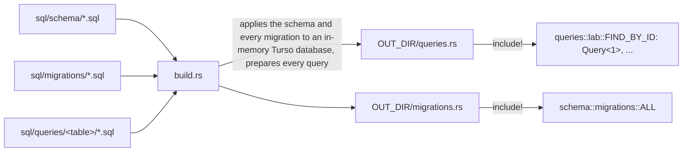

# Database

Sherpa's records (users, node images, labs, nodes, links, bridges, and each lab's definition)
live in an embedded
[Turso](https://github.com/tursodatabase/turso) database inside `sherpad`: the `turso` crate,
pinned to an exact pre-1.0 version with default features off, because they install mimalloc as the
process's global allocator. The file is `SHERPA_DB_FILE_PATH`
(`/opt/sherpa/db/sherpa.sqlite`), in SQLite's format, with a write-ahead log. Everything is in
`crates/db`; the only other crate that depends on Turso is the `agent-bus` development tool, for
its own file, the host's record (see [`AGENT_BUS.md`](AGENT_BUS.md), "The record"), which shares
only the workspace pin. Outside the crate, records are the `shared::data`
types and ids are the database-neutral `shared::data::RecordId`.

Releases before 0.5.0 used a SurrealDB container.

## The `Database` handle

`db::open(path)` and `db::open_in_memory()` return a `Database` (`crates/db/src/connect.rs`). It is
`Clone`; `AppState` holds one and every task shares it.

- **A connection per operation.** A Turso `Connection` cannot be used by two tasks at once: a
  second concurrent use fails with `Misuse("concurrent use forbidden")`. So the handle holds the
  `turso::Database`, and each operation takes a fresh connection from `reader()` or `writer()`.
  Every connection gets a busy timeout (`SHERPA_DB_BUSY_TIMEOUT_SECS`) and
  `PRAGMA foreign_keys = ON`, which SQLite leaves off by default.
- **One writer at a time.** `writer()` also takes the handle's write lock, a `tokio::sync::Mutex`,
  and returns a `Writer` holding both until it is dropped. Turso's busy timeout works for a single
  waiter, but under contention its busy wait does not serve waiters in order: with 64 writing
  tasks, about 0.5% of transactions waited past the timeout and failed with `Busy`. The tokio mutex
  is fair, so writers queue in arrival order instead, with no loss of throughput. Reads take no
  lock.
- **Whole operations under the lock.** A write that reads before it writes does both under one
  `Writer`, so nothing changes between the check and the write. Statements that must succeed
  together run in one transaction (`writer.conn.transaction()`, committed explicitly; dropping it
  rolls back); a test checks that a transaction that fails after DDL and a `user_version` change
  leaves neither.
- **Narrow updates.** An update writes only the columns it is for: `update_lab_phase_from`,
  `update_lab_tailscale_container`, `update_link_impairments` and the `update_node_*` functions.
  A caller holding an older copy of the record cannot write back columns another task changed
  meanwhile. `update_user` writes the user's own fields, sets `updated_at` itself and never changes
  `created_at`. It is also compare-and-set: it writes only if the row's `updated_at` is still the
  one in the `DbUser` it was given, and otherwise fails with `UserChanged`, so an edit made from a
  stale read cannot undo a concurrent one. `change_user_password` writes only the hash and
  `updated_at`, and ends the user's other sessions in the same transaction.
  `set_device_password` writes only the sealed device password and `updated_at`. A link is created with its impairments in one statement (`create_link` takes a
  `DbLink`).
- **Exclusive file.** While `sherpad` has the file open, no other process can open it, including
  the `sqlite3` command; Turso's multi-process mode is experimental. Inspection therefore runs
  with `sherpad` stopped.
- **Backups.** `Database::backup(path)` runs `VACUUM INTO` under the write lock, so the copy is
  consistent and writes wait for it. It refuses a destination that exists. The `server.backup`
  RPC (`crates/server/src/services/backup.rs`) writes to `SHERPA_DB_BACKUP_PATH`, which it first
  restricts to `sherpa` (`SHERPA_DB_BACKUP_DIR_MODE`, `0700`): `VACUUM INTO` writes the copy before
  its file is restricted. The database directory is `0750` (`SHERPA_DB_DIR_MODE`), set by the
  installer, the update script and `sherpad` at startup. `open` restricts the database file and
  its `-wal` and `-shm` files to `0600`; Turso creates the `-wal` file when it opens the database,
  so the first writes do not leave it readable by others.
- **What a backup holds.** The copy is the whole database: users (password hashes), node images,
  labs, nodes, links, bridges, sessions, and every
  lab's [definition](#lab-definitions). A definition holds the manifest as the user wrote it:
  paths, settings and literal values, **never the contents of files or scripts, nor the values
  of `$VAR` environment variables**. Only the values sealed with the
  [database key](#secret-values) are ciphertext: `lab.ztp_server_password` and
  `user.device_password`. The key is not
  in the database or the backup, so **back up `SHERPA_DB_KEY_PATH`
  (`/opt/sherpa/.secret/db.key`) alongside every backup, but separately from it**: not in the
  backup directory, and not in the same copy. A restored database with no key, or another
  key, does not start (see [Secret values](#secret-values)).
- **Tests.** `open_in_memory()` gives each test its own database; connections to one in-memory
  database share its data. The db and server integration tests need no database server.

## Queries and row mapping

Every statement the crate runs is a plain SQL file under `crates/db/sql/queries/<table>/`, one
statement per file, complete and readable. The tables as first created are
`crates/db/sql/schema/<table>.sql`, which the schema code includes with `include_str!`; each later
schema change is a file in `crates/db/sql/migrations/` (see [Versions](#versions)).

- **Checked at build time.** `crates/db/build.rs` applies the schema files, then each migration in
  order, to an in-memory Turso database, so it has the schema a running server has, and prepares
  each query file against it. Preparing checks the syntax and every table and
  column a statement names, so a statement that does not fit the schema fails the build, naming the
  file and Turso's message. It reruns only when a file under `sql/` changes, and takes about a
  second; Cargo shares the `turso` build with the crate, so a cold build compiles Turso once and
  the script adds about 14 seconds.
- **Constants.** The build script generates one constant per file, holding the file with
  `include_str!`, in a module per directory: `sql/queries/lab/find_by_id.sql` is
  `queries::lab::FIND_BY_ID`, a `Query<1>`. A statement used by more than one module, such as
  `queries::node::COUNT_BY_LAB`, is one file. Triggers are migrations.
- **Column order checked.** A statement that returns every column of a table must return them in
  the table's order (`PRAGMA table_info`), or the build fails naming the file: the mappers read by
  position, and two columns of one type, such as `gateway_ipv4` and `router_ipv4`, would otherwise
  swap silently. A statement returning some columns, such as the network readers' `lab_id` and
  network, is not checked.
- **Parameter count checked.** Every query numbers its bound parameters, `?1`, `?2`, ...; a
  number may repeat. `build/placeholders.rs` reads them from the SQL text, skipping string
  literals, quoted identifiers and comments, and the count is the highest number. A bare `?`, a
  named parameter (`:name`, `@name`, `$name`), `?0` or a gap in the numbering fails the build,
  naming the file, so the highest number is always the count. Turso's public `Statement` has no
  parameter count to cross-check against. The count is the constant's type, `Query<N>`
  (`src/sql.rs`), and the only way to run a query is `Query::bind`, which takes `[Value; N]`, so
  binding another number of values is a type error at the call site (`expected an array with a
  size of 1`). Only the count is checked, not the values' types. The
  `*_values` mappers return fixed-size arrays (`lab_values` returns `[Value; 18]`), so a
  statement that writes a whole row and its mapper must agree too. `Query`, `Bound` and the
  helpers that run a `Bound` are crate-private. The rules' tests are
  in the same file, which the crate includes under `cfg(test)`, so `cargo test -p db` runs them.
- **Built-in statements.** `PRAGMA user_version` is a `Query<0>` written in `schema/apply.rs`;
  setting the version, triggers and `VACUUM INTO` take no bound parameter and are plain
  strings.
- **Schema order.** The build script applies `sql/schema/` in the order `apply_schema` does,
  parents first (`SCHEMA_FILES`), and refuses a schema file missing from that list.

`crates/db/src/sql.rs` has `Query<N>`, `Bound` and the four query helpers: `query_optional`,
`query_all`, `query_count` and `execute`. Each takes a `Bound` query,
`queries::lab::FIND_BY_LAB_ID.bind([lab_id.into()])`. The first two take a mapper, a plain
`fn(&Row) -> Result<T>`. A failed statement is named by its first line, and a row that does not
map by its first column, its id.

`crates/db/src/persistence.rs` maps rows to records:

- **Column order.** Statements list a table's columns in its `CREATE TABLE` order, and the mappers
  read and write them in that order.
- **Reading.** `Cells` reads a row's columns in order and names the field in every error.
  `*_from_row` builds a record; `*_values` gives a record's values in column order, as an array
  of the table's width, for positional parameters (`?1`, `?2`, ...). SQL never contains
  formatted values.
- **Types.** Unit enums are stored as text, by their serde names (`enum_text`). Lists such as
  `ssh_keys` are JSON text. Timestamps are RFC 3339 text from `jiff`, which keeps
  nanoseconds. Booleans are `0` and `1`. A link's impairments are flattened into `a_to_b_*` and
  `b_to_a_*` columns, and a bridge's members are rows of `bridge_member`, ordered by `position`.
  A node image's settings (`NodeConfig`'s shared groups and its kind's group, see
  [`NODE_SETTINGS.md`](NODE_SETTINGS.md#image-definition)) are flat `node_image` columns, mapped
  by hand in `db::persistence`: `cpu.count` is `cpu_count`, `interfaces.data_count`,
  `.management` and `.reserved_count` are `data_interface_count`, `management_interface` and
  `reserved_interface_count`; the `vm` group's `cpu.*`, `machine.kind`, `machine.bios`,
  `boot_disk.bus`, `cdrom.image`, `cdrom.bus`, `interfaces.kind`, `interfaces.mtu` and
  `ztp.method` are `cpu_architecture`, `cpu_model`, `vmx_enabled`, `machine_type`, `bios`,
  `hdd_bus`, `cdrom`, `cdrom_bus`, `interface_type`, `interface_mtu` and `ztp`, with
  `os_variant`; a container's `repo` and `ztp`; a unikernel's `boot_mode` and its CPU, machine
  and interface columns. The `kind` column says which group a row holds. Each kind-only column
  is `NULL` for the kinds that do not take it and set for those that do, `cdrom` and `repo`
  excepted, which are optional for their kind; a `CHECK` on each column holds this (migration
  33). `node_image_from_row` reads every column into a local in column order and then builds the
  shared groups and the kind's group, failing on a kind-only column the kind needs but the row
  lacks, because `Cells` reads positionally and the groups are not in column order.
  `node_image_values` writes `NULL` to the columns of other kinds.
  `test_every_model_image_reads_back_as_written` writes every model's built-in image and checks
  it reads back as the same JSON.
  Impairment percentages are `f64` in `LinkImpairment`, the width of a `REAL`, so they read back
  exactly as written. `Cells::percent` refuses a value outside 0 to 100, which includes `NaN` and
  infinity, naming the field: netem would otherwise clamp it silently. A node's readiness check
  (`DbNode::ready_check`, a `ReadyCheck`) is the `node.ready_port`, `node.skip_ready_check` and
  `node.ready_sshd_marker` columns.
- **Record keys.** A column holds only a record's key; the table is implied by the column, and
  `Cells::record(table, field)` rebuilds the `RecordId`. `key_of` refuses an id from another table.
  New keys are 20 random characters from `SHERPA_DB_KEY_CHARSET`, the length and alphabet of the
  keys of releases before 0.5.0, which upgraded servers still hold.

## Schema

`crates/db/src/schema/` has one file per table. Tables are `STRICT`. Ranges are `CHECK`
constraints; uniqueness is `UNIQUE` constraints; references are foreign keys:

- `lab.user` and `node.image` are `ON DELETE RESTRICT`: an owner with labs, or an image in use,
  cannot be deleted.
- `node.lab`, `link.lab`, `link.node_a`, `link.node_b`, `bridge.lab`, `bridge_member.bridge`,
  `bridge_member.node`, `session.user` and every `manifest_*` table's `lab` or `node` are
  `ON DELETE CASCADE`. Deleting a lab is one `DELETE`, which takes its definition with it, and
  deleting a user ends their login sessions.
- `session` holds one row per login session (`db::session`). `expires_at` is whole Unix seconds,
  the token's `exp`, so the sweep compares integers. What each row means and what ends it is in
  [`SERVER.md`](SERVER.md#sessions-and-identity).

### Versions

`apply_schema` (`schema/apply.rs`) runs on every start and in `sherpad init`, in one transaction.
The database's `PRAGMA user_version` is its schema version. Version 1 is the tables in
`sql/schema/` (`TABLES` in `apply.rs`). Each file in `sql/migrations/` takes the schema up one
version; its name is the version it takes the schema to, four digits, then a name:
`0002_fix_data_interface_counts.sql`. The build script refuses a gap or a misnumbered file, and
generates `schema::migrations`: a constant per file, named without the number
(`FIX_DATA_INTERFACE_COUNTS`), and `ALL`, every migration in order. `SCHEMA_VERSION` is
`1 + ALL.len()`.
A database with a newer version than the build knows is refused, so a downgrade cannot write to a
schema it does not understand.

A version never changes once released, including `sql/schema/`. To change the schema, add the
next migration file, and change the queries that use it; the build checks them against the new
schema. New columns come last, so the mappers in `persistence.rs` read and write them last. SQLite
cannot alter
most constraints in place, so a change to a column's constraints is a table rebuild: create the new
table, copy the rows, drop the old one, rename.

| Version | Change |
|---|---|
| 1 | Every table (`sql/schema/<table>.sql`) |
| 2 | `0002_fix_data_interface_counts.sql`: `cisco_csr1000v` and `cisco_iosvl2` images stored with more than 15 data interfaces (the old default was 16, one more than they have after the management interface) are set to 15 |
| 3 | `0003_lab_source.sql`: `lab.client_host` and `lab.client_folder`, where `sherpa up` ran (see below) |
| 4 | `0004_fix_ztp_image_defaults.sql`: `cisco_ise` images stored with the CD-ROM ZTP method (the old default, which has no ISE generator) are set to the disk method, and `generic_vm` images stored with a VirtIO CD-ROM bus (the old default, which cannot hold the cloud-init ISO) are set to SATA |
| 5 | `0005_fix_vsrx_ztp_method.sql`: `juniper_vsrxv3` images stored with the TFTP ZTP method (the old default; vSRX's factory config runs no DHCP client, so it never fetched its config) are set to the CD-ROM method |
| 6 | `0006_one_default_node_image.sql`: one default image per model and kind. Duplicate defaults keep the most recently written image, then the partial unique index `node_image_one_default` refuses a second |
| 7 | `0007_interfaces_used_once.sql`: triggers refuse a link or bridge member on a node interface already used by a link or bridge, a link from an interface to itself, and an interface twice in one bridge. They check new rows only, so a database that holds a repeat still opens |
| 8 | `0008_static_triggers.sql`: drops the enum rule triggers, which earlier releases rebuilt from the Rust enums on every start, and creates the admin protection triggers as fixed text |
| 9 | `0009_drop_dedicated_management_interface.sql`: drops `node_image.dedicated_management_interface`. Index 0 of every model's interface table is its management interface, so the flag changed nothing |
| 10 | `0010_lab_description.sql`: `lab.description`, the manifest's optional `description` (see below) |
| 11 | `0011_lab_ssh_key.sql`: `lab.ssh_key`, the key pair the `sherpa` account on the lab's nodes logs in with: `lab` for the lab's own, `server` (the default, for every lab created before) for the server's shared key. Dropped by version 17 |
| 12 | `0012_session.sql`: the `session` table, one row per login session, with indexes on `user` and `expires_at`. Tokens issued before it name no session, so every user logs in again after the upgrade. See [`SERVER.md`](SERVER.md#sessions-and-identity) |
| 13 | `0013_node_lifecycle.sql`: nodes left `created` by the scanner become `stopped`. See [`STATE_MACHINES.md`](STATE_MACHINES.md) |
| 14 | `0014_promote_missing_default_image.sql`: a model with images and no default, left by an earlier release, gets its most recently added image as the default. Writes keep it that way; see [`STATE_MACHINES.md`](STATE_MACHINES.md#28-node-images) |
| 15 | `0015_lab_phase.sql`: `lab.phase`, which operation owns the lab's record (`ready` for every lab created before), and drops `lab.status`: a lab's status is derived from its nodes when it is read. See [`STATE_MACHINES.md`](STATE_MACHINES.md#2-lab-phase-and-status-labphase-and-labstate) |
| 16 | `0016_ztp_setting.sql`: `node_image.ztp`, the image's one ZTP setting (`disabled` or a method), filled from the `ztp_enable` and `ztp_method` columns, which are dropped. See [`ZTP.md`](ZTP.md#the-setting). |
| 17 | `0017_drop_lab_ssh_key.sql`: drops `lab.ssh_key`. Every lab has its own key and the server's shared key is gone (0.6.0). Refused while a lab is still `server`; see [Labs on the server's SSH key](#labs-on-the-servers-ssh-key) |
| 18 | `0018_reset_unused_image_settings.sql`: container images get the default machine, boot disk and CD-ROM settings (`machine_type` `pc`, `bios` `sea_bios`, `hdd_bus` and `cdrom_bus` `virtio`, no `cdrom`), and unikernel images the default firmware, boot disk and CD-ROM settings, keeping their `machine_type`. Neither kind reads them; the four network OS containers were stored with a q35 machine and SATA buses. See [`NODE_SETTINGS.md`](NODE_SETTINGS.md#settings-a-kind-does-not-use) |
| 19 | `0019_node_ready_check.sql`: `node.ready_port` (`NULL` or 1 to 65535) and `node.skip_ready_check` (`0` or `1`, default `0`), each node's readiness check, which the scanner, `resume` and `redeploy` read instead of the saved manifest. Existing virtual machines get their model's port (22, or 50000 for `talos_linux`), containers and unikernels none, and no check is skipped: what the scanner did with them before. See [Node readiness checks](#node-readiness-checks) |
| 20 | `0020_lab_definition.sql`: the [lab definition](#lab-definitions): the manifest's lab-level parameters on `lab` (with `has_definition`, `0` for every lab before), its node-level ones on `node`, the `manifest_*` tables for its lists, and `secret_key_check`. Existing labs got theirs from the startup import of 0.6.4 and 0.6.5. Triggers refuse a `node_image.ztp_password` that is not [sealed](#secret-values); sherpad up to 0.6.5 sealed the plain ones at startup. The column and triggers are dropped by version 26 |
| 21 | `0021_node_definition_imported.sql`: `node.definition_imported` (`0` or `1`, default `0`), set by the startup import of 0.6.4 and 0.6.5 on every node of a lab whose definition came from a saved manifest; the web UI refused to redeploy a marked node. Dropped by version 25. See [Imported definitions](#imported-definitions) |
| 22 | `0022_node_ssh_username.sql`: `node.ssh_username`, the account the lab's SSH config logs in to the node with (`NULL` for the shared `sherpa` account). Existing rows are left `NULL`: sherpad 0.6.5 copied the accounts from each lab's `lab-info.toml` at startup. See [Node SSH accounts](#node-ssh-accounts) |
| 23 | `0023_cpu_pin.sql`: the `cpu_pin` table, one row per host CPU and role a node holds, and its triggers. Every node's `cpu_pinning` and `qemu_thread_cpus` are copied into it, as stored, before the triggers exist, then both columns are dropped. See [CPU pins](#cpu-pins) |
| 24 | `0024_talos_cluster_plan.sql`: the `talos_cluster_plan` table, what `up` works out for each Talos cluster (endpoint, shared address, load balancer range), keyed on the lab and the cluster's position in `manifest_talos_cluster`. sherpad 0.6.5 filled it at startup from the `cluster.toml` files older releases saved. See [Talos cluster plans](#talos-cluster-plans) |
| 25 | `0025_drop_node_definition_imported.sql`: drops `node.definition_imported`. Nothing sets it since the startup import was removed (0.7.0), and the web UI no longer refuses a marked node. See [Imported definitions](#imported-definitions) |
| 26 | `0026_drop_image_ztp_login.sql`: drops `node_image.ztp_username`, `ztp_password` and `ztp_password_auth`, and the two triggers that refused a `ztp_password` not sealed. Sherpa's generated configurations never read them. Stored values, sealed passwords included, are dropped; the images and their `ztp` setting are kept. See [Secret values](#secret-values) |
| 27 | `0027_user_device_password.sql`: `user.device_password`, the user's [device password](#device-passwords) as sealed text, `NULL` (none) for every user; and two triggers that refuse a value that is not sealed text, on insert and on update |
| 28 | `0028_drop_provision_current_user.sql`: drops `lab.provision_current_user`. The owner's login is the only one on lab nodes, so there is nothing to choose. Stored lab definitions lose the value |
| 29 | `0029_legacy_node_ssh_username.sql`: `UPDATE node SET ssh_username = 'sherpa' WHERE ssh_username IS NULL`. A node built before 0.7.0 has the shared `sherpa` account and no recorded login; this records it, so its SSH config stays `User sherpa`. See [Node SSH accounts](#node-ssh-accounts) |
| 30 | `0030_fix_sonic_data_interface_count.sql`: `sonic_linux` images stored with 52 data interfaces (the old default) are set to 32, one per front-panel port of the SONiC virtual switch. A count an administrator set is kept |
| 31 | `0031_rename_node_models.sql`: `node_image.model` takes the 0.7.0 names (`arista_veos` and `arista_ceos` to `arista_eos`, `generic_*` to `generic`, and the others in `shared::data::REMOVED_MODELS`). It is the only column that names a model: a node refers to its image, and a lab's stored definition takes each node's model and kind from it, so running labs and definitions follow. Each row keeps its kind, so the rows of a merged model cannot collide on `(model, kind, version)` and each kind keeps its default. A container image keeps the repo it was pulled or imported as, so no Docker image is retagged |
| 32 | `0032_node_ready_sshd_marker.sql`: `node.ready_sshd_marker` (`0` or `1`, default `0`), whether the node's SSH server must show Sherpa's ready marker before the node is ready: a Windows node with cloud-init ZTP. Nodes already built keep `0`: a Windows node from before Sherpa's sshd config never shows the marker. See [Node readiness checks](#node-readiness-checks) |
| 33 | `0033_srx_ztp_cdrom_only.sql`: `juniper_srxv3` images stored with the TFTP ZTP method are set to `cdrom`, the one method the model takes from 0.7.0 (#676). `cdrom` and `disabled` are kept; no other value can have been written for the model |
| 34 | `0034_per_kind_image_settings.sql`: a node image holds only its own kind's settings (#613, #614). The kind-only columns become nullable, each with a `CHECK` that it is set exactly for the kinds that take it: `os_variant`, `vmx_enabled`, `bios`, `hdd_bus`, `cdrom_bus` for a VM (`cdrom` only for a VM); `cpu_architecture`, `cpu_model`, `machine_type`, `interface_type`, `interface_mtu` for a VM or a unikernel; `ztp` for a VM or a container; `repo` only for a container; `boot_mode` for a unikernel. Each row's values are kept for its kind and dropped for the others, and a unikernel stored without a boot mode gets `direct_kernel`, as the code read it. `interface_prefix` and `first_interface_index`, which nothing read, are dropped. `node.image` references `node_image`, and Turso refuses dropping a referenced table even with deferred foreign keys, so the table is not rebuilt: each column is added again under a temporary name, filled in one `UPDATE` (every `CHECK` is tested on each row an `UPDATE` writes), and the old one dropped and replaced. The `CHECK`s are written with `AND` and `OR`, not as a comparison of two conditions, which Turso cannot read back when it re-reads a `STRICT` table's schema, as `VACUUM INTO` (the backup) does |
| 35 | `0035_retire_lab_loopback_network.sql`: a node's serial console is a UNIX socket only sherpad reaches (#674), so a lab is given no IPv4 loopback network. `lab.loopback_network` is UNIQUE, so it cannot be dropped, and `lab` cannot be rebuilt under the foreign keys that reference it: it is renamed `retired_loopback_network`, and a new lab stores its own `lab_id` in it, which is unique and not null. Nothing reads it. See [`SERVER.md`](SERVER.md#node-consoles) |
| 36 | `0036_retire_node_vnc_port.sql`: a VM's VNC console is a UNIX socket only sherpad reaches (#674), so no node is given a VNC port. `node.vnc_port` is UNIQUE, so it cannot be dropped, and `node` cannot be rebuilt under the foreign keys that reference it: every value is set to `NULL` and the column is renamed `retired_vnc_port`. Nothing reads or writes it. See [`SERVER.md`](SERVER.md#node-consoles) |
| 37 | `0037_delete_manifest_ssh_keys.sql`: the manifest's per-node `ssh` group is removed (#754), as every node takes the keys on its owner's account, so the `authorized_key` and `authorized_key_file` rows of `manifest_node_text` are deleted and older labs' definitions still read. The `list` CHECK keeps both names, as the table cannot be rebuilt in place; nothing writes them. See [`NODE_SETTINGS.md`](NODE_SETTINGS.md) |

A migration can correct data as well as change the schema; it runs once, when a database reaches that
version.

### Labs on the server's SSH key

Labs created before lab keys log in to their nodes with the server's shared key
(`lab.ssh_key = 'server'`, version 11). 0.6.0 removes that key, and with it version 17 drops the
column, so such a lab would lose SSH access to its nodes. The schema does not move past
version 16 while one exists:

- **`apply_schema`**, before it runs `DROP_LAB_SSH_KEY`, reads the labs on the server's key with
  their owners (`schema::server_key`) and fails, naming each one (`lab_id (name, owned by user)`)
  and saying to destroy them with the release the server ran before. The whole run is one
  transaction, so the database keeps the version it had. sherpad's startup applies the schema
  first, so it does not start; `sherpad init` fails the same way.
- **`check_schema_upgrade`** makes the same refusals as `apply_schema` (a newer version, labs on
  the server's key) without writing. `sherpad check-database` runs it on the server's database,
  and `scripts/sherpa_update.sh` runs the new release's `check-database`, as `sherpa`, before
  installing it: a refusal leaves the running release installed and starts it again, so the
  labs can be destroyed with it.
- The two statements read a column the current schema no longer has, so they are `Query::new`
  constants in `server_key.rs`, not query files the build checks. Once the column is gone there
  is nothing to read, and the check passes.

### Node readiness checks

`node.ready_port`, `node.skip_ready_check` and `node.ready_sshd_marker` hold how a node shows it
is ready. `up` writes them after it creates the node's record, and `redeploy` replaces them from
the new manifest node before the node starts, both with `db::update_node_ready_check` and the
values `node_ops::stored_ready_check` takes from the manifest node and its ZTP setting: its
`ready_check.port`, else a virtual machine's model port; its `ready_check.skip`; and, when the
port is SSH, whether its SSH server must show Sherpa's ready marker
(`ModelKind::waits_for_sshd_ready_marker`, a Windows node with cloud-init ZTP). A container or
unikernel without a port stores `NULL`, and is ready once it runs. `create_node` stores `NULL`,
`0` and `0`. What reads them is
in [`STATE_MACHINES.md`](STATE_MACHINES.md#5-node-readiness-and-host-keys).

### CPU pins

The `cpu_pin` table holds the host CPUs nodes are pinned to, and is the only place they are
stored. One row per host CPU and role a node holds:

| Column | Notes |
|---|---|
| `lab` | References `lab(id)`, `ON DELETE CASCADE` |
| `node_name` | The node's name in the lab. Not the node's record: admission claims the pins during `up`'s validation, before the node rows exist |
| `host_cpu` | 0 to 65535 |
| `role` | `vcpu` (`cpu.pinning`) or `thread` (`cpu.emulator_pinning` and `boot_disk.io_thread_cpus`) |

The primary key is `(lab, node_name, host_cpu, role)`, with an index on `host_cpu`. The rules are
triggers, so they hold for any statement, not only the application's:

- **`cpu_pin_held`**, `BEFORE INSERT`: a new row is refused with "Host CPU is already pinned by
  another node" when a row of another node (another lab, or another name in the lab) has the
  same `host_cpu` and either row is `vcpu`. vCPUs never share a CPU; QEMU threads share with
  threads. A node's own rows never conflict, which is how a node may hold its old and its new
  pins together while a redeploy runs. A node's own vCPU and thread CPUs are kept apart by
  `check_vm_tuning`, before admission.
- **`cpu_pin_unchanged`**, `BEFORE UPDATE`: rows are claimed and given back, never changed, so
  an `UPDATE` cannot move a pin around the first trigger.
- **`cpu_pin_node_deleted`**, `AFTER DELETE ON node`: deleting a node record deletes its rows.
  Deleting the lab deletes them through the foreign key.

The functions are in `db::cpu_pin`:

- **`claim_cpu_pins(lab, nodes)`** inserts, in one transaction, a row for each CPU and role a
  node does not hold yet (`INSERT ... SELECT ... WHERE NOT EXISTS`). Skipping the rows it holds
  matters: the trigger runs before the primary key is checked, so inserting a row a node already
  holds, on a CPU another node also holds (an overlap carried from before version 23), would be
  refused. When the trigger refuses a row, it reads which role the other node pins to the CPU and
  fails with `db::CpuPinTaken`, naming the node, the CPU and both roles; the transaction is not
  committed, so nothing is claimed. The server maps it to `ServiceError::CpuPinsHeld` with
  `ServiceError::from_cpu_pin_claim`, the same refusal as admission's own check (-32006, HTTP 409,
  exit 75).
- **`retain_cpu_pins(lab, pins)`** deletes, in one transaction, the node's rows that are not in
  `pins`. It only deletes, so it cannot be refused. A redeploy keeps its new pins with it once the
  old domain is gone, or its old ones when it fails before then.
- **`list_cpu_pins`** returns every node's pins, one `DbCpuPins` per node (its lab, and a
  `NodeCpuPins` under its name, each list ascending).

Pins are held while a lab is stopped: `down`, a node stop and `resume` do not touch the table.
Only destroying the lab (or a failed `up`'s rollback, or the release of a refused `up`'s
reservation) deletes them.

Version 23 copies every node's stored pins with `json_each`, as they are, before it creates the
triggers. The triggers check new rows only, so pins that two labs already shared against the
rules stay, and the database still opens. sherpad logs a warning naming each such pair at every
start (`node_resources::warn_shared_cpu_pins`), and each `resume`, node start or `redeploy` of
one of the nodes warns too, as before. Redeploying one of the two on other host CPUs ends the
overlap.

### Node SSH accounts

`node.ssh_username` is the account the lab's SSH config logs in to the node with: the lab
owner's login (their Sherpa username) on every node with a generated login, `admin` on Cisco
FTDv, and `sherpa` on a node built before 0.7.0 (migration 29). It is `NULL` for a node with no
generated login: a custom `ztp.config`, ZTP off, an application container; the SSH config then
names the lab owner. It is the `ssh_usernames` of `lab-info.toml`, which the server no longer
keeps; 0.6.5 copied it from older labs' files at startup.

- **Written** by `up`, after it creates the nodes' records (`up::records::store_ssh_usernames`),
  and by `redeploy`, with the account the node was rebuilt with, once the rebuild succeeds; both
  with `db::update_node_ssh_username`. `create_node` stores `NULL`.
- **Read** with every node row (`DbNode::ssh_username`): `lab_info::lab_info_from_records` lists
  the nodes that have one as the lab info's `ssh_usernames`, and `ssh_config::lab_ssh_files`
  renders the SSH config and `known_hosts` file from that and the node rows (`mgmt_ipv4`,
  `ssh_host_key`) for `up`'s response, `download` and `node.host_keys`. `inspect` and `redeploy`
  read the lab info the same way.
- **Imported** at startup by 0.6.5 from labs stored before version 22. 0.7.0 does not; such a
  lab's nodes use the `sherpa` account (see
  [`SERVER.md`](SERVER.md#files-older-releases-left-in-lab-folders)), which migration 29 records.
- **Counted** at startup by `db::count_nodes_by_ssh_username`: sherpad logs one warning while
  any node still has `sherpa` as its login (`daemon::state::warn_on_sherpa_logins`), because those
  nodes keep the published `sherpa` password until they are redeployed or recreated.

### Talos cluster plans

A Talos cluster's plan (`shared::data::ClusterPlan`) is its manifest cluster with the addresses
`up` chose for it. The manifest's side is in the lab's definition (`manifest_talos_cluster`,
`manifest_talos_member`), and members' and services' addresses are their nodes' `mgmt_ipv4`, so
`talos_cluster_plan` holds only the rest, one row per cluster:

| Column | Holds |
|---|---|
| `lab`, `cluster` | the key: the lab, and the cluster's `position` in `manifest_talos_cluster` |
| `endpoint` | the Kubernetes API address: the shared address, or the only control plane's |
| `vip` | the shared address of a cluster with three control planes, else `NULL` |
| `load_balancer_first`, `load_balancer_last` | a Cilium cluster's load balancer range, else both `NULL` (a `CHECK` refuses one alone) |

The values are columns of their own table rather than of `manifest_talos_cluster`, which holds
what the user wrote and is read back as the manifest: the definition is stored before the
plan exists, so the columns would be nullable there, and every writer of the definition would
have to carry them. The composite foreign key to `manifest_talos_cluster` cascades, so a row
goes with its cluster: storing the definition again drops the plans (nothing does that to a lab
that has them), and destroying the lab removes both.

- **Written** by `db::store_talos_cluster_plans(db, lab, plans)`, in one transaction: each plan
  replaces its cluster's row, found by name, so storing the same plans again changes nothing. A
  plan for a cluster the definition does not have fails the call and stores nothing. `up` calls
  it from `talos::prepare_clusters`.
- **Read** by `db::list_talos_cluster_plans(db, lab)` (`talos/list_cluster_plans.sql` and
  `talos/list_cluster_members.sql`), in manifest order. A cluster without a row is left out; a
  member, Keycloak or Vault node without a `mgmt_ipv4` is an error naming it.
- **Imported** at startup by 0.6.5 from labs stored before version 24. 0.7.0 does not; a
  cluster with no row is handled as above (see
  [`SERVER.md`](SERVER.md#files-older-releases-left-in-lab-folders)).

### Lab definitions

A lab's definition is every parameter of the manifest it was deployed from, **as the user wrote
it**. The manifest is how the user defines a lab; once it is deployed, the database is the
server's record of it.

**No file contents and no resolved values are stored.** Before it sends a manifest, the client
replaces `ztp.config`, a path, with the file's contents, replaces each `KEY=$VAR` environment
variable with its value, and adds the `*_data` fields: the contents of `text_files`,
`binary_files`, `systemd_units`, `startup_scripts` and `user_scripts`. The server builds the
node from that resolved manifest, as before, and never writes it to the database. What it stores is the manifest as written:

- Files and scripts as references: `ztp.config`'s path, `text_files` (`src`, `dst`, `user`,
  `group`, `permissions`), `binary_files` (`source`), `systemd_units` (`name`, `source`,
  `enabled`), `startup_scripts` and `user_scripts`.
- `environment_variables` as written: `KEY=$VAR` keeps `$VAR`.
- Literal parameters as they are, with `ztp_server.password` sealed.

The client sends the parts it changes, and the ones it never serializes, as written, beside the
manifest: `topology::ManifestAsWritten` (`Manifest::as_written`, taken before it resolves
anything), the optional `as_written` field of `UpRequest` and `RedeployRequest`, holding each
node's `ztp.config` path, `environment_variables` and `provisioners`, and the lab's
`provision_concurrency`. `Manifest::definition(as_written)` puts them back and clears every
`*_data` field; the server's `services::lab_definition::definition` also checks the provisioners.
Without `as_written` (an older client), `ztp.config`, `environment_variables`, provisioners and
`provision_concurrency` are not stored at `up`, rather than stored resolved, and a `redeploy`
keeps the node's stored ones (`lab_definition::stored_as_written`). The web UI's manifest is
already as written, so it sends its own parts. `store_lab_definition` and
`store_redeployed_node` refuse a manifest that holds a `*_data` field
(`Manifest::has_file_contents`).

Storage is normalised: one-to-one parameters are columns of the lab's and nodes' rows, lists are rows of
child tables, and nothing is a JSON or TOML document. Everything is in `crates/db/src/definition/`
and the query files in `sql/queries/definition/`.

**Lab-level parameters** are on `lab`. `name` and `description` are the lab's own columns, written
by `create_lab`; the rest come with migration 20:

| Column | Manifest |
|---|---|
| `has_definition` | `1` once a definition is stored. `0` for a lab stored before version 20 whose saved manifest was not imported |
| `ready_timeout`, `provision_concurrency` | the same names (`provision_concurrency` 1 to 255) |
| `tailscale_enabled`, `tailscale_auth_key_env` | `[tailscale]`; `NULL` when the manifest has no table |
| `ztp_server_enable`, `ztp_server_username`, `ztp_server_password` | `[ztp_server]`; `NULL` when absent. The password is [sealed](#secret-values) |

**Node-level parameters** are on `node`. Where the node already records what it was built with,
or refers to a record, the manifest's value is a `manifest_` column beside it: `manifest_image`
(`image`), `manifest_memory`, `manifest_cpu_count`, `manifest_ready_port`,
`manifest_skip_ready_check`. The rest are named after their manifest path: `version`,
`cpu_mode`, `cpu_sockets`, `cpu_cores`, `cpu_threads`, `numa_node`, `numa_memory_mode`,
`boot_disk_size`, `boot_disk_clone_method`, `boot_disk_cache`, `boot_disk_io`,
`interfaces_data_count`, `interfaces_queues`, `ztp_method`, `ztp_config`, `vm_watchdog`,
`container_user`, `container_privileged`, `container_shm_size`, `container_platform` and
`unikernel_cmdline`. `NULL` is "not set", as in the manifest. A node's `model` is its image's,
and so is its `kind`, which has no column: the definition holds `kind` only when the image's
kind is not the model's default, so a node is rebuilt as the kind it was deployed as, and a
manifest that wrote the default kind reads back without it. A `generic` node has no default
kind, so its definition always holds it.
Choices are `CHECK`ed against their serde names, and numbers against their type's range, or the
manifest's where it validates one.

**Lists** are child tables, keyed by their parent and a `position` in manifest order:

| Table | Holds |
|---|---|
| `manifest_link` | `links`: `src`, `dst`, `p2p`, and the `impairment` (`impaired` says whether it has the table) |
| `manifest_bridge`, `manifest_bridge_link` | `bridges` and the ends each names |
| `manifest_talos_cluster`, `manifest_talos_member` | `talos_clusters` (`cni`, `oidc`, `vault`) and their members, by `role` (`controller`, `worker`) |
| `manifest_node_cpu` | a node's CPU lists, by `list`: `pinning`, `emulator_pinning`, `io_thread` (`boot_disk.io_thread_cpus`) |
| `manifest_node_text` | a node's lists of strings, by `list`: `container_command`, `environment_variable` (as written), `startup_script`, `user_script` (paths), `binary_file` (paths) |
| `manifest_node_volume` | `container.volumes` |
| `manifest_node_text_file` | `text_files`: `src`, `dst`, `user`, `group`, `permissions` |
| `manifest_node_systemd_unit` | `systemd_units`: `name`, `source`, `enabled` |
| `manifest_node_provisioner`, `manifest_node_provisioner_file`, `manifest_node_provisioner_path` | `provisioners`: their `type`, files (an ssh file has a `dst`, a container file a `name`), and an ssh provisioner's `env_files` and `scripts`. Paths and settings only |

Nested tables (`manifest_bridge_link`, `manifest_talos_member`, the provisioner files and paths)
refer to their parent row with a composite foreign key and cascade with it.

**Writers.**

- `store_lab_definition(db, lab, manifest)` replaces the whole definition in one transaction:
  the lab's columns, its links, bridges and Talos clusters, and every node's columns and lists.
  Each manifest node must already have its record. `up` calls it at the end of its
  DatabaseRecords phase, once the lab and node records exist.
- `store_redeployed_node(db, lab, node, name, manifest)` is `redeploy`'s, before the node
  starts: the node's columns and lists, and the lab-level settings a redeploy applies,
  `ready_timeout` and `provision_concurrency`. The lab's links,
  bridges, Talos clusters, Tailscale and ZTP server settings are what `up` built; a redeploy does
  not rebuild them, so it does not change them.

**Read-back.** `read_lab_definition(db, lab)` returns the `topology::Manifest` the definition
records, as written and with no `*_data` field, or `None` when `has_definition` is `0`. The one thing that does not round-trip is an
empty list or an empty `vm`, `container` or `unikernel` table: none is stored, and it reads back
as absent, which every reader treats the same. A test builds a manifest that sets every field,
as written (no `*_data` field), with a destructuring that stops compiling when `Manifest` or
`Node` gains one, and checks that it reads back equal and that every child table got rows.

**Readers.** The server reads a lab's manifest only from its definition; it writes no copy of
it to the lab's directory. `services::lab_definition::stored_definition` is the read for readers
that fall back to defaults: for a lab with no definition (`has_definition` `0`), or one that
cannot be read, it logs a warning and gives `None`, and the reader uses its defaults, never a
made-up definition.

| Reader | Reads | Without a definition |
|---|---|---|
| `resume` (`wait_for_cold_booted`) | `ready_timeout` | `konst::READINESS_TIMEOUT` |
| `resume` (`reattach_cold_booted`) and the scanner's link repair (`scanner::repair_links`), through `p2p_links::recreated_end` | a container's `interfaces.data_count` | the image's data interface count |
| the web UI's node page (`labs_web::defined_node_ztp`) | the node's `ztp.method` | the image's setting |
| the web UI's node redeploy (`lab_definition::web_redeploy_manifest`) | the whole definition, narrowed to the node | refused (409) |

The ready port is not read from the definition: it is the node's own readiness check
(`node.ready_port`, `node.skip_ready_check`), what it was built with. A web UI redeploy rebuilds a
node from its definition alone, so it refuses a node that needs what the definition does not hold
(see [SERVER.md](SERVER.md#redeploy)).

#### Imported definitions

0.6.4 and 0.6.5 imported the definition of each lab stored before version 20 at startup, from
the manifest older releases saved in its folder. The saved copy held each node's `ztp.config`
and `environment_variables` resolved and never held its `provisioners`, so the import left them
out. Those releases marked every node of such a lab (`node.definition_imported`, version 21) and
refused a web UI redeploy of a marked node until `sherpa redeploy` stored its parts as written
and cleared the mark.

0.7.0 removed the import and dropped the mark (version 25). A node imported then and not
redeployed from the CLI since cannot be told apart: the web UI rebuilds it from its definition,
without those parts. The 0.7.0 upgrade notes say to redeploy such nodes from the CLI, or destroy
their lab, before upgrading. A lab stored before version 20 that was never imported has no
definition (`has_definition` `0`); see
[`SERVER.md`](SERVER.md#files-older-releases-left-in-lab-folders).

### Secret values

No secret is stored in the database as plain text: secret values are sealed, so a database file
or backup that leaves the server without its key holds only ciphertext. The sealed columns are
`lab.ztp_server_password` and `user.device_password`. The credentials of the lab's services, the
Vault tokens, Keycloak admins and realm users and SurrealDB root users, are not in the database
at all: they are files only the server can read (0600) in the lab's folder on the server. `crates/db/src/secret.rs` has the cipher:

- **Cipher.** AES-256-GCM, from `aes-gcm` 0.11 (no `getrandom` feature: `rand` makes the
  nonces). Sherpa's code adds no `unsafe`.
- **Format.** A sealed value is one `BLOB`: a format version byte (`1`), a random 12-byte nonce,
  then the ciphertext and its 16-byte tag. Every value gets its own nonce. The associated data is
  the value's place, `table.column:row-key`, so a value copied to another row or column does not
  open.
- **Key.** 32 random bytes in `SHERPA_DB_KEY_PATH` (`/opt/sherpa/.secret/db.key`), mode `0600`,
  in the `0700` `sherpa` directory that holds the JWT secret, beside it in `server`. It is
  never in `/opt/sherpa/db`, beside the database and its backups, so a copy of that directory
  does not carry it. The install and update scripts create `/opt/sherpa/.secret` (`0700`,
  `sherpa`) when it is missing and leave an existing one's mode alone; sherpad creates it the same
  way if it must. The uninstall script keeps it with `--keep-data` and `--remove-data`, so a kept
  database can still be opened, and removes it only with `--remove-all`.
  never in the database. The `Database` handle carries it (`Database::with_secret_key`); writing
  or reading a sealed value without one fails with "The database key is not loaded".
- **Key check.** `secret_key_check` holds one row: a known value sealed with the key the
  database's values are sealed with, written once with the first key. At startup sherpad loads
  the key and `verify_secret_key` opens the row, or writes it for a database that has none.
- **Errors.** A key file that is missing while the database has a key check stops startup
  ("The database key ... is missing ..."): sherpad does not make a new key a sealed value would
  not open with. A key that does not open the check stops startup ("The database key does not
  match ..."). A key file of the wrong length stops startup as damaged. A sealed value that does
  not open, because the key differs or the value was changed, fails its read and names its place.
  None of these replace the key file.
- **Sealed text.** A `TEXT` column holds a `SealedText`: `sealed:` and the sealed value in
  lower-case hex. Only `seal_text` makes one, so a writer that binds one cannot store plain text,
  and `open_text` refuses a value without the prefix. The column's insert and update triggers
  refuse any other value with `<table>.<column> must be sealed`: it must start `sealed:`, have
  at least 65 characters (the prefix and the hex of the shortest sealed value, 29 bytes) and
  only lower-case hex after the prefix. `user.device_password` is the one such column. Up to
  version 25 `node_image.ztp_password` was one too; version 26 dropped it with its triggers and
  sherpad's startup pass that sealed plain values older releases stored.
- **Another secret field** is a `BLOB` column with a `length() >= 29` check, written with
  `seal(key, value, place)` and read with `open(key, sealed, place)`, where `place` names the
  column and row.

There is no key rotation yet, and no recovery from a lost key: sherpad refuses to start on a
database whose key check it cannot open, so a lost key stops the server until the key file is
restored.

### Device passwords

`user.device_password` is the user's device password, their login password on lab nodes: sealed
text bound to the user's row (`user.device_password:<user key>`), or `NULL` when they have set
none. It is not part of `DbUser`, and no user query but the three below reads it, so listing or
editing users never touches it. `crates/db/src/user/device_password.rs` has:

- `set_device_password(db, id, password)`: seals the password for the row and writes it with
  `updated_at`. The caller checks who may set it and the password rule
  (`server::services::user_device_password`, see [`SERVER.md`](SERVER.md#device-passwords)).
- `device_password_set(db, id)`: whether one is set, without opening it. `user.info`,
  `user.list` and the Profile page show this.
- `open_device_password(db, id)`: the password opened, as a `DevicePassword`, whose `Debug`
  prints `DevicePassword([REDACTED])` and which has no `Serialize`, so no response can carry it.
  `up` and `redeploy` call it through `guest_account::require_device_password` before they create
  or tear down anything, and refuse the operation when none is set. A value that does not open, for another row or under another key, is an error.

There is no clear: a user replaces a forgotten device password with a new one.

### What the user said about a lab

`lab.description` holds the manifest's optional `description`. `topology::validate::check_lab_description`,
which the client and the server both run, refuses one over 1000 characters or with control
characters other than line breaks and tabs.

`lab.client_host` and `lab.client_folder` record the hostname of the machine `sherpa up` ran on
and the folder it ran in. The CLI sends them in the `up` request (`client_host`, `client_folder`);
`server::validate::validate_lab_origin` refuses an empty value, one over its length limit (253 and
4096 characters) or one with control characters. Labs started from the web UI or the API, and
labs created before version 3, have neither (`NULL`).

`create_lab` stores all three through `db::LabDetails`. `inspect` reads them from the record into
`LabInfo`, so the CLI's lab table and the web UI's lab page show them. The description is also in
each lab's `LabSummary`, so the web UI's labs tables and the `labs.list` API show it too.

### Enum values and triggers

Enum columns are checked by the types, not by the database: every value `db` writes is serialized
from its Rust enum (`enum_text`), and every value it reads is decoded back, so a value outside the
enum, such as one a newer release stored before a downgrade, fails when its row is read, naming the
row. The lifecycle states are the exception: `node.state` and `lab.phase` decode
text they do not know as `unknown` (`#[serde(other)]`), so one row from a newer release does not
fail a whole listing. Data-fix migrations, which write enum names as literal text, each have a test that reads the
corrected rows back.

Triggers enforce only rules the types cannot express. All of them are fixed text in migrations, so
the build checks them:

- **The built-in admin account** (`0008_static_triggers.sql`). Triggers refuse deleting, renaming
  or demoting `admin`, and an `admin` row without the admin flag, with `ADMIN_PROTECTED_MESSAGE`.
  They apply to any statement, not only the application's.
- **Interfaces used once** (`0007_interfaces_used_once.sql`).
- **CPU pins** (`0023_cpu_pin.sql`): a host CPU on a node's vCPUs belongs to that node alone;
  rows are never updated; deleting a node deletes its pins. See [CPU pins](#cpu-pins).

## Upgrades from before 0.5.0

Releases before 0.5.0 kept their data in a SurrealDB container, `sherpa-db`, with its files in
`/opt/sherpa/db/sherpa.db`. Releases 0.5.0 to 0.5.12 moved it into the embedded database with
`sherpad migrate-db`, which their `scripts/sherpa_update.sh` ran on the first update. No later
release reads SurrealDB. While a server has no `sherpa.sqlite` but has the container or its files,
`scripts/sherpa_update.sh` refuses it before changing anything and tells the user to update with
the v0.5.12 update script first; `scripts/sherpa_install.sh` refuses any server with the container.
