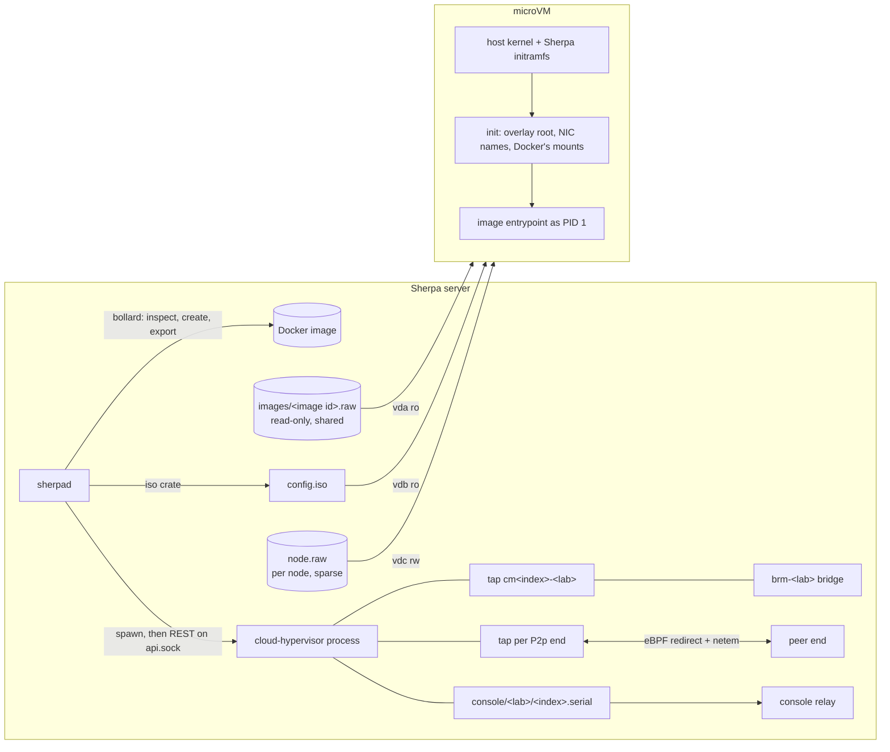

# Privileged Containers in MicroVMs

The network-OS container models that need `--privileged` (`arista_eos` and `nokia_srlinux` as
containers) do not run in Docker. Each runs from its Docker image inside its own Cloud
Hypervisor microVM that `sherpad` drives directly, so the privilege the image needs is
privileged in the microVM's kernel and never in the host's. The behaviour is in
[`tests/specs/nodes.md`](../../tests/specs/nodes.md) (`privileged_microvm`); the host tools are
in [`tests/specs/install-and-update.md`](../../tests/specs/install-and-update.md)
(`microvm_host_tools`).

`ModelKind::runs_in_microvm` (`crates/shared/src/data/model_kind.rs`) is the one list of these
models. Everything else about the node stays a container node: its database record, manifest
settings, ZTP, address, links and state are a container's, and only the runtime differs.

## Parts

| Part | Where | What |
|---|---|---|
| Cloud Hypervisor | `/opt/sherpa/microvm/cloud-hypervisor` | The static release binary, pinned by version and SHA-256 in the install and update scripts. One process per node, no daemon. |
| Guest kernel | `/opt/sherpa/microvm/vmlinuz` | The host's own kernel, copied by the installer from `/boot` (it is readable by root only there). |
| Guest initramfs | `/opt/sherpa/microvm/initramfs.img` | Built by `scripts/microvm/build-guest.sh` at install and update: busybox-static, GNU tar and its libraries, `scripts/microvm/init`, and the host kernel's network, netfilter, overlayfs, isofs and FUSE modules with their dependencies. |
| Base disks | `/opt/sherpa/microvm/images/<image id>.raw` | One read-only root disk per Docker image ID, built once and shared by every node of that image. |
| Node files | `<lab dir>/<node>/microvm/` | `config.iso`, its staging folder, and `node.raw`, the node's writable disk. Removed with the node folder. |
| Runtime | `/opt/sherpa/run/microvm/<lab>/<node>/` | `api.sock`, `ch.pid`, `ch.log`. Its presence marks a node as running in a microVM. |
| Serial socket | `/opt/sherpa/run/console/<lab>/<index>.serial` | The same path a VM's serial socket has, so the console relay serves it unchanged. |

The code is in `crates/container/src/microvm/` (Cloud Hypervisor, base disks, guest config) and
`crates/server/src/services/microvm.rs` (a container spec turned into a microVM, state for the
scanner, stop on redeploy).

## The Root Disk: Built in a Builder MicroVM, Not Shared Over virtio-fs

`sherpad` runs as the unprivileged `sherpa` user with `CAP_NET_ADMIN`, `CAP_NET_RAW`,
`CAP_BPF` and `CAP_PERFMON` only. An image's root filesystem is root-owned, has files only root
can read (`sudoers` at `0440`, `shadow`), set-uid binaries, and file capabilities (SR Linux's
`sr_linux_mgr` and 58 other files carry `security.capability` and refuse to start without it).
Serving that tree over virtio-fs needs a `virtiofsd` that can read every file and report its
real owner, which is either root on the host or a uid-shifted unpack under a subordinate uid
range, which is new privileged machinery of its own. Both undo the point of this design.

So the root filesystem is a disk image, and the privileged part of making it runs as root in a
throwaway guest (`microvm::ensure_base_disk`):

1. Docker creates a stopped container from the image and exports its filesystem as a tar
   archive; `sherpad` streams it to `images/<id>.tar.partial` and removes the container.
2. A sparse raw disk a quarter larger than the archive, plus 512 MiB, is created.
3. A builder microVM boots the same kernel and initramfs with `sherpa.mode=build`, the empty
   disk as `vda` and the archive as `vdb`. The init formats `vda` and unpacks `vdb` into it with
   GNU tar `--xattrs --xattrs-include='*' --numeric-owner -p`, keeping owners, modes and file
   capabilities, then prints `sherpa-init: BUILD-OK` on its serial file and powers off.
4. The disk is renamed into place and the archive removed. One build runs at a time.

## Booting a Node

`microvm::start_microvm_node` takes the same `ContainerSpec` Docker would get:

1. The base disk of the image, built when there is none.
2. The guest config (`GuestConfig`): Docker's rules over the image config: the image's
   entrypoint followed by the spec's commands, or by the image's `Cmd` when the spec has none;
   the image's environment with the spec's entries replacing those of the same name, and entries
   without `=` left out, as Docker leaves them; the spec's user, else the image's; the image's
   working directory.
3. `config.iso`, written with the `iso` crate: `node.toml` (hostname, management address and
   gateway, each NIC's guest name by MAC), `entrypoint.sh`, and `files/`, each bind volume's
   source at its container path.
4. `cloud-hypervisor --api-socket path=<runtime>/api.sock`, spawned in its own process group,
   then `PUT vm.create` with the kernel, initramfs, the three disks, every NIC and the serial
   socket, and `PUT vm.boot`. The API is spoken with `hyper` and `hyperlocal` over the Unix
   socket. The `vm.create` body is kept as `<runtime>/vm.json`.
5. The management tap is put on the lab's `brm-<lab>` bridge, a bridge member's tap on its
   bridge, and a disabled interface's tap set down. This wiring is kept as `taps.toml` in the
   node's `microvm` folder.

A microVM that cannot be defined, booted or wired is stopped again before the error returns,
so a retry, or the rollback of a failed up, starts clean.

### NICs

Every NIC is cold-plugged at `vm.create`: Sherpa knows them all, and cEOS ignores a NIC that
appears after EOS has started. Cloud Hypervisor creates each tap itself, from the
`CAP_NET_ADMIN` it inherits from `sherpad`; the taps are not persistent and go when the process
exits.

| NIC | Host tap | Guest name |
|---|---|---|
| Management | `cm<index>-<lab>` | `eth0` |
| Each P2p or bridge interface | the name the container's host veth would have | the container's interface name (`util::container_interface_name`) |

MACs are locally administered, `02:53:<lab hash>:<index>:<nic>`. Cloud Hypervisor gives a PCI
segment 32 slots, so NICs past the first 24 go on further segments, 30 to a segment, and the
platform gets as many segments as they need. Hotplug through `vm.add-net` works
(`microvm::add_nic`) and is not used.

### The Guest Init

`scripts/microvm/init` is PID 1 of the initramfs. In run mode it:

1. Loads the modules in `modules.list` (bridging, VLANs, VRF, bonding, tunnels, MPLS,
   netfilter, netem and more).
2. Mounts the base disk read-only and the node disk (formatting it on first boot) and makes the
   root an overlay of the two, so writes land on the node's own disk.
3. Names each NIC by its MAC, sets the management address and default route when
   `node.toml` has them, and copies `files/` into the root file by file, so the ISO's read-only
   directory modes never replace the image's.
4. Copies the module tree into the root, so the image's own `modprobe` loads what it asks for
   later (EOS loads `xt_HL` for a `-j TTL` rule).
5. Sets up what a Docker container finds: `/proc`, `/sys`, `/dev` with `devpts`, `/dev/shm`,
   `/dev/fd` and `/dev/std*`, cgroup v2, `/etc/hostname`, `/etc/hosts`, `/etc/resolv.conf`,
   `/.dockerenv` (SR Linux decides it runs in a container from it), and a tmpfs `/run` holding
   the image's own `/run` tree (systemd would otherwise mount an empty one, and cEOS needs its
   `/run/lock/subsys`).
6. `switch_root`s into the root and runs `entrypoint.sh` with the busybox it left in
   `/.sherpa`. The script keeps a getty on `ttyS0`, respawned after each login, and `exec`s the
   command with `env -i` and the container's environment, so the command is PID 1.

SR Linux puts its management address in its own `srbase-mgmt` namespace, so its guest gets
none in the default namespace, as Docker's path flushes it.

## Links, Impairment and Readiness

A microVM node's P2p ends are taps, as a VM's are, and are named as the container's veths would
be, so `attach_ready_p2p_links`, `reattach_node_links` (with `RecreatedEnd::Domain` on
redeploy), `sync_netem` and the scanner work on them unchanged. See
[`P2P-ARCHITECTURE.md`](P2P-ARCHITECTURE.md).

A microVM node is checked as a container is (`CONTAINER_SETTLE`, then its ready port if it has
one). `microvm::microvm_status` maps the VM's state to Docker's (`Running` to `running`,
`Paused` to `paused`, anything else to `exited`), and `node_lifecycle::container_states` adds
every microVM under its container name, so the scanner, `up`, redeploy and `inspect` see one
state for each container node, whichever runtime it has.

## Console

`console_target` lets the serial console of a container that runs in a microVM through; the
socket is the node's `<index>.serial` in the lab's console folder, served by the same relay
as a VM's. A container in Docker still has no console.

## Stopping, Destroy and Rollback

`microvm::halt_microvm` asks the VMM to shut down (`vmm.shutdown`), waits for the process
recorded in `ch.pid` (checked against its command line, so a reused pid is never signalled),
and kills it when it does not exit in 15 seconds. The taps go with the process; the runtime
folder, with `vm.json`, stays. `microvm::stop_microvm` halts the microVM and removes the
runtime folder. A microVM that is not there is already stopped.

## Down and Resume

`down` halts a microVM node (`Route::HaltMicroVm`) instead of pausing it, so its memory is
freed as a VM's is. Its runtime folder stays, so its state reads as `exited` and the node is
recorded `stopped`.

`resume` boots it again (`microvm::restart_microvm`): a new Cloud Hypervisor process takes the
kept `vm.json`, so the node gets the same disks, its writable node disk as it left it, and the
same NICs, whose taps Cloud Hypervisor makes again. The taps are wired from `taps.toml`, and
the node's P2p links are re-attached as a cold-booted domain's are: `recreated_end` plans a
microVM node's ends as `RecreatedEnd::Domain`, which the scanner's repair uses too. A paused
microVM (paused outside Sherpa) is resumed with `vm.resume`.

- Destroy, clean and the rollback of a failed up stop every microVM of the lab
  (`stop_lab_microvms`) before they remove containers.
- Redeploy's `destroy_container_node` stops the node's microVM first.
- The base disks are not lab resources: they stay for the next node of the same image.

`sherpad` starts each Cloud Hypervisor process as its child. Its unit has
`KillMode=process`, so stopping or restarting `sherpad` leaves the microVMs running, as libvirt
domains are, and `sherpad` finds them again by their API sockets.

## Limits

- A container command that exits panics the guest kernel, and Cloud Hypervisor reboots the
  microVM rather than stopping it, so the node is not reported `failed`.
- Only `arista_eos` and `nokia_srlinux` containers run in a microVM. A microVM node on no link
  gets no data interfaces, where Docker gives a container on no link its disabled data
  networks.
- Secret files reach the guest in the config ISO on disk, where Docker mounts them from RAM.
- The guest kernel is the host's own.
