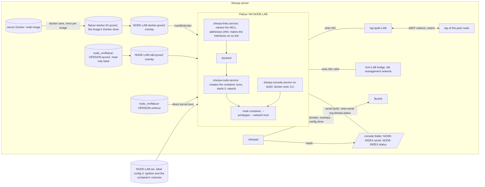

# Node VMs

The container models that need root-like privileges to boot, `arista_ceos` (`arista_eos`
container), `nokia_srlinux` and the `sonic_linux` container, each run in a Flatcar Container
Linux VM of their own. Inside it, Docker runs the node's image unmodified with `--privileged` and
the settings a container on the server gets, in the VM's network namespace, so the network OS has
the VM's NICs as its own interfaces. A privileged container that escapes reaches that VM's
kernel, not the server's.

`ModelKind::runs_in_node_vm` (`crates/shared/src/data/model_kind.rs`) is the one list of these
models; `ModelKind::runs_as` is the kind sherpad handles such a node as, a VM. Every other
container model runs on the server's Docker.

sherpad never talks to the VM's Docker. It configures the VM once, with Ignition and a config
drive, and a unit in the VM starts the container and reports how that went on a status channel.

## Shape

## Base image

- Flatcar stable, the OpenStack image (`flatcar_production_openstack_image.img.bz2`), whose
  Ignition reads its config from a config drive, and its kernel,
  `flatcar_production_image.vmlinuz`, which node VMs boot directly.
- The release is `FLATCAR_NODE_VM_VERSION` in `crates/server/src/services/node_vm/base.rs`, and
  `NODE_VM_FLATCAR_VERSION` with the SHA-512s Flatcar publishes in the "node VM image" section of
  `scripts/sherpa_install.sh` and `scripts/sherpa_update.sh`. `dev/check-node-vm-image.sh` fails
  when the two scripts' sections differ or their version is not sherpad's.
- `ensure_node_vm_image` downloads both files as `sherpa`, checks each against its SHA-512, and
  puts them at `/opt/sherpa/images/node_vm/flatcar-VERSION.qcow2` and `flatcar-VERSION.vmlinuz`,
  mode `0644`. A file already there is never changed. The update installs `bzip2` when
  `bunzip2` is missing.
- `up` and `redeploy` refuse a lab with a node VM before creating anything when either file is
  missing (`ServiceError::NodeVmBaseImageMissing`).

## Boot

The domain boots the kernel directly (`<os><kernel>`, `<cmdline>`), with the command line
Flatcar's GRUB builds (`base::kernel_cmdline`):

- `verity.usrhash` is read from the kernel's header, 64 hex digits at offset 64, and `/usr` is
  the first `/usr` partition, which updates never change.
- No `console=`: the serial console is the network OS's, and printing the kernel's messages
  there is slow.
- `rootflags=rw,noinit_itable`: ext4 does not zero the root filesystem's inode tables into the
  node's overlay.
- `flatcar.first_boot=detected` on the first boot only, so Ignition runs once. sherpad defines the
  domain again without it (`libvirt::set_node_vm_cmdline`) when the VM first reports its status,
  which comes from a unit Ignition installed.

## Config drive

`NODE-LAB.iso` in the storage pool, ISO 9660 labelled `config-2` (`guest::write_config_drive`,
staged in `LAB_DIR/NODE/config-drive` and removed again):

- `openstack/latest/user_data`: the Ignition config (see First boot).
- `sherpa/volumes/N`: the file or folder of the container's Nth volume, copied from the server:
  the generated config, startup files, certificates and secret files.

The VM mounts the drive read-only at `/media/config`. A read-only volume is mounted into the
container from the drive. A writable one is copied into the container with `docker cp` when the
container is created, as a network OS may replace the file, which it cannot do to a bind-mounted
file (SR Linux saves its config by renaming a new file over it). What it writes stays in the
container's layer, on the VM's Docker disk, across down and resume.

## First boot

Ignition's JSON is generated at run time (`template::NodeVmGuest::ignition_json`; its fixed files
and units are in `crates/template/src/node_vm.rs` and `crates/template/templates/node_vm/`). It
sets:

- Updates and reboots off (`IgnitionFile::disable_updates`, `update-engine` and `locksmithd`
  masked); no login (no users, `sshd` and its sockets and the serial getty masked); none of the
  image's OpenStack metadata units.
- No network of the VM's own: `systemd-networkd`, its socket and its varlink sockets are masked,
  so nothing addresses, raises or renames an interface after `sherpa-links` (see Links): the
  network OS owns every interface.
- No library cache or hardware database rebuild: `ldconfig.service` and
  `systemd-hwdb-update.service` are masked; the image ships the cache, and the VM's virtio
  devices need no hardware database.
- Docker on its socket only, with no default bridge and no iptables rules (`--bridge=none
  --iptables=false --ip6tables=false`), and containerd without the CRI plugins and NRI
  (`containerd.toml`), its data on the Docker disk (see Docker stores).
- The units below, the container's `docker create` arguments (`/etc/sherpa/create`, separated
  by NUL bytes, from `container::node_vm_create_args`), the writable volumes to copy into it
  (`/etc/sherpa/writable`), the NICs (`/etc/sherpa/interfaces`, `/etc/sherpa/placeholders`), the
  management addresses (`/etc/sherpa/management`) and the console command
  (`/etc/sherpa/console`).

| Unit | Runs | Does |
|---|---|---|
| `sherpa-links.service` | once per boot, before Docker | `links.sh`: names the NICs, addresses `eth0`, makes the interfaces on no link |
| `sherpa-node.service` | once per boot, after Docker and `sherpa-links` | `node.sh`: on the first boot creates the container and copies the writable volumes into it; on every boot starts it, and reports |
| `sherpa-console.service` | on `ttyS0`, restarted when it exits | `console.sh`: the network OS CLI (see Console) |
| `var-lib-docker.mount` | before containerd and Docker | mounts the Docker disk, `noinit_itable` |
| `media-config.mount` | at boot | mounts the config drive |

The container is created with Docker's `unless-stopped` restart policy and `--pull=never`: the
VM has the image in its store.

## Status

Each VM has a virtio-serial port, `org.sherpa.status`, whose host side is a socket QEMU binds in
the lab's console folder: `NODE_INDEX.status` for a node VM, `store-ID.status` for a Docker
store VM. `report.sh` writes one line to it: `started`, `loaded` or `failed: REASON`, newlines
flattened. A guest's write waits until a reader is connected, for up to 60 s.

sherpad connects as soon as it has started the domain (`status::connect`) and reads the first
status (`status::read_status`). `failed: REASON` fails the node with that reason
(`ServiceError::NodeVmFailed`): each step of `links.sh`, `node.sh` and `store.sh` that fails
reports, with Docker's or the command's own message. A VM that stops before it reports fails
with `ServiceError::NodeVmStatusClosed`. On later boots, after down and resume, nobody reads the
channel, and the report gives up.

## Docker stores

The node's image is not copied into each node VM. Each image has a Docker store: a disk whose
Docker data has the image loaded, which every node VM of the image boots an overlay of.

- **Name.** `flatcar-docker-ID.qcow2` in the storage pool, `ID` the first 16 hex digits of the
  image's ID on the server's Docker, so an image imported again gets a store of its own.
- **Made** at the first `up` or `redeploy` that needs it (`store::ensure_docker_store`), one at a
  time per store (`DockerStoreLocks` in `AppState`). sherpad writes `docker save` of the image to
  `flatcar-docker-ID.tar` in the storage pool, padded to whole sectors, and starts
  `sherpa-flatcar-docker-ID`: a Flatcar VM with no NICs and no console, on an overlay of the base
  image, with an empty 32 GiB `flatcar-docker-ID.qcow2.part` as its Docker disk, which its
  Ignition formats, and the archive as a read-only raw disk with serial `sherpa-image`.
  `sherpa-store.service` runs `docker load` from that disk, reports `loaded`, and powers the VM
  off. sherpad waits for the report, then for the domain to stop, removes the VM, its disks and
  the archive, and renames the disk to the store, so a store that exists is complete.
- **Used.** A node VM's Docker disk is `NODE-LAB-docker.qcow2`, a qcow2 overlay on the store,
  mounted at `/var/lib/docker` with `noinit_itable`.
- **Kept.** Stores belong to no lab: destroy never deletes one (`node_vm_037`).

## Per node

| What | Where | Removed by |
|---|---|---|
| Domain `NODE-LAB` | libvirt, persistent | destroy (lab suffix), redeploy, rollback |
| Disk, a qcow2 overlay on the base image | storage pool, `NODE-LAB-hdd.qcow2` | destroy (lab volume suffix), redeploy |
| Docker disk, a qcow2 overlay on the image's Docker store | storage pool, `NODE-LAB-docker.qcow2` | destroy (lab volume suffix), redeploy |
| Config drive | storage pool, `NODE-LAB.iso` | destroy, redeploy |
| Serial console and status sockets | lab console folder, `INDEX.serial`, `INDEX.status` | destroy (console folder) |

The two overlays hold everything the node writes, so a saved config survives `down` and
`resume`. Redeploy and destroy delete them.

The domain is `template::NodeVmDomainTemplate` (`templates/libvirt/node_vm_domain.jinja`): q35,
`host-passthrough` CPU, no video and no balloon; the base image's kernel and its command line;
the two overlays on virtio; the config drive on SATA; the management NIC on the lab's management
network; one virtio NIC per data interface on a link or bridge, its tap named like the node's
link end; a virtio RNG; the status channel; and the serial console on the node's console socket.

## Links

Each data interface of the node on a link or bridge is a virtio NIC whose host side is a tap
named like the node's link end. libvirt makes the taps when it starts the domain, so a node VM's
links are attached in phase 11b with the VMs' (`attach_vm_links`), and re-attached after a cold
boot or a redeploy as a domain's are (`RecreatedEnd::Domain`). The eBPF redirect, netem
impairment and carrier handling are those of every P2p link
([P2P-ARCHITECTURE.md](P2P-ARCHITECTURE.md)).

The container runs with Docker's host network mode, so the VM's NICs are the network OS's
interfaces. On every boot, before Docker starts, `links.sh`:

- names each NIC, found by its MAC in `/etc/sherpa/interfaces`: the management NIC `eth0`, each
  data NIC as the network OS expects (`eth1`, `e1-1`, ...), through a temporary name first, flushes
  any address, and sets it up;
- gives `eth0` the node's management addresses and default routes (see Management);
- makes each data interface on no link, listed in `/etc/sherpa/placeholders`, a veth with the MAC
  sherpad picked, whose peer is down in the namespace `sherpa-unwired`, so it has no carrier.

A NIC that does not appear in 60 s fails the script, which reports it; Docker then does not start
the container. Every MAC is fixed per node: cEOS makes new SSH host keys when its interfaces' MACs
change.

## Management

`eth0` is on the lab's libvirt management network, with a MAC fixed per node. `links.sh` gives it
the node's IPv4 address and, when the lab has IPv6, its recorded IPv6 address, each with the
network's prefix length and a default route through the lab's gateway
(`guest::management_addresses`): what Docker gives a container on the lab's network.

- **cEOS** takes `eth0` as `Management0` and keeps only the addresses its config sets: the ones
  in the config Sherpa generates. With `ztp` off, or a config of its own that sets none, it has
  no management address, as under runc.
- **SR Linux** renames `eth0` to `mgmt0`; the DHCP client of `mgmt0.0`, in the config Sherpa
  generates and in its factory config, takes the addresses into the `mgmt` network instance. A
  config of its own with static addresses on `mgmt0.0` leaves the copy on `mgmt0` as well, and SSH
  to the address is reset, as under runc.
- **SONiC** keeps them on `eth0`.

A node is ready once SSH answers on its management address, except a cEOS node without the config
Sherpa generates and an SR Linux node with a config of its own, which are ready once their VM
reports the container started, unless `ready_check.port` says otherwise (`node_ready_036`).

The VM has no resolver, so the container gets the lab's name servers and domain (`--dns`,
`--dns-search`), and its hostname resolves to `127.0.1.1` (`--add-host`).

## Console

The serial console is on the node's console socket, which the console relay serves as for any
VM, so `sherpa console` works for these nodes; their VNC console is refused. `console.sh` waits
for Enter, waits for the container to run, gives the line a size, and runs `docker exec -it` of
the model's CLI (`Cli`, `sr_cli`, `bash` for SONiC). systemd starts it again when the CLI exits.

## Lifecycle

- **Up.** Phase 11 creates each node VM, in parallel with the others (`create_node_vms`, after
  the VMs): the image's Docker store when there is none, the config drive with the node's
  container and secret files, the two overlays, the domain, and a watch on its status. Readiness
  (phase 13) records the node launched once its VM reports `started`, failed with the reason when
  it reports a failure, and ready as above.
- **Down, resume, status, scanner, console.** These nodes run as VMs (`ModelKind::runs_as`):
  `down` shuts the domain down over ACPI, which stops Docker and the container cleanly; `resume`
  starts the domain, `sherpa-node` starts the container again with what it wrote, and the links
  are re-attached.
- **Redeploy.** Removes the VM and its volumes as a VM's (`destroy_vm_node`), generates the
  node's config again, and creates the VM again with a new config drive and new overlays; it waits
  for the VM's status up to the manifest's `ready_timeout`.
- **Destroy and rollback.** The domain and its volumes go with the lab's other domains and
  volumes, by the lab's name suffix. A domain libvirt defined stays defined when a later step
  fails, as a VM's does, and destroy or the rollback removes it.
- **sherpad restart.** The VMs are libvirt's; a restart of sherpad leaves them running.

## Resources

A node VM gets the manifest's or the image's `memory` with 1024 MiB on top
(`NODE_VM_MEMORY_OVERHEAD_MIB`), and the manifest's or image's `cpu.count`
(`planned_resources`); admission counts that. In the VM the container has no limits: the VM is
its limit.

## Rejected alternatives

The measurements behind each are on #683.

- Docker's API over vsock with mutual TLS: a host kernel module, a CA per VM and a custom client
  for what a unit and a config drive do.
- Docker's API over TCP on the management network or over SSH: the VM has no address of its own.
- A read-only Docker store shared by every node: dockerd refuses a read-only or overlayfs data
  root; the qcow2 backing file shares the store instead.
- The image baked into one disk per image with the base: more disk per image, a flattening copy,
  and a new bake per Flatcar release.
- Copying the image into each VM at start: minutes per node and a copy per node on disk.
- Restoring a saved VM state: the state file is the VM's memory, and it keeps another node's MACs.
- A PCIe NIC per unwired interface: each costs boot time; a veth costs none.
- Ignition from `fw_cfg` with the QEMU image, a balloon with free page reporting, and kernel and
  unit tweaks beyond those above: no gain measured.

## Limits

- A shared bridge (`[[bridges]]` with Docker networks) does not reach a node VM's container.
- A volume's source is read when the config drive is written: a change on the server is not seen
  until a redeploy, and what the container writes to a writable volume stays in the VM.
- Secret files are on the config drive in the storage pool, not in RAM, until destroy or redeploy.
- A container that exits after its VM reported it started is restarted by Docker; sherpad sees
  only that its ready port stops answering.
- A failure before the VM's units run, such as Ignition failing in the initrd, sends no status:
  the node is not ready when the readiness wait ends.
- SR Linux's first commit of its startup config sometimes fails with `Unacceptable syslog
  configuration` (nested guest); it then falls back to the next config.
- `frr_linux` and the `juniper_evolved` container still run privileged on the server.
- Nothing removes a Docker store when its image is deleted or imported again.
