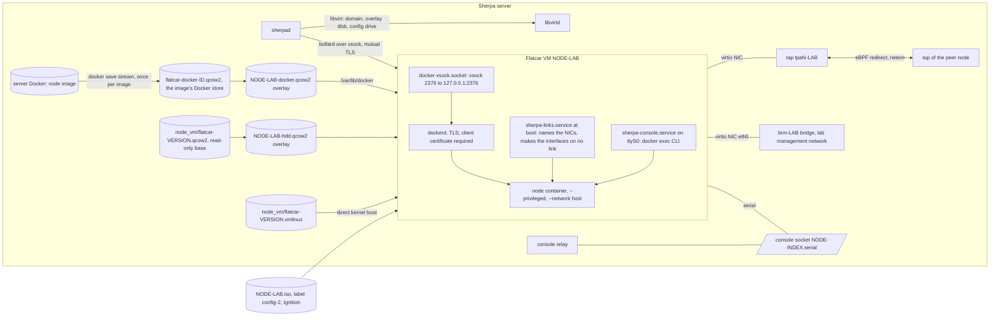

# Node VMs

The container models that need root-like privileges to boot, `arista_ceos` (`arista_eos`
container), `nokia_srlinux` and the `sonic_linux` container, each run in a Flatcar Container
Linux VM of their own. Inside it, a normal Docker runs the node's image unmodified with
`--privileged` and the settings a container on the server gets, in the VM's network namespace,
so the network OS has the VM's NICs as its own interfaces. A privileged container that escapes
reaches that VM's kernel, not the server's.

`ModelKind::runs_in_node_vm` (`crates/shared/src/data/model_kind.rs`) is the one list of these
models. Every other container model runs on the server's Docker as before.

## Shape

## Base image

- Flatcar stable, the OpenStack image (`flatcar_production_openstack_image.img.bz2`), whose
  Ignition reads its config from a config drive. The QEMU image reads Ignition only from
  `fw_cfg`; booting with Ignition from `fw_cfg` measured the same as the config drive.
- Its kernel, `flatcar_production_image.vmlinuz` of the same release, which node VMs boot
  directly (below).
- The release is pinned in two places that must match: `FLATCAR_NODE_VM_VERSION` in
  `crates/server/src/services/node_vm/mod.rs`, and `NODE_VM_FLATCAR_VERSION` with
  `NODE_VM_FLATCAR_SHA512` and `NODE_VM_KERNEL_SHA512` in the "node VM image" section of
  `scripts/sherpa_install.sh` and `scripts/sherpa_update.sh` (the section is the same in both).
- `ensure_node_vm_image` downloads the compressed image and the kernel from
  `stable.release.flatcar-linux.net` as `sherpa`, checks each against its pinned SHA-512 (the
  values Flatcar publishes in their `.DIGESTS`), and puts them at
  `/opt/sherpa/images/node_vm/flatcar-VERSION.qcow2` and `flatcar-VERSION.vmlinuz`, mode `0644`.
  A file already there is never changed: every node VM disk is an overlay on the image, and every
  node VM boots the kernel. A new release is a new file name, so running node VMs keep theirs.
- The script also loads `vhost_vsock` and adds it to
  `/etc/modules-load.d/sherpa-node-vm.conf`; uninstall removes that file.
- `up` and `redeploy` refuse a lab with a node VM before creating anything when the base image
  or its kernel is missing (`ServiceError::NodeVmBaseImageMissing`).

## Boot

The domain boots the kernel directly (`<os><kernel>`, `<cmdline>`), not through GRUB:

- The command line is the one Flatcar's GRUB builds, with `verity.usrhash` read from the
  kernel's header (64 hex digits at offset 64, where GRUB reads it) and `/usr` on the first
  `/usr` partition, which updates never change.
- It has no `console=`: the kernel's messages never reach the serial console, which is the
  network OS's. Printing them there is slow in a VM, and slower nested.
- `rootflags=rw,noinit_itable`: ext4 does not zero the root filesystem's inode tables in the
  background. Flatcar's ROOT has 1.6 million inodes, and zeroing their tables wrote about 300 MB
  into every node's overlay of the base image.
- `flatcar.first_boot=detected` is on the command line of the first boot, so Ignition runs.
  Once the VM's Docker answers, Ignition has run, and sherpad defines the domain again without it
  (`libvirt::set_node_vm_cmdline`): later boots skip Ignition, as GRUB's would.

## Docker stores

The node's image is not copied into each node VM. Each image has a Docker store: a disk whose
Docker data has the image loaded, which every node VM of the image boots an overlay of.

- **Name.** `flatcar-docker-ID.qcow2` in the storage pool, `ID` the first 16 hex digits of the
  image's ID on the server's Docker. An image imported again under the same name has a new ID,
  so it gets a store of its own.
- **Made** at the first `up` or `redeploy` that needs it (`store::ensure_docker_store`), while
  the node VMs are created. A Flatcar VM `sherpa-flatcar-docker-ID`, with no NICs and no console,
  boots on an overlay of the base image with an empty 32 GiB qcow2 as its second disk. Its
  Ignition formats that disk ext4, labelled `sherpa-docker`, and mounts it at
  `/var/lib/docker`, with Docker on vsock as in a node VM. sherpad streams `docker save` of the
  image into its `docker load` (`container::copy_image_to_node_vm`), shuts it down over ACPI, and
  removes it. The disk is made as `flatcar-docker-ID.qcow2.part`, mode `0644`, and renamed to
  the store once the VM has shut down, so a store that exists is complete. Nodes of one image
  wait for the one VM that makes its store.
- **Used.** A node VM's second disk is `NODE-LAB-docker.qcow2`, a qcow2 overlay on the store.
  Its Ignition mounts it at `/var/lib/docker` before containerd and Docker start, with
  `noinit_itable`, so no node zeroes inode tables into its overlay. The VM's Docker has the image
  when it starts; `start_node_container` still copies it when it is missing.
- **Kept.** Stores belong to no lab: destroy never deletes one (`node_vm_037`).

The alternatives measured, and why they were not taken:

- **A read-only disk shared by every node, with Docker's data on it.** dockerd refuses a
  read-only data root (it changes its mode at start). A data root on an overlayfs of the
  read-only store and a writable layer is refused by the `overlay2` driver ("driver not
  supported"), and dockerd then picks no other driver. With the containerd image store, Docker
  keeps images in the system containerd's root, which must be writable and is under the same
  overlay limit. Docker has no additional read-only image stores; those are a
  `containers/storage` feature of Podman and CRI-O, which Flatcar does not ship. Binding the
  store's layer folders read-only into a writable data root depends on Docker's private layout;
  it did not run and was not pursued. A qcow2 backing file shares the store at the block layer
  instead: the node's Docker sees a writable disk, and the server's disk holds the store once.
- **The image baked into the base image, one disk.** A Flatcar VM boots an overlay of the base
  image, loads the image into `/var/lib/docker` on its root filesystem, stages
  `flatcar-reset --keep-paths /var/lib/docker /var/lib/containerd` so the next boot is a first
  boot again, and the disk is flattened to stand alone; each node boots one overlay of it.
  Without the reset, a node's Ignition writes its files but enables none of its units (presets
  apply only on a first boot), so the NICs are not named and the console never runs. Measured with the
  test lab, three runs each: lab up 134 to 144 s against 138 to 139 s, Docker answering 2 to
  3 s sooner, the same memory, about 70 MiB per node against 50 MiB once the root filesystem
  skips its inode table zeroing (see Boot), and 2.6 to 4.3 GB per image on the server against
  the store's 1.9 to 3.6 GB, as every baked disk holds its own Flatcar. It also needs the
  flattening copy and a new bake of every image for each Flatcar release.
- **Starting the container from a systemd unit at boot, not over the API.** The API calls after
  Docker answers take about 2 s (create, file upload, start); the unit would save at most that,
  and would need the container's settings and files in Ignition.
- **Restoring a saved VM state.** A restore answered in under 5 s, against about 40 s for a boot,
  but the state file is the VM's memory (0.95 GB for an idle 2 GiB VM), and a restored VM keeps the
  saved one's NIC MACs, vsock ID and Docker certificates, which are per node.

## Per node

| What | Where | Removed by |
|---|---|---|
| Domain `NODE-LAB` | libvirt, persistent | destroy (lab suffix), redeploy, rollback |
| Disk, a qcow2 overlay on the base image | storage pool, `NODE-LAB-hdd.qcow2` | destroy (lab volume suffix), redeploy |
| Docker disk, a qcow2 overlay on the image's Docker store | storage pool, `NODE-LAB-docker.qcow2` | destroy (lab volume suffix), redeploy |
| Config drive, ISO 9660 labelled `config-2` holding `openstack/latest/user_data` | storage pool, `NODE-LAB.iso` | destroy, redeploy |
| sherpad's CA, client certificate and key for the VM's Docker, `0600` | `LAB_DIR/NODE/node-vm/` | destroy (lab folder), redeploy |

The two overlays hold everything the node writes, including the network OS's saved config, so a
saved config survives `down` and `resume`. Redeploy and destroy delete them.

The domain (`crates/libvirt/src/node_vm.rs`, XML written with `quick-xml`) is q35 with
`host-passthrough` CPU, no video and no balloon: the base image's kernel and its command line,
the two overlay disks on virtio, the config drive on SATA, the management NIC on the lab's
libvirt management network, one virtio NIC per data interface on a link or bridge whose tap is
named like the node's link end, a vsock device with a context ID libvirt picks, a virtio RNG,
and the serial console on the node's console socket. A balloon with free page reporting was
measured and gave nothing: without an image load, a node VM never fills its memory.

## First boot

Ignition runs once, on the first boot of a disk (see Boot). Its JSON is generated at run time from
`template::IgnitionConfig` (`crates/server/src/services/node_vm/ignition.rs`); none is checked
in. It sets:

- Updates and reboots off: `/etc/flatcar/update.conf` (`SERVER=disabled`, `REBOOT_STRATEGY=off`),
  and `update-engine` and `locksmithd` masked.
- No login: no users, `sshd` and its vsock socket masked, the serial getty masked. The OpenStack metadata units of the
  image are masked: the VM has no network of its own.
- No rebuilds of the library cache and the hardware database: `ldconfig.service` and
  `systemd-hwdb-update.service` are masked. Both run on every boot of a node VM and hold up
  Docker (see Boot time). Flatcar's default confext ships the `/etc/ld.so.cache` that
  `ldconfig` would write, and udev needs no hardware database for the VM's virtio devices.
- Networking: none of the VM's own. `systemd-networkd`, its socket and its varlink sockets are
  masked, so nothing in the VM addresses, raises or renames an interface after
  `sherpa-links.service` (see Links): the network OS owns every interface.
- Docker: its data on the Docker disk (see Docker stores); it listens on `127.0.0.1:2376` with `--tlsverify`, its server certificate and the VM's CA,
  besides its local socket, with no default bridge and no iptables rules (`--iptables=false
  --ip6tables=false`): the container publishes no ports. containerd runs with
  `/etc/containerd/config.toml` (`crates/server/src/services/node_vm/containerd.toml`, set by a
  drop-in's `CONTAINERD_CONFIG`): Flatcar's settings with the CRI plugins and NRI disabled,
  which Docker does not use and whose start held up containerd's. `docker-vsock.socket` listens
  on vsock port 2376 and hands each connection to `systemd-socket-proxyd`, which connects it to
  that listener.
- The interface naming (see Links) and the console, as scripts in `/opt/sherpa` with their
  units.

## Boot time

From `virsh start` to the VM's Docker answering over vsock, one SONiC node VM alone, nested,
median of three first boots: 34.8 s. The phases, on the kernel's clock:

| Phase | Ends at | Takes |
|---|--:|--:|
| Kernel, to `/init` | 3.9 s | 3.9 s |
| initrd modules, to the initrd's systemd | 7.0 s | 3.1 s |
| initrd: devices, Ignition, root setup, to the switch to the root | 16.1 s | 9.1 s |
| Root: systemd and SELinux policy, udev, local file systems, confext and sysext (Docker and containerd are sysexts) | 23.0 s | 6.9 s |
| containerd, to ready | 24.9 s | 1.9 s |
| dockerd, to its API | 28.8 s | 3.9 s |

The other 6 s are before the kernel's clock starts (libvirt starting QEMU, the firmware, loading
and unpacking the kernel) and the first answer over vsock. The vsock socket listens from about
23 s and holds each connection until dockerd is ready, so
sherpad's next check after that answers as soon as Docker does; a shorter poll than its 2 s
gains nothing.

Measured one at a time against that boot, and not taken, as none moved it beyond the 0.6 s
noise between boots: `cryptomgr.notests` (the kernel's slowest initcall, `crypto_kdf108_init`,
1.7 s, is a self-test), loading `sha256_ssse3` before dm-verity in the initrd (`/usr` is
verified with `sha256-generic`), no USB controller, Ignition by `fw_cfg` with
`flatcar.oem.id=qemu` and no config drive, qboot instead of SeaBIOS, masking the config drive's
mount, and masking units that are off the critical path (`sshd-keygen`, `nvidia`, `motdgen`,
`systemd-timesyncd`). Docker socket activation was not tried: dockerd waits for containerd
either way, and sherpad is the only client.

## Docker's API: vsock with mutual TLS

sherpad reaches each VM's Docker over vsock with mutual TLS. The other candidates:

- **TLS over TCP on the management network.** The VM's one management address is the network
  OS's, which its config sets, or not, and which is not there until the network OS has booted.
  An address of the VM's own would need a spare one: a lab's management `/24` gives every host
  offset from 21 to 254 to a node index, so there is none without shrinking the largest lab or
  adding a second network with its own addressing.
- **SSH.** bollard's SSH transport needs the `openssh` crate, which is not in `Cargo.lock`, and it
  still needs an address to reach.
- **vsock.** It needs no address and no network: only the host reaches a guest's vsock, and
  guests cannot reach each other's. Any process on the host can connect to any guest's context
  ID, though, so vsock alone is not authenticated. Mutual TLS on top closes that.

Each VM gets a CA of its own (`NodeVmCerts::issue`). It signs the VM's server certificate, whose
name is the domain name, and sherpad's client certificate; its key is dropped once both are
issued. dockerd accepts only a client certificate of that CA, and sherpad trusts only that CA
for the VM. The certificates are valid for ten years; there is no renewal.

The client is `container::node_vm_docker` (`crates/container/src/node_vm/transport.rs`), a bollard
custom transport. Each request opens its own connection: a non-blocking `AF_VSOCK` socket from
`nix`, polled by tokio's `AsyncFd`, wrapped in `tokio-rustls` with the aws-lc-rs provider, and an
HTTP/1 connection from `hyper` kept for upgrades. The context ID is read from the running
domain's XML each time a client is made, so it can change across restarts.

## Links

Each data interface of the node on a link or bridge is a virtio NIC whose host side is a tap
named like the node's link end (the name a container's host veth has). Its other data interfaces
are made in the VM: each NIC adds a PCIe device that QEMU starts and the kernel probes, which
cost a 52-interface cEOS about 30 s of boot (nested). libvirt makes the taps when it starts the
domain, so a node VM's links are attached in phase 11b with the VMs' (`attach_vm_links`), and
re-attached after a cold boot or a redeploy as a domain's are (`RecreatedEnd::Domain`). The eBPF
redirect, netem impairment and carrier handling are those of every P2p link
([P2P-ARCHITECTURE.md](P2P-ARCHITECTURE.md)). A node on no link gets no data NICs, as a
container on the server gets no veths.

The container runs with Docker's host network mode: its network namespace is the VM's, so the
VM's NICs are the network OS's interfaces, with the names and MACs it expects. On every boot,
before Docker starts, `sherpa-links.service` runs `links.sh` once:

- It names each NIC, found by its MAC in `/etc/sherpa/interfaces`: the management NIC `eth0`,
  each data NIC as the network OS expects (`eth1`, `e1-1`, ...). Each goes through a temporary
  name first, so no NIC takes a name another still has. It flushes any address the initrd left,
  and sets the NIC up; the network OS owns it from then on.
- For each data interface on no link, listed in `/etc/sherpa/placeholders` with a MAC sherpad
  picked, it makes a veth with that MAC under the interface's name, whose peer is down in the
  namespace `sherpa-unwired`, so the network OS sees only its own interfaces, and each of these
  is there without carrier, as a disabled interface of a container on the server is. A PCIe NIC
  per interface would cost the boot time above; the veth costs none.

Every MAC is fixed per node: cEOS makes new SSH host keys when its interfaces' MACs change. The
interfaces live as long as the VM, so a restart of the container in the VM finds them as it left
them, and so do the network OS's own (cEOS's `cpu` and `fabric`, SR Linux's `mgmt0` and its
namespaces, SONiC's `Ethernet` taps).

## Management

The management NIC is `eth0` on the lab's libvirt management network, with a MAC fixed per node.
The network OS sets its addresses itself, as Docker does not: cEOS from `Management0` in its
startup config, SR Linux on `mgmt0.0` in its `mgmt` network instance, and the SONiC container's
start script (`sonic/container_init.jinja`) on `eth0`, with the default routes, at every start.
Each uses the node's IPv4 address and, when the lab has IPv6, the IPv6 address recorded for the
node. The VM has no address on the network.

The VM has no resolver, so Docker gives the container the lab's name servers and domain
(`--dns`, `--dns-search`), and the node's hostname resolves to `127.0.1.1` (`--add-host`).

## Console

The serial console is on the node's console socket, which the console relay serves as for any
VM, so `sherpa console` works for these nodes; their VNC console is refused. `sherpa-console`
runs `console.sh` on `ttyS0`: it waits for Enter, so the CLI starts with someone at the console,
gives the line a size, and runs `docker exec -it` of the model's CLI in the container (`Cli`,
`sr_cli`, `bash` for SONiC). systemd starts it again when the CLI exits.

## Lifecycle

- **Up.** Phase 11 creates each node VM, in parallel with the other VMs
  (`create_node_vms`): the image's Docker store when there is none, certificates, config drive,
  the two overlay disks, domain. Readiness (phase 13) starts each node's container in the
  background (`start_node_container`): wait for the VM's Docker, drop `flatcar.first_boot` from
  the domain, create the container with Docker's `unless-stopped` restart policy, copy the node's files from its volumes into it, and start it.
  The node is ready once SSH answers on its management address (`ModelKind::ready_port`).
- **Status, down, resume, scanner, console.** `NodeConfig::runtime_kind` is `VirtualMachine` for
  these nodes, so they follow the VM paths: `down` shuts the domain down over ACPI, which stops
  Docker and the container cleanly; `resume` starts the domain, Docker starts the container
  again on its interfaces, and the links are re-attached.
- **Redeploy.** Removes the VM, its two disks, its config drive and its certificates, and the server
  container of the same name if one is left, then creates the VM again
  (`redeploy_node_vm`).
- **Destroy and rollback.** The domain and its volumes go with the lab's other domains and
  volumes, by the lab's name suffix; the certificates go with the lab folder. A failure while
  creating a node VM removes what that node had.
- **sherpad restart.** The VMs are libvirt's; a restart of sherpad leaves them running.

## Resources

A node VM gets the manifest's or the image's `memory` with 1024 MiB on top, and the manifest's or
image's `cpu.count` (`planned_resources`); admission counts that. In the VM the container has no
limits: the VM is its limit.

Measured in a nested guest, lab up with the three models and an Alpine VM, Docker stores made,
mean of three ups, a minute after ready:

| Node | VM memory | QEMU PSS on the host | Used in the VM | Page cache in the VM | Disks on the server | Domain start to SSH-ready | runc: container start to SSH |
|---|---|---|---|---|---|---|---|
| cEOS | 5120 MiB | 2947 MiB | 1547 MiB | 1374 MiB | 51 MiB | 120 to 123 s | 71 s |
| SR Linux | 5120 MiB | 3726 MiB | 1952 MiB | 1641 MiB | 37 MiB | 91 to 93 s | not reached |
| SONiC | 2048 MiB | 1457 MiB | 772 MiB | 631 MiB | 44 MiB | 93 to 104 s | 65 s |

The whole lab is up in 129 to 140 s, which is cEOS's own boot. A node VM's time to ready is 37
to 40 s from domain start to its Docker answering (see Boot time), under 2 s to create and start
its container, and then the network OS's own boot. SR Linux answers SSH once it has set its
management address, about 50 s after its container starts. The first up with an image adds
making its store: about 120 s for one, about 140 s with the three made at once. A store takes
1.8 to 3.6 GB once on the server; each node's disks hold only what it writes, 11 MiB of it on
its overlay of the base image.

## Limits

- A shared bridge (`[[bridges]]` with Docker networks) does not reach a node VM's container.
- Writes to a read-write volume stay in the container: they never reach the server's file, and a
  changed source on the server is not read again until a redeploy.
- Secret files are copied into the container, on the node's disk, not mounted from RAM.
- The config drive, with the VM's server key, stays in the storage pool until destroy or
  redeploy.
- The management address is the network OS's: a cEOS or SR Linux node whose own config (`ztp`
  off, or a custom config) has no management address has none.
- The network OS shares the VM's loopback with Docker's TLS listener, `127.0.0.1:2376`. A client
  there still needs a certificate of the VM's CA; the network OS is privileged in the VM anyway.
- `frr_linux` and the `juniper_evolved` container still run privileged on the server.
- A Docker store stays in the storage pool when its image is deleted or imported again; nothing
  removes stores yet.
