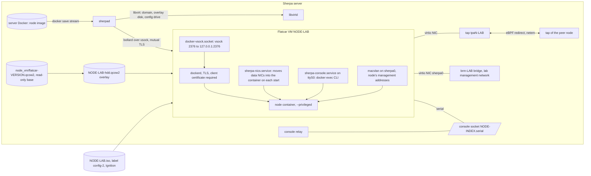

# Node VMs

The container models that need root-like privileges to boot, `arista_ceos` (`arista_eos`
container), `nokia_srlinux` and the `sonic_linux` container, each run in a Flatcar Container
Linux VM of their own. Inside it, a normal Docker runs the node's image unmodified with
`--privileged` and the settings a container on the server gets. A privileged container that
escapes reaches that VM's kernel, not the server's.

`ModelKind::runs_in_node_vm` (`crates/shared/src/data/model_kind.rs`) is the one list of these
models. Every other container model runs on the server's Docker as before.

## Shape

## Base image

- Flatcar stable, the OpenStack image (`flatcar_production_openstack_image.img.bz2`), whose
  Ignition reads its config from a config drive. The QEMU image reads Ignition only from
  `fw_cfg`.
- The release is pinned in two places that must match: `FLATCAR_NODE_VM_VERSION` in
  `crates/server/src/services/node_vm/mod.rs`, and `NODE_VM_FLATCAR_VERSION` with
  `NODE_VM_FLATCAR_SHA512` in the "node VM image" section of `scripts/sherpa_install.sh` and
  `scripts/sherpa_update.sh` (the section is the same in both).
- `ensure_node_vm_image` downloads the compressed image from `stable.release.flatcar-linux.net`
  as `sherpa`, checks it against the pinned SHA-512 (the value Flatcar publishes in the image's
  `.DIGESTS`), and unpacks it to `/opt/sherpa/images/node_vm/flatcar-VERSION.qcow2`, mode `0644`.
  An image already there is never changed: every node VM disk is an overlay on it. A new
  release is a new file name, so running node VMs keep theirs.
- The script also loads `vhost_vsock` and adds it to
  `/etc/modules-load.d/sherpa-node-vm.conf`; uninstall removes that file.
- `up` and `redeploy` refuse a lab with a node VM before creating anything when the base image
  is missing (`ServiceError::NodeVmBaseImageMissing`).

## Per node

| What | Where | Removed by |
|---|---|---|
| Domain `NODE-LAB` | libvirt, persistent | destroy (lab suffix), redeploy, rollback |
| Disk, a 24 GiB qcow2 overlay on the base image | storage pool, `NODE-LAB-hdd.qcow2` | destroy (lab volume suffix), redeploy |
| Config drive, ISO 9660 labelled `config-2` holding `openstack/latest/user_data` | storage pool, `NODE-LAB.iso` | destroy, redeploy |
| sherpad's CA, client certificate and key for the VM's Docker, `0600` | `LAB_DIR/NODE/node-vm/` | destroy (lab folder), redeploy |

The disk holds everything the node writes, including the image Docker loaded and the network
OS's saved config, so a saved config survives `down` and `resume`. Redeploy and destroy delete
it.

The domain (`crates/libvirt/src/node_vm.rs`, XML written with `quick-xml`) is q35 with
`host-passthrough` CPU, no video and no balloon: the overlay disk on virtio, the config drive on
SATA, the management NIC on the lab's libvirt management network, one virtio NIC per data
interface whose tap is named like the node's link end, a vsock device with a context ID libvirt
picks, a virtio RNG, and the serial console on the node's console socket.

## First boot

Ignition runs once, on the first boot of a disk. Its JSON is generated at run time from
`template::IgnitionConfig` (`crates/server/src/services/node_vm/ignition.rs`); none is checked
in. It sets:

- Updates and reboots off: `/etc/flatcar/update.conf` (`SERVER=disabled`, `REBOOT_STRATEGY=off`),
  and `update-engine` and `locksmithd` masked.
- No login: no users, `sshd` masked, the serial getty masked. The OpenStack metadata units of the
  image are masked: the VM has no network of its own.
- Networking: the management NIC is renamed `sherpa0` by MAC and kept up with no address; every
  other NIC is unmanaged.
- Docker: listens on `127.0.0.1:2376` with `--tlsverify`, its server certificate and the VM's CA,
  besides its local socket, with no default bridge. `docker-vsock.socket` listens on vsock port
  2376 and hands each connection to `systemd-socket-proxyd`, which connects it to that listener.
- The NIC mover, the console, and for SR Linux the start step (below), as scripts in
  `/opt/sherpa` with their units.

## Docker's API: vsock with mutual TLS

sherpad reaches each VM's Docker over vsock with mutual TLS. The other candidates:

- **TLS over TCP on the management network.** The VM would need a management address of its own
  besides its container's. A lab's management `/24` gives every host offset from 21 to 254 to a
  node index, so there is no spare address without shrinking the largest lab or adding a second
  network with its own addressing.
- **SSH.** bollard's SSH transport needs the `openssh` crate, which is not in `Cargo.lock`, and it
  still needs an address to reach.
- **vsock.** It needs no address and no network: only the host reaches a guest's vsock, and
  guests cannot reach each other's. Any process on the host can connect to any guest's context
  ID, though, so vsock alone is not authenticated. Mutual TLS on top closes that.

Each VM gets a CA of its own (`NodeVmCerts::issue`). It signs the VM's server certificate, whose
name is the domain name, and sherpad's client certificate; its key is dropped once both are
issued. dockerd accepts only a client certificate of that CA, and sherpad trusts only that CA
for the VM. The certificates are valid for ten years; there is no renewal.

The client is `container::node_vm_docker` (`crates/container/src/node_vm/transport.rs`), a bollard
custom transport. Each request opens its own connection: a non-blocking `AF_VSOCK` socket from
`nix`, polled by tokio's `AsyncFd`, wrapped in `tokio-rustls` with the aws-lc-rs provider, and an
HTTP/1 connection from `hyper` kept for upgrades. The context ID is read from the running
domain's XML each time a client is made, so it can change across restarts.

## Images into the VM

`container::copy_image_to_node_vm` streams `docker save` of the server's image into the VM's
`docker load`, unless the VM has the image already. It is copied once per disk: at `up` and at
`redeploy`, never at `resume`.

| Image | Size on the server | `docker save` stream | Copy time (nested guest, three at once) |
|---|---|---|---|
| `localrepo/arista_eos:4.35.1F` | 3.5 GB | 0.89 GB | 143 s |
| `ghcr.io/nokia/srlinux:26.7.2` | 3.2 GB | 0.75 GB | 133 s |
| `docker-sonic-vs:202511` | 1.8 GB | 0.85 GB | 76 s |

The other candidates:

- **A local registry on the server.** A new service to install, secure and keep, every image
  pushed into it (a second copy on the server, compressed on the way), and the VMs would need an
  address to pull from.
- **A shared read-only disk.** Docker cannot run from a read-only image store, so each VM would
  still load the image onto its own disk; the shared disk would save only the stream, and it needs
  a builder.

`docker load` over the API needs nothing new on the server, uses the authenticated channel the
VM already has, and its cost is the copy each node's disk holds.

## Links

Each data interface of the node is a virtio NIC whose host side is a tap named like the node's
link end (the name a container's host veth has). libvirt makes the taps when it starts the
domain, so a node VM's links are attached in phase 11b with the VMs' (`attach_vm_links`), and
re-attached after a cold boot or a redeploy as a domain's are (`RecreatedEnd::Domain`). The eBPF
redirect, netem impairment and carrier handling are those of every P2p link
([P2P-ARCHITECTURE.md](P2P-ARCHITECTURE.md)). A node on no link gets no data NICs, as a
container on the server gets no veths.

In the VM, `sherpa-nics.service` runs `move-nics.sh`: at start and on every `start` event of the
node's container, it renames each data NIC, found by its MAC in `/etc/sherpa/interfaces`, to a
temporary name, moves it into the container's network namespace and names it as the network OS
expects (`eth1`, `e1-1`, ...). When the container's namespace goes, the kernel hands its NICs back
to the VM, and the next start moves them again. The script then runs `/opt/sherpa/on-start` when
the model has one: SR Linux's flushes Docker's copy of the management address once SR Linux has
moved management into its own namespace, which Docker sets again at every start.

## Management

The VM's Docker has a macvlan network on `sherpa0` named like the lab's management network, with
the lab's subnets. The container gets the node's IPv4 address and, when the lab has IPv6, the
IPv6 address recorded for the node: the VM's Docker knows none of the lab's other addresses, so
an address it picked could be the router's. The container's management MAC is random per
creation.

## Console

The serial console is on the node's console socket, which the console relay serves as for any
VM, so `sherpa console` works for these nodes; their VNC console is refused. `sherpa-console`
runs `console.sh` on `ttyS0`: it waits for Enter, so the CLI starts with someone at the console,
gives the line a size, and runs `docker exec -it` of the model's CLI in the container (`Cli`,
`sr_cli`, `bash` for SONiC). systemd starts it again when the CLI exits.

## Lifecycle

- **Up.** Phase 11 creates each node VM, in parallel with the other VMs
  (`create_node_vms`): certificates, config drive, overlay disk, domain. Readiness (phase 13)
  starts each node's container in the background (`start_node_container`): wait for the VM's
  Docker, copy the image, make the management network, create the container with Docker's
  `unless-stopped` restart policy, copy the node's files from its volumes into it, and start it.
  The node is ready once SSH answers on its management address (`ModelKind::ready_port`).
- **Status, down, resume, scanner, console.** `NodeConfig::runtime_kind` is `VirtualMachine` for
  these nodes, so they follow the VM paths: `down` shuts the domain down over ACPI, which stops
  Docker and the container cleanly; `resume` starts the domain, Docker starts the container
  again, the mover moves its NICs, and the links are re-attached.
- **Redeploy.** Removes the VM, its disk, its config drive and its certificates, and the server
  container of the same name if one is left, then creates the VM again
  (`redeploy_node_vm`).
- **Destroy and rollback.** The domain and its volumes go with the lab's other domains and
  volumes, by the lab's name suffix; the certificates go with the lab folder. A failure while
  creating a node VM removes what that node had.
- **sherpad restart.** The VMs are libvirt's; a restart of sherpad leaves them running.

## Resources

A node VM gets the manifest's or the image's `memory` with 1024 MiB on top, and the manifest's or
image's `cpu.count` (`planned_resources`); admission counts that. In the VM the container has no
limits: the VM is its limit.

Measured in a nested guest, lab up with the three models and an Alpine VM:

| Node | VM memory | QEMU PSS on the host | Used in the VM | Container | On runc (cgroup) | Domain start to SSH-ready | runc: container start to SSH |
|---|---|---|---|---|---|---|---|
| cEOS | 5120 MiB | 5163 MiB | 1711 MiB | 1112 MiB | 1768 MiB | 343 s | 71 s |
| SR Linux | 5120 MiB | 5188 MiB | 2171 MiB | 1617 MiB | 2448 MiB | 248 s | not reached |
| SONiC | 2048 MiB | 2115 MiB | 875 MiB | 241 MiB | 259 MiB | 232 s | 65 s |

The VM's page cache fills its memory while the image loads, so on the host a node VM holds all
the memory it was given. The time to ready is the VM's boot (about 95 to 125 s here, three at
once), the image copy, and the network OS's own boot.

## Limits

- A shared bridge (`[[bridges]]` with Docker networks) does not reach a node VM's container.
- Writes to a read-write volume stay in the container: they never reach the server's file, and a
  changed source on the server is not read again until a redeploy.
- Secret files are copied into the container, on the node's disk, not mounted from RAM.
- The config drive, with the VM's server key, stays in the storage pool until destroy or
  redeploy.
- `frr_linux` and the `juniper_evolved` container still run privileged on the server.
