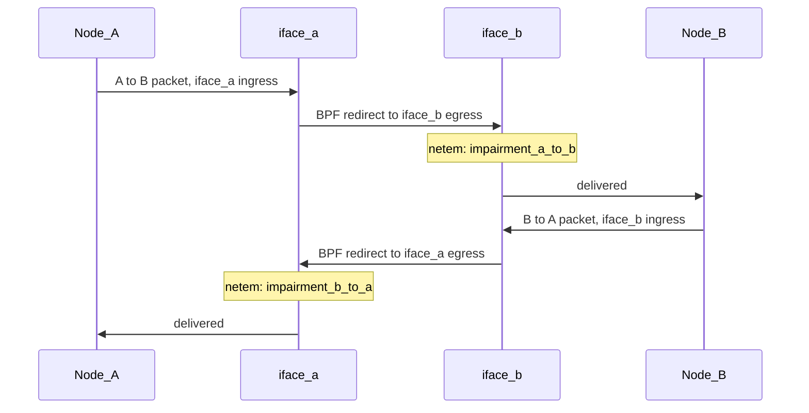
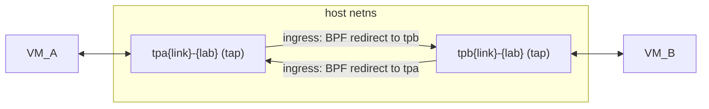
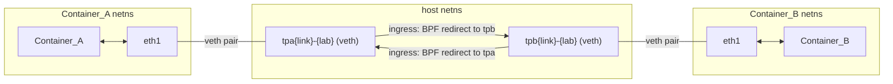
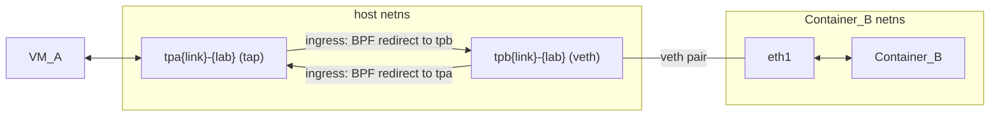

# P2p Link Architecture

P2p (point-to-point) links provide protocol-transparent connections between nodes using eBPF TC
classifier programs. Every `[[links]]` link is a P2p link. They pass all L2 protocols, including
STP, LLDP, LACP, pause frames and anything else a Linux bridge would filter or never forward.

Links used to have a `p2p` setting, and a link without it was joined through two Linux bridges
and a veth pair. The setting is now rejected by `topology::validate::check_no_p2p_field`, and
nothing creates or handles bridge links any more. Labs that still have them must be destroyed
before upgrading. UDP tunnels for VMs and direct veths for containers were planned once and
never built; their leftovers are gone.

## How It Works

Each link endpoint has a host-side network interface (tap for VMs, veth for containers). An eBPF TC classifier program attached to each interface's ingress redirects all packets to the peer interface's egress. No bridges or intermediate devices are involved.

### eBPF Redirect Program

A single TC classifier BPF program is shared across all P2p links. For each interface:

1. A `clsact` qdisc is added to the interface
2. The BPF program is attached to the ingress hook
3. A BPF HashMap stores the peer's ifindex (key=0, value=peer_ifindex)
4. On every ingress packet, the program calls `bpf_redirect(peer_ifindex, 0)` to send the packet to the peer's egress

Each TC attachment is taken out of its aya program and forgotten, because aya detaches the links a program holds when it is dropped. The rest of the aya object is dropped, closing sherpad's file descriptors for the program and its map: the TC filter holds the program and the program its map, so both stay in the kernel. They are removed when the interfaces are deleted during lab destroy. Leaking the whole object instead kept two descriptors open in sherpad per attach, and the programs alive until sherpad restarted.

`network::attach_p2p_redirect` attaches the program as a legacy netlink TC filter
(`TcAttachOptions::Netlink`), never through TCX, which aya chooses by default on kernels 6.6 and
later. Two things depend on this:

- **Restarts.** A TC filter holds its own kernel reference to the program. A TCX link lasts only
  while its file descriptor is open, and that descriptor lives in `sherpad`, so a restart would
  drop every redirect.
- **Re-attach.** Redeploy and resume re-attach the surviving end of a link to the new peer. The
  function first removes the old filter with `qdisc_detach_program`, which only sees TC filters.
  A TCX program would stay in front of the new one and keep redirecting to the deleted peer.

### Re-attaching after an end is made again

A VM or unikernel cold boot gives the node new taps, a container started from exited gets a new
network namespace with none of its veths, and a redeploy makes the node's ends again. Each new
end has a new ifindex, so the peer's redirect is stale. All of these go through one function,
`services::p2p_links::reattach_node_links`, which works from the database rows:

1. For a container, it makes every data interface's veth in the new namespace first: links,
   bridge members (joined to their bridge) and disabled interfaces, planned as redeploy plans
   them.
2. For each of the node's links, on its own, it looks up both ends. Both present: each end's
   redirect is pointed at the other, and each direction's impairment is synced from the
   database. The peer's end absent: the link is left `PeerDown`, and the peer's own re-attach,
   when it starts, sets both directions. Anything else: `Failed`, with the reason.
3. The carrier of each link's ends is set to follow its state (see
   [Carrier propagation](#carrier-propagation)), and the per-link states go back to the user
   with the resume or redeploy result, and are kept for `sherpa inspect`. None of them fails
   the node.

Ends made again outside Sherpa are repaired by the scanner through the same function; see
[Repair by the scanner](#repair-by-the-scanner).

Re-attach cannot tell a paused peer from a running one: a paused node keeps its ends. And
unpausing a node makes no end again, so nothing is re-attached. So after re-attaching, resume
and redeploy also decide the links of the nodes they started as the scanner would
(`p2p_links::follow_started_links`; see [Carrier propagation](#carrier-propagation)).

The states and the transition are described in
[`STATE_MACHINES.md`, section 25](STATE_MACHINES.md#25-p2p-link-attachment).

### Link Impairment (TC netem)

Each interface supports two coexisting TC layers:

- **clsact qdisc** — ingress hook for the BPF redirect program
- **root netem qdisc** — egress hook for delay/loss/jitter simulation

netem on iface_a's egress controls B->A impairment. netem on iface_b's egress controls A->B
impairment. Each direction is stored on the link record (`impairment_a_to_b`,
`impairment_b_to_a`, where A is the manifest's `src`) and is set on its own by the impairment
API (`services::impairment`, `direction` in the request). `up` stores the manifest's
`[links.impairment]` in both; resume and redeploy sync each direction from the database with
`network::sync_netem`, which applies a set direction and removes any netem qdisc from a clear
one. `network::remove_netem` reports `NothingToRemove` only when the interface has no netem
qdisc of Sherpa's, found by listing its qdiscs; any other failure is an error, so a direction is
never recorded clear while the kernel keeps its qdisc.

`network::tc::apply_netem` sends a `tc_netem_qopt` (delay, jitter, loss, and a gap of 1 when
reordering) followed by `TCA_NETEM_REORDER` and `TCA_NETEM_CORRUPT` attributes: reordering and
corruption have no field in `tc_netem_qopt`.

## VM-to-VM

### Setup

1. The libvirt domain template uses `<interface type='ethernet'>` with a `<target dev='tap_name'/>` directive. This tells libvirt/QEMU to use a pre-named tap device instead of connecting to a bridge. It also sets `<mtu size='9600'/>` (`konst::MTU_JUMBO_NET`), as the container veths have: libvirt sets the tap's MTU and gives virtio guests the host MTU. A redirect to egress does not check the target's MTU, so jumbo frames passed before, but the tap reported 1500.
2. Libvirt creates the tap device when the VM starts.
3. After VM creation (Phase 11b), the eBPF redirect program is attached to each tap's ingress, wiring tap_a -> tap_b and tap_b -> tap_a.

### Teardown

Deleting the tap devices (via libvirt domain undefine/destroy) automatically detaches the BPF programs.

### Naming Convention

- Tap devices: `tpa{link_index}-{lab_id}` (side A), `tpb{link_index}-{lab_id}` (side B)

## Container-to-Container

### Setup

1. Phase 5 records a veth for each container endpoint, and phase 7 one for each private
   bridge (`[[bridges]]`) member. Nothing is created yet.
2. After the container starts (Phase 13), its PID is obtained via Docker inspect.
3. `network::create_veth_in_netns` creates each veth in one netlink request. The container end is
   the request's own link, created in the container's network namespace (`IFLA_NET_NS_PID`)
   with its final name (e.g. `eth1`, `e1-1`), promiscuous and up. The host end (e.g.
   `tpa0-{lab_id}`) is the veth peer and stays in the host namespace. A veth already named
   like the host end, with its peer in another namespace, is deleted first: the kernel can tear
   a removed container's namespace down minutes after the container, so a redeployed node's
   old veths may still exist. Any other interface of that name fails the request.
4. Disabled (unlinked) interfaces get veths too, but down on both ends and without eBPF, so the
   container sees the interface as "not connected". A bridge member's host end joins the
   bridge's `brs` Linux bridge.
5. The eBPF redirect program is attached to the host end's ingress once both ends of the link
   exist: VM-to-VM links in phase 11b, links with a container end as each container comes up.

Nothing runs inside the container, so this works for images without `ip` or a shell, and needs
only `CAP_NET_ADMIN`. Two kernel details shape the request:

- **Which end is the container's.** The kernel brings a new veth's own end up only after both
  ends are joined; it applies the peer's flags before that, where bringing it up fails with
  `ENOTCONN`. So the container end must be the request's own end, not the peer. An existing
  link in another namespace cannot be brought up from outside it: `IFLA_TARGET_NETNSID` on a
  set-link request means "move it there", not "change it there".
- **The name lookup.** Older kernels, 6.8 among them (7.0 does not), look a new link's name
  up in the caller's namespace first, so a host interface named `eth1` would fail a request for the container's `eth1`
  (`EEXIST` under `NLM_F_EXCL`). The request therefore also sets an interface index, one above
  the host's highest, which the kernel looks up instead. Indexes are per namespace, so one free
  on the host can be taken in the container; the next is tried then.

### Docker Networking Bypass

P2p containers bypass Docker's network stack entirely for data interfaces. Docker only handles the management interface. All data interfaces (both linked and disabled) are created as veth pairs and moved into the container's netns manually. This avoids Docker's ethN naming conflicts that occur when mixing Docker networks with manual netns interface injection.

### Disabled Interface Carrier Removal

Disabled container interfaces are created down on both ends. Since a veth end has carrier only while its peer is up, the container side has no carrier, so the interface appears "not connected" to the container NOS, even if the NOS brings it up itself (cEOS does).

cJunosEvolved waits at boot until every data interface is up, so its disabled interfaces are
created up in the container and down on the host (`network::NetnsVethState::DisabledUp`,
chosen by `node_ops::netns_veth_state`): up, but still with no carrier. Its container ends are
named from `eth4`, since the image creates `eth1` to `eth3` itself
(`util::container_interface_name`).

### Transmit checksum offload

A veth leaves the checksum of a TCP or UDP packet it sends for the "hardware" to fill in. A
kernel stack in the container accepts that; a program that reads the interface through a packet
socket gets the unfinished packet. Cisco IOL reads its interfaces that way (through the bridge
in the docker-cisco-iol image), so its TCP failed while ping worked.

For a model whose `NodeModel::needs_host_checksums` is true (`cisco_iol`, `cisco_ioll2`),
Sherpa turns transmit checksum offload off on the host end of every veth facing the container,
so the kernel finishes the checksum before the veth sends the packet. Segmentation offload goes
off with it. The other end of the link is unchanged: a redirected packet is sent on the IOL
node's host end, whatever it came from.

- P2p, disabled and bridge-member veths: `KernelHost::create_veth`, after the veth is made, so
  `up`, redeploy, cold-boot resume and the scanner's repair all do it.
- The management veth, which Docker makes at every start of the container, with offload on:
  `node_ops::finish_management_checksums` after `up` and redeploy start the container
  (`start_container_node`), after a cold-boot resume, and from the scanner for a container
  started outside Sherpa (see [Repair by the scanner](#repair-by-the-scanner)). Its host end is
  found through the container's network namespace (`network::container_veth_peer_ifindex`). It
  reads the offload first and changes it only when it is on, and logs a change at info.
- Offload is read and changed through the kernel's ethtool netlink family
  (`network::tx_checksum_offload_on`, `network::disable_tx_checksum_offload`), with
  netlink-sys through rtnetlink. Offload counts as on while any of the transmit checksum
  features that `ethtool -K <iface> tx off` turns off is active.

Not covered: an IOL node on a private bridge with no P2p link takes its bridge interfaces as
Docker macvlan interfaces, which have no host end to change.

IOL's MTU is fixed at 1500, while Sherpa's veths are 9600. A Linux node linked to an IOL node
must use MTU 1500 on that interface, or it advertises a larger TCP MSS and its TCP stalls.

### Teardown

Host-side veths are cleaned up during lab destroy by matching the `tpa*`, `tpb*`, `cb*` and `cd*` prefixes via fuzzy interface search. Deleting a host end deletes its container end, and a container's ends go when its namespace does.

### Naming Convention

- Host-side veths (linked): `tpa{link_index}-{lab_id}` / `tpb{link_index}-{lab_id}` (same as VM taps)
- Host-side veths (disabled): `cd{node_index}i{interface_index}-{lab_id}`
- Host-side veths (bridge member): `cb{node_index}i{interface_index}-{lab_id}` (`konst::BRIDGE_MEMBER_HOST_VETH_PREFIX`)
- Container ends are created with their interface name in the container (`eth1`, `e1-1`, ...)

Note: Disabled and bridge member veth names include the node index to avoid collisions when multiple containers share the same disabled interface index. The compact format stays within Linux's 15-character interface name limit.

## VM-to-Container

### Setup

This is a hybrid of the VM-VM and Container-Container flows:

1. The VM side uses a tap device created by libvirt (`<interface type='ethernet'>`).
2. The container side uses a veth pair — host side stays in host namespace, container side is created in the container's netns.
3. The eBPF redirect program wires the VM's tap to the container's host-side veth and vice versa.

The VM's tap and container's host-side veth are both regular kernel network interfaces, so the eBPF redirect works identically regardless of whether the peer is a tap or veth.

### Teardown

Same as above — deleting the interfaces removes the BPF programs.

## Disabled VM Interfaces

VM disabled interfaces use libvirt's isolated network (`<interface type='network'>` with `<link state='down'/>`). After VM creation, the isolated network bridge is set DOWN to remove carrier from all taps connected to it. This ensures disabled VM interfaces show as "not connected" to the VM NOS.

## Packet Capture

Since each endpoint has a standard kernel network interface on the host:

- `tcpdump -i tpa<link>-<lab>` (or `tpb`) captures all traffic to/from a VM endpoint
- the same works on a container end's host veth, which is named the same way
- All L2 protocols are visible — no bridge filtering

## Crash Resilience

If one side of a P2p link stops (VM shut off or crashed, container stopped or killed):

- Its taps or veths are deleted, with their TC filters and programs.
- The surviving side's eBPF program keeps redirecting to the deleted ifindex, and the kernel
  drops those frames. The scanner finds the link `PeerDown` within `scanner.interval_secs` and
  takes the surviving end's carrier down; see [Carrier propagation](#carrier-propagation).
- When the node starts again, its ends have new ifindexes. Started through Sherpa (`resume`,
  `redeploy`), they are re-attached at once. Started outside Sherpa, the scanner repairs them
  within `scanner.interval_secs`; see [Repair by the scanner](#repair-by-the-scanner).
- A reboot from inside a guest, `virsh reboot`, a pause and unpause, and a sherpad restart
  change nothing in the redirects: the same tap and filter stay. A paused node counts as down
  for carrier, so its peer loses carrier while it is paused. A resume that unpauses it gives
  the peer its carrier back at once (see [Carrier propagation](#carrier-propagation)).
- Full cleanup happens during lab destroy.

### Repair by the scanner

A redirect is tied to an ifindex in two places: the filter and its program on the end's own
interface, which die with it, and the peer's ifindex in the *other* end's map, which nothing
updates. So making one end again breaks both directions. The scanner finds such ends from the
kernel alone, with nothing remembered:

- **a running node's end does not exist.** `docker restart`, or `docker stop` then `start`,
  destroys the container's network namespace and every data veth with it (links, bridge
  members, disabled interfaces); the new namespace has only `eth0`.
- **an end exists with no `p2p_redirect` filter, and its peer's end exists.** `virsh destroy`
  then `start`: libvirt makes a new, bare tap. A filter cannot move between interfaces, so a
  new interface never has one. `network::has_p2p_redirect` reads the end's ingress filters
  over netlink.

For each node with such an end, `repair_node` runs `reattach_node_links`. A container's veths
are planned as resume plans them (`p2p_links::recreated_end`), and only those that do not exist
are made, so its working interfaces are not deleted and made again. Then both redirects of
each of the node's links are set again, with their impairments.

Only nodes that are running are checked; a stopped or paused node is left alone and its links
are `PeerDown`. The repair runs under the scanner's hold on the lab, so never beside a resume,
redeploy or `up`. Each link's last state is kept in memory for `sherpa inspect`. The states,
the rule and its limits are in
[`STATE_MACHINES.md`, section 25](STATE_MACHINES.md#25-p2p-link-attachment).

Each scan of a `Ready` lab runs three steps under the lab hold, in this order: the management
veth's checksum offload, then the link check and repair above, then carrier (see
[Carrier propagation](#carrier-propagation)).

For the first, for each running container of a model that needs finished checksums, the
scanner reads transmit checksum offload on the host end of the management veth and turns it off
when it is on (`repair_management_checksums`, through `finish_management_checksums`). A
container started outside Sherpa has a new management veth with offload on, and TCP to its
management address fails until then. This runs for every container node of a `Ready` lab,
whether or not the lab has links, and needs nothing remembered: a veth that is right is only
read. A failure is logged at warn and the other nodes are still checked.

A guest that cached its peer's MAC address keeps sending to the old one after the peer's
container restarted (the new veth has a new MAC), until its neighbour entry is probed again,
which Linux does within seconds.

### Carrier propagation

The carrier of a link's ends follows its state (`p2p_links::carrier`), as a cable's would:

| State | End of the running node | Peer's end |
|---|---|---|
| `Attached` | carrier | carrier |
| `PeerDown` | no carrier | left alone (gone, or its node paused) |
| `Failed` | no carrier | no carrier |

When both nodes are down, `PeerDown` names the first, and the second's end is taken down, so a
node that comes back before its peer has no carrier.

How an end's carrier is set, behind `LinkHost::carrier` and `LinkHost::set_carrier`:

- **Container end:** its host veth is set down (`network::set_link_state`). The container's
  interface goes `NO-CARRIER`, and back to `LOWER_UP` when the host end comes up. The filter
  and the netem qdisc stay. Setting the veth inside the namespace down is not used: it shows as
  admin-down, and the NOS can bring it back up itself.
- **VM or unikernel end:** the interface's link state in the live domain
  (`libvirt::set_interface_link`, as `virsh domif-setlink` does it: the interface's live XML
  with its `<link state>` set, through `Domain::update_device_flags` with
  `VIR_DOMAIN_AFFECT_LIVE`). The tap, its ifindex and its filter are unchanged. A host tap set
  down, or its carrier taken off, is not seen by the guest's virtio-net, so neither is used;
  libvirt's link state is the only thing the guest sees. The persistent definition is not
  changed: a domain started again has its links up, and the re-attach or repair that follows
  sets them again.

  The interface XML is edited as a stream of `quick-xml` events, not through a model of the
  interface: the `<interface>` whose own `<target dev>` is the tap is copied event by event,
  with its own `<link>` replaced, or `<link state>` added before `</interface>` when it has
  none. Every other element, attribute and value passes through with its bytes, so nothing
  libvirt reports that Sherpa does not model is lost; libvirt refuses a live update that
  changes a field it cannot change live. The current state is read from the same events: the
  link is up unless its `<link state>` is `down`. Domain XML that is not well formed is refused.

The eBPF program is not changed. It already drops what it cannot deliver.

**When carrier is set.** Only when a link's state changes, so a user who takes an end down by
hand (`ip link set tpb3-lab down`) to simulate a failure keeps it down while the link's state
stays the same. The change is per end: an end is set when the carrier its link's new state
wants differs from what the last recorded state (`LinkStates`) wants. Two cases set it without
a change:

- **Nothing is recorded for the link.** The in-memory states are empty after sherpad starts.
  The first scan then sets every end to what its link's state wants, which repairs a carrier
  left wrong by a change made while sherpad was down. It cannot tell an end Sherpa took down
  from one a user took down, so it brings a link a user took down while its state is
  `Attached` back up, once.
- **The end was made again** (a cold boot, a container start, a redeploy, or an end the
  scanner found missing or with no filter). A new end starts with carrier, whatever was set on
  the old one: a VM cold-booted while its peer is still down gets its link taken down again.

Each end's carrier is read first, and set only when it differs. So none of these flap an end
that already has the carrier wanted: the first scan after a restart changes nothing on a lab
whose carrier is right. An end that does not exist is left; one whose carrier cannot be read
or set is logged, and is not retried until the link's state changes again.

Where the states come from:

- **The scanner:** every link of a `Ready` lab, after its repair.
- **Resume and redeploy:** first the re-attach of the nodes whose ends were made again
  (`report_links`). Then, for every node they booted or unpaused, the scanner's own check
  (`check_lab_links`, with the nodes libvirt and Docker report running), which decides those
  nodes' links. Each end's carrier follows the change from the recorded state, and the new
  state is recorded (`follow_started_links`). So the peers of a container unpaused by
  `sherpa resume` get their carrier back when the command returns. A node booted beside a
  paused peer has its link taken down at once. The next scan finds the same states and changes
  nothing. A link this check finds `Failed` is not recorded: the scan repairs what it can
  first. When libvirt or Docker does not answer, nothing is decided here, as every node of
  that runtime would look down.

A paused node is not running to the scanner. `docker pause` and `sherpa down` (which pauses
containers and shuts VMs off) are not followed by a check, so their peers lose carrier at the
next scan, within one scan interval. With `scanner.enabled = false`, only resume and redeploy
set carrier.
