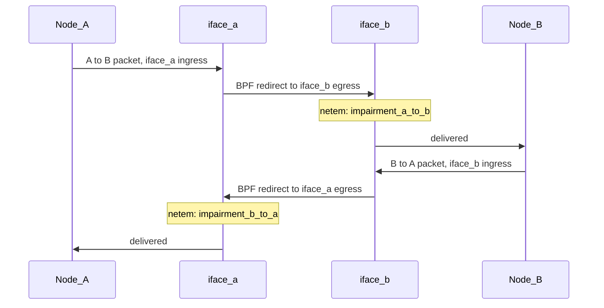
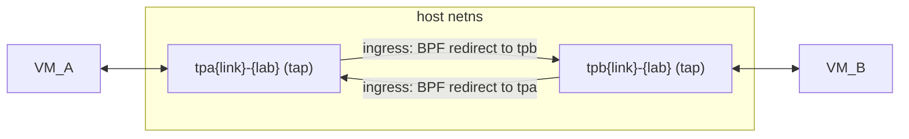
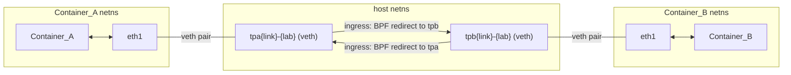
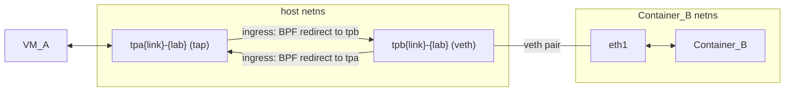

# P2p Link Architecture

P2p (point-to-point) links provide protocol-transparent connections between nodes using eBPF TC
classifier programs. Every `[[links]]` link is a P2p link. They pass all L2 protocols, including
STP, LLDP, LACP, pause frames and anything else a Linux bridge would filter or never forward.

Links used to have a `p2p` setting, and a link without it was joined through two Linux bridges
and a veth pair. The setting is now rejected by `topology::validate::check_no_p2p_field`, and
nothing creates or handles bridge links any more. Labs that still have them must be destroyed
before upgrading. UDP tunnels for VMs and direct veths for containers were planned once and
never built; their leftovers are gone.

## How It Works

Each link endpoint has a host-side network interface (tap for VMs, veth for containers). An eBPF TC classifier program attached to each interface's ingress redirects all packets to the peer interface's egress. No bridges or intermediate devices are involved.

### eBPF Redirect Program

A single TC classifier BPF program is shared across all P2p links. For each interface:

1. A `clsact` qdisc is added to the interface
2. The BPF program is attached to the ingress hook
3. A BPF HashMap stores the peer's ifindex (key=0, value=peer_ifindex)
4. On every ingress packet, the program calls `bpf_redirect(peer_ifindex, 0)` to send the packet to the peer's egress

Each TC attachment is taken out of its aya program and forgotten, because aya detaches the links a program holds when it is dropped. The rest of the aya object is dropped, closing sherpad's file descriptors for the program and its map: the TC filter holds the program and the program its map, so both stay in the kernel. They are removed when the interfaces are deleted during lab destroy. Leaking the whole object instead kept two descriptors open in sherpad per attach, and the programs alive until sherpad restarted.

`network::attach_p2p_redirect` attaches the program as a legacy netlink TC filter
(`TcAttachOptions::Netlink`), never through TCX, which aya chooses by default on kernels 6.6 and
later. Two things depend on this:

- **Restarts.** A TC filter holds its own kernel reference to the program. A TCX link lasts only
  while its file descriptor is open, and that descriptor lives in `sherpad`, so a restart would
  drop every redirect.
- **Re-attach.** Redeploy and resume re-attach the surviving end of a link to the new peer. The
  function first removes the old filter with `qdisc_detach_program`, which only sees TC filters.
  A TCX program would stay in front of the new one and keep redirecting to the deleted peer.

### Re-attaching after an end is made again

A VM or unikernel cold boot gives the node new taps, a container started from exited gets a new
network namespace with none of its veths, and a redeploy makes the node's ends again. Each new
end has a new ifindex, so the peer's redirect is stale. All of these go through one function,
`services::p2p_links::reattach_node_links`, which works from the database rows:

1. For a container, it makes every data interface's veth in the new namespace first: links,
   bridge members (joined to their bridge) and disabled interfaces, planned as redeploy plans
   them.
2. For each of the node's links, on its own, it looks up both ends. Both present: each end's
   redirect is pointed at the other, and each direction's impairment is synced from the
   database. The peer's end absent: the link is left `PeerDown`, and the peer's own re-attach,
   when it starts, sets both directions. Anything else: `Failed`, with the reason.
3. The per-link states go back to the user with the resume or redeploy result, and are kept
   for `sherpa inspect`. None of them fails the node.

Ends made again outside Sherpa are repaired by the scanner through the same function; see
[Repair by the scanner](#repair-by-the-scanner).

The states and the transition are described in
[`STATE_MACHINES.md`, section 25](STATE_MACHINES.md#25-p2p-link-attachment).

### Link Impairment (TC netem)

Each interface supports two coexisting TC layers:

- **clsact qdisc** — ingress hook for the BPF redirect program
- **root netem qdisc** — egress hook for delay/loss/jitter simulation

netem on iface_a's egress controls B->A impairment. netem on iface_b's egress controls A->B
impairment. Each direction is stored on the link record (`impairment_a_to_b`,
`impairment_b_to_a`, where A is the manifest's `src`) and is set on its own by the impairment
API (`services::impairment`, `direction` in the request). `up` stores the manifest's
`[links.impairment]` in both; resume and redeploy sync each direction from the database with
`network::sync_netem`, which applies a set direction and removes any netem qdisc from a clear
one. `network::remove_netem` reports `NothingToRemove` only when the interface has no netem
qdisc of Sherpa's, found by listing its qdiscs; any other failure is an error, so a direction is
never recorded clear while the kernel keeps its qdisc.

`network::tc::apply_netem` sends a `tc_netem_qopt` (delay, jitter, loss, and a gap of 1 when
reordering) followed by `TCA_NETEM_REORDER` and `TCA_NETEM_CORRUPT` attributes: reordering and
corruption have no field in `tc_netem_qopt`.

## VM-to-VM

### Setup

1. The libvirt domain template uses `<interface type='ethernet'>` with a `<target dev='tap_name'/>` directive. This tells libvirt/QEMU to use a pre-named tap device instead of connecting to a bridge. It also sets `<mtu size='9600'/>` (`konst::MTU_JUMBO_NET`), as the container veths have: libvirt sets the tap's MTU and gives virtio guests the host MTU. A redirect to egress does not check the target's MTU, so jumbo frames passed before, but the tap reported 1500.
2. Libvirt creates the tap device when the VM starts.
3. After VM creation (Phase 11b), the eBPF redirect program is attached to each tap's ingress, wiring tap_a -> tap_b and tap_b -> tap_a.

### Teardown

Deleting the tap devices (via libvirt domain undefine/destroy) automatically detaches the BPF programs.

### Naming Convention

- Tap devices: `tpa{link_index}-{lab_id}` (side A), `tpb{link_index}-{lab_id}` (side B)

## Container-to-Container

### Setup

1. Phase 5 records a veth for each container endpoint, and phase 7 one for each private
   bridge (`[[bridges]]`) member. Nothing is created yet.
2. After the container starts (Phase 13), its PID is obtained via Docker inspect.
3. `network::create_veth_in_netns` creates each veth in one netlink request. The container end is
   the request's own link, created in the container's network namespace (`IFLA_NET_NS_PID`)
   with its final name (e.g. `eth1`, `e1-1`), promiscuous and up. The host end (e.g.
   `tpa0-{lab_id}`) is the veth peer and stays in the host namespace. A veth already named
   like the host end, with its peer in another namespace, is deleted first: the kernel can tear
   a removed container's namespace down minutes after the container, so a redeployed node's
   old veths may still exist. Any other interface of that name fails the request.
4. Disabled (unlinked) interfaces get veths too, but down on both ends and without eBPF, so the
   container sees the interface as "not connected". A bridge member's host end joins the
   bridge's `brs` Linux bridge.
5. The eBPF redirect program is attached to the host end's ingress once both ends of the link
   exist: VM-to-VM links in phase 11b, links with a container end as each container comes up.

Nothing runs inside the container, so this works for images without `ip` or a shell, and needs
only `CAP_NET_ADMIN`. Two kernel details shape the request:

- **Which end is the container's.** The kernel brings a new veth's own end up only after both
  ends are joined; it applies the peer's flags before that, where bringing it up fails with
  `ENOTCONN`. So the container end must be the request's own end, not the peer. An existing
  link in another namespace cannot be brought up from outside it: `IFLA_TARGET_NETNSID` on a
  set-link request means "move it there", not "change it there".
- **The name lookup.** Older kernels, 6.8 among them (7.0 does not), look a new link's name
  up in the caller's namespace first, so a host interface named `eth1` would fail a request for the container's `eth1`
  (`EEXIST` under `NLM_F_EXCL`). The request therefore also sets an interface index, one above
  the host's highest, which the kernel looks up instead. Indexes are per namespace, so one free
  on the host can be taken in the container; the next is tried then.

### Docker Networking Bypass

P2p containers bypass Docker's network stack entirely for data interfaces. Docker only handles the management interface. All data interfaces (both linked and disabled) are created as veth pairs and moved into the container's netns manually. This avoids Docker's ethN naming conflicts that occur when mixing Docker networks with manual netns interface injection.

### Disabled Interface Carrier Removal

Disabled container interfaces are created down on both ends. Since a veth end has carrier only while its peer is up, the container side has no carrier, so the interface appears "not connected" to the container NOS, even if the NOS brings it up itself (cEOS does).

cJunosEvolved waits at boot until every data interface is up, so its disabled interfaces are
created up in the container and down on the host (`network::NetnsVethState::DisabledUp`,
chosen by `node_ops::netns_veth_state`): up, but still with no carrier. Its container ends are
named from `eth4`, since the image creates `eth1` to `eth3` itself
(`util::container_interface_name`).

### Teardown

Host-side veths are cleaned up during lab destroy by matching the `tpa*`, `tpb*`, `cb*` and `cd*` prefixes via fuzzy interface search. Deleting a host end deletes its container end, and a container's ends go when its namespace does.

### Naming Convention

- Host-side veths (linked): `tpa{link_index}-{lab_id}` / `tpb{link_index}-{lab_id}` (same as VM taps)
- Host-side veths (disabled): `cd{node_index}i{interface_index}-{lab_id}`
- Host-side veths (bridge member): `cb{node_index}i{interface_index}-{lab_id}` (`konst::BRIDGE_MEMBER_HOST_VETH_PREFIX`)
- Container ends are created with their interface name in the container (`eth1`, `e1-1`, ...)

Note: Disabled and bridge member veth names include the node index to avoid collisions when multiple containers share the same disabled interface index. The compact format stays within Linux's 15-character interface name limit.

## VM-to-Container

### Setup

This is a hybrid of the VM-VM and Container-Container flows:

1. The VM side uses a tap device created by libvirt (`<interface type='ethernet'>`).
2. The container side uses a veth pair — host side stays in host namespace, container side is created in the container's netns.
3. The eBPF redirect program wires the VM's tap to the container's host-side veth and vice versa.

The VM's tap and container's host-side veth are both regular kernel network interfaces, so the eBPF redirect works identically regardless of whether the peer is a tap or veth.

### Teardown

Same as above — deleting the interfaces removes the BPF programs.

## Disabled VM Interfaces

VM disabled interfaces use libvirt's isolated network (`<interface type='network'>` with `<link state='down'/>`). After VM creation, the isolated network bridge is set DOWN to remove carrier from all taps connected to it. This ensures disabled VM interfaces show as "not connected" to the VM NOS.

## Packet Capture

Since each endpoint has a standard kernel network interface on the host:

- `tcpdump -i tpa<link>-<lab>` (or `tpb`) captures all traffic to/from a VM endpoint
- the same works on a container end's host veth, which is named the same way
- All L2 protocols are visible — no bridge filtering

## Crash Resilience

If one side of a P2p link stops (VM shut off or crashed, container stopped or killed):

- Its taps or veths are deleted, with their TC filters and programs.
- The surviving side's eBPF program keeps redirecting to the deleted ifindex, and the kernel
  drops those frames. The surviving side keeps its carrier.
- When the node starts again, its ends have new ifindexes. Started through Sherpa (`resume`,
  `redeploy`), they are re-attached at once. Started outside Sherpa, the scanner repairs them
  within `scanner.interval_secs`; see [Repair by the scanner](#repair-by-the-scanner).
- A reboot from inside a guest, `virsh reboot`, a pause and unpause, and a sherpad restart
  change nothing: the same tap and filter stay.
- Full cleanup happens during lab destroy.

### Repair by the scanner

A redirect is tied to an ifindex in two places: the filter and its program on the end's own
interface, which die with it, and the peer's ifindex in the *other* end's map, which nothing
updates. So making one end again breaks both directions. The scanner finds such ends from the
kernel alone, with nothing remembered:

- **a running node's end does not exist.** `docker restart`, or `docker stop` then `start`,
  destroys the container's network namespace and every data veth with it (links, bridge
  members, disabled interfaces); the new namespace has only `eth0`.
- **an end exists with no `p2p_redirect` filter, and its peer's end exists.** `virsh destroy`
  then `start`: libvirt makes a new, bare tap. A filter cannot move between interfaces, so a
  new interface never has one. `network::has_p2p_redirect` reads the end's ingress filters
  over netlink.

For each node with such an end, `repair_node` runs `reattach_node_links`. A container's veths
are planned as resume plans them (`p2p_links::recreated_end`), and only those that do not exist
are made, so its working interfaces are not deleted and made again. Then both redirects of
each of the node's links are set again, with their impairments.

Only nodes that are running are checked; a stopped or paused node is left alone and its links
are `PeerDown`. The repair runs under the scanner's hold on the lab, so never beside a resume,
redeploy or `up`. Each link's last state is kept in memory for `sherpa inspect`. The states,
the rule and its limits are in
[`STATE_MACHINES.md`, section 25](STATE_MACHINES.md#25-p2p-link-attachment).

A guest that cached its peer's MAC address keeps sending to the old one after the peer's
container restarted (the new veth has a new MAC), until its neighbour entry is probed again,
which Linux does within seconds.
