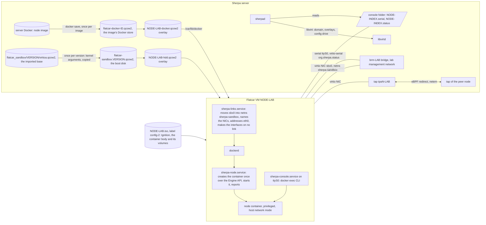

# Sandboxes

The container models that need root-like privileges to boot, `arista_ceos` (`arista_eos`
container), `nokia_srlinux` and the `sonic_linux` container, each run in a Flatcar Container
Linux VM of their own. Inside it, Docker runs the node's image unmodified, privileged
(`HostConfig.Privileged`) and with the settings a container on the server gets, in the VM's
network namespace, so the network OS has
the VM's NICs as its own interfaces. A privileged container that escapes reaches that VM's
kernel, not the server's.

`ModelKind::runs_in_sandbox` (`crates/shared/src/data/model_kind.rs`) is the one list of these
models; `ModelKind::runs_as` is the kind sherpad handles such a node as, a VM. Every other
container model runs on the server's Docker.

sherpad never talks to the VM's Docker. It configures the VM once, with Ignition and a config
drive, and a unit in the VM starts the container and reports how that went on a status channel.

## Shape

## Base image

- The base image is a node model of its own, `flatcar_sandbox`: Flatcar stable's OpenStack
  image (`flatcar_production_openstack_image.img.bz2`, unpacked with `bunzip2`), whose Ignition
  reads its config from a config drive. The user imports it as any VM image, with
  `sherpa server image import --model flatcar_sandbox`, and sandboxes boot the default version,
  `IMAGES/flatcar_sandbox/VERSION/virtioa.qcow2`. The install and update scripts install
  `bzip2` for the unpacking and download no image. Sandboxes boot no overlay of the image itself
  but of its boot disk (see Boot disk); the image is never changed.
- `flatcar_sandbox` is no node model: a manifest node of it is refused
  (`TopologyError::SandboxBaseModel`), pointing to `flatcar_linux` for a Flatcar VM.
- `up` and `redeploy` look the image up while they plan (`base::sandbox_base`), before creating
  anything, and refuse a lab with a sandbox when there is no default `flatcar_sandbox` image
  (`SandboxRefusal::BaseImageMissing`, which says how to import one) or its disk is missing
  (`SandboxRefusal::BaseDiskMissing`). The image is leased, as a node's image is, until the
  sandboxes' disks exist; from then on their overlays on its boot disk keep it from being
  deleted or replaced.

## Boot

The domain boots its disk as the `flatcar_linux` VM does: a q35 machine with SeaBIOS, which
starts Flatcar's GRUB from the overlay, and GRUB builds the kernel command line. On the first
boot GRUB finds the first-boot flag in the image's EFI partition, and Ignition runs once and
clears it, so a later boot (`resume`) does not run Ignition again. sherpad defines the domain
once and never changes it.

GRUB gives the kernel `console=ttyS0`, the network OS's serial console, and the sandboxes' kernel
arguments, `quiet` (`template::SANDBOX_KERNEL_ARGUMENTS`), from the boot disk's OEM partition. The
kernel prints only errors there, from its start on and after boot too: console log level 4, so
kernel info messages, such as interface renames and bridge port states, never mix into the
network OS CLI; they are in the VM's kernel log. The console's emulated
serial port takes VM exits for each character, which cost most in a nested VM: printing the
kernel's boot messages there takes about 20 s of a sandbox's first boot and 15 s of a resume on a
dev server.

## Boot disk

`flatcar-sandbox.VERSION.qcow2` in the storage pool: the base image with the sandboxes' kernel
arguments in its OEM partition's `grub.cfg`, which GRUB reads before it builds the command line.
A sandbox boots an overlay of it, so it boots with them from its first boot on, with no reboot.

- **Made** at the first `up` or `redeploy` with a sandbox after the version is imported
  (`boot::ensure_boot_disk`), before the Docker store, one at a time per version
  (`SandboxDiskLocks` in `AppState`). The build runs in a task of its own that holds the
  version's lock until the build ends, so an operation that stops waiting for it, such as a
  dropped request, leaves the build to finish, and the next one waits for it
  (`SandboxDiskLocks::build`, `sandbox_089`). `sherpa-flatcar-sandbox.VERSION`, a Flatcar VM with no
  NICs, console or status channel, boots `sherpa-flatcar-sandbox.VERSION-hdd.qcow2`, an overlay on
  the base image, with a config drive whose Ignition config sets only `kernelArguments`
  (`template::boot_vm_ignition_json`). Flatcar applies kernel arguments in the initrd, before
  Ignition touches the root filesystem or clears the first-boot flag: it writes them to the OEM
  partition's `grub.cfg` and reboots. The domain's `on_reboot` is `destroy`, so that reboot stops
  the VM, about 30 s after it started on a dev server. sherpad waits for the domain to stop (up to
  10 minutes), copies the overlay with the base image into the standalone
  `flatcar-sandbox.VERSION.qcow2.part` through libvirt (`libvirt::flatten_disk`, mode `0640`, as a
  Docker store, since sherpad reads its header to put each node's overlay on it), removes the VM,
  its disk and config drive, and renames the copy to the boot disk, so a boot disk that exists is
  complete. The user sees a progress message while it is made.
- **Changed** from the base image only in the GPT, the EFI partition's file system and the OEM
  partition, which that first boot wrote; the root partition is untouched and the first-boot flag
  is still set. The boot disk is about the size of the base image.
- **Swept** with the Docker store builds at sherpad's start: every `sherpa-flatcar-sandbox.*`
  domain and volume and `flatcar-sandbox.*.qcow2.part` volume, and their staging folders; boot
  disks are kept. No node's domain or volume has a `.` in its name before its suffix.
- **Deleted** with its version: deleting the `flatcar_sandbox` version, or importing it again
  over a file of another size, deletes the boot disk (`image_lifecycle::remove_boot_disk`), which
  the next `up` makes from the new image. A lab disk built on the boot disk refuses both, as a
  lab disk built on any image does (`ImageHasOverlay`).

## Config drive

`NODE-LAB.iso` in the storage pool, ISO 9660 labelled `config-2` (`guest::write_config_drive`,
staged in `LAB_DIR/NODE/config-drive` and removed again):

- `openstack/latest/user_data`: the Ignition config (see First boot).
- `sherpa/container.json`: the body Docker's Engine API creates the container from (see
  Container), as serde writes bollard's `ContainerCreateBody`.
- `sherpa/volumes/N`: the file or folder of the container's Nth volume, copied from the server:
  the generated config, startup files, certificates, secret files and the manifest's
  `container.volumes`.

`up` and `redeploy` check the source of each of the manifest's volumes of a sandbox node while
they plan, before any VM is made (`validate::validate_sandbox_volumes`), and refuse one that the
drive cannot carry with `SandboxRefusal::VolumeRefused`, which names the path and why (see
Limits): the copy follows no symlink, and ISO 9660 allows eight folder levels, of which the drive
takes four above a volume, names of up to 31 characters, and files under 4 GiB.

The VM mounts the drive read-only at `/media/config`. A read-only volume is mounted into the
container from the drive. A writable one, its files and its empty folders, is uploaded into the container as a tar
archive when the container is created, as a network OS may replace the file, which it cannot do to a bind-mounted
file (SR Linux saves its config by renaming a new file over it). What it writes stays in the
container's layer, on the VM's Docker disk, across down and resume.

## First boot

Ignition's JSON is generated at run time (`template::SandboxGuest::ignition_json`). Its units,
drop-ins, scripts and guest files are Askama templates in `crates/template/templates/sandbox/`,
which take their paths, labels, port names and MTU from the constants in
`crates/template/src/sandbox.rs`. It sets:

- Updates and reboots off (`IgnitionFile::disable_updates`, `update-engine` and `locksmithd`
  masked); no login (no users, `sshd` and its sockets and the serial getty masked); none of the
  image's OpenStack metadata units.
- No network of the VM's own: `systemd-networkd`, its socket and its varlink sockets are masked,
  so nothing addresses, raises or renames an interface after `sherpa-links` (see Links): the
  network OS owns every interface.
- No library cache or hardware database rebuild: `ldconfig.service` and
  `systemd-hwdb-update.service` are masked; the image ships the cache, and the VM's virtio
  devices need no hardware database.
- Docker on its socket only, with no default bridge and no iptables rules (`--bridge=none
  --iptables=false --ip6tables=false`), and containerd without the CRI plugins and NRI
  (`containerd.toml`), its data on the Docker disk (see Docker stores).
- The units below, the container's name (`/etc/sherpa/container`), the writable volumes to copy
  into it (`/etc/sherpa/writable`), the NICs (`/etc/sherpa/interfaces`, `/etc/sherpa/placeholders`), the
  management addresses (`/etc/sherpa/management`) and the console command
  (`/etc/sherpa/console`).

| Unit | Runs | Does |
|---|---|---|
| `sherpa-links.service` | once per boot, before Docker | `links.sh`: names the NICs, addresses `eth0`, makes the interfaces on no link |
| `sherpa-node.service` | once per boot, after Docker and `sherpa-links` | `node.sh`: until `/var/lib/sherpa/created` exists, removes any container an earlier boot left, creates the container, copies the writable volumes into it and then writes that marker, removing the container when the copy fails; on every boot starts it, and reports (see Container) |
| `sherpa-console.service` | on `ttyS0`, restarted when it exits | `console.sh`: the network OS CLI (see Console) |
| `var-lib-docker.mount` | before containerd and Docker | mounts the Docker disk, `noinit_itable` |
| `media-config.mount` | at boot | mounts the config drive |

## Container

sherpad describes the container to the guest's Docker as an Engine API body, not as CLI flags:
`container::sandbox_create_body` takes the body `run_container` creates a container on the
server's Docker from (`create_body`), for the same `ContainerSpec` with its read-only volumes
mounted from the config drive, and sets only:

- `HostConfig.NetworkMode` `host`: the VM's network namespace, with the NICs `sherpa-links` named;
- `HostConfig.Dns` and `DnsSearch`: the lab's name servers, IPv4 then IPv6, and its domain;
- `HostConfig.ExtraHosts`: the hostname at `127.0.1.1`;
- `HostConfig.RestartPolicy` `unless-stopped`;
- no `HostConfig.Memory`, `MemorySwap` or `NanoCpus`: the VM is the container's limit;
- no `NetworkingConfig`: no Docker network endpoints.

`node.sh` sends the body to the VM's Docker socket, `/run/docker.sock`, with `curl`, at the
Engine API version bollard uses (`container::docker_api_version`, `v1.49`), which the Docker of
the base image supports:

| Step | Request | Docker answers |
|---|---|---|
| Remove a container an unfinished first boot left | `DELETE /containers/NAME?force=true` | `204`, or `404` when there is none |
| Create | `POST /containers/create?name=NAME`, the body from the config drive | `201` |
| Copy the writable volumes in | `PUT /containers/NAME/archive?path=/`, a tar of their files and empty folders, owned by root | `200` |
| Start | `POST /containers/NAME/start` | `204`, or `304` when its restart policy started it already |

Any other answer fails the boot with Docker's `message` (read with `jq`), as `failed: REASON` on
the status channel. A create never pulls: the VM has the image in its store, and a missing image
fails with Docker's `No such image`. `node.sh` logs how long the create and the copy took to the
journal.

## Status

Each VM has a virtio-serial port, `org.sherpa.status`, whose host side is a socket QEMU binds:
`NODE_INDEX.status` in the lab's console folder for a sandbox, and `store-ID.status` in
`/opt/sherpa/run/sandbox` (`SHERPA_SANDBOX_RUN_DIR`, `sherpa:kvm`, mode `2770`) for a Docker
store VM, which belongs to no lab. `report.sh` writes one line to it: `started`, `loaded` or `failed: REASON`, newlines
flattened. A guest's write waits until a reader is connected, for up to 60 s.

sherpad connects as soon as it has started the domain (`StatusWatch::connect`) and reads up to
the first status (`StatusWatch::next`). `failed: REASON` fails the node with that reason
(`ServiceError::SandboxFailed`): each step of `links.sh`, `node.sh` and `store.sh` that fails
reports, with Docker's or the command's own message. A VM that stops before it reports fails
with `ServiceError::SandboxStatusClosed`. These failures, and the two status limits below, have
the category `ServiceCategory::Failed`, so the caller is told the reason: `up` lists it with the
node, and a `redeploy` over RPC, REST (`502`, `NODE_FAILED`) or the web UI answers with it. On later boots, after down and resume, nobody reads the
channel, and the report gives up.

The channel is the guest's, and a privileged container can write to it, so sherpad reads it as
untrusted input:

- A line longer than 4 KiB fails the node (`ServiceError::SandboxStatusTooLong`) once that much
  has arrived without a newline; more than 64 KiB without a status fails it
  (`ServiceError::SandboxStatusFlood`).
- Control characters are dropped from every line, and a failure's reason is cut to 512
  characters, before it reaches a log, an error or the CLI.
- Only the first line that is no status is logged, cut to 80 characters.

## Docker stores

The node's image is not copied into each sandbox. Each image has a Docker store: a disk whose
Docker data has the image loaded, which every sandbox of the image boots an overlay of.

- **Name.** `flatcar-docker-ID.qcow2` in the storage pool, `ID` the first 16 hex digits of the
  image's ID on the server's Docker, so an image imported again gets a store of its own.
- **Made** at the first `up` or `redeploy` that needs it (`store::ensure_docker_store`), one at a
  time per store, in a task that holds the store's lock until the build ends, as a boot disk's
  build does (`SandboxDiskLocks` in `AppState`). sherpad writes `docker save` of the image to
  `flatcar-docker-ID.tar` in the storage pool, padded to whole sectors, and starts
  `sherpa-flatcar-docker-ID`: a Flatcar VM with no NICs and no console, on an overlay of the boot
  disk, with an empty 32 GiB `flatcar-docker-ID.qcow2.part` as its Docker disk, which its
  Ignition formats, and the archive as a read-only raw disk with serial `sherpa-image`.
  `sherpa-store.service` runs `docker load` from that disk, reports `loaded`, and powers the VM
  off. sherpad waits for the report, then for the domain to stop, removes the VM, its disks and
  the archive, and renames the disk to the store, so a store that exists is complete. The user
  sees a progress message while a store is made, and another while waiting for a store another
  operation is making.
- **Swept.** A build sherpad stopped during, or whose operation was dropped, leaves its VM and
  files. At its start, before it takes requests, sherpad removes every `sherpa-flatcar-docker-ID`
  domain, every pool volume a build makes (the VM's disk `sherpa-flatcar-docker-ID-hdd.qcow2` and
  config drive `sherpa-flatcar-docker-ID.iso`, `flatcar-docker-ID.tar` and
  `flatcar-docker-ID.qcow2.part`), and the staging folders of their config drives and the store
  status sockets in `/opt/sherpa/run/sandbox` (`sweep::remove_unfinished_builds`, with the boot
  disk builds); stores are kept. A name is a build's only when `ID` is 16 hex digits and the name
  ends there or in one of those suffixes, so a node named like a store VM keeps its domain and
  disks.
- **Used.** A sandbox's Docker disk is `NODE-LAB-docker.qcow2`, a qcow2 overlay on the store,
  mounted at `/var/lib/docker` with `noinit_itable`.
- **Kept.** Stores belong to no lab: destroy never deletes one (`sandbox_037`).

## Per node

| What | Where | Removed by |
|---|---|---|
| Domain `NODE-LAB` | libvirt, persistent | destroy (lab suffix), redeploy, rollback |
| Disk, a qcow2 overlay on the boot disk | storage pool, `NODE-LAB-hdd.qcow2` | destroy (lab volume suffix), redeploy |
| Docker disk, a qcow2 overlay on the image's Docker store | storage pool, `NODE-LAB-docker.qcow2` | destroy (lab volume suffix), redeploy |
| Config drive | storage pool, `NODE-LAB.iso` | destroy, redeploy |
| Serial console and status sockets | lab console folder, `INDEX.serial`, `INDEX.status` | destroy (console folder) |

The two overlays hold everything the node writes, so a saved config survives `down` and
`resume`. Redeploy and destroy delete them.

The domain is `template::SandboxDomainTemplate` (`templates/libvirt/sandbox_domain.jinja`): q35,
`host-passthrough` CPU, no video and no balloon; SeaBIOS booting the first disk; the two overlays
on virtio; the config drive on SATA; the management NIC and the sandbox's own NIC on the lab's
management network; one virtio NIC per data interface on a link or bridge, its tap named like the
node's link end; a virtio RNG; the status channel; and the serial console on the node's console
socket.

## Links

Each data interface of the node on a link or bridge is a virtio NIC whose host side is a tap
named like the node's link end. libvirt makes the taps when it starts the domain, so a sandbox's
links are attached in phase 11b with the VMs' (`attach_vm_links`), and re-attached after a cold
boot or a redeploy as a domain's are (`RecreatedEnd::Domain`). A data interface on a private
bridge is a bridge interface of the domain (`<interface type='bridge'>`), so libvirt puts its
tap on the bridge at every start, as it does for a VM's. The eBPF redirect, netem
impairment and carrier handling are those of every P2p link
([P2P-ARCHITECTURE.md](P2P-ARCHITECTURE.md)).

The container runs with Docker's host network mode, so the VM's NICs are the network OS's
interfaces. On every boot, before Docker starts, `links.sh`:

- names each NIC, found by its MAC in `/etc/sherpa/interfaces`: the management NIC `eth0`, each
  data NIC as the network OS expects (`eth1`, `e1-1`, ...), through a temporary name first, flushes
  any address, and sets it up;
- gives `eth0` the node's management addresses and default routes (see Management);
- makes each data interface on no link, listed in `/etc/sherpa/placeholders`, a veth with the MAC
  sherpad picked, whose peer is down in the namespace `sherpa-unwired`, so it has no carrier.

A NIC that does not appear in 60 s fails the script, which reports it; Docker then does not start
the container. Every MAC is fixed per node: cEOS makes new SSH host keys when its interfaces' MACs
change.

## Management

`eth0` is on the lab's libvirt management network, with a MAC fixed per node. `links.sh` gives it
the node's IPv4 address and, when the lab has IPv6, its recorded IPv6 address, each with the
network's prefix length and a default route through the lab's gateway
(`guest::management_addresses`): what Docker gives a container on the lab's network.

- **cEOS** takes `eth0` as `Management0` and keeps only the addresses its config sets: the ones
  in the config Sherpa generates. With `ztp` off, or a config of its own that sets none, it has
  no management address, as under runc.
- **SR Linux** renames `eth0` to `mgmt0`; the DHCP client of `mgmt0.0`, in the config Sherpa
  generates and in its factory config, takes the addresses into the `mgmt` network instance. A
  config of its own with static addresses on `mgmt0.0` leaves the copy on `mgmt0` as well, and SSH
  to the address is reset, as under runc.
- **SONiC** keeps them on `eth0`.

A node is ready once SSH answers on its management address, except a cEOS node without the config
Sherpa generates and an SR Linux node with a config of its own, which are ready once their VM
reports the container started, unless `ready_check.port` says otherwise (`node_ready_036`).

The VM has no resolver, so the container gets the lab's name servers and domain
(`HostConfig.Dns`, `HostConfig.DnsSearch`), and its hostname resolves to `127.0.1.1`
(`HostConfig.ExtraHosts`). The lab's name server,
its boot server, answers a name without a domain that is not a node's as not found and never
forwards it (`domain-needed`, `boot_server_021`): the server's resolver may never answer one.
SR Linux looks up `matelink` at each rsyslogd start, three of them in the commit of its startup
config, and the commit fails with `Unacceptable syslog configuration` when it takes over about
60 s.

### The sandbox's own address

The VM has a second NIC on the lab's management network, with a MAC of its own, which the network
OS never sees. Before it names the other NICs, `links.sh` moves it into the network namespace
`sherpa-sandbox` as `sbx0` and gives it the sandbox's own addresses and default routes through the
lab's gateway, from `/etc/sherpa/sandbox-nic`; the container runs in the VM's first namespace.
Before `sbx0` is up it turns off router advertisements and SLAAC on it (`accept_ra=0`,
`autoconf=0`, set in `sherpa-sandbox`), so it has only those addresses and its link-local one
(`sandbox_079`). The network OS's interfaces, in the first namespace, keep the kernel's settings.

- **Addresses.** In a lab of N nodes the kth sandbox, in node index order, takes the node block's
  address of node N + k, in IPv4 and in IPv6 when the lab has it
  (`util::sandbox_management_host_offset`): the sandboxes' addresses follow the nodes'. A lab
  whose nodes and sandboxes together need more than the block's 234 addresses is refused
  (`TopologyError::TooManyAddresses`).
- **Recorded** in `sandbox_node` with the NIC's MAC when `up` gives the node its addresses,
  before the boot server's config is written; `down`, `resume` and `redeploy` keep them, and
  `redeploy` refuses a node without a row before it tears anything down
  (`SandboxRefusal::AddressMissing`). Destroy gives them back with the node.
- **Named** `<node>-sbx` and `<node>-sbx.<lab domain>` on the lab's boot server, IPv4 and IPv6,
  and its IPv4 address is reserved for the NIC's MAC with a DHCP host entry, so the boot server
  never leases it to another client, while the sandbox is down too (`boot_server_022`). A node named so is refused (`TopologyError::SandboxNameTaken`).
- Nothing listens on the address yet; it answers ping from the server and from the lab's nodes.

## Console

The serial console is on the node's console socket, which the console relay serves as for any
VM, so `sherpa console` works for these nodes; their VNC console is refused
(`SandboxRefusal::VncConsole`). `console.sh` waits
for Enter, waits for the container to run, gives the line a size, and runs `docker exec -it` of
the model's CLI (`Cli`, `sr_cli`, `bash` for SONiC). systemd starts it again when the CLI exits.

## Lifecycle

- **Up.** Phase 11 creates each sandbox, in parallel with the others (`create_sandboxes`, after
  the VMs): the base image's boot disk and the image's Docker store when there is none, the
  config drive with the node's
  container and secret files, the two overlays, the domain, and the connection to its status
  channel (`StatusWatch`). No task reads the channel: readiness (phase 13) reads what has arrived
  at each poll (`StatusWatch::started`), records the node launched once its VM reports `started`,
  failed with the reason when it reports a failure, and ready as above, and closes the channel
  when it stops waiting. Every node's create is built before any VM is created, and every
  creation task is awaited before up goes on or rolls back.
- **Down, resume, status, scanner, console.** These nodes run as VMs (`ModelKind::runs_as`):
  `down` shuts the domain down over ACPI, which stops Docker and the container cleanly; `resume`
  starts the domain, `sherpa-node` starts the container again with what it wrote, and the links
  are re-attached. A node of these models that has no `sandbox_node` row was made before
  its model ran in a sandbox, as a container on the server's Docker: `down` and `resume` refuse
  it with `SandboxRefusal::AddressMissing`, which says to destroy the lab and bring it up
  again (`sandbox_096`).
- **Redeploy.** Removes the VM and its volumes as a VM's (`destroy_vm_node`), generates the
  node's config again, and creates the VM again with a new config drive and new overlays; it waits
  for the VM's status up to the manifest's `ready_timeout`, in the redeploy itself.
- **Destroy and rollback.** The domain and its volumes go with the lab's other domains and
  volumes, by the lab's name suffix. A domain libvirt defined stays defined when a later step
  fails, as a VM's does, and destroy or the rollback removes it.
- **sherpad restart.** The VMs are libvirt's; a restart of sherpad leaves them running.

## Resources

A sandbox gets the manifest's or the image's `memory` with 1024 MiB on top
(`SANDBOX_MEMORY_OVERHEAD_MIB`), and the manifest's or image's `cpu.count`
(`planned_resources`); admission counts that. In the VM the container has no limits
(`sandbox_create_body` clears them): the VM is its limit.

## Limits

- A volume's source is read when the config drive is written: a change on the server is not seen
  until a redeploy, and what the container writes to a writable volume stays in the VM.
- A volume's source may hold no symlink, which is refused rather than followed, no special file
  (FIFO, socket or device), no folder more than four levels below it, no file of 4 GiB or more,
  and no name longer than 31 characters (`sandbox_090` to `sandbox_094`).
- Secret files are on the config drive in the storage pool, not in RAM, until destroy or redeploy.
- A container that exits after its VM reported it started is restarted by Docker; sherpad sees
  only that its ready port stops answering.
- A failure before the VM's units run, such as Ignition failing in the initrd, sends no status:
  the node is not ready when the readiness wait ends.
- A sandbox stopped before its first boot finished Ignition boots without it the next time, and
  its container is never made; redeploy the node.
- SR Linux's commit of its startup config fails with `Unacceptable syslog configuration` when
  its rsyslogd restarts take over about 60 s, as when the lab's name server does not answer; it
  then falls back to the next config, and the node has no `dev` login.
- `frr_linux` and the `juniper_evolved` container run privileged on the server's Docker.
- Nothing removes a Docker store when its image is deleted or imported again.
- The boot VM stopping is what tells sherpad the kernel arguments are written: a VM that crashes
  in the initrd stops too, and its boot disk boots sandboxes that print the kernel's boot
  messages until the version is deleted, or imported again over a file of another size, and the
  next `up` makes a new boot disk.
- A boot disk takes about the base image's size in the storage pool per imported version.
- Each sandbox takes a node block address of its own, so a lab with sandboxes has fewer than 234
  nodes.
