# Sherpa Application Server Architecture

`sherpad` is the Sherpa application server daemon. It is not just an HTTP wrapper around the old CLI path; it is the process that owns the server-side control plane for browser users, REST clients, WebSocket JSON-RPC clients, and the Sherpa CLI.

The server crate is `crates/server`. It sits above the infrastructure crates (`db`, `libvirt`, `container`, `network`, `template`, `topology`) and coordinates them through explicit service modules under `crates/server/src/services`.

## System context

At runtime, Sherpa is a single server process with multiple public transports and several infrastructure backends.

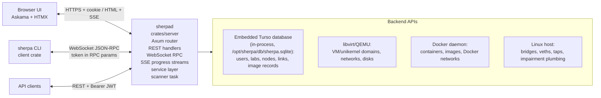

The public API surface is intentionally transport-agnostic at the data-model level. Request/response types live in `shared`, and the generated API registry in `crates/shared/src/api_spec.rs` describes how those operations map to REST, WebSocket RPC, and CLI commands. The implementation is not fully generated from the registry yet, but the registry is the intended public contract source of truth.

## High-level server layering

The server code is layered like this:

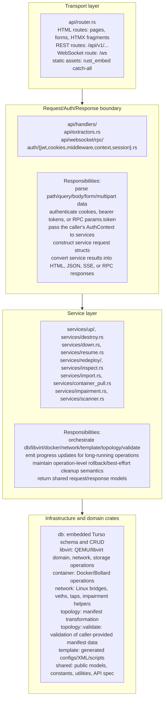

The important boundary is between handlers and services. Handlers know about transports and authentication. Services know about orchestration. Infrastructure crates know how to talk to their backend, but should not know about HTTP, cookies, WebSocket message IDs, or HTMX fragments.

## Server startup architecture

The binary entry point is `crates/server/src/main.rs`. Its job is intentionally small: initialize rustls, detect the internal background-child mode, parse the `sherpad` CLI, and dispatch to daemon management.

`sherpad` is also a library, for `main.rs` and the integration tests (`crates/server/tests/integration/`, one test binary). It exports only what they use: `cli`, `init`, `doctor`, `check_database`, `daemon::{manager, metrics, state}`, `api::build_router`, `api::websocket::{connection, handler}` and `auth::cookies`. Everything else is `pub(crate)`, so the compiler reports unused code and the pedantic API lints apply only to that surface.

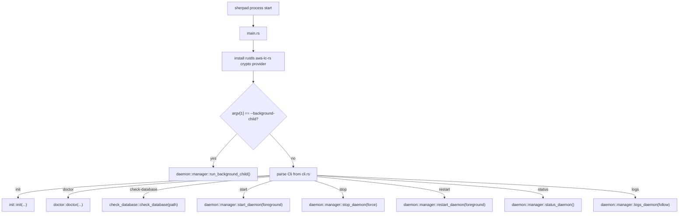

Daemon mode is implemented in `crates/server/src/daemon/manager.rs`:

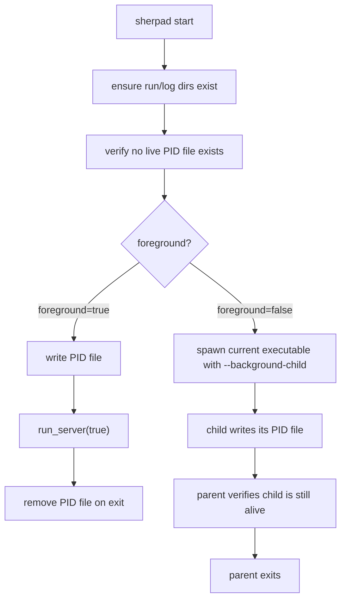

The real server runtime is built by `crates/server/src/daemon/server.rs`:

```mermaid
flowchart TB
    runserver["run_server(foreground)"] --> config["load sherpa.toml"]
    config --> filter["build tracing filter from RUST_LOG or default to info"]
    filter --> otel{"[otel].enabled?"}
    subgraph otelinit["OTel"]
        traceexp["initialize OTLP trace exporter"] --> metricexp["initialize OTLP metric exporter"] --> otellayer["attach tracing-opentelemetry layer"]
    end
    otel -->|yes| traceexp
    otel -->|no| logging
    otellayer --> logging{"configure logging"}
    logging -->|foreground| stdoutfmt["compact stdout/stderr formatter"]
    logging -->|daemon| filefmt["compact file formatter"]
    stdoutfmt --> signals
    filefmt --> signals
    signals["install SIGINT and SIGTERM handlers<br/>(startup fails if registration fails)"]
    signals --> envoverrides["apply env overrides<br/>SHERPA_SERVER_IPV4<br/>SHERPA_SERVER_IPV6<br/>SHERPA_SERVER_WS_PORT<br/>SHERPA_SERVER_HTTP_PORT"]
    envoverrides --> jwt
    subgraph appstate["AppState::new(config, metrics)"]
        jwt["load JWT secret, or generate it if missing<br/>(a new one written 0600 in a 0700 directory;<br/>a file of the wrong length stops startup)"] --> database["open the database file"] --> schema["apply DB schema"] --> seed["optionally seed admin user"] --> storage["restrict lab and database storage<br/>(daemon::storage::secure_storage)"] --> qemu["initialize Qemu wrapper"] --> docker["connect Docker client"] --> registry["create WebSocket registry and pending-job map"]
    end
    registry --> recover["services::lab_lifecycle::recover:<br/>labs left Creating become Interrupted,<br/>left Destroying become DestroyFailed,<br/>nodes left Building become Failed"]
    recover --> cancel["create CancellationToken for background services"]
    cancel --> scanner["if scanner enabled:<br/>spawn services::scanner::run_scanner(...)"]
    scanner --> sweeper["spawn auth::session::run_sweeper<br/>(deletes expired sessions at startup, then hourly)"]
    sweeper --> router
    router["build Axum router and add /ws route"]
    router --> tls{"TLS enabled?"}
    tls -->|yes| sans["compute certificate SANs if none configured"]
    sans --> ensurecert["ensure certificate/key exist"]
    ensurecert --> certlistener["start HTTP /cert listener"]
    certlistener --> certlistener6["optionally start IPv6 HTTP /cert listener"]
    certlistener6 --> tls6["optionally spawn IPv6 TLS listener"]
    tls6 --> servetls["serve main IPv4 TLS listener with graceful shutdown handle"]
    tls -->|no| bindplain["bind plain IPv4 listener"]
    bindplain --> plain6["optionally spawn IPv6 listener"]
    plain6 --> serveplain["serve with graceful shutdown future"]
```

In `daemon/server.rs`, `run_server` calls `init_telemetry` (filter, OTel, logging), `apply_env_overrides`, builds `AppState`, recovers the labs and nodes the operations running when the server last stopped left mid-way (`lab_lifecycle::recover`, before anything takes requests; see [`STATE_MACHINES.md`](STATE_MACHINES.md#2-lab-phase-and-status-labphase-and-labstate)), starts the scanner and the session sweeper, then `serve_tls` or `serve_plain` with the bound `Listening` addresses; `serve_cert_endpoint` serves `/cert` on each address family.

`auth::jwt::load_or_generate_secret` generates the JWT secret only when the file is missing. A file that exists with a length other than 32 bytes stops startup with an error naming the file: replacing it would silently end every session. Deleting the file generates a new secret, which logs every user out.

Shutdown uses SIGINT/SIGTERM. The handlers are registered once, before the server binds any listener, so a registration failure stops startup with an error instead of leaving a server that cannot shut down gracefully. On shutdown, the server cancels the background-service token. With TLS, it also asks the `axum_server::Handle` to perform graceful shutdown with a short timeout. The OpenTelemetry guard flushes traces/metrics when dropped.

### Lab and database storage permissions

Lab data and the database are kept from other server users by directory modes, not file modes,
so files written by older releases are covered too. `daemon::storage::secure_storage` runs on
every start and calls `restrict_dir` on:

| Directory | Mode and group | Constants |
|---|---|---|
| `/opt/sherpa/labs` | `2750`, the `sherpa` group | `SHERPA_LABS_DIR_MODE` |
| `/opt/sherpa/libvirt/images` (storage pool) | `2750`, `kvm` | `SHERPA_STORAGE_POOL_DIR_MODE`, `SHERPA_STORAGE_POOL_GROUP` |
| `/opt/sherpa/db` | `750` | `SHERPA_DB_DIR_MODE` |
| `/opt/sherpa/db/backups` | `700`; the backup service restricts it again before each backup | `SHERPA_DB_BACKUP_DIR_MODE` |

- QEMU runs as `libvirt-qemu` in `kvm`, so it can reach the pool. Nothing reads `/opt/sherpa/labs`
  through the directory except `sherpad`: the dnsmasq router and container nodes get lab files
  through Docker bind mounts.
- File modes inside lab directories are left as they are. dnsmasq runs as root and serves only
  world-readable TFTP files, and container nodes may read their bind-mounted configs as a
  non-root user, so a restrictive umask would break ZTP.
- New pool volumes are created `0600` (`konst::STORAGE_VOLUME_MODE`, in
  `crates/libvirt/templates/copy.xml` and `overlay.xml`); libvirt hands them to the QEMU user
  while a VM runs. Flatcar's `.ign` file is `0644` (`STORAGE_VOLUME_QEMU_ARG_MODE`), because QEMU
  opens it from a raw `-fw_cfg` argument that libvirt does not relabel
  (`libvirt::vm::volume_format_and_mode`).
- A failure is logged, not fatal. `sherpad init` runs as the installing administrator, so it
  does not create these directories: one it created would not be owned by `sherpa`. The install
  and update scripts set the same owner and modes as root, and `scripts/fix-permissions.sh` keeps
  them.

### Container secret files

Container secret files (see [`PROVISIONERS.md`](PROVISIONERS.md)) are kept in RAM, under
`/run/sherpa`, the daemon's systemd `RuntimeDirectory` (`0700 sherpa`, a tmpfs).
`RuntimeDirectoryPreserve=yes` keeps it when `sherpad` stops or restarts, so running containers
keep their secrets; a reboot clears it. The install script writes these settings into the unit,
and the update script and `dev/rebuild` add them to older units as the drop-in
`sherpad.service.d/runtime-directory.conf`.

`services::node_secrets` writes `konst::SHERPA_SECRETS_DIR/<lab>/<node>/`: the lab directory is
`0700`, and the node directory, the bind mount's root, is `0755`. Nothing under `/run/sherpa` is
readable by other server users or the `sherpa` group.

## Runtime state: `AppState`

`AppState` is the dependency graph passed into Axum handlers and cloned into async tasks. It is defined in `crates/server/src/daemon/state.rs`.

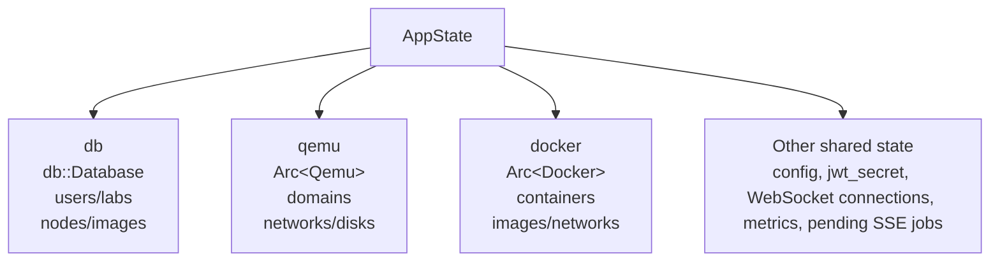

The state object deliberately holds clients rather than opening new connections in every handler. Some libvirt operations still create short-lived libvirt connections through `Qemu::connect()` because libvirt calls are blocking FFI-style operations and are wrapped at the libvirt crate boundary.

### AppState fields

| Field | Architectural role |
|---|---|
| `connections` | Active WebSocket connection registry. Used for connection lifecycle and log/status subscriptions. |
| `db` | Shared handle to the embedded database (`db::Database`). Each operation takes its own connection, and writes queue on its write lock (`DATABASE.md`). All persistent user/lab/node/image state flows through this. |
| `qemu` | Shared QEMU/libvirt wrapper. Service modules call into the `libvirt` crate for VM, unikernel, storage, and network operations. |
| `docker` | Shared Bollard Docker client. Container services use this instead of shelling out to Docker. |
| `config` | Immutable runtime configuration loaded from `sherpa.toml` after env overrides. |
| `jwt_secret` | Secret used by JWT login, cookie auth, REST bearer auth, and RPC token auth. |
| `metrics` | OTel metric instruments or no-op instruments when OTel is disabled. |
| `pending_jobs` | A small one-shot job handoff registry for HTML form submissions that redirect to a job page and then open an SSE stream. |

## Transport architecture

Sherpa has three main public transports and one browser-specific HTML flow.

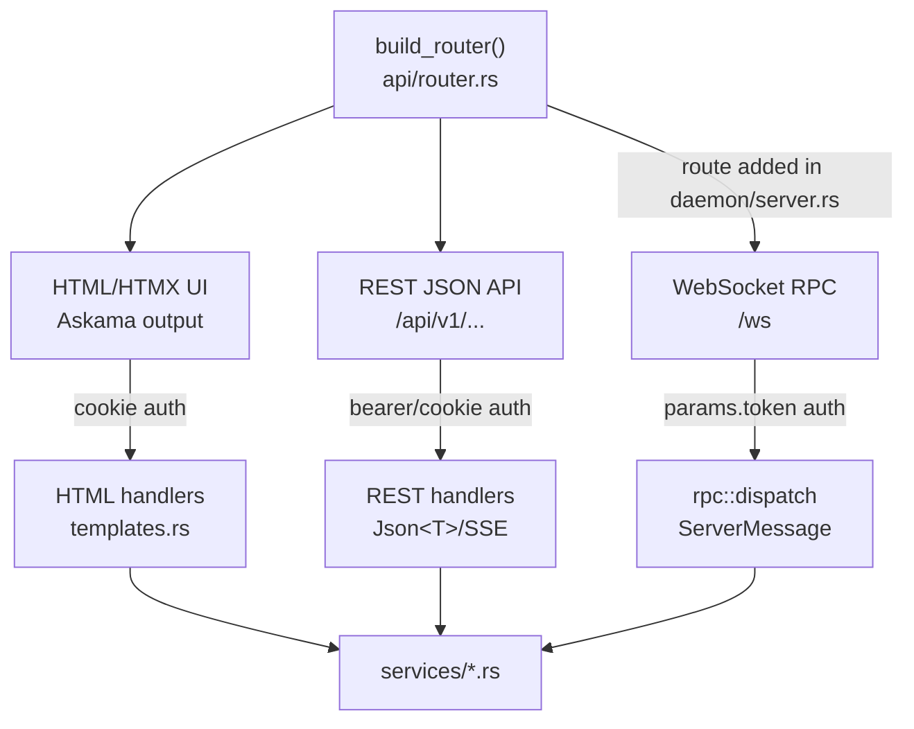

### HTML/HTMX UI

The browser UI is not a separate frontend application. It is server-rendered HTML:

- Askama template structs are defined in `crates/server/src/templates.rs`. Each derives `askama_web::WebTemplate`, so a handler returns it as the response: a template that fails to render is logged and answered with a 500. The error pages wrap themselves in `WebTemplate` to keep their 404 or 403 status.
- A page that contains a partial also swapped on its own by HTMX (the SSH key lists) holds the partial's template as a field and renders it in place, so the partial's render errors fail the page.
- SSE progress streams (`api/sse.rs`) render fragments with `render_fragment`. The stream has already started, so a fragment that fails to render is logged and sent empty.
- Template files live in `crates/server/templates/`.
- Static assets are embedded from `crates/server/web/static/` using `rust_embed`.
- HTMX is used for form submissions, partial updates, node-table polling, lab-grid updates, and progress pages.
- Templates only render. The handler, or a view type it builds, decides from enums with exhaustive `match`es and passes the result: a `templates::Badge` (label, tone, size) drawn by `snippets/badge.html.jinja`, a `KindBadge` drawn by `snippets/kind-badge.html.jinja`, the `LabActions` or `NodeActions` a lab or node offers, `FormChoice` rows (value, label, selected) for every dropdown of the image edit form, the sidebar's `Nav` built from a `NavPage`, and the login page's `LoginError`. The view types are in `crates/server/src/templates/`, each with a test over every variant. A template does not compare an enum, its text, or call a method that decides; `templates::tests::templates_decide_nothing_from_an_enums_text` rejects `to_string()` and comparisons with string literals in template tags. Class names stay in the templates, because Tailwind only scans `templates/**/*.jinja`.
- Templates carry no inline JavaScript: no `on*=` handlers and no `<script>` blocks without `src`. Buttons name their action and target in `data-` attributes, and the scripts in `web/static/js` listen for them. HTML escaping does not make interpolation into a handler safe, because the browser decodes the escapes before running it. `templates::tests::templates_carry_no_inline_javascript` enforces this.

HTML routes generally authenticate with `AuthenticatedUserFromCookie`. When auth fails, the extractor redirects to `/login?error=session_required`.

The HTML job/progress flow looks like this:

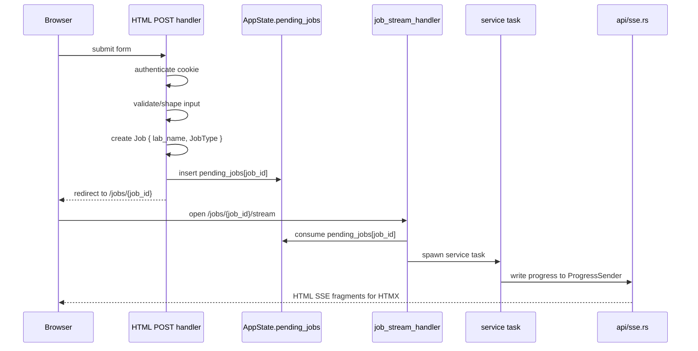

That `pending_jobs` map is intentionally a transient handoff, not persistent job storage. If the process dies, pending jobs are lost.

### REST JSON API

HTTP handlers live in `api/handlers/`, one file per resource and transport: `auth`, `profile`,
`system`, `labs_api`, `labs_web`, `admin_web`, `images_api`, `images_web` and `users_api`. They use Axum extractors (`Path`, `Query`, `Json`, `Multipart`, `State`) and return either `Json<T>`, generic `IntoResponse`, or SSE streams.

REST auth is implemented by `AuthenticatedUser` in `api/extractors.rs`. It tries bearer auth first and then cookie auth. Admin-only REST handlers call `require_admin_auth(&auth)` inside the handler.

`GET /api/v1/labs` requires authentication and lists the caller's labs. Admins may pass `?username=` to list another user's labs; regular users get 403 for any other username.

### WebSocket JSON-RPC

The WebSocket stack lives under `api/websocket/`:

```mermaid
flowchart TB
    get["GET /ws"] --> wshandler["handler.rs::ws_handler"]
    wshandler -->|upgrades connection| inner["handle_socket_inner"]
    inner --> split["split WebSocket sender/receiver"]
    split --> conn["create Connection { id, sender }"]
    conn --> insert["insert into AppState.connections"]
    insert --> metric["increment ws connection metric"]
    metric --> connected["send ConnectedMsg"]
    connected --> msgloop["loop over incoming ClientMessage"]
    msgloop --> rpcreq["RpcRequest { id, method, params }"]
    rpcreq --> dispatch["spawn rpc::dispatch(...)"]
    dispatch --> lookup["find the method in rpc::METHODS"]
    lookup --> authn["authenticate once: Public, User or Admin"]
    authn --> streaming{"streaming?"}
    streaming -->|yes| forward["forward ProgressSender messages to the connection"]
    streaming -->|no| call["call the resource module"]
    forward --> call
    call --> respond["send RpcResponse, record rpc_duration"]
```

`api/websocket/rpc/dispatch.rs` holds `METHODS`, the one table of RPC methods: each method's
access (`Public`, any authenticated `User`, or `Admin` with its refusal message) and whether it
streams status messages before its response. `dispatch` authenticates the caller as the table
says, so the method functions in `auth.rs`, `labs.rs`, `images.rs`, `users.rs` and `server.rs`
only parse their params, call the service and return `Result<Value, RpcError>`; `parse` and
`respond` turn parse failures and service results into RPC errors and results. A test checks
`METHODS` against the published API spec (`shared::api_spec`): every RPC method's access and
streaming must agree, and the spec's `transports.rpc.streaming` says which methods stream.

The streaming methods are `up`, `destroy`, `resume`, `redeploy`, `image.import`, `image.pull`
and `image.download`.

`node.secrets` (a regular method) rewrites a container node's secret files; its params are never
logged, and a parse error is not echoed back. `up` and `redeploy` carry secret files too, so
all three parse with `parse_quietly`, which drops serde's message because it can quote values.

Regular RPC methods return one `ServerMessage::RpcResponse`. Streaming methods send zero or more `ServerMessage::Status` values, followed by one final `ServerMessage::RpcResponse`.

### SSE progress architecture

Long-running operations use a common progress channel pattern:

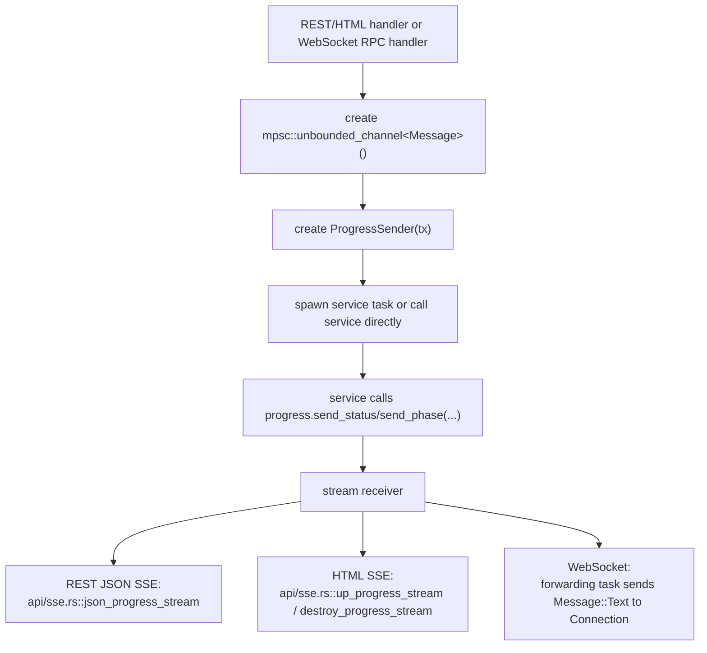

The service layer does not know if progress is ultimately going to a browser SSE stream, REST SSE stream, or WebSocket. It only sees `ProgressSender`.

## Authentication and authorization architecture

Authentication has three input paths but one shared JWT validation model.

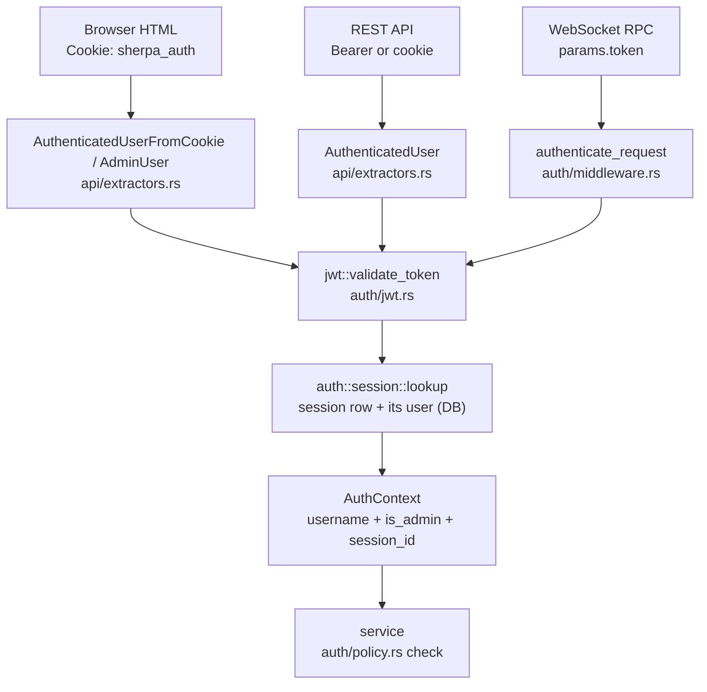

### Sessions and identity

Every token names a login session, and identity comes from the session's row, not from the
token. The JWT carries `sid`, the key of a row in the `session` table, besides `sub`, `iat`,
`exp` and `is_admin`. After the signature and expiry check, every extractor, the RPC
`authenticate_request` and `auth.validate` present the session with `auth::session::lookup`,
which reads the session and its user in one query:

- A token is accepted only while its session is active: the row exists and its `expires_at` has
  not passed. Otherwise REST returns 401, HTML routes clear the cookie and redirect with
  `session_expired`, RPC returns `AuthRequired`, and `auth.validate` answers `valid: false`.
- `username` and `is_admin` in `AuthContext` come from the user row. Demoting an admin takes
  effect on their next request, not when their token expires.
- Sessions belong to a user's id, not their name, so a token of a deleted user never works for a
  new account with the same name.
- If the lookup itself fails, REST returns 500 and HTML routes return 503.

The token still carries `sub` and `is_admin`, and the UI and CLI may use them for display, but no
authorization decision reads them.

The session states (`Active`, `Expired`, `Ended`), the events that move them and the code behind
each are defined in one place, `auth/session.rs`, with a table test. What ends a session:

| Event | Effect | Code |
|---|---|---|
| Logout: web `POST /logout`, REST `POST /api/v1/auth/logout`, RPC `auth.logout` (`sherpa logout`) | ends that session only | `session::logout` |
| Users change their own password | ends their other sessions, keeps the one they used | `db::change_user_password`, from `services::user_password` |
| An admin resets another user's password | ends all of that user's sessions | the same |
| The user is deleted | ends all their sessions | `session.user` is `ON DELETE CASCADE` |
| `expires_at` passes | refused at once; the row is deleted by the next sweep | `session::run_sweeper`, at startup and every `SESSION_SWEEP_INTERVAL_SECS` (an hour) |

A password change writes the new hash and deletes the sessions in one transaction. Web logout
ends the cookie's session before it clears the cookie; if the session cannot be ended it returns
503 and keeps the cookie, so the user is not shown as logged out while the token still works.
A session lasts `JWT_TOKEN_EXPIRY_SECONDS` (7 days), or 30 days for a web login with "remember me";
the token's `exp` and the row's `expires_at` are the same second.

### Services enforce authorization

Every lab service takes the caller's `&AuthContext` and checks it with the helpers in `auth/policy.rs` before it sends progress, takes a lock, or touches a resource:

| Rule | Helper | Operations |
|---|---|---|
| Lab owner or admin | `require_lab_access` | inspect, destroy, down, resume, download, link impairment |
| Lab owner only, no admin bypass | `require_lab_owner` | redeploy (it rebuilds the node with the owner's SSH keys and account) |
| Admin only | `require_admin` | clean |
| Self or admin | `require_self_or_admin` | listing another user's labs |
| Any authenticated user | none | up (creates the caller's own lab), listing your own labs |

`require_lab_access` and `require_lab_owner` return the lab record, so services do not look it up twice. When an admin acts on another user's lab, the helper logs a `warn` line with `event = "auth.admin_lab_access"`, naming the admin, the lab and the owner. Refusals log `event = "auth.access_denied"`.

Refusals are returned as a typed `services::error::ServiceError` inside `anyhow::Error`: `Denied` (not allowed), `NotFound`, or `Conflict` (allowed, but the current state forbids it, such as deleting a user who owns labs). Transports find it with `ServiceError::find`, which works through added context:

- REST: `ApiError::from` maps `Denied` to 403, `NotFound` to 404 and `Conflict` to 409. No authorization decision is made by matching on error text.
- RPC: `service_error` in `rpc/dispatch.rs` maps them to `AccessDenied`, `NotFound`, `InvalidParams`, and `ServerError` with the conflict message (JSON-RPC has no conflict code); other failures stay `ServerError` with the error's message chain (`{:#}`, never its debug form) as context. Authentication failures carry no context.
- HTML: `lab_error_page` and `lab_error_fragment` in `handlers/labs_web.rs` render the 403 and 404 templates.

Request structs (`UpRequest`, `DestroyRequest`, `InspectRequest`, `RedeployRequest`, `UpdateImpairmentRequest`) do not carry a username. Identity only ever comes from the `AuthContext`. Older clients that still send `username` keep working, because unknown fields are ignored.

### When a transport checks first

A few transports must answer before the service runs, and call the same policy helper first:

- REST destroy and REST redeploy return SSE streams, so a refusal inside the service would arrive as a 200 with an error event. They call `require_lab_access` or `require_lab_owner` first, so a refused caller gets 403.
- Web redeploy checks ownership before loading the saved manifest, so a non-owner gets 403 rather than a load error.
- Web destroy checks access before queuing the job.

The service always checks again, so the rule is still enforced if a transport forgets.

### Web jobs

Web UI create and destroy run as jobs: the POST queues a `Job` in `AppState::pending_jobs` and redirects to `/jobs/{id}`. The job records its `requester` (`AuthContext`, with the session it was queued through). The job page and `/jobs/{id}/stream` serve the job only to its requester or an admin; another user gets 403, and the job is left for its owner. When the stream starts the job, `Job::resolve_requester` presents the requester's session again: if it has ended or expired since the job was queued (logout, a password change, the user deleted), the job does not run and the stream reports why; otherwise it runs as the requester with their current admin flag.

### Other rules

- Browser page access uses cookie-only extractors.
- REST API access uses bearer-or-cookie extractors.
- WebSocket RPC access requires `params.token`.
- Password changes go through `services::user_password::change_password` on every transport (web profile, web admin reset, REST, RPC). Users change only their own password and admins may reset anyone's. Changing your own password, as an admin too, needs the current password, so a stolen token cannot lock the owner out; `sherpa server user passwd` prompts for it. An admin resetting another user's password does not. A change ends the user's other sessions (see [Sessions and identity](#sessions-and-identity)).
- Edits of a user row are compare-and-set: `db::update_user` writes only if the row's `updated_at` is still the one it read, and otherwise fails with `db::UserChanged`. `ServiceError::from_user_write` turns that into a `Conflict` ("reload and try again"), so of two concurrent SSH-key edits the second is refused instead of overwriting the first. A password change writes only the hash (`db::change_user_password`), so it cannot undo a concurrent key edit.
- User info operations allow admins to target anyone and regular users to target themselves. These checks are still in the transports, not in services.
- Logins on every route go through `auth::login::check_credentials`. An unknown username is checked against a dummy hash, so it takes as long as a wrong password and response times do not show which usernames exist.
- `auth::policy::require_host_access` refuses `up` and `redeploy` manifests from non-admins whose nodes are `container.privileged` or bind-mount host paths (`container.volumes`). Either is root on the host.
- The server never opens a path a manifest names. The CLI reads `text_files`, `binary_files`, `systemd_units`, `ssh.authorized_key_files` and the scripts on the client and sends their contents in the matching `*_data` fields; `topology::validate::check_client_read_files` refuses a manifest that lists files without them, and binary file and unit names that are not plain file names.
- Signup is closed unless `allow_signup = true` in `sherpa.toml`. With it off, `GET` and `POST /signup` return 404 and the login page does not link to it.
- User deletion goes through `services::user_delete::delete_user` on every transport. It is admin only and refuses self-delete, the last admin account, and any user who owns labs (`Conflict`, listing the labs). The web admin page shows a refusal in its `#user-delete-error` notification using `HX-Retarget`. The database backs up the owned-lab rule: `lab.user` is `REFERENCE ON DELETE REJECT`, because deleting only the records would leave the labs' VMs, containers and networks running unmanaged. With identity read from the database, the last-admin rule can only be hit by a race (two admins deleting each other at once); there is no transaction around the check and the delete.
- `clean_lab_resources` is the unchecked clean used internally, to roll back a failed `up` on behalf of the user who started it. User requests go through `clean_lab`. Both validate the lab ID first (`Invalid`, a 400 or `InvalidParams`): resources are matched by it and the lab folder is built from it, so an empty or path-like ID would reach every lab.

## Service layer architecture

The services directory is the orchestration layer. Each service is built around a public async function that takes typed request data, `&AppState`, and sometimes a `ProgressSender`.

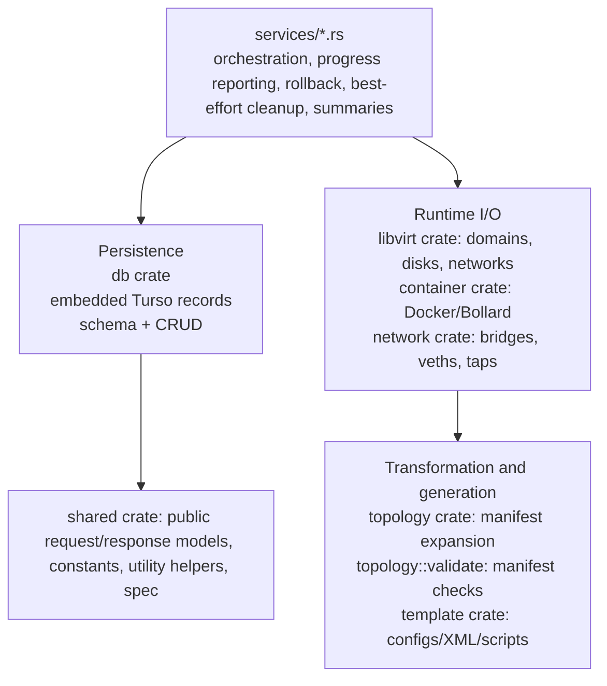

The services are not symmetrical. Some are short CRUD-style orchestrators, and some are large lifecycle engines.

### Service categories

| Category | Module | Purpose |
|---|---|---|
| Lifecycle services | `up/` | create a full lab and all resources |
| | `destroy.rs` | remove a full lab and all resources |
| | `redeploy/` | replace one node inside an existing lab |
| | `down.rs` | stop all nodes or one node |
| | `resume.rs` | start all nodes or one node |
| | `lab_nodes.rs` | the lab's nodes and images that `down` and `resume` act on |
| Read/model services | `inspect.rs` | read DB + runtime data and build lab inspection output |
| | `list_labs.rs` | list lab summaries for a user |
| | `download.rs` | package saved lab files for client download |
| Image/admin services | `import.rs` | image import/list/show/set-default/scan/download support |
| | `container_pull.rs` | Docker/OCI image pull with progress |
| | `clean.rs` | admin force-clean path |
| Network mutation services | `impairment.rs` | update delay/jitter/loss/reorder/corrupt settings on P2P links |
| Background service | `scanner.rs` | observe Docker/libvirt runtime state into the node lifecycle, and check and repair P2p links, for labs no operation holds |
| Node lifecycle | `node_lifecycle.rs` | the only writer of node states: `record` for operations, `observe` for the scanner, the runtime mapping table |
| Lab lifecycle | `lab_lifecycle.rs` | the only writer of lab phases (`record`, under the lab's lease), `require_ready` for operations on nodes, and startup `recover` |
| Shared helpers | `node_ops.rs` | common node setup/building helpers |
| | `progress.rs` | progress message abstraction |

### Node operations

`node_ops.rs` holds what `up`, `redeploy` and `resume` share: generating a node's configuration,
building its domain, and starting it. Arguments that travel together are grouped:

- `LabZtp`: the lab's part of generating any node's configuration (lab ID and directory, images
  directory, the sherpa user, DNS, management network, progress, the owner's account).
  `generate_vm_ztp` and `generate_container_ztp` take it with the node, its image and its
  addresses. Each ZTP method's generator takes the private per-node `NodeZtp`.
- `DomainParts`: the disks, interfaces and network names a VM or unikernel domain is built from,
  for `build_domain_template` and `build_unikernel_domain_template`.
- `container::ContainerSpec`: what `start_container_node` starts, as the `container` crate's
  `run_container` takes it.

### Service call graph for lab creation

`up` is the largest orchestration module. Its job is to convert a validated manifest into persistent records, generated files, runtime networks, and running nodes. `up_lab` runs the phases in turn; each phase is a function in its own file, taking the shared `LabBuild` (lab ID and directory, connections, config, progress) and returning what the next phases need:

| File | What it holds |
|---|---|
| `lab.rs` | `up_lab`: the request checks, setup (phase 1) and planning (phase 2); `LabUp`, whose methods run phases 3 to 13 in groups (records, lab network, links, nodes, readiness) and build the response; rolling back a failed `up` |
| `context.rs` | `LabBuild` |
| `plan.rs` | phase 2: validation against the server, and the `LabPlan` |
| `records.rs` | phase 3: the lab and node records, interfaces, per-node networks |
| `networks.rs` | subnet reservation, lab files and management networks (4), container data networks (6), shared bridges (7) |
| `links.rs` | phase 5, and attaching P2p eBPF redirects |
| `ztp.rs` | phases 8 and 9: addresses, certificates, node configurations and domains, the boot container |
| `runtime.rs` | phases 10 and 11: disks, VM and unikernel domains |
| `ssh.rs` | phase 12 |
| `readiness.rs` | phase 13: starting containers and waiting for nodes |
| `services.rs` | Kubernetes clusters, Keycloak realms and Vaults once nodes are ready |
| `nodes.rs` | manifest node expansion and image lookup, shared with `redeploy` |

```mermaid
flowchart TB
    uplab["up_lab(&AuthContext, UpRequest, &AppState, ProgressSender)"] --> pre["Deserialize manifest JSON into topology::Manifest<br/>validate node secrets and Tailscale enrollment<br/>db::validate_lab_id<br/>lab_operations::begin"]
    pre --> setup
    subgraph phase1["1. Setup"]
        setup["Load current user from DB<br/>Guard: lab_id must not already exist<br/>Load node image records from DB"]
    end
    setup --> validation
    subgraph phase2["2. ManifestValidation"]
        validation["topology::validate checks: duplicate device, device count, Talos clusters<br/>validate environment variables<br/>validate::validate_and_resolve_node_versions (server): versions, container image repos<br/>process_manifest_nodes, then lease node images<br/>validate disk method and guest account per node<br/>check_container_image: Docker has each container image<br/>topology::process_manifest_links, process_manifest_bridges (unknown nodes fail)<br/>validate management/reserved/data interface bounds<br/>admission::admit_lab_nodes: CPU pins and memory against the server<br/>validate duplicate links"]
    end
    validation --> startguard["Guard: no disks or VMs left from an earlier attempt with this lab_id<br/>(after validation, before any resource is created)"]
    startguard --> hostnets
    subgraph phase3["3. DatabaseRecords"]
        subgraph reserve["reserve_lab_networks (retried while concurrent labs win a subnet)"]
            hostnets["read host interface networks (IPv4 and IPv6)"] --> mgmtsubnets["allocate IPv4/IPv6 management subnets<br/>(not in DB, not overlapping host)"] --> loopsubnets["allocate IPv4/IPv6 loopback subnets (not in DB)"] --> createlab["db::create_lab: unique subnet indexes make the insert the reservation"]
        end
        createlab --> createnode["for each node:<br/>db::create_node<br/>node_resources::reserve_node_resources (vCPUs, memory, VNC port, pinned CPUs)<br/>create the node's isolated and reserved libvirt networks and bridges"]
    end
    createnode --> labfiles
    subgraph phase4["4. LabNetworkSetup"]
        labfiles["create /opt/sherpa/labs/{lab_id}<br/>write lab info file<br/>save manifest.toml for redeploy<br/>lab_ssh_key::create_lab_ssh_key: the lab's SSH key pair, 0600"] --> mgmtnets["libvirt NAT management network<br/>Docker bridge management network"] --> tailscale["tailscale::provision when the lab joins a tailnet"]
    end
    tailscale --> links
    subgraph phase5["5. LinkCreation"]
        links["for each link: db::create_link, all P2p, with the manifest's impairment<br/>nothing created yet: libvirt makes VM taps, container veths come later<br/>record veths for disabled interfaces on containers with links"]
    end
    links --> ctrnets
    subgraph phase6["6. ContainerNetworks"]
        ctrnets["Docker macvlan bridge networks for disabled interfaces of containers with no link"]
    end
    ctrnets --> bridges
    subgraph phase7["7. SharedBridges"]
        bridges["network::create_bridge for each [[bridges]] entry<br/>members of containers with links: veth planned for start<br/>other container members: Docker macvlan bridge network<br/>db::create_bridge with its members"]
    end
    bridges --> ztpdirs
    subgraph phase8["8. ZtpGeneration"]
        ztpdirs["create ZTP and TFTP directories<br/>generate the lab CA certificate"] --> nodeztp["per node: assign and save management addresses, node TLS certificate<br/>containers: node_ops::generate_container_ztp<br/>Kubernetes clusters planned and their secrets generated<br/>VMs: node_ops::generate_vm_ztp, save management MAC, build domain template<br/>unikernels: node_ops::generate_unikernel_setup, build domain template"]
    end
    nodeztp --> boot
    subgraph phase9["9. BootContainers"]
        boot["create ZTP config and dnsmasq directories<br/>write dnsmasq config<br/>start the boot container (dnsmasq router)"]
    end
    boot --> disks
    subgraph phase10["10. DiskCloning"]
        disks["node_ops::clone_node_disks for VMs and unikernels"]
    end
    disks --> vms
    subgraph phase11["11. VmCreation"]
        vms["node_ops::create_vm for each VM<br/>node_ops::create_unikernel for each unikernel<br/>release the disk image leases"] --> vmebpf["11b: attach_ready_p2p_links: eBPF redirect on VM-to-VM P2p links"] --> isodown["11c: set isolated bridges down"]
    end
    isodown --> ssh
    subgraph phase12["12. SshConfig"]
        ssh["ssh_config::save_lab_ssh_files<br/>read the lab's SSH private key for the client<br/>build container network attachments"]
    end
    ssh --> secrets
    subgraph phase13["13. NodeReadiness"]
        secrets["write container secret files to RAM"] --> startctr["start containers (node_ops::start_container_node)<br/>P2p containers: veths created into the container netns,<br/>then attach_ready_p2p_links for links now complete<br/>node_lifecycle::record Launched, Ready"]
        startctr --> ready["poll VMs with node_ops::check_vm_ready, record host keys<br/>poll unikernels with check_unikernel_ready<br/>no wait for ready_check.skip nodes or Talos cluster workers"]
        ready --> refresh["ssh_config::refresh_lab_ssh_files with recorded host keys<br/>bootstrap Kubernetes clusters"]
    end
    refresh --> response["Return UpResponse { success, lab_info, summary, errors, total_time_secs }"]
    phase1 -.->|"failure: returned, no cleanup"| failed["error returned"]
    phase2 -.-> failed
    startguard -.-> failed
    phase3 -.->|"failure in phases 3-13"| rollback["clean::clean_lab_resources rolls back the lab<br/>(skipped when a destroy stopped up)"]
    phase13 -.-> rollback
```

The central architectural decision in creation is that the manifest is transformed into fully-expanded intermediate structures before resource creation. That avoids spreading manifest parsing rules across Docker/libvirt/network calls. Validation happens before resource-creating phases where possible; resource phases still need cleanup handling because external backends can fail mid-operation.

The management network's `brm-{lab_id}` bridge is created by libvirt from
`crates/libvirt/templates/network/nat.jinja`, with STP off. With STP on, the kernel holds every
new port for its 2 second minimum forward delay twice, listening then learning, whatever the
network XML asks for. A container's first DNS lookups were lost that way, so the FRR image's boot
`apk add` of openssh failed and the node never became reachable.

### Lab creation data flow

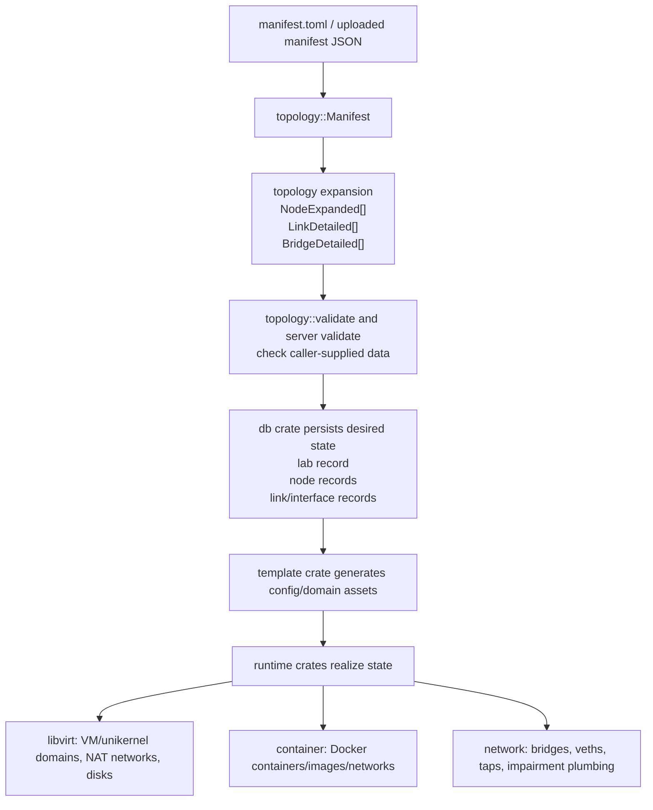

### Service call graph for lab destruction

`destroy.rs` is best-effort: it attempts every cleanup category even if an earlier category
fails. A failure on one resource (a container, VM, disk, network or interface) is recorded and
destroy carries on. So is a setup failure: if `destroy_vms_and_disks` cannot connect to libvirt,
list domains, or find, refresh or list the storage pool, or `destroy_libvirt_networks` cannot
connect or list networks, that step records a `vm`, `disk` or `libvirt_network` error and the
later steps still run. A `vm` or `disk` error keeps the lab record and lab directory, so destroy
can be retried once libvirt is back.

```mermaid
flowchart TB
    destroylab["destroy_lab(&AuthContext, lab_id, &AppState, ProgressSender)"] --> access["require_lab_access: load lab, check owner or admin"]
    access --> stopops["lab_operations::stop: cancel up/redeploy/resume on this lab and wait for them to end"]
    stopops --> reread{"lab still recorded?"}
    reread -->|no: another destroy removed it| already["Return success: already destroyed"]
    reread -->|yes| started["lab_lifecycle::record DestroyStarted: the lab is Destroying"]
    started --> listcontainers
    subgraph containers["destroy_containers"]
        listcontainers["container::list_containers"] --> kill["kill matching lab containers if running"] --> removecontainers["remove matching lab containers"]
    end
    removecontainers --> secrets["destroy_lab_secrets: remove the lab's container secret files"]
    secrets --> listdomains
    subgraph vms["destroy_vms_and_disks"]
        listdomains["list libvirt domains"] --> undefine["undefine/destroy domains named node-lab_id"] --> pool["lookup Sherpa storage pool"] --> volumes["delete volumes named node-lab_id plus a disk suffix"]
    end
    volumes --> listnetworks
    subgraph dockernets["destroy_docker_networks"]
        listnetworks["container::list_networks"] --> deletenetworks["delete networks named name-lab_id"]
    end
    deletenetworks --> listlibvirtnets
    subgraph libvirtnets["destroy_libvirt_networks"]
        listlibvirtnets["list libvirt networks"] --> undefinenets["destroy/undefine networks named name-lab_id"]
    end
    undefinenets --> findifaces
    subgraph interfaces["destroy_interfaces"]
        findifaces["network::list_interface_names"] --> deleteifaces["delete the lab's Sherpa-created bridge/veth/tap interfaces"]
    end
    deleteifaces --> anyerror{"any resource error?"}
    anyerror -->|no| removedir["remove lab directory"]
    removedir -->|removed| deletelab["lab_lifecycle::record Destroyed:<br/>db::delete_lab_from, the schema deletes its nodes, links and bridges"]
    removedir -->|failed| failed
    anyerror -->|yes| failed["lab_lifecycle::record DestroyFailed:<br/>record and folder kept for a retry"]
    deletelab --> response["Return DestroyResponse { success, summary, errors }"]
    failed --> response
```

Destruction uses name-based matching for many runtime resources because the runtime backends are external systems and the database may not be fully reliable after partial failures. This is why consistent naming with `lab_id` embedded in resource names is part of the architecture.

Every resource is matched by its whole name. Everything Sherpa creates for a lab is named
`<name>-<lab_id>` (domains and containers, Docker and libvirt networks, bridges, taps and veths),
and `shared::util::is_lab_resource` checks that form; `libvirt::is_lab_volume` adds one of
`shared::konst::LAB_VOLUME_SUFFIXES` for disks. A substring match would also take another lab's
resources when one of its names contains this lab's ID. Redeploy removes a container node's
data networks with `container_networks::is_node_network` (`<node>-brs<n>-<lab_id>` or
`<node>-iso<n>-<lab_id>`), so node `r1` never takes the networks of node `r1-x`. A new kind of disk needs its suffix in
`LAB_VOLUME_SUFFIXES`, or destroy leaves it behind. The startup guard in `up` and the disks
`inspect` lists use the same rules.

The lab name comes from the lab's database record, so destroy also works when `up` was stopped
before it wrote the lab info file.

`destroy::tear_down_lab` runs these steps for destroy, admin clean and the rollback of a failed
`up`, under the lab's lease, and moves the lab's phase through `Destroying` (see
[`STATE_MACHINES.md`](STATE_MACHINES.md#7-destroy-and-clean)). When any resource fails to go,
`cleanup_lab_metadata` keeps the lab's database record and folder, and the lab is left
`DestroyFailed`, so its owner can destroy it again. Otherwise the folder goes first and the record
last, so a folder that cannot be removed still has a record to destroy it through. A destroy that
waited behind another and finds the lab gone reports success. Admin clean also works on a lab with
no record: it removes the resources and the folder named for the lab ID.

The five teardown steps are `destroy::destroy_lab_resources` (`destroy_compute`: containers,
secret files, VMs and disks; then `destroy_networking`: Docker networks, libvirt networks,
interfaces). `clean` (admin clean, and the rollback of a failed `up`) runs the same function
without a progress sender, so both remove exactly the same resources.

### Operation lifecycle and stopping operations

Long-running operations (`up`, `destroy`, `redeploy`, `resume`, `down`, admin `clean`, image
operations) always run as their own tasks, on every transport, and keep running when their
client disconnects. The WebSocket and SSE handlers spawn them; the plain HTTP handlers wait on
them through `run_detached` in `api/handlers/labs_api.rs`, because axum drops a handler's future when
its client disconnects and would otherwise stop the operation at an arbitrary await point.

`services/lab_operations.rs` keeps, per lab, a read/write lease and a cancellation token with
a stop reason:

- `up`, `redeploy`, `resume` and `down` call `lab_operations::begin` and hold the read lease
  until they return;
- the scanner calls `lab_operations::try_observe`, which takes the write lease without waiting
  and without cancelling anything; a lab an operation holds is skipped that cycle, and an
  operation that starts meanwhile waits while the scanner holds it: a few milliseconds, or a
  few netlink calls and two program loads per link when it repairs P2p links;
- `lab_operations::stop(lab_id, reason)` cancels the token, then waits for the write lease, so
  it returns once every operation on the lab has ended.

Operations check the token only at safe points: between `up` phases, in the readiness and
Talos bootstrap and Kubernetes waits (`LabOperation::sleep` ends early when cancelled), and
before writing lab files. They are never dropped mid-step, because disk and VM steps run in
`spawn_blocking` tasks that would carry on detached.

| Stopped by | Reason | Stopped `up` |
|---|---|---|
| `destroy_lab`, admin `clean_lab` | `Destroy`; the write lease is held while the lab is removed | Skips its auto-cleanup; the destroy removes the lab |
| `lab.cancel` (`services/cancel.rs`): RPC `cancel`, `POST /api/v1/labs/{id}/cancel`, Ctrl-C in the CLI | `Request`; the lease is released at once | Rolls back like a failed `up` |

The first reason wins if both happen. Without this, an orphaned `up` kept polling destroyed
VMs, held its image leases, and recreated the lab directory with cluster credentials after
destroy.

A requested stop removes the lab's token when it releases the lease, so an operation queued
behind it would start with a fresh token ahead of a destroy waiting behind both. `stop` counts
pending destroys per lab, and `begin` cancels a new operation with `Destroy` while one is
pending. `redeploy` and `resume` check access before taking the lease, and again once they hold
it, so a lab destroyed while they waited is not rebuilt.

The CLI (`cmd/interrupt.rs`) waits for `up`, `redeploy` and `resume` while listening for
Ctrl-C. On Ctrl-C it asks whether to stop the operation on the server too, defaulting to no; a
yes opens a new connection and calls `cancel`.

`up` holds read leases on its node images so they cannot be deleted while it provisions. VM
and unikernel image leases end once every disk and domain exists (node records and overlay
backing files protect the images from then on), so a long readiness wait does not block image
pull, import or delete. Container image leases last until the containers start.

### Admission: memory and CPU pins

Nothing else serializes operations across labs, so `services/admission.rs` admits the nodes an
operation will start, one request at a time, before anything is created:

- `up` calls `admit_lab_nodes` in phase 2 (`up/plan.rs`), and holds the `Admission` in its
  plan until it returns;
- `redeploy` calls it in stage 1 (`check_fits_server` in `redeploy/context.rs`), before the
  node is torn down, and holds it in `Redeploy`. The node being replaced does not count
  against itself;
- `resume` and node start call `admit_stopped_nodes` (`resume.rs`) for the target VMs,
  unikernels and memory-limited containers that are stopped, before the Tailscale gateway is
  enrolled or any node starts. Paused and running ones already hold their memory, and stopped
  nodes keep their stored pins.

Requests wait on a Tokio mutex, which grants the lock in arrival order. Under it, the request's
CPU pins are checked (`node_resources::check_cpu_pins_on_server`) against the stored pinned
nodes and against the pins in the pending ledger, its containers' CPU quotas against the
server's CPUs (`validate::check_container_cpus`; containers take no part in pinning), and its
memory against the server
(`validate::check_memory_fits`). Admitted nodes go into the ledger, keyed by domain name
(`<node>-<lab id>`), so the next request counts them before libvirt shows them running. Dropping
the `Admission` when the operation ends releases them; by then libvirt counts the ones that
run. A domain that is running and pending counts once, as pending. The ledger is in memory: a
restart ends the operations it held.

Memory is compared with what is committed, not with free memory. QEMU allocates guest memory
as the guest touches it, so free memory at start overstates the room a lab has. The server's
guest memory is its total (`virNodeGetInfo`) less its hugepage pools and
`host_memory.reserve_mib`, times `host_memory.overcommit_percent` percent (both in
`sherpa.toml`, 4096 MiB and 100 by default; startup refuses a percentage below 1). The limit is
computed in whole MiB with saturating integer arithmetic, rounded down. Against it count every running or
paused domain's maximum memory, Sherpa's and others', the pending nodes, and the request. A VM
held strictly on a NUMA node (`numa.node`, with `numa.memory_mode` `strict` or left out;
`NodeNuma::strict_node`) is also checked against that node: its memory (from the
capabilities XML) less its hugepages and its share of the reserve, against the domains held
strictly on it (`numatune` mode `strict` or `restrictive` with one node). Memory that is not
bound to one node, including a VM with `numa.memory_mode = "preferred"`, whose memory falls
back to other nodes when its node is full, counts only against the whole server, both as a
request and once it runs. A container with a memory limit counts like a domain: its limit
when it is requested, and, read from Docker (`container::list_container_memory`), while it
runs or is paused, Sherpa's and others'; its memory is not bound to a NUMA node. A container
without a limit counts as nothing; the reserve covers those and QEMU's own memory. A refusal names the numbers that fell short
and the two settings. `libvirt::host_memory` and `libvirt::list_domain_memory` read the server
(`crates/libvirt/src/host.rs`). See `docs/investigations/host-memory-oom.md` for why.

### Redeploy architecture

Redeploy is a controlled single-node replacement. It exists because updating node configuration in place is often less reliable than destroying and recreating that node.

The web UI loads the lab's saved manifest; the CLI sends its own. `redeploy_node` (`node.rs`)
runs the stages; each is in its own file under `services/redeploy/`:

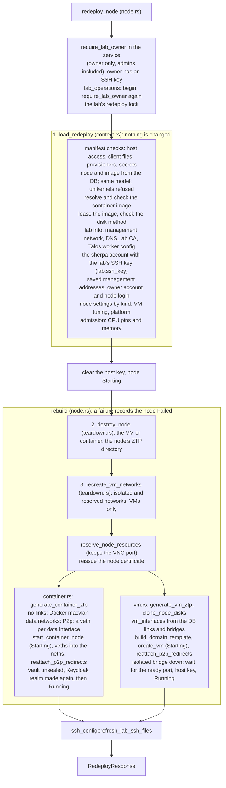

A refused redeploy leaves the node, its state and its host key as they were; a node another
operation is building is refused before teardown. Teardown records it `Building`, the started
node `Starting`, and a ready one `Running`: a container only once Vault and Keycloak are
restored. Once the node is torn down, a failure records it `Failed`, which the scanner never
overwrites. A VM that is not ready within the ready timeout is left `Starting`, the redeploy
succeeds, and the scanner records it `Running` once it answers on SSH. The node lifecycle is
in [`STATE_MACHINES.md`](STATE_MACHINES.md#1-node-lifecycle-nodestate).

The important boundary is that redeploy should preserve the lab-level network topology and only replace the selected node's runtime resources and generated files.

### Down/resume architecture

`down.rs` and `resume.rs` operate at two scopes:

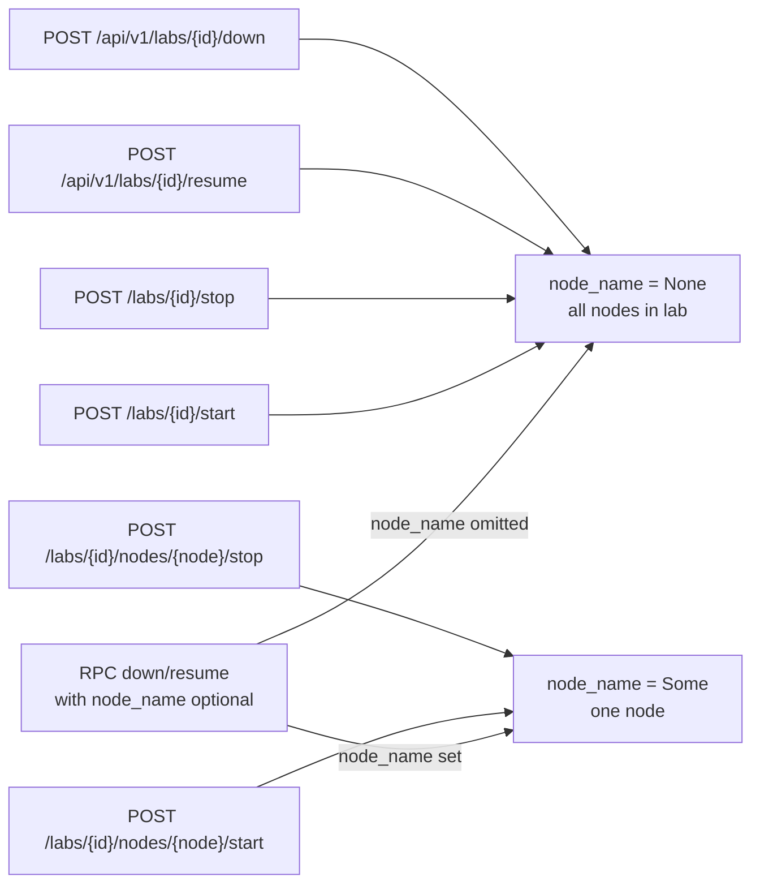

Services check owner-or-admin access first, then inspect node kind and call the right runtime backend: Docker for containers and libvirt for VMs/unikernels. The service returns a `LabNodeActionResponse` describing what changed and what failed.

After the access checks, and before starting anything, resume admits the stopped VMs,
unikernels and memory-limited containers against the server's memory (see [Admission](#admission-memory-and-cpu-pins)); a
refusal fails the whole call.

Both hold the lab's operation lease (`lab_operations::begin`), so a destroy waits for them and
the scanner leaves the lab alone while they run. Both move nodes only through the node
lifecycle (`node_lifecycle::record`): a node another operation is building (`Building`), or one
with no domain or container (`Missing`), is refused before anything is done to it.

Both are idempotent per node. A VM already stopped or running is reported as such. Resume
reads the node's runtime through the one mapping table (`node_lifecycle::libvirt_runtime` and
`container_runtime`) and decides with `start_step`: it boots a shut-off domain or an exited or
created container, resumes or unpauses a paused one, leaves a running one, and refuses a
crashed domain, a dead container, one between states and one that does not exist. Its result
is a `StartOutcome` (`ColdBooted`, `Resumed`, `AlreadyRunning`, `Failed`), and that, not the
message text, decides which nodes get their links re-attached and are waited for. A cold-booted
node is recorded `Starting`, then `Running` once ready; a resumed one `Running`; a running one
is left as it is. `down` pauses only a running container.

`down` routes each node (`shutdown_route`): VMs are asked to shut down (`domain.shutdown()`:
libvirt uses the guest agent when present, otherwise the ACPI power button); Talos cluster
nodes, whose kernel ignores the power button, get a graceful shutdown over the Talos API
(see `TALOS.md`). `down` then polls until the VM stops and forces a power-off only if it is
still running after `VM_SHUTDOWN_TIMEOUT` (60 seconds) or the request fails. Nodes stop in
parallel in two waves, Talos cluster controllers last, so a lab takes at most about two
timeouts. Unikernels and Talos nodes outside a Sherpa-built cluster are powered off directly,
and the result says why. A node is marked `Stopped` only once it has stopped. Forcing guests off without asking lost recently
written files on every VM without a guest agent, which includes Talos and the Ubuntu images.

Resume then waits for the nodes it cold-booted, as `up` does. It loads the lab's saved
manifest (`manifest.toml` in the lab directory, written by `up`) for `ready_timeout`,
`ready_check.skip` and `ready_check.port`; labs without a readable saved manifest use the default
timeout and SSH checks. VMs are probed on SSH, unikernels with `check_unikernel_ready`.
Containers and paused nodes are not waited for. A node that is not ready within the timeout
is reported in its result message, not as an error, and stays `Starting` until the scanner's
probe answers. The WebSocket `resume` RPC is streaming
and sends readiness status messages before its response; the REST and web handlers return
the same `LabNodeActionResponse` once the wait completes.

### Image service architecture

Image management is split by image kind and source:

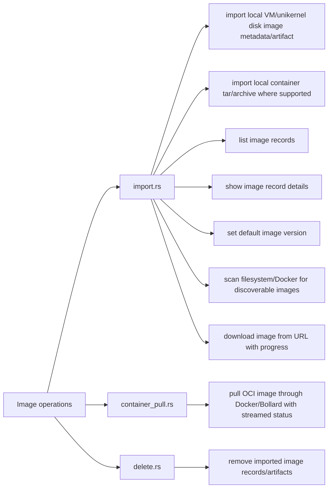

Admin-only image mutations are enforced at the transport boundary. Image list/show require authentication but not admin privileges. Long-running import/pull/download paths use `ProgressSender` so REST, WebSocket, and UI callers can receive progress without service-specific transport code.

#### Container image reference

A container node runs one image reference from pull to create, `container::image_reference(repo,
tag)`, which is `{repo}:{tag}` with the repo kept as written:

- **Pull** (`container_pull.rs`) pulls `repo:tag` and records `repo` on the version's
  `node_image` row. A tar import records the model's built-in repo (`NodeConfig::get_model`).
  An image scan records the repo it matched the tag by: the model's built-in repo, or the
  request's `repo`.
- **Resolve** (`validate::validate_and_resolve_node_versions`) sets the node's `image` to
  `NodeConfig::container_repo`: the manifest's `image`, else the row's repo. Models with a built-in
  repo follow the same rule; the built-in repo is only what their rows start with. A node with
  neither fails, naming both fixes.
- **Check** (`image_lifecycle::check_container_image`) asks Docker for the reference with Bollard
  `inspect_image`. Docker resolves it, so `docker.io/library/nats:2.11`, which Docker tags
  `nats:2.11`, is found. Sherpa does not parse or rewrite references. `up` checks after leasing
  the images, and a redeploy checks in stage 1, before the node is torn down.
- **Create** (`up/readiness.rs`, `redeploy/container.rs`) creates the container from the same
  reference. The container ZTP start settings in `node_ops.rs` set a model's environment, user,
  command and mounts, never its image.

#### Container image scan

`import::scan_images` records local Docker tags the database does not have.
`container_scan::plan_container_scan`, which is pure, decides which repos to ask Docker for:

- With no target, each container model with a built-in repo, and the models with none
  (`generic_container`, `mysql_db`, `postgresql_db`) come back as `SkippedModel`s, which the
  response lists so the CLI can say why they were not matched.
- With a target, the request's `model` and `repo`, only that repo, as versions of that model,
  and the disk scan is not run. `validate::validate_image_scan` checks the pair first: both or
  neither, a container model, a repo without a tag, and no other kind.

Docker matches each repo to its images: `container::get_local_images` lists images with the
Docker API's `reference` filter, as `docker images <repo>` does. Sherpa does not rewrite or
compare names. Docker matches a Docker Hub image by its short name (`mysql`) or its full name
(`docker.io/library/mysql`), but not by `docker.io/mysql` or `index.docker.io/...`, which find
nothing, and never by a prefix (`nats` does not match `natsio/nats-box` or `nats-streaming`).
Docker returns plain `repo:tag` strings, under its own name for the repo (`mysql:8.4` for
`docker.io/library/mysql`), so `container_scan::tagged_versions` reads the tag after the last
`:`, skips digest entries (`nats@sha256:...`, how the containerd image store lists an untagged
image) and leaves out tags that are not valid image versions. The repo is recorded as given.
Each version is recorded through `scan_version`, with `DefaultRequest::Keep`, so only a model's
first version becomes its default and an existing record, repo included, is left as it is.

### Scanner service architecture

The scanner is the background service `run_server` starts to keep node states in line with
libvirt and Docker. It never creates or destroys resources, and it never writes a state an
operation owns: it observes a lab only while no operation holds it, and moves nodes only
through `node_lifecycle::observe`, which applies `NodeState::on_observation`.

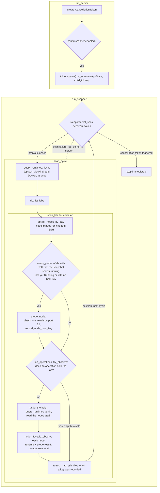

What the scanner may do to each state is in
[`STATE_MACHINES.md`](STATE_MACHINES.md#1-node-lifecycle-nodestate). In short: a node gone
from libvirt or Docker is `Missing`, a crashed domain or dead container `Failed`, a stopped,
paused or exited one `Stopped`; a running one is `Running` once ready. `Building` and `Failed`
nodes are left to the operations.

The probes run before the hold, so a slow SSH server does not delay an operation that wants
the lab. The runtimes are queried again under the hold, so what an operation did just before
it released the lab is what the scanner sees. Each write is a compare-and-set on the state
the scanner read, so it never overwrites a newer write.

A runtime that cannot be queried in a cycle (libvirtd or Docker restarting) is unknown for that
cycle: its nodes keep their recorded state. Treating it as empty would mark every node
`Missing`.

A running VM with SSH is probed while it is not yet `Running`, as after a readiness wait that
timed out or a start outside Sherpa, or while it has no host key. A probe that answers
records the key it offers and lets the node be recorded `Running`. A `Running` VM with a key
is not probed again, so the scanner makes no SSH connections to settled nodes; a key that
changes without a state change, as on a reboot from inside the guest, is read when a client
finds it does not match. Other nodes have no probe: running counts as ready.

Still under the hold, the scanner checks the P2p links of a `Ready` lab in the kernel and
repairs the ends of running nodes that were made again outside Sherpa (`repair_links`): a VM
started with `virsh`, a container started or restarted with `docker`. It keeps each link's
state in `AppState::link_states`, which `inspect` reports. The check and the repair are in
[`STATE_MACHINES.md`, section 25](STATE_MACHINES.md#25-p2p-link-attachment) and
[`P2P-ARCHITECTURE.md`](P2P-ARCHITECTURE.md#repair-by-the-scanner). With `scanner.enabled =
false` nothing repairs them, and `inspect` shows links as not checked until a resume or
redeploy re-attaches them.

## HTTP routing architecture

`api/router.rs` builds a single Axum router. It attaches HTTP tracing, embedded static asset handling, and the route table. It has no CORS layer; see `API.md`. The WebSocket route is added in `daemon/server.rs` after `build_router()` returns.

`build_router()` merges one router per area (`auth_page_routes`, `user_page_routes`, `admin_page_routes`, `public_api_routes`, `api_routes`), then adds the trace layer and, after it, the static asset route:

| Group | Routes |
|---|---|
| Public browser routes | `GET/POST /login`, `GET/POST /signup` (404 unless `allow_signup`), `POST /logout` |
| Protected browser routes | `GET /`; `GET /labs`, `/labs/grid`, `/labs/create`; `GET /jobs/{job_id}`, `/jobs/{job_id}/stream`; `GET /labs/{lab_id}`; `GET /labs/{lab_id}/nodes[/node]`; `POST` lab/node start/stop/redeploy/destroy actions; `GET/POST` profile and SSH-key routes |
| Admin browser routes | `/admin/users...`, `/admin/labs`, `/admin/tools...`, `/admin/images...` |
| Public API routes | `GET /health`, `GET /cert`, `GET /api/v1/spec`, `GET /api/v1/openapi.json`, `GET /api/docs`, `POST /api/v1/auth/login` |
| REST API routes | labs: list/create/inspect/delete/down/resume/redeploy; links: impairment update; images: list/show/import/upload/delete/default/pull/download; admin tools: clean/scan; users: create/list/info/delete/password |
| Layers | `TraceLayer::new_for_http()` |
| Catch-all | static asset route `/{*path}` |

Auth is enforced by handler signatures and handler-local checks, not by route grouping. When reviewing a route's protection level, check the handler parameters and body rather than only the route table.

## Public API specification architecture

The generated API metadata is built from `crates/shared/src/api_spec.rs`.

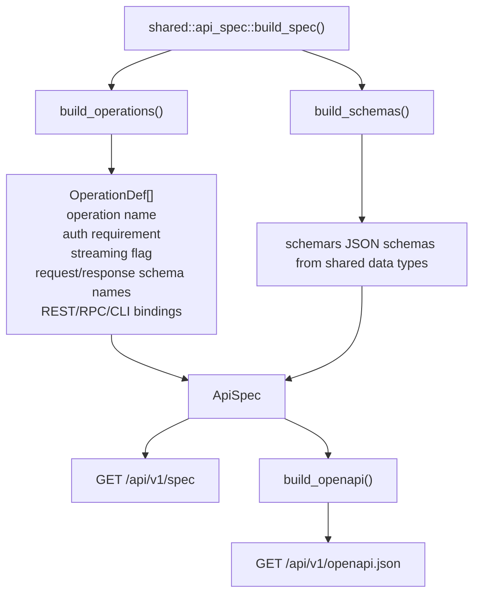

`/api/docs` serves embedded Swagger UI backed by the OpenAPI endpoint.

Current implementation note: the registry marks five canonical operations as streaming (`lab.create`, `lab.destroy`, `node.redeploy`, `image.pull`, `image.download`), while the current REST/RPC handlers also stream `image.import`. That mismatch should be resolved in `api_spec.rs` if streaming import is the intended public contract.

## Lab lifecycle architecture

### Create lifecycle phases

The creation path validates and expands the whole manifest before it creates anything, then creates the lab's records, files and runtime resources phase by phase.

```mermaid
flowchart TB
    input["Manifest input"] --> setup["1. Setup<br/>user, lab_id unused, image records"]
    setup --> validation["2. ManifestValidation<br/>validate and expand nodes, links, bridges"]
    validation --> guard["startup guard<br/>no leftover disks or VMs"]
    subgraph created["Phases that create resources: a failure rolls back with clean_lab_resources"]
        direction TB
        db["3. DatabaseRecords<br/>lab, nodes, per-node libvirt networks"]
        labnet["4. LabNetworkSetup<br/>lab dir and files, management networks, Tailscale"]
        links["5. LinkCreation<br/>link records"]
        ctrnets["6. ContainerNetworks"]
        bridges["7. SharedBridges"]
        ztp["8. ZtpGeneration<br/>CA and node certs, ZTP, cluster secrets, domain templates"]
        boot["9. BootContainers"]
        disks["10. DiskCloning"]
        vms["11. VmCreation<br/>VMs, unikernels, VM-to-VM P2p links"]
        ssh["12. SshConfig"]
        ready["13. NodeReadiness<br/>start containers and their P2p links, wait for nodes"]
        db --> labnet --> links --> ctrnets --> bridges --> ztp --> boot --> disks --> vms --> ssh --> ready
    end
    guard --> db
    ready --> response["UpResponse"]
```

`up_lab` reports progress per `shared::data::UpPhase`, in this order. Setup, ManifestValidation
and the startup guard create nothing, so a failure there returns without cleanup. Once resource
creation starts, the service must assume partial success is possible: a failure in a later
phase cleans up what was created. The [call graph](#service-call-graph-for-lab-creation) lists
what each phase does.

### Node readiness

`up`, `redeploy` and `resume` poll each VM's readiness port (`node_ops::vm_ready_port`: the
manifest's `ready_check.port`, else the model's) with `node_ops::check_vm_ready`. Unikernels use
`check_unikernel_ready`, and containers are ready once running.

A container that is not running right after it starts is reported as a failed node, a
non-critical `NodeReadiness` error, and is not started again (that would fail on its name and
roll back the whole lab). Once readiness ends, `up` checks every started container again, so
one that exited since is reported too and its node marked `Stopped`. VM and unikernel creation
tasks are all awaited before a failure is reported, so none is still creating a domain while
the rollback removes the lab.

```mermaid
flowchart TB
    check["check_vm_ready(ip, port)"] --> port{"port"}
    port -->|22| ssh["check_node_ssh_ready"]
    ssh --> tcp["TCP connect (100 ms)"]
    tcp -->|"refused/timeout"| notready["not ready"]
    tcp -->|connected| hostkey["Jato Session::host_key<br/>(5 s, no login)"]
    hostkey -->|"SSH handshake through key exchange, then disconnect"| ready["ready, with host key"]
    hostkey -->|"non-SSH reply or timeout"| notready
    port -->|other port| portready["check_node_port_ready:<br/>TCP connect (100 ms)"]
```

An open port is not enough on SSH: network devices and some guests accept TCP connections
before their SSH server can answer. The probe uses the Jato library (`bwks/jato-lib`, a
git dependency pinned to a release tag; it is not on crates.io yet). It sends no credentials, so a
node logs no failed login. It allows legacy algorithms for older network devices. The TCP
connect comes first so that nodes that are still booting fail in 100 ms and do not hold up
the poll loop.

The probe returns the host key the node offered (`VmReadiness::Ready { host_key }`), accepted
without checking: the server is on the lab's management network and sees the node first, so
it is the party users already trust to vouch for it. Labs are short-lived, and nodes'
keys were accepted unchecked before. The key is kept on the node's database record
(`node.ssh_host_key`, `db::update_node_host_key`):

- `up` records each VM's key as it becomes ready.
- `redeploy` clears the node's key before teardown and records the new one when it is ready.
- `resume` records the keys of the nodes it cold-booted, as some network operating systems
  (Cisco IOSv, IOSvL2, IOS-XE) make a new RSA key on every boot.
- The scanner records the key of a running VM that is not yet known ready, such as one whose
  readiness wait timed out or that started outside Sherpa, and of a running VM with no key
  (see the scanner section).
- The `node.host_keys` RPC (`services::host_keys`) reads one node's key on request, for a
  client whose recorded key did not match.

`ssh_config::record_node_host_key` writes a key only when it differs, and logs a warning when
it replaces another. `ssh_config::refresh_lab_ssh_files` then renders the lab's SSH files
from the database (nodes' addresses, whether their image has SSH, and their keys) and saves
them with `lab-info.toml`: `sherpa_ssh_config`, in which a node with a recorded key gets
`StrictHostKeyChecking yes` and `UserKnownHostsFile sherpa_known_hosts` (others keep `no` and
`/dev/null`), and `sherpa_known_hosts` (template `ssh/known_hosts.jinja`), one line per key under
the name OpenSSH looks up: the address on port 22, else `[address]:port`. `up`'s response, the
download service and `node.host_keys` carry the known_hosts file, and the client saves it as
`.sherpa/ssh/known_hosts` and rewrites the relative `UserKnownHostsFile` path to that absolute
one, as it does for `IdentityFile` (`client::lab_files`, see [`LAB_FOLDER.md`](LAB_FOLDER.md)). When a node's key is unknown or changed, the client fetches the lab's
keys with `node.host_keys`, warns about a changed key, and connects again (`SSH_CLIENT.md`).

### Lab SSH keys

Nodes that cannot take their owner's keys (no personal account, or a model that has none) are
reached as `sherpa` with a key pair, the `IdentityFile sherpa_ssh_key` hosts of
`sherpa_ssh_config`. Each lab has its own pair, so one lab's key opens no other lab's nodes.
`services::lab_ssh_key` holds the rules:

- **In the lab folder.** `LabSshKeyPaths::in_lab(lab_dir)` is `{lab_dir}/sherpa_ssh_key` and
  `.pub`. Nothing records which key a lab uses: there is no other.
- **`up`** makes the pair in phase 4 (`create_lab_ssh_key`), once the lab folder exists, and
  builds the `sherpa` account (`util::sherpa_user`) from its public key for every node's
  configuration. It is RSA, as some network operating systems take no other kind, and the
  private key is `0600` (`konst::LAB_SSH_PRIVATE_KEY_MODE`). A failed `up` rolls the folder back
  with the key.
- **Node configuration** takes the key only from the `sherpa_user` it is given: the template
  crate's `CloudInitUser::sherpa` and `CloudbaseInitUser::sherpa` take the public key, and the
  MikroTik config disk gets `sherpa_ssh_key.pub` written from it.
- **`redeploy`** builds the account from the lab's key, as `up` did. `resume` changes no node
  configuration.
- **`up`'s response and `download`** return the private key only when the SSH config uses it
  (`LabSshFiles::uses_lab_key`), and only to the owner or an admin (`require_lab_access`). A
  missing key file is an error (`read_private_key`).
  The response and file names are unchanged: the client saves the key as `.sherpa/ssh/key`
  (see [`LAB_FOLDER.md`](LAB_FOLDER.md)).
- **`destroy` and `clean`** delete the key with the lab folder (`cleanup_lab_metadata`).
- **No server key.** Releases before 0.6.0 had a shared key pair in `/opt/sherpa/ssh/`, made by
  `sherpad init`, which labs created before lab keys kept (`lab.ssh_key = 'server'`). 0.6.0
  removed it: `sherpad` and the update script refuse to take over a database that still has
  such labs, naming them ([`DATABASE.md`](DATABASE.md#labs-on-the-servers-ssh-key)), and the
  update script deletes `/opt/sherpa/ssh/sherpa_ssh_key*` once the new release has started.

### Runtime resource model for a lab

A running lab is spread across several systems. The DB is the desired/known state, not the only state.

```mermaid
flowchart LR
    lab["Lab {lab_id}"]
    database["Database<br/>user record<br/>lab record<br/>node records<br/>link records<br/>image records"]
    ram["RAM: /run/sherpa/secrets/{lab_id}/{node}<br/>(container secret files)"]
    fs["Filesystem: /opt/sherpa/labs/{lab_id}<br/>lab info file<br/>saved manifest<br/>generated node configs<br/>ZTP/TFTP assets<br/>cert material where needed<br/>SSH/helper config files"]
    libvirt["libvirt/QEMU<br/>VM domains<br/>unikernel domains<br/>NAT/isolated/reserved networks<br/>cloned/resized disks in Sherpa storage pool"]
    docker["Docker<br/>containers<br/>bridge/macvlan networks<br/>pulled/imported container images"]
    host["Linux host networking<br/>bridges<br/>veth pairs<br/>tap devices<br/>impairment/eBPF/netns wiring where applicable"]
    lab --> database
    lab --> ram
    lab --> fs
    lab --> libvirt
    lab --> docker
    lab --> host
```

Destroy and clean paths must account for all of these locations. That is why cleanup is not a single database delete.

### Node resources and VNC ports

What a node is given is stored on its database record (`DbNode`), not read back from the
hypervisor, by `services::node_resources`:

- `planned_resources`: VMs and unikernels get the manifest's `cpu.count` and `memory`, else the
  image's. Containers get the manifest's, which become their Docker limits, and nothing for
  what it leaves out; `juniper_cevolved` gets its EVO VM's memory plus its container overhead,
  and no CPU count, and `cisco_iol` and `cisco_ioll2` get IOL's memory plus the launcher's
  overhead (see `NODE_SETTINGS.md`). `up` (`readiness.rs`) and redeploy
  (`redeploy/container.rs`) create the container with the stored values, so Docker and the
  database agree; resume starts the existing container, which keeps its limits.
- `reserve_node_resources` (`up`, right after each node record is created, and `redeploy`): a
  VM also gets a VNC port, the lowest in `konst::VNC_PORT_FIRST..=VNC_PORT_LAST` that no node
  holds and nothing on the server listens on. `unique_node_vnc_port` settles a race with a
  concurrent lab, which is retried, as lab subnets are. A redeployed VM keeps its port.
- `node_ops::build_domain_template` takes the stored values, so the domain and the database
  agree. The domain has `port='N' autoport='no'`, so libvirt never moves the console, also
  across down/resume.
- `inspect` and the web UI node page read them from the record, with no domain lookup.

### VM performance tuning

A VM node's tuning in its `cpu`, `numa`, `boot_disk` and `interfaces` groups
(`shared::data::NodeCpu`, `NodeNuma`, `NodeBootDisk`, `NodeInterfaces`; see
[`NODE_SETTINGS.md`](NODE_SETTINGS.md)) reaches the domain as `template::DomainTuning`, built by
`DomainTuning::from_node_settings` in `node_ops::build_domain_template`. The domain then renders:
- `<cputune>` with `vcpupin`, `emulatorpin` and `iothreadpin`;
- `<numatune>`, with `<memory mode>` from `numa.memory_mode` (`strict` by default, or
  `preferred`);
- `<iothreads>`;
- the CPU mode and `<topology>`;
- the disk driver's `cache`, `io` and `iothread`;
- `<driver queues>` on virtio interfaces.

The checks run in three places:
- **`topology::validate::check_vm_tuning`** (client `validate` and server `up` and
  `redeploy`): the node's own settings against its image. `check_node_kind_settings` refuses
  these settings on other kinds first; `cpu.topology` and `cpu.pinning` match `cpu.count`; I/O
  threads need virtio disks; `interfaces.queues` needs virtio interfaces; `numa.memory_mode`
  needs `numa.node`.
- **`topology::validate::check_cpu_pin_overlap`**: a host CPU pinned to a vCPU belongs to one
  node, and no node runs QEMU or I/O threads on it. QEMU and I/O threads may share CPUs.
- **`node_resources::check_cpu_pins_on_server`** (`up` and `redeploy`, before anything is
  created or destroyed): every CPU and the NUMA node exist on the server, from
  `libvirt::host_cpus`. The pins also must not overlap those stored on any node of any lab
  (`db::list_pinned_nodes`). A redeployed node's own stored pins are skipped.

`planned_resources` stores the pins on the node (`cpu_pinning`, and `qemu_thread_cpus` for the
QEMU and I/O threads), so later labs see them. Two labs started at the same moment could both
pass the check before either stores its pins; unlike VNC ports, pins have no unique index.

Huge pages come from the host's transparent hugepages, which QEMU requests for guest RAM.
There is no `memoryBacking` setting. `scripts/sherpa_install.sh` sets THP to `madvise` unless it
is `always`, now and on boot through `/etc/tmpfiles.d/sherpa-thp.conf`; the uninstall script
removes that rule.

### VM hardware watchdog

A VM has an i6300esb watchdog only when its node sets `vm.watchdog` (`shared::data::WatchdogAction`,
libvirt's action names). `node_ops::build_domain_template` copies it to
`DomainTemplate::watchdog`, and the domain renders `<watchdog model='i6300esb' action='...'/>`
for it. `topology::validate::check_node_kind_settings` (client `validate`, server `up` and
`redeploy`) refuses the `vm` group on containers and unikernels. Nothing is stored: the domain keeps it across down and
resume, and `redeploy` reads it from the manifest again.

libvirt (10.0 on Ubuntu 24.04) also lists the q35 chipset's iTCO watchdog on every q35 domain,
`<watchdog model='itco'>`, with the same action, which QEMU applies to all watchdogs: `reset`
without `watchdog`. Sherpa does not add or remove it; it acts only if the guest arms it.

VMs once all had a `reset` watchdog. Cisco IOS arms it at boot and feeds it only after an init
phase that, under nested KVM, outlasts the timeout, so those VMs reset in a loop; it was removed
from the default domain for that reason.

### Container data interfaces

Every `[[links]]` link is a P2p (eBPF) link. A container with a link takes all its data
interfaces as veth pairs created from the host straight into its namespace after it starts,
including its private bridge members and disabled interfaces (see `P2P-ARCHITECTURE.md`).
Nothing runs in the image, so images without `ip` (such as `mongo`) or a shell work.

A container with no link gets a Docker network attachment (`ContainerNetworkAttachment`) for
each data interface, connected in index order after the container starts
(`container::run_container`). `services::container_networks` builds them for `up` and
`redeploy`. Every data interface gets one: Docker names unnamed interfaces in attach order, so
one left out would rename every interface after it. A link end among them is an error, since a
container with a link takes veths.

`run_container` takes a `container::ContainerSpec`. A container it creates but cannot start or
attach is removed again, so a retried `up` or `redeploy` can create it under the same name. An
active, renamed data interface is set up with a script that gets the interface name as `$1`,
never in the script text.

| Interface | Docker network | Mode | Parent |
|---|---|---|---|
| `[[bridges]]` member | `{node}-brs{interface_index}-{lab_id}` | macvlan bridge | the bridge's `brs{bridge_index}-{lab_id}` |
| disabled | `{node}-iso{interface_index}-{lab_id}` | macvlan bridge | the node's isolated `bri` bridge |

Bridge links, from labs created before every link was a P2p link, are no longer supported: see
[P2P-ARCHITECTURE.md](P2P-ARCHITECTURE.md).

Bridge member networks are created in phase 7, after their `brs` bridge, and the members of
containers with links get a veth pair there. The bridge record stores its `members`, each a
node and interface, so `redeploy` reconnects exactly those interfaces, for VMs as well as
containers.

- Docker names the interface in the container through the endpoint driver option
  `konst::DOCKER_ENDPOINT_IFNAME_OPT` when `linux_interface_name` is set.
- A disabled interface is a macvlan on the node's isolated bridge. The server sets that bridge
  down from the host (`network::set_link_down`, phase 11c and the container redeploy), as for
  VMs, so the interface has no carrier.
- An active interface that Docker renames (an SR Linux bridge member) is set promiscuous and up
  with `ip` in the container (`data_interface_command`).

### Lab management addressing

Each lab gets a management `/24` (IPv4) and `/64` (IPv6). Host offsets are split into fixed
blocks, defined in `crates/shared/src/konst.rs` and applied to both address families:

| Offsets | Block | Users |
|---|---|---|
| `1`–`10` | Sherpa infrastructure (`MANAGEMENT_INFRA_HOST_OFFSETS`) | `.1` gateway and DNS, `.2` router (dnsmasq, boot server), `.3` Tailscale gateway |
| `11`–`20` | Lab control planes (`MANAGEMENT_CONTROL_PLANE_HOST_OFFSETS`) | `.11`–`.12` Talos cluster VIPs (`TALOS_VIP_HOST_OFFSETS`); `.13`–`.20` Cilium cluster load balancer addresses, four per cluster (`TALOS_LOAD_BALANCER_HOST_OFFSETS`) |
| `21`–`254` | Lab nodes (`MANAGEMENT_NODE_HOST_OFFSETS`) | node `n` (1-based manifest index) at `.20 + n`; the dnsmasq DHCP range |

`util::node_management_host_offset` maps a node index to its offset and refuses indexes outside
the node block, so a lab holds at most 234 nodes; `topology::validate::check_device_count` rejects larger
manifests before anything is created. Nodes keep `dhcp-host` reservations inside the DHCP range,
so dnsmasq never leases a node's address to another client.

Up assigns addresses from the node index and saves them on the node records. Redeploy reuses the
saved addresses and only computes one for a node without them, so labs created under an earlier
layout keep the addresses their dnsmasq config and SSH config already hold. Resume reads the
saved addresses.

### Destroy lifecycle phases

```mermaid
flowchart TB
    destroy["destroy_lab(&AuthContext, lab_id)"] --> access["require_lab_access: load lab, owner or admin"]
    access --> stopops["lab_operations::stop: cancel operations on this lab"]
    stopops --> labname["lab name from the lab record"]
    labname --> containers
    subgraph cleanup["best-effort cleanup sequence"]
        containers["Step 1: Docker containers, then their secret files"]
        domains["Step 2: libvirt domains and disks"]
        dockernets["Step 3: Docker networks"]
        libvirtnets["Step 4: libvirt networks"]
        interfaces["Step 5: Linux host interfaces"]
        records["Step 6: database lab/link/node records"]
        labdir["Step 7: /opt/sherpa/labs/{lab_id} directory"]
        containers --> domains --> dockernets --> libvirtnets --> interfaces --> records --> labdir
    end
    labdir --> response["DestroyResponse<br/>success = errors.is_empty()<br/>summary of each cleanup category<br/>detailed DestroyError[] for failed categories"]
```

The best-effort rule is important: failing to delete a disk should not prevent the server from attempting to delete Docker networks or database records. Operators need a complete summary of what was cleaned and what still requires manual repair.

## TLS/listener architecture

TLS is enabled by default. The main listener serves the UI, REST API, and WebSocket endpoint. When TLS is enabled, a separate HTTP listener is started only for certificate retrieval.

```mermaid
flowchart TB
    subgraph tlson["TLS enabled"]
        main["main listener"]
        main --> main4["IPv4: wss/https on config.server_ipv4:config.ws_port"]
        main --> main6["IPv6: optional wss/https on [config.server_ipv6]:config.ws_port"]
        cert["cert listener"]
        cert --> cert4["IPv4: http on config.server_ipv4:config.http_port"]
        cert --> cert6["IPv6: optional http on [config.server_ipv6]:config.http_port"]
    end
    subgraph tlsoff["TLS disabled"]
        mainonly["main listener only"]
        mainonly --> plain4["IPv4: ws/http"]
        mainonly --> plain6["IPv6: optional ws/http"]
    end
```

Certificate SAN generation is part of server startup. If no SANs are configured, startup adds listen IPs, non-loopback interface IPs when listening on unspecified addresses, localhost, loopbacks, hostname, and FQDN when available.

The `/cert` endpoint is public by design because clients need to fetch the certificate before they can establish trust. If TLS is disabled, `/cert` returns a service-unavailable JSON response.

## Observability architecture

Logging and OTel are initialized before `AppState` so startup failures and backend connection failures are visible.

```mermaid
flowchart TB
    runserver["run_server"] --> envfilter["EnvFilter from RUST_LOG or info"]
    envfilter --> otel{"OTel enabled?"}
    otel -->|yes| tracer
    subgraph otelinit["OTel"]
        tracer["SdkTracerProvider + OTLP span exporter"] --> meter["SdkMeterProvider + periodic OTLP metric exporter"] --> layer["tracing_opentelemetry layer"] --> metrics["Metrics::new(meter)"]
    end
    otel -->|no| mode
    metrics --> mode{"foreground or daemon?"}
    mode -->|foreground| terminal["tracing fmt layer to terminal"]
    mode -->|daemon| logfile["tracing fmt layer to sherpad log file"]
```

Important spans/metrics are created at these levels:

- HTTP requests through `tower_http::TraceLayer`.
- WebSocket connections through a `ws_connection` span.
- RPC calls through an `rpc_call` span.
- Public service operations through `#[instrument]` spans.
- Database, Docker, libvirt, and network helper functions where instrumented in their crates.
- Metrics for WebSocket connection count, RPC duration, service operation duration, and errors.

See [`OTEL.md`](OTEL.md) for collector configuration and exported metric names.

## Known architectural seams

Open implementation seams (handler-driven auth, inconsistent service authorization, spec/streaming parity, in-memory jobs, name-based resource cleanup, blocking libvirt calls) each have a proposal in [`../prds/`](../prds/).

## Source map

| Concern | Primary file(s) |
|---|---|
| Binary dispatch | `crates/server/src/main.rs` |
| CLI shape | `crates/server/src/cli.rs` |
| Daemon/PID/log management | `crates/server/src/daemon/manager.rs`, `pidfile.rs` |
| Server runtime setup | `crates/server/src/daemon/server.rs` |
| Shared state | `crates/server/src/daemon/state.rs` |
| Metrics | `crates/server/src/daemon/metrics.rs` |
| Router | `crates/server/src/api/router.rs` |
| REST/HTML handlers | `crates/server/src/api/handlers/` |
| REST auth extractors | `crates/server/src/api/extractors.rs` |
| SSE conversion | `crates/server/src/api/sse.rs` |
| WebSocket lifecycle | `crates/server/src/api/websocket/handler.rs`, `connection.rs`, `messages.rs` |
| RPC dispatch | `crates/server/src/api/websocket/rpc/dispatch.rs` |
| JWT/cookies/auth context | `crates/server/src/auth/` |
| Lab create | `crates/server/src/services/up/` |
| Lab destroy | `crates/server/src/services/destroy.rs` |
| Node/lab stop/start | `crates/server/src/services/down.rs`, `resume.rs` |
| Redeploy | `crates/server/src/services/redeploy/` |
| Inspect/list/download | `crates/server/src/services/inspect.rs`, `list_labs.rs`, `download.rs` |
| Lab SSH keys | `crates/server/src/services/lab_ssh_key.rs` |
| Image management | `crates/server/src/services/import.rs`, `container_pull.rs`, `delete.rs` |
| Link impairment | `crates/server/src/services/impairment.rs` |
| Scanner | `crates/server/src/services/scanner.rs` |
| Node lifecycle | `crates/shared/src/data/node_lifecycle.rs` (transitions), `crates/server/src/services/node_lifecycle.rs` (writes) |
| TLS certificates | `crates/server/src/tls/` |
| Generated API registry | `crates/shared/src/api_spec.rs` |
