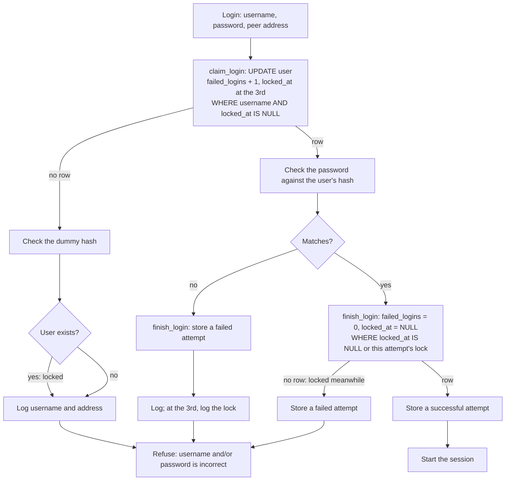

# Sherpa Application Server Architecture

`sherpad` (`crates/server`) serves the web UI, REST, WebSocket JSON-RPC and the CLI. Handlers know
transports and authentication, services (`services/`) know orchestration, and the infrastructure
crates know their backend and nothing of HTTP or RPC. The operations, their access and transports
are one registry, `shared::api_spec`, published at `/api/v1/spec`; the user's view is sherpa-docs
`api-reference.md`. An operation has a REST route, an RPC method or both, and the spec leaves out
the `rest` or `rpc` binding it lacks; the OpenAPI document holds only the operations with a REST
route. Server-only constants live in the narrowest module that uses them, else in
`crates/server/src/konst.rs`, so editing one rebuilds `sherpad` alone.

## Server startup architecture

`daemon::server::run_server` installs the signal handlers before any listener binds, so a server
that could not shut down cleanly does not start. `AppState::new` loads the JWT secret, opens and
migrates the database, loads its key, requires the built-in `sherpa-admin` (created only from
`SHERPA_ADMIN_PASSWORD`), restricts storage. A secret or key
that is damaged stops startup and is never replaced: a new secret would end every session, a new
key would open nothing sealed. Before anything takes requests, `lab_lifecycle::recover` marks what
the last run left mid-way, shared CPU pins are logged and stopped domains' consoles move to their
sockets; then the scanner and the session sweeper start.

### A Docker management network that is already there

The lab's Docker management network, `sherpa-management-<lab_id>`, is named from the lab ID, so a
network an earlier lab of the same name left can be there. During validation, before anything
is created, `up::networks::check_existing_docker_management_network` inspects it with
`container::inspect_existing_bridge_network`: one with the lab's subnets, gateways and bridge is
reused, and one that differs refuses the `up` with a conflict naming it and each difference. The
check must come before any resource, since a failed `up`'s rollback removes every Docker network
named for the lab. `container::create_docker_bridge_network` makes the same comparison when Docker
answers 409, for a network that appears in between. Nothing removes a network that differs. The
cases are `links-and-bridges.md`, `management_network`.

### The server process and its PID file

`sherpad start` runs one server per host. The server takes an exclusive `flock` on
`/opt/sherpa/run/sherpad.pid` (`daemon::pidfile::lock_pid_file`, with nix's `Flock`) before it
writes its PID there, and holds it until it exits, so a second start, in the foreground or as the
background child, fails at the lock. A file left by a crash has no lock holder and is taken over.
`stop`, `restart`, `status` and `sherpad user unlock` trust the PID only when its process runs and
was started as `sherpad`, by the program name in `/proc/<pid>/cmdline`
(`daemon::pidfile::running_server_pid`): a stale PID that another program now holds reads as no
server and is never signalled. The cases are `install-and-update.md`, `sherpad_daemon`.

### Lab and database storage permissions

Lab data and the database are kept from other users by directory modes, not file modes
(`daemon::storage::secure_storage`, every start), so files of any age are covered. File modes in
lab folders are left alone: dnsmasq runs as root and serves only world-readable files, and
containers may read their bind-mounted configs as non-root. Pool volumes are `0600`, and libvirt
hands them to QEMU while a VM runs. The modes are `install-and-update.md`, `server_file_modes`.

### Who owns `/opt/sherpa`

`/opt/sherpa`, `bin`, the binaries and `libvirt` are root's and `0755`: systemd runs
`bin/sherpad` as `sherpa`, and the scripts run it as root, so neither `sherpa` nor its group may
change it. `sherpa` owns only the folders sherpad writes (config, env, logs, `.secret`, `.certs`,
db, labs, the storage pool, images, containers, bins, run). sherpad cannot create a folder in
`/opt/sherpa`, so the install and update scripts make each of them (`secure_server_folders`, in
the `# BEGIN server folders` section both scripts carry), changing the folders only, never what
is in them. The `sherpa` group reads the lab folders and the log, and writes only the images
folder, where admins stage node images; nothing there is run by systemd or written by root.

Root changes nothing through a symlink: the scripts refuse a path with a symlink in any
component, set owners with `chown -h`, install binaries and env files with `install`, which
replaces a link, and write the blank disks and set file modes as `sherpa`. The update script
runs an installed binary for its version only when the binary is root's and no other account
can write it; any other is replaced without being run. When a new release does not start, the
update moves back only the binaries it set aside, keeping their owners, so it never makes a
binary another account wrote root's. The modes are `install-and-update.md`,
`server_file_modes`.

### Config, env and log file permissions

`sherpa.toml` and the env files can hold secrets, so only `sherpa` reads them, not its group.
`sherpad init` and `sherpad user unlock` run as `sherpa` and refuse any other account, root
included. The update script
changes owner and mode only, and skips symlinks, so root never follows one planted by `sherpa`.

## Transport architecture

The web UI is server-rendered Askama with HTMX. Templates only render: handlers decide from enums
and pass view types, and `dev/check-template-text-decisions.sh` rejects text decisions in templates.

`api/websocket/rpc/dispatch.rs` holds `METHODS`, the one table of RPC methods with each method's
access and whether it streams; `dispatch` authenticates as it says, and a test holds it to the
API spec. Long operations report through a `ProgressSender`, so a service never knows whether its
progress goes to SSE, the web UI or a WebSocket.

Every request body and query string is read through `api/request_parse.rs`: handlers take
`JsonBody`, `FormBody` and `QueryParams` instead of axum's `Json`, `Form` and `Query`, RPC
parameters go through `dispatch::parse`, and the WebSocket message and the manifests of `up` and
`redeploy` through `parse_json` and `parse_value`. serde's and axum's messages quote the value
they failed on, a password or a secret file among them, so their text is never read, logged or
kept. A JSON body or WebSocket message is deserialized straight into its type with
`serde_path_to_error` over `serde_json::Deserializer::from_slice`, and a `serde_json::Value` (RPC
parameters, a manifest) with `serde_path_to_error` over the value itself. A form body, taken as
bytes by axum's `RawForm`, and a query string, taken from the URI, are deserialized the same way
over `serde_urlencoded::Deserializer` on `form_urlencoded::parse`. The error keeps only the
path. The answer is `400` with `the request is not valid at <path>`, or `the request is not
valid` when the path is empty (a missing top-level field) or has a segment that is not an index
or a plain name, since map keys and unknown fields are what the client sent. Only a body that is
not JSON, the wrong content type and a body that cannot be read keep their own fixed messages. A
JSON body must be sent as `application/json` or `application/*+json`, which stops a cross-site
form post: the `Content-Type` header is parsed as a `mime::Mime` and its type, subtype and suffix
compared. A form must be sent as `application/x-www-form-urlencoded`, which `RawForm` checks.
Path parameters are read by axum's own `Path`: they come from the URL, which is not secret.

## Authentication and authorization architecture

### Sessions and identity

Cookies, bearer tokens and the RPC `params.token` carry the same JWT. Each names a login session,
and identity comes from the session's row, not the token: `auth::session::lookup` reads the session and its user in one query, so a token works only while
its session is active, and a deleted user's token never
works for a new account of the same name. No authorization decision reads the token's own claims.
What ends a session is `tests/specs/accounts-and-auth.md`, `user_sessions`.

### Logins and the account lockout

RPC `auth.login`, REST `POST /api/v1/auth/login` and the web form `POST /login` all call
`auth::login::check_credentials` with the peer's address (`ConnectInfo`; the WebSocket
connection keeps its peer's). Each answers every refusal with one status and one body,
"username and/or password is incorrect", so a caller cannot tell a wrong password from an
unknown username or a locked account.

The attempt is counted before its password is checked: `db::claim_login` is one
`UPDATE … RETURNING` that adds 1 to `user.failed_logins` only while `locked_at` is `NULL`, and sets
`locked_at` on the attempt that reaches 3. Attempts that arrive together are serialised by that
statement, so no more than 3 passwords are checked against an account between successes, and the
third locks it before its password is checked. `db::finish_login` then, in one transaction,
stores the attempt in `login_attempt` and, for the right password, sets the count back to 0 and
clears the lock only if it is this attempt's own or none: a login whose account another attempt
locked meanwhile is refused and stored as a failure. A server error between the two leaves the
attempt counted and not stored. Nothing unlocks an account by time.

An attempt on a locked account and one for an unknown username are logged with the username and
address and not stored; neither checks a real hash. Passwords are never logged or stored. An admin
unlocks an account with `services::user_unlock` (RPC `user.unlock`, REST
`POST /api/v1/admin/users/{username}/unlock`, the users page's Unlock button), which sets the
count back to 0. A password reset leaves the lock as it is.

When no admin can log in, root unlocks an account, the built-in `sherpa-admin` included, on the
host with `sherpad user unlock <username>` (`crates/server/src/user.rs`), with no channel into the
server. It calls the same `db::unlock_user` on the database file, so it needs `sherpad` stopped:
it reads the PID file as `sherpad status` does (`daemon::pidfile::running_server_pid`), and while
that names a running `sherpad` it refuses before opening the database. Like `sherpad init` it
runs as `sherpa` only (`validate::validate_service_account`),
since the database is that account's, and an unknown username is an error. It logs
`user.unlocked` at `info` on stderr. The steps are `systemctl stop sherpad`,
`sudo -u sherpa sherpad user unlock sherpa-admin`, `systemctl start sherpad`. The cases are
`tests/specs/accounts-and-auth.md`, `user_login`.

### Services enforce authorization

Every lab service checks the caller's `&AuthContext` with `auth/policy.rs` before it sends
progress, takes a lock or touches a resource; requests carry no username. Refusals are a typed
`ServiceError` each transport maps to its status, never decided by error text. Who may do what is
`tests/specs/accounts-and-auth.md`, `access_control`.

### What a caller is told of an error

`services::error` classifies every failure by type. `ServiceError`, re-exported from the crate
root, is the server crate's one error enum. Its four text variants (not found, denied, invalid,
conflict) carry the message the user is shown; a refusal a test or caller tells apart has its own
variant, which carries the values it is about as fields and builds its message from them, as the
memory (`MemoryShortage`) and CPU pin refusals do. `ServiceError::category` maps every variant to
the kind of refusal a transport answers with (`ServiceCategory`: not found, denied, conflict,
invalid), or to `Failed` for a node failure whose reason the caller is told (a sandbox's reported
failure or broken status channel: RPC server error, REST `502` `NODE_FAILED`), so each transport
picks its status from the category and a new variant cannot miss its code. A variant whose
category is `None`, such as a startup or `sherpad` command failure, is not a
refusal: `ServiceError::find` skips it and the caller is not told of it. A refusal of what the
user sent or of the current state is typed where it is raised, or where a validator that refuses
only user input is called, with its full wording. Anything else is `Unexpected`: `Unexpected::log`
logs what failed and the error's chain at `error` level with a short random reference, and the
caller gets only `internal error (ref <id>); see the server log`. A problem the server meets on
each scan and works around logs once instead, with `Unexpected::warn` at `warn` level, and keeps
its reference (see the scanner's unreadable link ends in `P2P-ARCHITECTURE.md`). RPC (`service_error`), REST
(`ApiError::from`, the SSE `error` event), the web UI's job page and fragments
(`caller_message`), and the errors inside an answer (a destroy's `DestroyError`s, an up's
service errors, down and resume per-node messages) all go through it, so no caller sees a path,
libvirt or Docker text, or a chain. The outer `.context` of a typed error is not sent: only the
`ServiceError`'s own message is, with the message of each error the variant carries as its
`#[source]` after it (`ServiceError::message`). A variant that carries the check that refused the
request as its source, such as `RequestUnreadable` with its `InvalidRequest`, keeps that error's
words out of its own message, so a chain reads each cause once. A request that does not parse is
an `InvalidRequest`, the extractors' rejection: a variant per reason, the path of the field that
is wrong carried as data, never the value sent. The cases are `tests/specs/inspect-and-web-ui.md`, `api_errors`.

#### The admin boundary

Admins see and manage every lab, but only its owner connects to its nodes: the owner is their only
login, and download, host keys, consoles and redeploy are owner-only. What remains is by design: an
admin who resets a password can sign in as that user (logged, ending their sessions), and an admin
may start privileged containers and host mounts, which is root. The boundary is the admin role
through Sherpa's interfaces, with an audit trail, not a defence against root.

The built-in `sherpa-admin` (`shared::konst::ADMIN_USERNAME`) runs the server and owns no new
labs: `auth::policy::require_lab_starter` refuses it up, resume and redeploy, and it keeps every
other admin power, destroy, stop and clean included. Its name is in Sherpa's reserved `sherpa-`
namespace, which no other user can take (`shared::validators::username`). The migration that
renames a built-in `admin` to it is in [`DATABASE.md`](DATABASE.md#versions). The
cases are `tests/specs/accounts-and-auth.md`, `builtin_admin`.

### Device passwords

Only the account's own user sets one (`services::user_device_password`), admins included, as
whoever sets it knows it, and it takes their login password, so a stolen session cannot. Nodes'
use of it is in [`GUEST_PROVISIONING.md`](GUEST_PROVISIONING.md#device-password).

### When a transport checks first

REST destroy and redeploy answer with SSE, where a service refusal would arrive as a 200 with an
error event, so they call the policy helper first, as do web redeploy, download and destroy; the
service checks again. A web job presents its requester's session again when it starts.

## Service layer architecture

`node_lifecycle` alone writes node states and `lab_lifecycle` lab phases; see
`tests/specs/nodes.md` and `lab-lifecycle.md`.

### Service call graph for lab creation

`up_lab` checks the request, takes the lab's lease and runs `shared::data::UpPhase` in order.
Setup (1) checks the nodes against their images before libvirt or Docker is touched, so a missing
image gets the same answer whatever the hypervisor's state, and ends by reserving the lab
(`up::networks::reserve_lab`), whose unique subnet indexes make the insert the reservation.
ManifestValidation (2) expands the whole manifest, so no parsing rule spreads into backend calls,
leases images and runs admission; a failure gives the reservation back. From phase 3 on, a failure
rolls the lab back with `clean::clean_lab_resources`, unless a destroy stopped it.

### Service call graph for lab destruction

`destroy::tear_down_lab` serves destroy, admin clean and `up`'s rollback alike, under the write
lease, and tries every step even when one fails. Resources are matched by their whole name,
`<name>-<lab_id>` (`shared::util::is_lab_resource`), since the database may lag the backends after
a partial failure and a substring match would take another lab's; a new disk kind needs its suffix
in `LAB_VOLUME_SUFFIXES`. When anything is left, the record stays and the lab is `DestroyFailed`;
otherwise the folder goes before the record, so a stuck folder still has a record to destroy.

### Operation lifecycle and stopping operations

Long operations run as their own tasks and outlive their client (`run_detached` for plain HTTP, as
axum drops a handler's future on disconnect). `services::lab_operations` gives each lab a lease and
a cancellation token, and records what holds or waits for the lease as a `LeaseHolder`: an
`Operation` (`up`, `redeploy`, `resume`, `down`, the startup recovery) shares the read lease, so
the lab's phase, not the lease, keeps them apart, and `REDEPLOY_LOCKS` serialises only a lab's
redeploys with each other; a destroy, a clean, a requested stop and the scanner take the write
lease. The token is checked only at safe points, as disk and VM steps run in `spawn_blocking`
tasks that a dropped future would leave running; `down` checks it once, before it starts, and the
recovery never. A requested stop (`request_stop`, the `cancel` call) acts only when an `up`,
`redeploy` or `resume` holds or waits for the lease: it cancels the token, waits for the write
lease and answers `stopped: true`. When only a `down`, a recovery, a destroy or the scanner holds
the lab, it cancels nothing and answers `stopped: false` at once. VM image leases end once every disk and domain exists, so a long readiness wait
does not block image changes.

### Admission: memory and CPU pins

`services::admission` admits the nodes an operation will start, one request at a time, before
anything is created: nothing else serializes operations across labs. Memory is compared with what
is committed, not with free memory, as QEMU allocates guest memory only once touched: every running
domain's and limited container's maximum, Sherpa's and others', plus the pending, against the total
less hugepages and `host_memory.reserve_mib`, times `overcommit_percent`; a VM bound strictly to a
NUMA node is checked against that node too. Pending memory is held in memory until libvirt counts it.

### CPU pins in admission

Admission checks pins against the `cpu_pin` table (see [`DATABASE.md`](DATABASE.md#cpu-pins)) to
refuse naming the holder, to admins and its owner only, then claims them; the trigger catches a
race. A redeploying node holds old and new pins until it keeps the old ones (while its old domain
may run) or the new (from `store_node_resources` on). Overlaps stored before the triggers are only
warned about, as an existing lab is never refused for its pins.

### Redeploy architecture

Redeploy replaces one node and keeps the lab's topology; redeploys of one lab serialize
(`REDEPLOY_LOCKS`), as each updates the shared definition. The node gets the image `up` would give
it. The web UI has only the stored definition, without file contents or resolved values, so it
refuses a node that needs them (`validate::check_web_redeployable`), naming the CLI command.

### Down/resume architecture

Resume acts on each node from its runtime alone (`start_step`), and its `StartOutcome`, not message
text, decides which nodes get their links back and are waited for. `down` asks VMs to shut down
before it forces them off, as forcing lost recent writes on VMs without a guest agent.

Lab infrastructure containers come back only with their lab. Resume brings the lab's router back
before any node starts (`boot_server::ensure_router_running`), as nodes take their addresses and
names from it, creating it again with `run_boot_container`, as `up` does, when it is gone. Neither
the router nor the Tailscale gateway has a Docker restart policy, and sherpad starts neither when
it starts, so a server reboot leaves both stopped until the lab is resumed. A whole-lab resume
enrolls a gateway that is not connected and refuses one that is gone, as only `up` creates a
gateway with a fresh identity.

### Image service architecture

`delete_image` holds the image's lock through its checks and the delete, and asks libvirt for disks'
backing files, as sherpad cannot read disks handed to QEMU. A container image is `{repo}:{tag}` from
pull to create, never parsed: Docker resolves it, and the scan uses Docker's `reference` filter.

### Scanner service architecture

The scanner moves nodes only through `node_lifecycle::observe`, a compare-and-set on the state it
read, and only in labs no operation holds; it never creates or destroys anything. It probes before
taking the lab (`try_observe`), so a slow node never delays an operation, then queries the runtimes
again under the hold to see what an operation just did. A runtime it cannot query keeps its nodes'
states, as empty would mark them `Missing`. Under the hold it also repairs link ends made again
outside Sherpa and sets carrier (see [`P2P-ARCHITECTURE.md`](P2P-ARCHITECTURE.md#repair-by-the-scanner)),
and unseals the Vault nodes Sherpa manages that it found sealed outside the hold (see
[`TALOS.md`](TALOS.md#clusters)).

## HTTP routing architecture

Auth is enforced by handler signatures and checks, not by route grouping in `api/router.rs`, so
review a route's protection in its handler. `build_router`'s doc comment says why there is no CORS.

## Lab lifecycle architecture

### Node readiness

A node's readiness check is stored on its record when it is built, and every probe reads it there.
On SSH an open port is not enough, as devices accept TCP before SSH answers, so `check_vm_ready`
completes key exchange through Jato, sending no credentials. The host key offered is recorded
unchecked: the server sees the node first, on its management network, and is the party users
already trust to vouch for it. The server keeps no SSH files; `ssh_config::lab_ssh_files` renders
them from the records on request.

### Lab management addressing

Each lab's subnets are split into fixed offset blocks in `shared::konst`: 1–10 infrastructure, 11–20
cluster control planes, 21–254 nodes in manifest order. Addresses are saved on the node records and
reused by redeploy and resume. The cases are `tests/specs/lab-lifecycle.md`, `lab_addressing`.

## Node consoles

Every serial and VNC console is a UNIX socket only sherpad reaches, under
`/opt/sherpa/run/console/<lab-id>/`, relayed to the owner over a WebSocket. The folder is writable
by `kvm`, as QEMU binds the VNC socket, and is on disk so defined domains still start after a
reboot. The routes take only the bearer token, as a browser sends its cookie with a WebSocket
upgrade from any site. Every refusal comes before the upgrade, from the same `check_console` that
`?check=true` runs. QEMU's VNC asks no password, so the folder and the owner-only route guard it.
TCP consoles of older domains move to sockets when stopped (`libvirt::move_consoles_to_sockets`).
See `tests/specs/consoles.md`.

## TLS/listener architecture

With TLS on, a separate plain listener serves only `/cert`, public by design: a client needs the
certificate before it can trust the server. Logging and OTel start before `AppState`, so backend
failures are logged; `[otel]` is in sherpa-docs `configuration/sherpa.md`.

### Server certificate ownership

`[tls] self_generate_cert` says who owns the certificate and key (`tls::CertificateManager::prepare`,
run before the listeners bind):

- On (the default), sherpad owns both. It keeps the key across starts, and makes a new one only
  when the key file is missing or does not load. On every start it writes a new self-signed
  certificate for that key, valid for `cert_validity_days` and naming the current SANs
  (`certificate_sans`), so a restart renews it and follows a changed address. Both files are
  written to a temporary file in their folder and renamed over the old one
  (`write_file_with_permissions`), the key `0600`, so a crash never leaves one half written.
- Off, the admin owns both and sherpad never writes them. A missing file stops startup, naming
  it. A certificate that expires within 30 days, or does not name `server_ipv4`/`server_ipv6`
  (unless unspecified), is served with a `warn` at start; `sherpad status` repeats the warnings
  (`CertificateManager::report`). Expiry and SANs come from `x509-parser`, through
  `shared::tls::certificate_scope`.

### Key pinning in the client

The client pins the server's public key, not its certificate. The trust store
(`~/.sherpa/trusted_certs/<host>_<port>.pem`) keeps the certificate the user accepted, and
`shared::tls::config::PinnedKeyVerifier` accepts a server whose certificate carries the same
public key (`compute_key_pin`, the SHA-256 of the SPKI), whatever its names and dates. Because
sherpad keeps its key, a renewed certificate needs no new question. A certificate with another
key is checked against the public CAs when `validate_certs` is on, and refused otherwise; the user
deletes the entry (`sherpa cert delete`) to be asked again. Everything that shows the server's
identity (`sherpa cert`, the trust prompt, sherpad's start log, `sherpad status`) shows the key pin.
