# State Machines

Sherpa has many values that move through a fixed set of states as operations run. Few of
them are written down as state machines. Some have an enum but no transition table. Others
exist only as a pair of fields, a bool or an `Option`, a string, or the presence of a file,
row or kernel object. This document records how each one works today: where it lives, its
states, the transitions the code makes, and who sets and reads it.

Issue #474 asked for this survey. The invalid states each machine can reach, and the order in
which to make them explicit, are in
[`../investigations/state-machines.md`](../investigations/state-machines.md).

## Conventions

- Paths are relative to the repository root. `file:line` points at the line that makes the
  transition or holds the value. Line numbers are those of the commit that added this document.
- **Checked** means the code looks at the current state before it moves to the next one.
  **Unchecked** means any state can jump there.
- In the diagrams, an edge labelled `unchecked` comes from a pseudo-state named `any`, so the
  diagram shows that every state can take that edge.
- Statements that come from reasoning, not from reading the code, are marked *(inferred)*.
  Most of them are about how libvirt, Docker or the kernel behave.

## Index

| # | Machine | Crate | States held in |
|---|---|---|---|
| 1 | [Node lifecycle](#1-node-lifecycle-nodestate) | shared, db, server | `NodeState` enum and transition functions, `node.state` TEXT, compare-and-set |
| 2 | [Lab status](#2-lab-status-labstate) | shared, db, server | `LabState` enum, `lab.status` TEXT, derived |
| 3 | [Lab operation leases](#3-lab-operation-leases-and-cancellation) | server | `lab_operations` statics, `REDEPLOY_LOCKS` |
| 4 | [Runtime state mappings](#4-runtime-state-mappings-libvirt-and-docker) | server | one table to `Runtime` |
| 5 | [Node readiness and host keys](#5-node-readiness-and-host-keys) | server, db | `NodeState::Running`, `ssh_host_key` Option |
| 6 | [`up` phases and rollback](#6-up-phases-and-rollback) | server | code order, `phases_completed`, side effects |
| 7 | [Destroy and clean](#7-destroy-and-clean) | server | `DestroySummary` bools, `errors` list |
| 8 | [Down and resume](#8-down-and-resume) | server | `StartOutcome` enum, node lifecycle events |
| 9 | [Redeploy](#9-redeploy) | server | node lifecycle events, side effects |
| 10 | [Talos cluster bring-up](#10-talos-cluster-bring-up) | server | files in the cluster dir, Talos itself |
| 11 | [Vault init and unseal](#11-vault-init-and-unseal) | server | Vault status, credentials file |
| 12 | [Keycloak realm](#12-keycloak-realm) | server | credentials file, HTTP 409 |
| 13 | [Tailscale gateway](#13-tailscale-gateway) | server, container | `tailscale_container_id` Option, Docker objects |
| 14 | [Sessions and tokens](#14-sessions-and-tokens-server) | server, db, shared | `SessionState` over the `session` row |
| 15 | [Web jobs](#15-web-jobs) | server | `pending_jobs` map entry |
| 16 | [WebSocket RPC and SSE streams](#16-websocket-rpc-and-sse-streams) | server, client | connection registry, channels |
| 17 | [Daemon process](#17-daemon-process) | server | PID file, process liveness |
| 18 | [Server TLS certificate](#18-server-tls-certificate) | server | cert and key files |
| 19 | [Lab CA and node certificates](#19-lab-ca-and-node-certificates) | server | files in `<lab>/certs` |
| 20 | [`sherpad init`](#20-sherpad-init) | server | side effects |
| 21 | [Client TLS trust](#21-client-tls-trust) | shared, client | 3 bools/Options, URL scheme, trust store file |
| 22 | [Client token](#22-client-token) | client | `~/.sherpa/token` file |
| 23 | [Client operation outcome and local lab files](#23-client-operation-outcome-and-local-lab-files) | client | files in the lab folder |
| 24 | [CLI provisioners](#24-cli-provisioners) | client | per-run `ProvisionStatus` |
| 25 | [P2p link attachment](#25-p2p-link-attachment) | network, server | kernel taps, TC filters, in-memory set |
| 26 | [Link impairment](#26-link-impairment) | server, network, db | `impairment_*` columns, netem qdisc |
| 27 | [Bridges and management networks](#27-bridges-and-management-networks) | server, libvirt, container, network | side effects |
| 28 | [Node images](#28-node-images) | server, db | `node_image` row, `default` flag, files |
| 29 | [ZTP settings](#29-ztp-settings-ztp_enable-and-ztp_method) | shared, db, server, template | `ztp_enable` bool + `ztp_method` enum + model |
| 30 | [The `ztp_config` field](#30-the-ztp_config-field) | topology, client, server | one `Option<String>` with four meanings |
| 31 | [Node resource reservation](#31-node-resource-reservation) | server, db | `vnc_port`, `cpu_pinning` Options, admission ledger |
| 32 | [Database schema version](#32-database-schema-version) | db | `PRAGMA user_version` |

Machines 3 and 32 were already explicit and checked; 1, 4 and 14 have been made so since. They
are here so the survey is complete, and because the other machines depend on them.

---

## Lab and node lifecycle

### 1. Node lifecycle (`NodeState`)

*Made explicit by #498; the defects it had are recorded in the investigation note, M1, M4,
M8.2 and M9.1.*

**Where.**

- `NodeState` is in `crates/shared/src/data/node.rs`: `Building`, `Starting`, `Running`,
  `Stopped`, `Failed`, `Missing` and `Unknown`.
- Every allowed move is in `crates/shared/src/data/node_lifecycle.rs`, with a table test of
  every state against every event:
  - `NodeState::on_operation(OperationEvent) -> Result<NodeState, Refused>`, for operations;
  - `NodeState::on_observation(Observation) -> NodeState`, for the scanner. An observation
    never fails; one the state does not take leaves it as it is.
  - `can_start`, `can_stop` and `can_redeploy`, which the web templates use to choose the
    buttons. A test checks they agree with `on_operation`.
- It is stored in `node.state TEXT NOT NULL` (`crates/db/sql/schema/node.sql`). The only write
  is `db::update_node_state_from(id, from, to)` (`crates/db/src/node/update.rs`), a
  compare-and-set: `UPDATE ... WHERE id = ? AND state = ?`. It returns `None` when the node is
  no longer in `from`.
- The only callers of that write are in `crates/server/src/services/node_lifecycle.rs`:
  - `record(db, &LabOperation, node, OperationEvent)`. It needs the operation's lease, so only
    an operation holding the lab can call it.
  - `observe(db, &ObservedLab, node, Observation)`. It needs the scanner's hold on a lab no
    operation holds (`lab_operations::try_observe`).

  Both read the node, apply the transition and write it with the compare-and-set. `record`
  evaluates the event again against the new state when another writer moved the node first, so
  an event is never applied to a state it was not meant for. `observe` leaves a node that moved
  for the next cycle. After a node moves, the lab's status is derived again and written
  (machine 2).
- Text this build does not know decodes as `Unknown` (`#[serde(other)]`), so one row from a
  newer version does not fail a whole listing. Migration `0013_node_lifecycle.sql` turned the
  old `created` into `stopped`.

**States.**

| State | Meaning | Who moves a node there |
|---|---|---|
| `Building` | an operation is creating the node's domain or container | `db::create_node` (`up` phase 3); a redeploy's teardown |
| `Starting` | started, not ready yet | an operation's `Launched`; the scanner, for a running node it has not seen answer |
| `Running` | ready: the readiness check passed, or the node has none | an operation's `Ready`; the scanner, once its probe answers |
| `Stopped` | the domain or container exists and is not running | `down`; the scanner |
| `Failed` | an operation failed, or the runtime reports a fault | an operation's `Failed`; the scanner, for a crashed domain or dead container |
| `Missing` | no domain or container | the scanner |
| `Unknown` | legacy or unreadable | nothing writes it |

**Operation events** (`on_operation`).

| Event | Sent by | Allowed from | Result |
|---|---|---|---|
| `RebuildStarted` | redeploy, before teardown | any but `Building` | `Building` |
| `Launched` | `up` readiness (`up/readiness.rs`), resume after a boot or unpause, redeploy after the VM is created or the container started | any but `Missing` | `Starting` |
| `Ready` | `up` after a probe or a skipped check, resume after the readiness wait or an unpause, redeploy after the VM probe, or after a container's Vault and Keycloak are restored | `Starting`, `Running` | `Running` |
| `Stopped` | `down`, once the node has stopped | any but `Building` and `Missing` | `Stopped` |
| `Failed` | `up` for a container that exited, redeploy's `mark_failed` | any but `Missing` | `Failed` |

`Refused` says why: "the node is being built by another operation; wait for it to finish",
"the node has no domain or container; redeploy it", or "cannot mark ready a node that is
stopped". `down` and `resume` check each node's state against the event before they touch its
domain or container, and report the refusal in its result.

**Observations** (`on_observation`). An observation is a `Runtime` and a `Probe`:

- `Runtime` comes from the one mapping table (machine 4): `Running`, `Stopped(Off | Paused)`,
  `Faulted("crashed" | "dead")`, `Transitional(...)` or `Absent`.
- `Probe` is `Ready` or `NotReady` for a virtual machine with SSH, from the scanner's SSH probe
  that cycle, and `NotProbed` for other nodes, for which running counts as ready.

| From | `Running` runtime | `Stopped` | `Faulted` | `Transitional` | `Absent` |
|---|---|---|---|---|---|
| `Building`, `Failed` | unchanged | unchanged | unchanged | unchanged | unchanged |
| `Running` | `Running` | `Stopped` | `Failed` | unchanged | `Missing` |
| `Starting`, `Stopped`, `Missing`, `Unknown` | `Running` if probed ready or not probed, else `Starting` | `Stopped` | `Failed` | unchanged | `Missing` |

**Who sets and who reads it.**

- Operations set it while they hold the lab's lease: `up`, `down`, `resume` and redeploy.
  `down` takes the lease too.
- The scanner sets it only for a lab no operation holds, and queries libvirt and Docker again
  under that hold, so it sees what the last operation did.
- Read by `LabState::derive` (machine 2), by `list_labs` and `inspect` (pass-through), by the
  CLI tables, and by the web templates through `can_start`, `can_stop` and `can_redeploy`.

**Not covered here.** A node left `Building` by a daemon killed during `up` stays `Building`:
no operation owns it and the scanner never moves it. That is the lab lifecycle, #499 (M6.3).

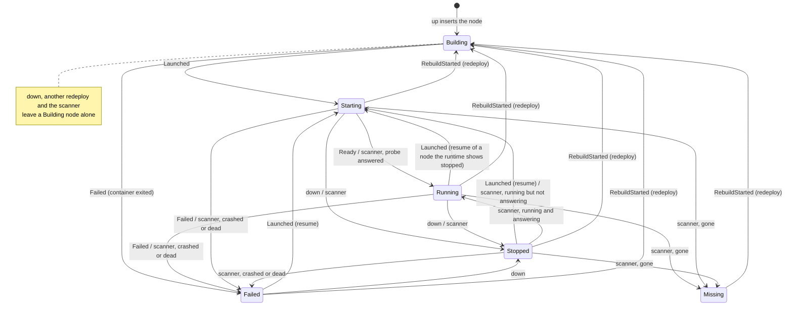

### 2. Lab status (`LabState`)

**Where.**

- `LabState` is in `crates/shared/src/data/lab.rs`. It has seven variants: `Running`,
  `Stopped`, `Partial`, `Starting`, `Failed`, `Empty` and `Unknown`.
- It is stored in `lab.status TEXT NOT NULL` (`crates/db/sql/schema/lab.sql:16`).
- It is not an independent machine. It is a cache of `LabState::derive(&[NodeState])`
  (`crates/shared/src/data/lab.rs`). In priority order, `derive` gives:
  1. `Empty` for no nodes;
  2. `Running` if all nodes are `Running`;
  3. `Stopped` if all are `Stopped`;
  4. `Failed` if any is `Failed` or `Missing`;
  5. `Starting` if any is `Starting` or `Building`;
  6. `Partial` otherwise. That includes all-`Unknown`.

**Transitions.**

| To | Function | What it checks |
|---|---|---|
| `Unknown` | `db::create_lab` (`LabState::default()`) | insert |
| `derive(nodes)` | `node_lifecycle::refresh_lab_status`, after every node write by an operation or the scanner | nothing: the value is derived from the nodes read then |
| `derive(nodes)` | the scanner, once per lab per cycle, labs with no nodes included | that the derived value differs from the stored one |

Consequences:

- The lab status follows every node write, with or without the scanner. A lab `up` is building
  is `Starting`.
- `Empty` is stored for a lab with no nodes once the scanner has looked at it.
- Two writers deriving at once can store the older derivation; the next write or scan corrects
  it *(inferred)*. Deriving the status on read instead of storing it is part of #499.

**Readers.**

- `list_labs` (`crates/server/src/services/list_labs.rs`) and `inspect` pass it through.
- The RPC `up` "already exists" message (`crates/server/src/api/websocket/rpc/labs.rs`).
- The web templates choose the action buttons from it:
  - `crates/server/templates/user/partials/labs-grid.html.jinja`;
  - `crates/server/templates/user/lab-detail.html.jinja`.

  `Running` and `Starting` show Stop. `Partial` shows Start and Stop. Every other state,
  `Unknown` included, shows Start.

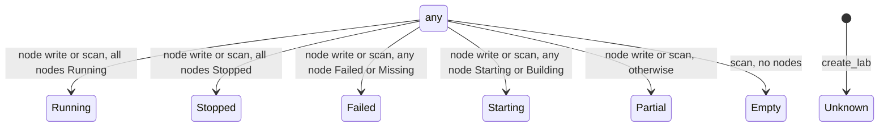

### 3. Lab operation leases and cancellation

**Where.** This machine is explicit, documented and tested. It lives in
`crates/server/src/services/lab_operations.rs`:

- `LAB_LEASES`: a per-lab `RwLock<()>` (`:23`). Entries are never removed.
- `LAB_CANCELLATIONS`: a `CancellationToken` with a first-wins `StopReason` (`:24`, `:38-42`).
- `PENDING_DESTROYS`: a count of waiting destroys (`:27`).
- The types are `LabOperation` (holds a read lease) and `StoppedLab` (holds the write lease).

**Transitions.**

- `begin` (`:134`) takes a read lease. It then cancels at once if a destroy is pending
  (`:141-148`). It is called by:
  - `up_lab` (`crates/server/src/services/up/lab.rs:145`);
  - `start_lab_nodes` (`resume.rs`);
  - `shutdown_lab_nodes` (`down.rs`);
  - `redeploy_node` (`redeploy/node.rs:59`).
- `try_observe` takes the write lease if it is free, for the scanner.
- `stop(reason)` (`:161`) cancels the token, then waits for the write lease. It is called by:
  - `destroy_lab` (`crates/server/src/services/destroy.rs:74`, `Destroy`);
  - `clean_lab` (`crates/server/src/services/clean.rs:33`, `Destroy`);
  - `cancel_lab_operations` (`crates/server/src/services/cancel.rs:23`, `Request`).
- Dropping `StoppedLab` (`:100-111`) removes the token, so later operations get a fresh one.
- Operations check for cancellation only at safe points:
  - `LabUp::start_phase` (`up/lab.rs:340`);
  - `LabOperation::sleep` in the readiness loops;
  - `ensure_active` (`redeploy/node.rs:88`).

**Who else takes part.**

- `shutdown_lab_nodes` (down) takes a read lease with `begin`, like the other operations.
- The scanner takes the write lease with `try_observe`, without waiting and without
  cancelling anything, and skips a lab an operation holds. It holds the lease only while it
  queries the runtimes and writes what it saw; its SSH probes run before. An operation that
  starts meanwhile waits for it. A `stop` that finds the scanner holding the lease reports
  `was_running`, as if an operation had held it.

**Who does not take part.**

- `refresh_node_host_key` takes no lease.
- Read leases are shared, so two `up`s on the same lab, or an `up` and a `resume`, run at the
  same time.
- Redeploys also hold a second, per-lab `Mutex` from `REDEPLOY_LOCKS`
  (`redeploy/node.rs:33, 62-63, 124-135`). It serializes redeploys with each other only.

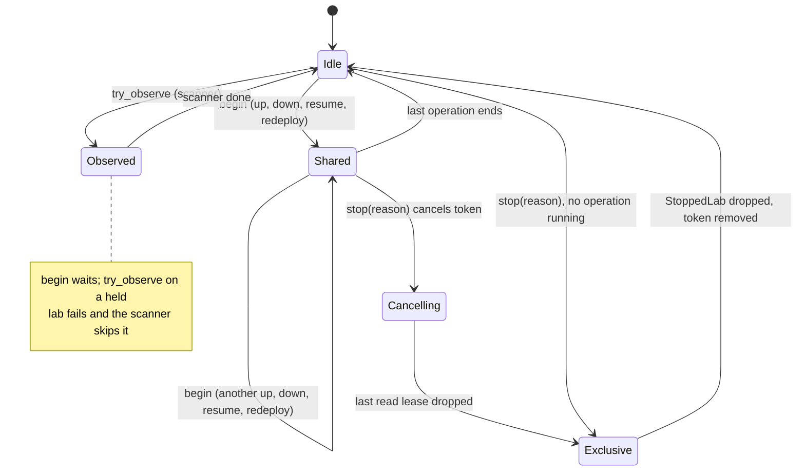

### 4. Runtime state mappings (libvirt and Docker)

*One table since #498 (M4).*

Sherpa reads libvirt's `VIR_DOMAIN_*` codes and Docker's container status, and maps them to
`shared::data::Runtime` in one place: `libvirt_runtime` and `container_runtime` in
`crates/server/src/services/node_lifecycle.rs`, each with a test of every value. The scanner
uses the mapping to observe nodes (machine 1); resume uses it, through `start_step`
(`resume.rs`), to decide what to do with each node.

| Runtime state | `Runtime` | Scanner records (machine 1) | Resume |
|---|---|---|---|
| libvirt RUNNING, Docker RUNNING | `Running` | `Running` once ready | already running |
| libvirt SHUTOFF, Docker EXITED, CREATED | `Stopped(Off)` | `Stopped` | boot (`create`, `start`) |
| libvirt PAUSED, Docker PAUSED | `Stopped(Paused)` | `Stopped` | `resume`, `unpause` |
| libvirt CRASHED, Docker DEAD | `Faulted` | `Failed` | refused: redeploy it |
| libvirt SHUTDOWN, BLOCKED, PMSUSPENDED, NOSTATE; Docker RESTARTING, REMOVING, EMPTY | `Transitional` | unchanged | refused: try again shortly |
| domain or container missing | `Absent` | `Missing` | refused: redeploy it |

- The scanner reads Docker's listing; its states are converted to the inspection's
  `ContainerStateStatusEnum`, which resume reads, so both go through `container_runtime`.
- Resume reports a container it cannot inspect, a missing one included, as "Failed to check the
  container".
- If a runtime query fails, the scanner keeps the recorded state of that runtime's nodes.
- `down` pauses containers, so a container that is down is `Stopped(Paused)`.

### 5. Node readiness and host keys

**Where.** "Ready" is `NodeState::Running` (machine 1): every writer records it only after a
readiness check passed or for a node that has none. The host key is
`node.ssh_host_key: Option<String>`; `Some` means the key was captured from a running node.

**Readiness waits.** The readiness wait is written four times, each with its own timeout and
error policy:

| Wait | Where | On a timeout |
|---|---|---|
| `up` | `up/readiness.rs` | adds a non-critical error |
| `resume` | `resume.rs` `wait_for_cold_booted` | the node stays `Starting`; the message says so |
| `redeploy` VM | `redeploy/vm.rs` `poll_until_ready` | the node stays `Starting` |
| scanner | `scanner.rs` `probe_node` | the node stays `Starting`; probed again next cycle |

`up` records a node not ready in time `Starting` too. A node left `Starting` by any of them is
recorded `Running` by the scanner once its probe answers (virtual machines with SSH) or as
soon as the runtime shows it running (other nodes).

**Host key transitions.**

| Transition | Function | file:line | Checked? |
|---|---|---|---|
| None → Some | `Readiness::record` (up) | `up/readiness.rs` | only when a key was read |
| None → Some or changed | `record_node_host_key`, from the scanner (`probe_node`), resume and `refresh_node_host_key` (`crates/server/src/services/host_keys.rs:63`) | `crates/server/src/services/ssh_config.rs:28-45` | a changed key is replaced with a warning |
| None → Some | redeploy VM | `redeploy/vm.rs:249` | only when a key was read |
| any → None | `redeploy_node`, after `RebuildStarted` is recorded | `redeploy/node.rs` | the node's state allowed the rebuild |

The scanner probes, and so reads a key, when `wants_probe` is true: a VM with SSH that the
runtime shows running and that is not yet `Running` or has no key. After recording a key it
rewrites the lab's SSH files. It does so after it has released its hold on the lab, and takes
no redeploy lock (M5.2).

**Not covered here.** `WatchdogAction` (`crates/shared/src/data/watchdog.rs`) configures the
guest's emulated hardware watchdog in the libvirt XML. It is not a Sherpa state machine.

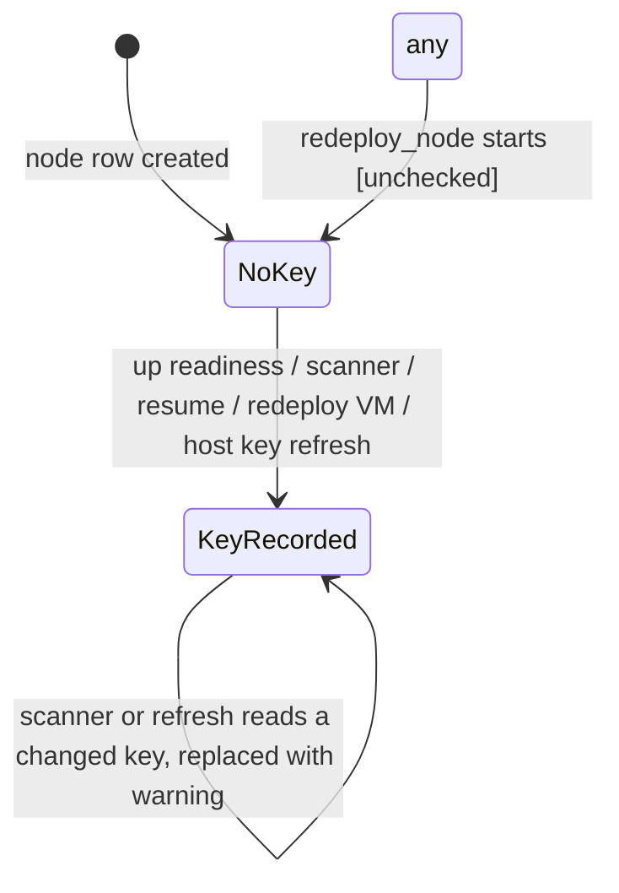

---

## Multi-step operations

### 6. `up` phases and rollback

**Where.** `crates/server/src/services/up/lab.rs`, with these types:

- `LabUp`, holding `phases_completed: Vec<String>` (`:73`) and `errors`;
- `UpPhase` labels (`crates/shared/src/data/up.rs`).

The stage is the program counter. `phases_completed` is reported in the response and never
read back. Progress is otherwise recorded only by what exists: DB rows, libvirt objects,
containers, bridges, kernel interfaces and files.

**Stages.**

| Phase | Function | Creates |
|---|---|---|
| 1 Setup | `set_up` (`up/lab.rs:251`) | nothing. Refuses if `find_lab` returns a record (`:283`). |
| 2 Validation | `plan_lab`, `ensure_no_earlier_attempt` (`:187-188`, `:314`) | image leases in memory. The earlier-attempt check only looks at libvirt volumes and domains, and skips labs where every node is a container (`:319-324`). |
| 3 DatabaseRecords | `create_node_records` (`up/records.rs`), `reserve_lab_networks` (`up/networks.rs:211`) | lab row, node rows, VNC ports, per-node networks |
| 4 | `set_up_lab_network` (`up/lab.rs:389`) | lab dir and files, libvirt NAT network, Docker bridge network, Tailscale gateway |
| 5 to 7 | `link_nodes`, `create_isolated_container_networks`, `create_shared_bridges` | link rows, Docker macvlan networks, host bridges, bridge rows |
| 8 | `configure_nodes` (`up/ztp.rs:75`) | ZTP files, lab CA (`up/ztp.rs:89`), node certificates, management addresses |
| 9 | `start_boot_container` | dnsmasq files and container |
| 10 to 12 | disk clone, `create_vms`/`create_unikernels`, `attach_vm_links`, SSH files | volumes, domains, eBPF redirects, netem |
| 13 | `wait_for_nodes`, `start_lab_services` | containers, veths, node state and host keys, Talos, Vault, Keycloak |

**Transitions out of the sequence.**

- **A failure in phase 1 or 2** returns without cleanup (`up/lab.rs:211-212`).
- **A failure or a cancellation from phase 3 on** calls `roll_back_failed_up` (`:218-219`,
  `:790`):
  - for `StopReason::Destroy`, it does nothing (`:797-802`);
  - otherwise it calls `clean_lab_resources(lab_id)` (`:828`), which removes everything
    named for the lab ID.
- **Timeouts and not-ready nodes in phase 13** are pushed to `errors` as non-critical, and
  `up` returns `Ok`. `success = critical_errors == 0` (`:745-747`). Nothing in the code
  constructs an `UpError` with `is_critical: true`, so `success` is always true when `up`
  returns `Ok`.

**Who sets and reads.**

- The RPC, REST and web handlers start `up` in detached tasks.
- The client reads `UpResponse.success` and `errors` (`crates/client/src/cmd/up.rs:167`).

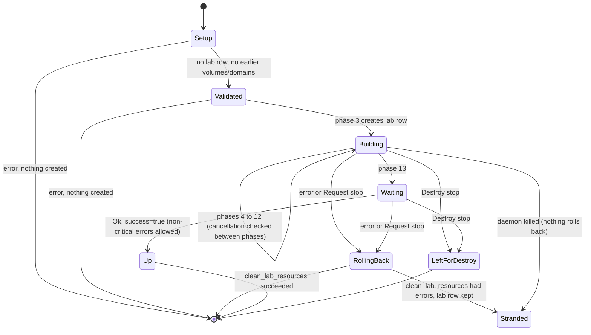

### 7. Destroy and clean

**Where.**

- `crates/server/src/services/destroy.rs`: `destroy_lab` (`:52`), `destroy_lab_resources`
  (`:150`), `cleanup_lab_metadata` (`:339`).
- `crates/server/src/services/clean.rs`: `clean_lab` (`:26`), `clean_lab_resources` (`:42`).

**State.** Progress is held only in the response. `DestroySummary` has per-resource lists and
the bools `database_records_deleted` and `lab_directory_deleted`. Alongside it is
`errors: Vec<DestroyError>`. Nothing is persisted: no "destroying" or "destroy failed" state
exists.

**Stages.** Each stage runs whether or not the ones before it failed:

1. containers and secrets;
2. VMs;
3. disks (skipped after a VM error);
4. Docker networks;
5. libvirt networks;
6. host interfaces;
7. `cleanup_lab_metadata`.

`cleanup_lab_metadata` does three things in order:

- If `errors` is not empty, it keeps the lab row and directory and returns (`:353-361`).
- Otherwise it deletes the row (`:368`).
- Only if the row was deleted does it remove the directory (`:381-401`).

**Entry checks.**

- `destroy_lab` calls `require_lab_access` (`:60`), then `stop(Destroy)` (`:74`). It does not
  check the lab again once it holds the lease.
- `clean_lab` requires an admin and the lease. It is documented to work on a lab that is not
  in the database (`clean.rs:19-24`). However, its `cleanup_database` calls `db::delete_lab`,
  and that fails when there is no row (`crates/db/src/lab/delete.rs:38`).

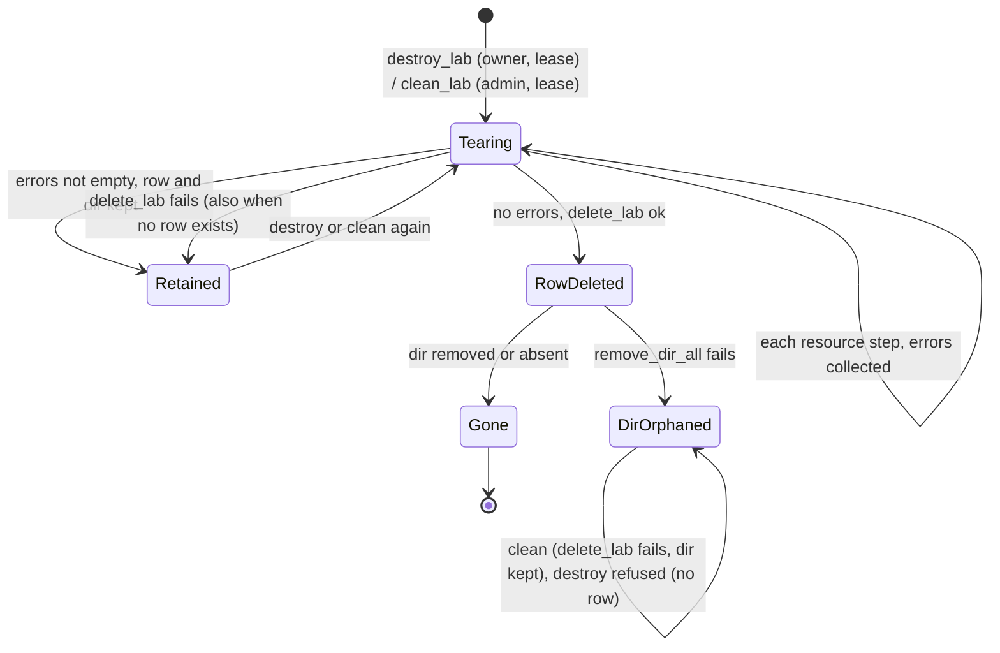

### 8. Down and resume

**Down.** `shutdown_lab_nodes` is in `down.rs`.

- It takes a read lease with `lab_operations::begin` and checks access again under it.
- A node whose state refuses `Stopped` (`Building`, `Missing`) is reported and not touched.
- VMs: ACPI, the Talos API, or power-off, depending on the model.
- Containers: paused.
- `Stopped` is recorded through the node lifecycle for each node whose action succeeded.
  "Already stopped" and "not running" count as success. A recording the state refuses makes
  that node's result a failure.
- A whole-lab down then stops the Tailscale gateway, which also logs it out (`down.rs`).

**Resume.** `start_lab_nodes` is in `resume.rs`.

- It takes a read lease and checks access again under it.
- It re-enrolls Tailscale before any node starts (M8.3).
- A node whose state refuses `Launched` (`Building`, `Missing`) is reported and not touched.
- It starts the nodes at the same time. `start_step` decides from the node's `Runtime`
  (machine 4); the result is a `StartOutcome`:
  - `ColdBooted`: recorded `Starting`;
  - `Resumed` (unpaused): recorded `Starting`, then `Running`;
  - `AlreadyRunning`: not recorded;
  - `Failed(reason)`: a crashed domain, dead container, one between states, a missing domain,
    or an error from libvirt or Docker.
- `ColdBooted` VMs have their eBPF redirects re-attached (`reattach_p2p_ebpf_for_nodes`).
  Unikernels are not re-attached (M8.1).
- `ColdBooted` nodes are waited on for readiness (`wait_for_cold_booted`). Those that become
  ready, and those with no check (containers, `skip_ready_check`), are recorded `Running`; the
  others stay `Starting`.

```mermaid
stateDiagram-v2
    Running --> Stopped : down, action ok
    Starting --> Stopped : down, action ok
    Failed --> Stopped : down, action ok
    Stopped --> Starting : resume, ColdBooted / Resumed
    Failed --> Starting : resume, ColdBooted / Resumed
    Starting --> Running : resume, ready or unpaused
    note right of Starting : readiness wait timed out: stays Starting
    note left of Stopped : Building and Missing nodes are refused by both
```

### 9. Redeploy

**Where.** `crates/server/src/services/redeploy/` (`node.rs`, `context.rs`, `vm.rs`,
`container.rs`, `links.rs`, `teardown.rs`).

**Stages.**

1. `load_redeploy` runs every check and changes nothing.
2. Record `RebuildStarted` (node `Building`; refused if another operation is building it),
   then clear the host key (`node.rs`).
3. `rebuild` (`crates/server/src/services/redeploy/node.rs`):
   - `destroy_node`;
   - for VMs, `recreate_vm_networks`;
   - regenerate ZTP and certificates;
   - recreate the node (`redeploy_vm` or `redeploy_container`), recorded `Starting` once the
     VM is created or the container runs;
   - re-attach P2p redirects (`vm.rs`, `container.rs`);
   - record `Running`:
     - containers: after Vault and Keycloak are restored (`ready_after_restore`,
       `container.rs`);
     - VMs: after the probe (`wait_until_ready`, `vm.rs`).
4. `ensure_active`, then `refresh_lab_ssh_files` (`node.rs`).

**Failures.**

- An error from `rebuild` records `Failed` (`mark_failed`, `node.rs`).
- Errors at stage 2, at `ensure_active`, or in the SSH file refresh return without
  `mark_failed`.
- A VM that does not become ready in time is left `Starting`, and redeploy succeeds
  (`vm.rs`). The scanner records it `Running` once its probe answers.

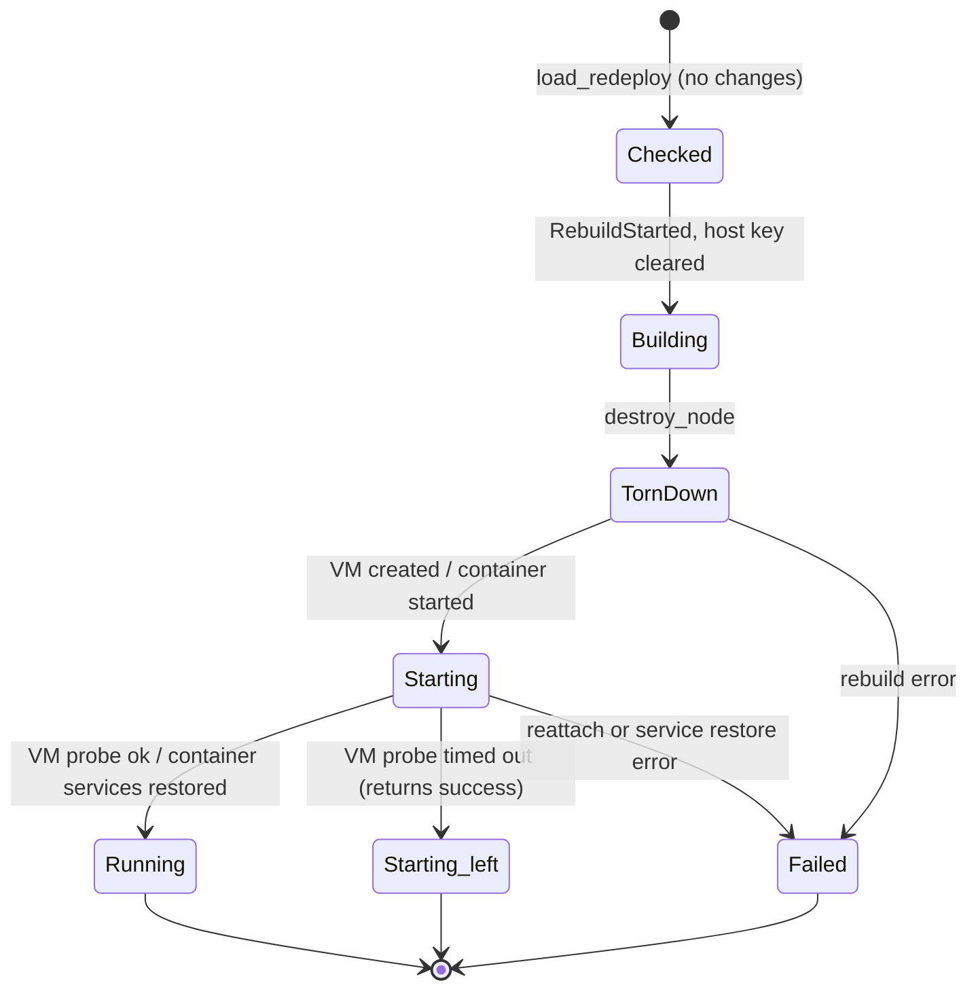

---

## Provisioning stages

### 10. Talos cluster bring-up

**Where.** `crates/server/src/services/talos/` (`lab.rs`, `bootstrap.rs`).

**Stages and their markers.**

| Stage | Marker | Where |
|---|---|---|
| Secrets | `<lab>/clusters/<name>/secrets.toml` | `talos/lab.rs:58-61` |
| Plan | `cluster.toml` | `talos/lab.rs:62-64` |
| Machine configs | none (memory). Regenerated from plan and secrets on a worker redeploy. | `redeploy/context.rs` |
| Credentials | `talosconfig`, `kubeconfig` | `talos/lab.rs:321-343` |
| Bootstrap | none in Sherpa. Talos answers `ALREADY_EXISTS` when bootstrapped. | `talos/bootstrap.rs:131-135` |
| Ready | Kubernetes node list | `talos/bootstrap.rs:143-194` |

**Who runs it.**

- `bring_up_clusters` is called only from `up` (`up/services.rs:55`).
- A cluster that does not become ready is a non-critical `up` error.
- Nothing retries the bootstrap later.
- Redeploy refuses control-plane nodes (`talos/lab.rs:88-99`).

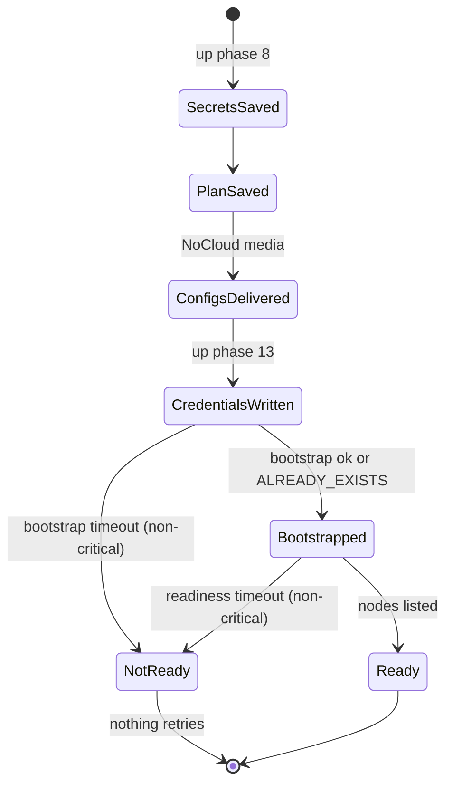

### 11. Vault init and unseal

**Where.** `ensure_vault_unsealed`, at `crates/server/src/services/vault/lab.rs:84-135`.

**States.** Vault holds one state and Sherpa holds another:

- Vault: uninitialized, initialized and sealed, unsealed, active.
- Sherpa: whether `<lab>/vault/<node>.toml` exists.

**Transitions.** All of them are checked against Vault's status.

- Uninitialized → `init()` (`:103`) → credentials saved (`:117`) → unseal (`:124`).
- Initialized → credentials loaded. If no file exists, it fails with "initialised outside
  Sherpa" (`:96-101`).
- Sealed → unseal with the saved key.
- Then `wait_until_active`.

The init and the save are two separate steps, and the code has no recovery for a failure
between them.

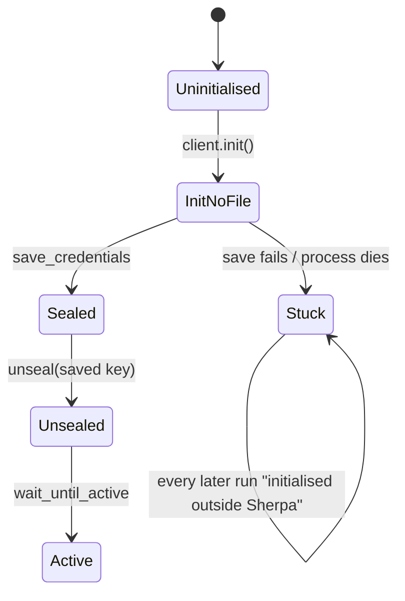

### 12. Keycloak realm

**Where.** `crates/server/src/services/keycloak/lab.rs`.

**Markers.**

- `<lab>/keycloak/<node>.toml`, holding the users and passwords. `realm_credentials` writes it
  before Keycloak hears of the users (`:73-97`), and returns it unchanged when it already
  exists (`:80-82`).
- Existence on the Keycloak server. HTTP 409 maps to `AlreadyExists`
  (`keycloak/api.rs:136-138`).

**Transitions.** The realm, client, groups and users are created in that order. Each create
is idempotent, because an existing object counts as done. An existing user keeps its
password.

### 13. Tailscale gateway

**Where.**

- `crates/server/src/services/tailscale.rs`;
- `crates/container/src/tailscale.rs`;
- the stored flag `DbLab.tailscale_container_id: Option<String>`.

The live connection state, `TailnetState` (`crates/shared/src/data/tailscale.rs:35-40`), is
computed from the daemon and never stored.

**Stages.** In `up` phase 4:

1. Create the volume. This refuses if the volume exists (`crates/container/src/tailscale.rs:135-141`).
2. Create the container.
3. Save the container ID (`services/tailscale.rs:54-58`).
4. Start and enroll.

**Later transitions.**

- `down` stops and logs out, but only if the ID is set (`down.rs:172-176`).
- `resume` starts and enrolls again, with a new key (`services/tailscale.rs:128-148`).
- `destroy` finds the gateway by name and labels, whether or not the ID is set (`destroy.rs:536`).

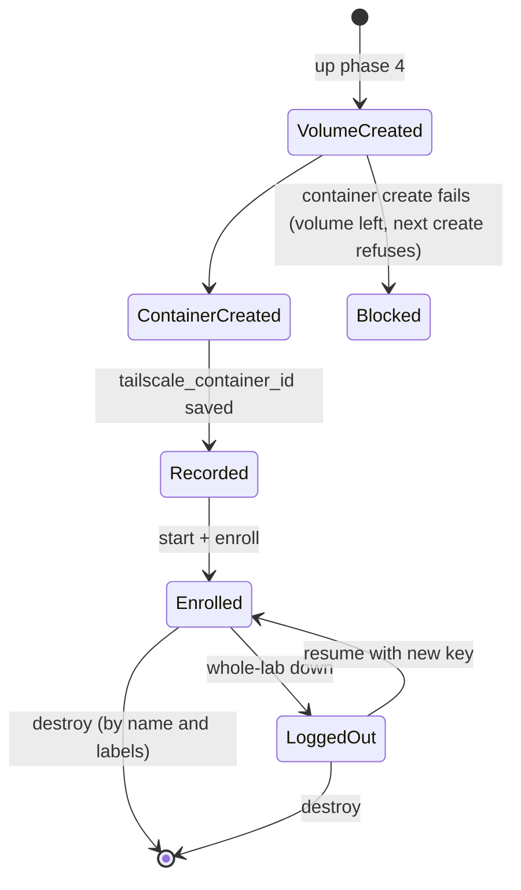

---

## Server sessions, transports and process

### 14. Sessions and tokens (server)

*Made explicit by #501; the defects it had are recorded in the investigation note, M14.*

**Where.**

- `SessionState`, `SessionEvent`, `transition` and `state_of` in `crates/server/src/auth/session.rs`,
  with the operations behind each event in the same file. Its module doc has the transition table.
- One row per session in the `session` table (`crates/db/sql/migrations/0012_session.sql`,
  `crates/db/src/session/`).
- JWT claims `{sub, sid, is_admin, iat, exp}` (`crates/shared/src/auth/jwt.rs`); `sid` names the row.
- The secret, in `crates/server/src/auth/jwt.rs` (`load_or_generate_secret`).

**States** *(explicit, `SessionState`)*:

- `Active`: the row exists and `expires_at` is in the future. The only state whose token is
  accepted.
- `Expired`: the row exists, `expires_at` has passed. Refused; the sweep deletes the row.
- `Ended`: no row. Logged out, ended by a password change or user deletion, or swept.

A token that fails its signature or `exp` check, or names no session (issued before 0.5.23), is
refused before the session is looked at.

**Transitions.**

| Transition | Function | Checked? |
|---|---|---|
| none → `Active` | `session::start`, from every login route and signup | checks the password |
| `Active` → `Active` (use) | `session::lookup`, from every extractor, `authenticate_request`, `auth.validate` and web job start | `transition(state, Use)` refuses `Expired` and `Ended` |
| `Active`, `Expired` → `Ended` (logout) | `session::logout`, from web `/logout`, REST `auth/logout`, RPC `auth.logout` | idempotent: ending an ended session is not an error |
| `Active`, `Expired` → `Ended` (password changed) | `db::change_user_password`, from `services::user_password` | every session of the user but the caller's own; one transaction with the new hash |
| `Active`, `Expired` → `Ended` (user deleted) | `db::delete_user`; `session.user` is `ON DELETE CASCADE` | — |
| `Active` → `Expired` | time passes `expires_at` | read from the clock by `state_of` |
| `Expired` → `Ended` (sweep) | `session::sweep`, from `session::run_sweeper` at startup and hourly | deletes `expires_at <= now`, the rows `state_of` calls `Expired`; a test checks they agree |
| startup refused | `load_or_generate_secret` with a secret file of the wrong length | the server does not start, so no session ends silently |

**Readers.**

- `AuthenticatedUser`, `AuthenticatedUserFromCookie` and `AdminUser` (`crates/server/src/api/extractors.rs`)
  and `authenticate_request` (RPC) build `AuthContext` from `session::lookup`: the user's current
  name and `is_admin`, and the `session_id`.
- `Job::resolve_requester` (`crates/server/src/daemon/state.rs`) presents the requester's session
  again when a web job starts.

```mermaid
stateDiagram-v2
    [*] --> Active : login (password checked)
    Active --> Active : use
    Active --> Expired : expires_at passes
    Active --> Ended : logout / password changed (other sessions) / user deleted
    Expired --> Ended : sweep / logout / password changed / user deleted
    Ended --> [*]
    note right of Expired : use refused (expired)
    note right of Ended : use refused (ended); a re-created user gets new sessions only
```

### 15. Web jobs

**Where.**

- `AppState.pending_jobs: DashMap<String, Job>` (`crates/server/src/daemon/state.rs:69`).
- `Job` holds the request and the requester's `AuthContext` (`state.rs:20-40`).

**Transitions.**

| Transition | Function | file:line | Checked? |
|---|---|---|---|
| absent → pending | destroy and create POST handlers | `crates/server/src/api/handlers/labs_web.rs:645`, `:869` | destroy checks lab access first; create leaves it to `up` |
| pending → consumed | `job_stream_handler` removes the entry once, after an ownership check | `labs_web.rs:729-745` | checked |
| consumed → running | `tokio::spawn` | `labs_web.rs` | the requester's session must still be active |

The job runs as its requester's session presented again when it is consumed
(`Job::resolve_requester`, see [14](#14-sessions-and-tokens-server)): a session that ended or expired
while the job was pending stops it from running, and a changed admin flag applies.

Nothing removes a pending job except the stream handler. There is no expiry. A consumed job
cannot be re-attached: a reload shows "Job not found or already completed"
(`labs_web.rs:678`).

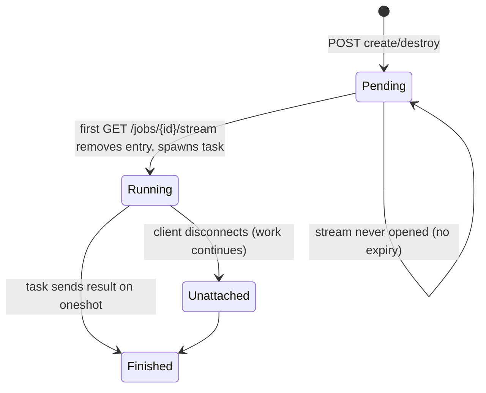

### 16. WebSocket RPC and SSE streams

**Server WebSocket.** In `crates/server/src/api/websocket/handler.rs`:

- The upgrade is not authenticated. Every RPC carries its own token.
- The connection is registered in `state.connections` and counted in a gauge. It is removed
  when the loop ends (`handler.rs:98-99`).
- Each RPC is spawned (`handler.rs:132-137`), so it outlives the socket.
- When the client has gone, progress messages and the final response are dropped with a debug
  log (`crates/server/src/api/websocket/rpc/dispatch.rs:296-298`, `:307-308`).

**SSE.** In `crates/server/src/api/sse.rs`:

- A stream drains progress until every `ProgressSender` clone is dropped, then waits for the
  `oneshot` result.
- A dropped result sender turns into "Lost connection to operation" (`sse.rs:129-132`).
- Progress text is decoded back into a `StatusMessage`. Lines that do not decode are dropped
  (`sse.rs:19-25`).

**Client.** `RpcClient` is in `crates/client/src/ws_client/client.rs`.

- `connect` (`:50-113`) runs TLS (machine 21) and then reads an optional "connected" banner.
  If the banner is missing or does not parse, the client only warns.
- `call` and `call_streaming` discard responses whose id does not match.
- A Close frame is an error.
- `close(self)` consumes the client.
- There is no reconnect.
- The `up`, `redeploy` and `resume` commands handle Ctrl-C through
  `call_streaming_or_interrupt`. `destroy` and `down` do not.

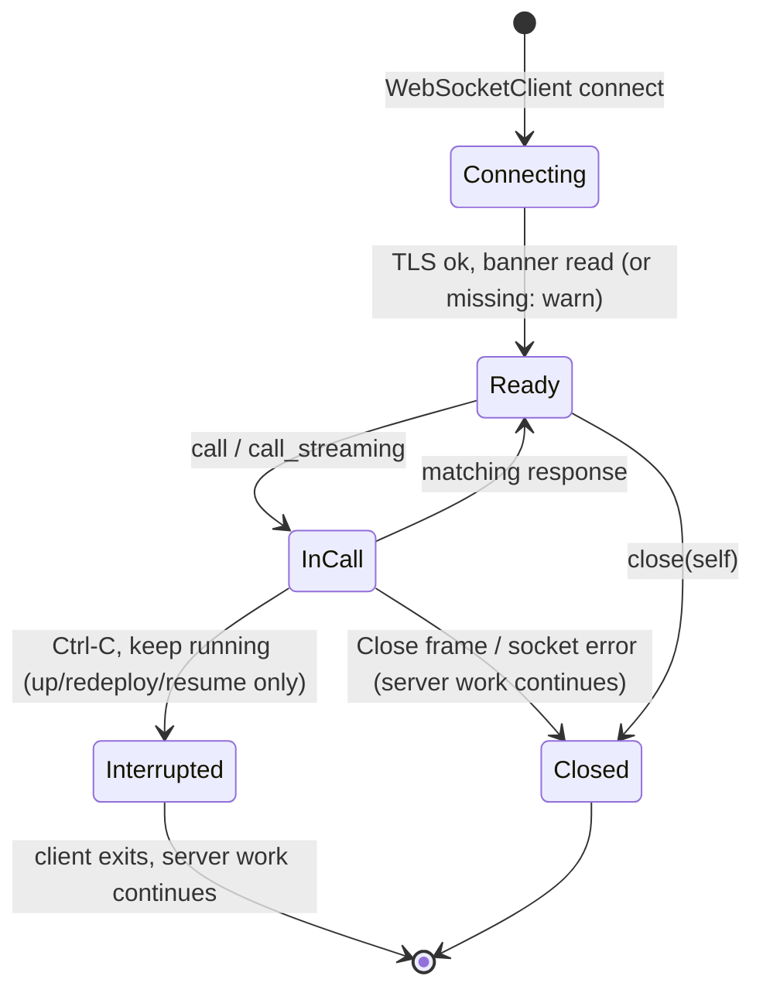

### 17. Daemon process

**Where.** `crates/server/src/daemon/manager.rs` and `pidfile.rs`.

**States** *(implicit)*:

- stopped: no PID file;
- running: a PID file whose process is alive (`kill(pid, 0)`, `pidfile.rs:67-70`);
- stale: a PID file whose process is dead;
- shutting down.

**Transitions.**

- **Foreground start** (`manager.rs:30-40`): `verify_not_running`, then `write_pid`, then
  `run_server`, then `remove_pid`.
  - `verify_not_running` (`pidfile.rs:73-83`) removes a stale file.
  - `write_pid` is a plain `fs::write` (`pidfile.rs:32-36`), so nothing stops two processes
    from both writing.
- **Background start**: the parent checks, and the child writes its own PID later
  (`manager.rs:59-69`, `:97-107`).
- **Stop** (`manager.rs:115-178`): SIGTERM, poll for 10 s, then optionally SIGKILL.

**Startup inside `run_server`** (`crates/server/src/daemon/server.rs:193-285`):

1. config;
2. telemetry;
3. signals;
4. `AppState::new`: database, schema, admin account, libvirt and Docker clients;
5. the scanner is spawned (`server.rs:240-245`);
6. the address is parsed;
7. TLS certificates;
8. bind.

The scanner can therefore act before the server is listening.

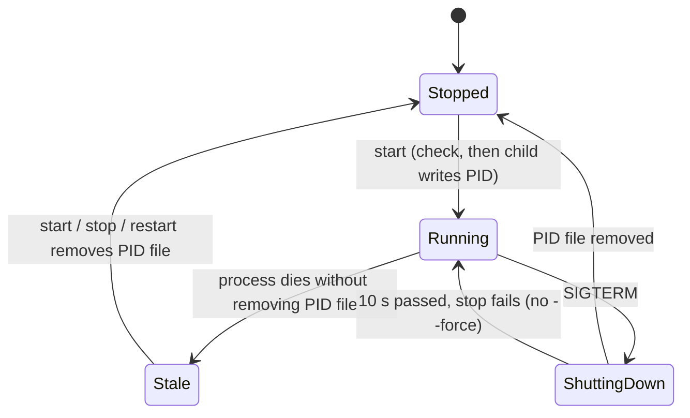

### 18. Server TLS certificate

**Where.** `CertificateManager::ensure_certificates`
(`crates/server/src/tls/certificate_manager.rs:41-67`), and the generator
(`crates/server/src/tls/generator.rs`).

**States.** Defined by which files exist: both, neither, or only one.

**Transitions.**

- Both files exist: they are used as they are. Expiry, SANs and whether the key matches the
  certificate are not checked (`:45-50`).
- Either file missing:
  - with `auto_generate_cert`, both are regenerated (`:52-55`), overwriting whichever file
    was there;
  - otherwise startup fails.
- There is no reload or renewal. The configuration is built once at startup
  (`crates/server/src/daemon/server.rs:476-484`).

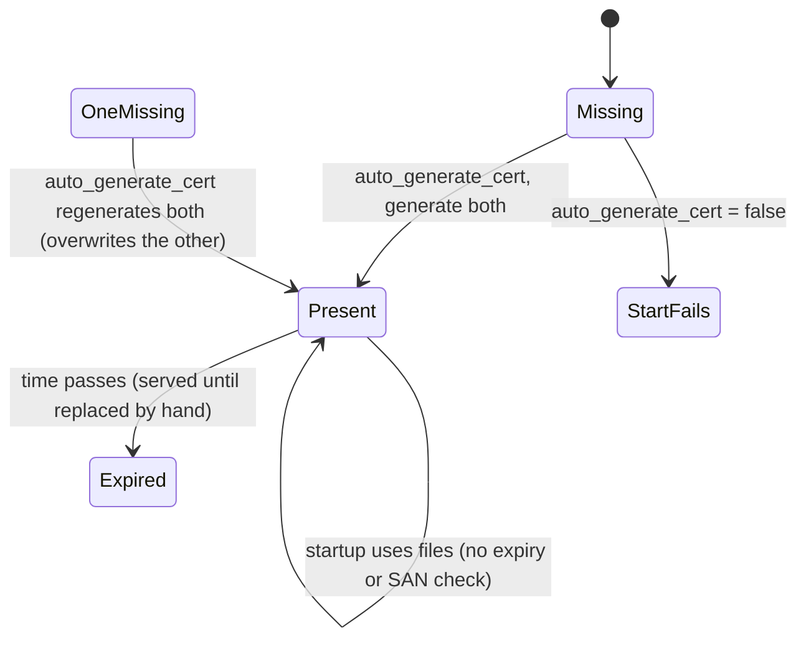

### 19. Lab CA and node certificates

**Where.** `crates/server/src/tls/lab_ca.rs`. The files live in `<lab>/certs/`.

**Transitions.**

- `create_lab_ca` (`lab_ca.rs:67-85`) writes the CA certificate, then the key. `up` phase 8
  calls it unconditionally (`up/ztp.rs:89`).
- `load_lab_ca` (`:89-101`) reads both files, for redeploy (`redeploy/context.rs`). It does not
  check validity.
- `issue_node_certificate` (`:121-154`) writes `<node>.crt`, then `<node>.key`, overwriting
  earlier ones.
- `up` refuses an existing lab row and `destroy` removes the directory, so a lab's CA is
  created once per lab lifetime.

### 20. `sherpad init`

**Where.** `crates/server/src/init.rs:37-138`.

**Stages:**

1. directories;
2. config, skipped if the file exists and `--force` is not set (`:79`);
3. SSH keys, skipped likewise (`:93`);
4. libvirt network (`:114`) and storage pool (`:122`);
5. database;
6. admin account;
7. first user, guarded by a lookup (`:147-184`).

No step is undone on failure. Re-running is the recovery: the doc comment at `:142-143`
says it is safe to re-run.

---

## Client

### 21. Client TLS trust

**Where.**

- `ServerConnection` (`crates/shared/src/data/config.rs:37-66`). Its fields are `url`,
  `validate_certs`, `ca_cert_path` and `insecure`.
- `ClientConfig.tls.enabled` (`config.rs:138-151`).
- The URL scheme.
- The trust store: one PEM per `host:port` in `~/.sherpa/trusted_certs`
  (`crates/shared/src/tls/trust_store.rs`).
- The `--insecure` flag, applied by `apply_insecure_override` (`crates/client/src/cmd/cli.rs:55-60`).

**How the mode is chosen.** No enum names the modes. `build_with_trust_flow`
(`crates/shared/src/tls/config.rs:69-123`) picks one through a fixed chain:

1. **Plain WebSocket.** The scheme is `ws://` (`crates/client/src/ws_client/client.rs:82-95`).
   No TLS setting is read.
2. **Insecure.** `insecure` is set (`crates/shared/src/tls/config.rs:70-76`).
3. **Custom CA only.** `ca_cert_path` is set (`:78-93`). Neither the trust store nor
   `validate_certs` is read.
4. **Pinned.** The trust store has an entry for the server (`:95-103`).
5. **Public CAs, with trust on first use as the fallback.** `validate_certs` is true
   (`:105-117`). When the handshake fails with an unknown issuer, the caller runs
   `trust_on_first_use` and reconnects (`client.rs:66-80`).
6. **Trust on first use now.** `validate_certs` is false (`:119-122`).

`trust_on_first_use` (`crates/shared/src/tls/config.rs:131-168`) fetches the certificate over plain HTTP, asks the
user, and saves it, which moves the server to mode 4. Removing the file, or replacing it with
`sherpa cert trust`, moves it back.

**URL.** `build_client_websocket_url` (`crates/shared/src/util/config.rs:47-56`) returns
`server_connection.url` when it is set. It reads `tls.enabled` only when the URL is unset.

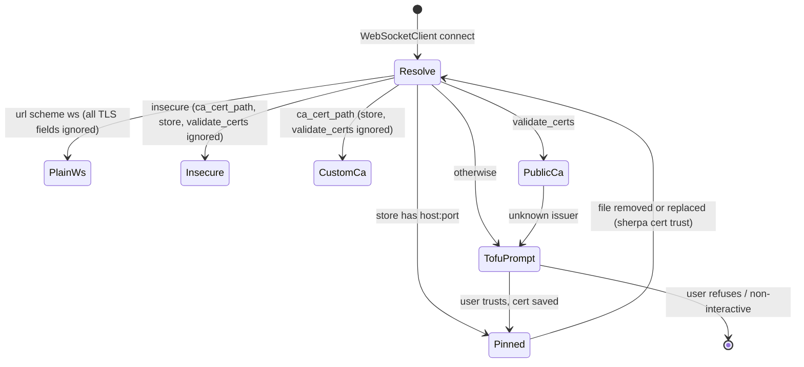

### 22. Client token

**Where.** `~/.sherpa/token` (`crates/client/src/token.rs:1-90`), readable only by the user. It holds one
raw JWT for whichever server the user last logged in to. The expiry is not stored locally.

**States.** absent, present and valid, present but expired or revoked or for another server.
The client can tell only absent from present.

**Transitions.**

- `login` saves the token and overwrites any earlier one (`crates/client/src/cmd/login.rs:67`).
- `logout` asks the server to end the session (`auth.logout`), then deletes the file
  (`crates/client/src/cmd/login.rs`). If the server cannot be reached it still deletes the file
  and warns that the session stays active on the server.
- Expiry is learned only from the server's `AuthRequired` error
  (`crates/client/src/ws_client/messages.rs:72-74`).
- `whoami` asks the server to validate the token and prints the expiry it reports
  (`crates/client/src/cmd/login.rs:106-156`).

### 23. Client operation outcome and local lab files

**Where.** `crates/client/src/cmd/up.rs`, `destroy.rs` and `lab_files.rs`.

The client keeps its own picture of a lab in the lab folder: SSH config, key, lab info,
`known_hosts`, and the include in `~/.ssh`.

**Transitions.**

- **`up` success or partial success** saves the files (`crates/client/src/cmd/up.rs:140-147`), then provisions, then
  fails if `!success` (`crates/client/src/cmd/up.rs:167-173`). `save_lab_files` stops at the first file that fails.
- **`up` interrupted with "keep running"** returns `bail!("Lab creation interrupted")`
  (`crates/client/src/cmd/up.rs:131`). The files are not saved and provisioning does not run.
- **`destroy`** removes local state only when `summary.database_records_deleted` is true
  (`destroy.rs:111-121`).
- **A connection that drops** before the response leaves the local files as they were.
- `sherpa download` and `sherpa provision` are the manual ways to catch up.

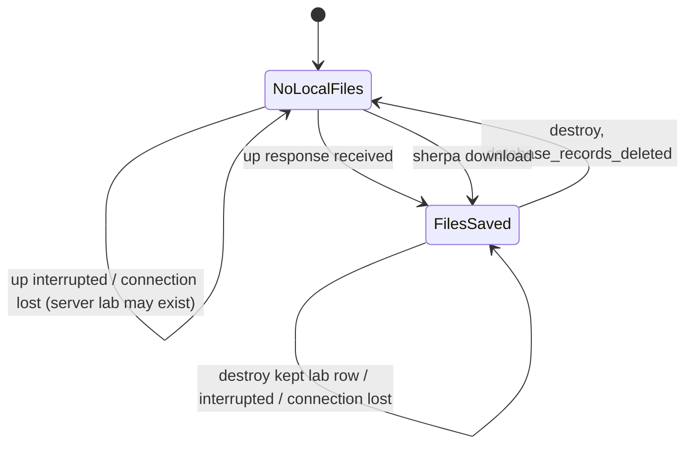

### 24. CLI provisioners

**Where.**

- `crates/client/src/provision/run.rs`, `ssh.rs` and `container.rs`;
- `crates/client/src/cmd/provision.rs`.

`ProvisionStatus` (Provisioned, Failed, Skipped) is the result of one run. It is never
persisted, so "provisioned" is not recorded anywhere.

**When provisioners run.**

| Command | When | file:line |
|---|---|---|
| `up` | after the response, for the nodes with an SSH port at that moment | `up.rs:152-163`, `:183` |
| `redeploy` | for the one node, after `download` | `crates/client/src/cmd/redeploy.rs:117-134` |
| `provision` | every provisioner on every node, again | `provision.rs:41-118` |

Per node, the steps are: wait for SSH, wait for cloud-init, then each step in order. A
failure stops at that step (`run.rs:154-166`), and nothing records how far it got.

Container provisioners are reported as provisioned from the request payload, not from a
confirmation from the server (`container.rs:32-42`).

---

## Networking and images

### 25. P2p link attachment

**Where.**

- `crates/network/src/ebpf.rs`, `tap.rs` and `tc.rs`;
- `crates/server/src/services/up/links.rs`, `redeploy/links.rs`, `resume.rs:632-680`.

`DbLink` has `tap_a` and `tap_b`, and no status field. The attachment state is held in two
places:

- the kernel: whether the tap or veth exists, the TC filter with the peer's ifindex in its
  BPF map (`ebpf.rs:86`), and netem;
- `P2pAttachment { ready_ends, attached }`, in memory, for one `up` (`up/links.rs:378-383`).

**States per link** *(implicit)*: ends missing, ends present, redirect attached both ways,
and stale (one end recreated with a new ifindex, so the peer's redirect points at the old one).

**Transitions.**

| Transition | Function | Checked? |
|---|---|---|
| ends present → attached | `attach_vm_links` (`up/links.rs:393`), `attach_ready_p2p_links` as container veths appear (`up/readiness.rs:342-399`) | waits until both ends are ready |
| attached → stale | a VM cold boot (resume), node teardown (redeploy), a container restart *(inferred)* | — |
| stale → attached | `reattach_p2p_ebpf_for_nodes` (resume, VMs only, `resume.rs:143-145`), `reattach_p2p_redirects` (redeploy, `redeploy/links.rs:39`) | none: the first `get_ifindex` that fails returns, and later links are skipped (`resume.rs:661-666`, `redeploy/links.rs:53-58`) |

`attach_p2p_redirect` detaches and then attaches again (`ebpf.rs:57-73`), so it is
idempotent.

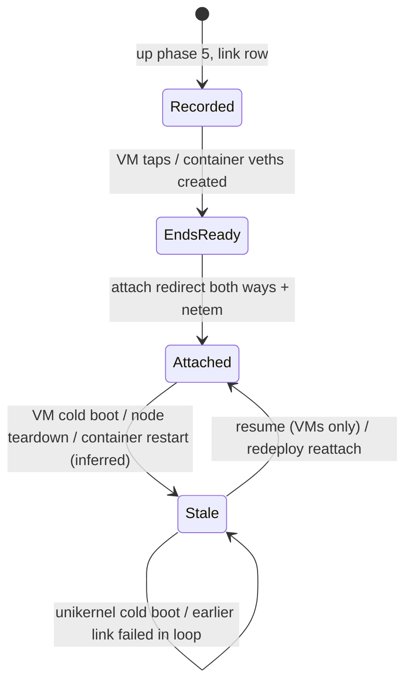

### 26. Link impairment

**Where.**

- `crates/server/src/services/impairment.rs`;
- `crates/network/src/tc.rs`;
- the columns `link.impairment_a_to_b` and `link.impairment_b_to_a`.

**States per direction.** Clear (`LinkImpairment::is_clear`) or set. The value is held twice:
in the database and in the kernel qdisc.

**Transitions.** `update_impairment` (`impairment.rs:25-138`):

- It checks lab access, that the link exists, and that it is a P2p link (`:53-60`).
- It writes the kernel first (`:68-82`), then the database (`:102-109`).
- If the second direction fails, it restores the first (`:71-80`).
- `set_netem` (`:167-186`) treats every error from `remove_netem` as "nothing to remove".

When links are attached (up, resume, redeploy), the DB value is applied. A clear direction is
skipped there, so nothing is removed (`tc.rs:185-205`).

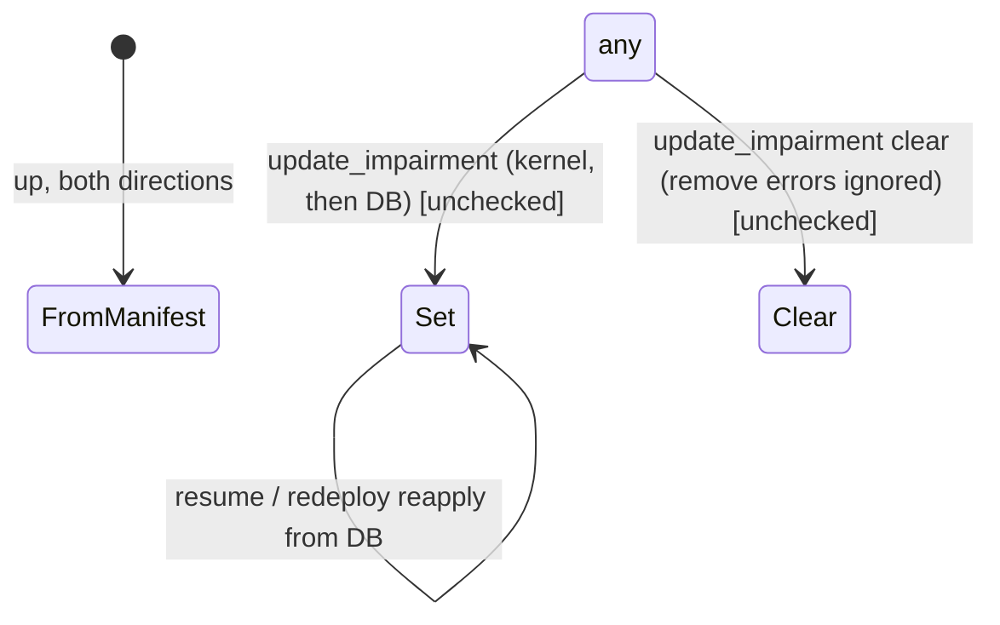

### 27. Bridges and management networks

**Where.**

- `crates/server/src/services/up/networks.rs`: `create_management_networks` at `:74-106` and
  `create_shared_bridges` at `:329-410`;
- `up/records.rs:272-301` for the per-node networks;
- `crates/libvirt/src/network.rs`, `crates/container/src/network/create.rs`,
  `crates/network/src/linux.rs`.

**State.** None is stored apart from the `bridge` rows. Each bridge exists as a Linux bridge,
libvirt or Docker networks, and a DB row, all created in sequence.

**How each create behaves when the object already exists.**

- `network::create_bridge` fails.
- libvirt `ensure_network` is idempotent: it defines the network if it is absent and starts it
  if it is inactive.
- Docker `create_docker_bridge_network` treats 409 as success (`crates/container/src/network/create.rs:62-65`) and does not
  compare the network's settings.
- `create_docker_macvlan_bridge_network` has no conflict handling (`:101-108`).

**Teardown.** Done by name: Docker networks, then libvirt networks, then host interfaces
(`destroy.rs:226-305`).

### 28. Node images

**Where.**

- `crates/server/src/services/import.rs`, `image_lifecycle.rs`, `delete.rs` and
  `container_pull.rs`;
- `crates/db/src/node_image/`.

**State.** There is no status column. An image's state is three things together:

- the `node_image` row, unique on `(model, kind, version)`;
- the `default` flag, with at most one default per `(model, kind)` by the partial unique
  index in `crates/db/sql/migrations/0006_one_default_node_image.sql`;
- the disk file or Docker tag.

Scan results are strings ("already_exists", "would_import", "imported (default)" and so on,
`import.rs:544-587`).

**Transitions.**

- Disk import: DB upsert (`import.rs:164`), then create the directory and copy (`:187-201`).
  The copy is skipped if the file exists. The copy writes straight to the destination
  (`crates/shared/src/util/file_system.rs:110-125`).
- Download: written to `.partial`, then renamed (`import.rs:710-760`).
- Default flag:
  - The first version of a model becomes the default.
  - Otherwise `request.default` decides (`import.rs:52-63`).
  - The upsert replaces every column, `default` included (`crates/db/src/node_image/create.rs:24-80`).
  - Setting a default clears the others in the same transaction.
  - The web form refuses to unset the last default (`crates/server/src/api/handlers/images_web.rs:344-368`).
- Delete: refused while a node references the image, or while an overlay depends on it. Then
  the row goes, then the files (`delete.rs:28-92`).
- Locking: `image_lifecycle.rs` keeps a per-`model/version` `RwLock`.
  - Import, download, delete and set-default take the write side.
  - `up` and `redeploy` take read leases.
  - Scan and container pull take no lock.

```mermaid
stateDiagram-v2
    [*] --> Absent
    Absent --> RowOnly : import upserts row
    RowOnly --> Tracked : copy complete
    RowOnly --> RowOnly : copy fails (row kept)
    Tracked --> IsDefault : set default / first version
    IsDefault --> Tracked : another version set default / re-import with default=false
    Tracked --> Absent : delete (unused), row then files
    IsDefault --> Absent : delete (no replacement default)
```

---

## Configuration combinations

### 29. ZTP settings (`ztp_enable` and `ztp_method`)

**Where.**

- `ZtpSettings { enable, method, username, password, password_auth }`
  (`crates/shared/src/data/node.rs:793-810`). `NodeConfig` flattens it into the columns
  `ztp_enable`, `ztp_method` and so on (`crates/db/src/persistence.rs`).
- `ZtpMethod` (`crates/shared/src/data/node.rs:650-681`) has eleven variants, including `None`.
  `#[default]` is `CloudInit`.

**States.** A bool times an enum gives 22 combinations. Whether a method works also depends
on the image's `model` and `kind`. Nothing names the valid combinations. `enable = false` and
`method = None` both mean "no ZTP".

**Writers.**

- The code defaults, `NodeConfig::get_model`. For example, `arista_veos` (a VM) is
  `enable = true, method = Tftp` (`crates/shared/src/data/node.rs:1023-1025`), and
  `arista_ceos` (a container) is `enable = true, method = None` (`node.rs:1060-1062`).
- Import, scan and pull upsert the code defaults over the row (`import.rs`).
- The admin web form writes any pair (`images_web.rs:220-226`, saved at `:391`). Its validation
  does not look at ZTP (`:373-379`).
- Migrations 0004 and 0005 rewrote some old defaults once.

**Readers.**

| Reader | file:line | Reads |
|---|---|---|
| `generate_vm_ztp` | `crates/server/src/services/node_ops.rs:1015` | `enable` only; false skips all media |
| `generate_vm_ztp_media` | `node_ops.rs:1104-1155` | `method` |
| `check_custom_ztp_supported` | `node_ops.rs:1060-1080` | `method`, only when enabled |
| `ZtpRecord.ztp_method` | `node_ops.rs:441` (containers), `:1046` (VMs) | `method`, whatever `enable` is |
| dnsmasq template | `crates/template/templates/dnsmasq/config.jinja:48-55` | `ztp_method`: Tftp or Http sets DHCP option 67 |
| `supports_guest_account` | `crates/server/src/services/guest_account.rs:99-170` | `enable`, `kind`, `method` and model |
| `generate_container_ztp` | `node_ops.rs:392-455` | model only; never reads `enable` |

The `username`, `password` and `password_auth` fields are read only for display
(`crates/shared/src/util/table.rs:456-462`).

```mermaid
stateDiagram-v2
    [*] --> Defaults : get_model(model)
    Defaults --> AdminEdited : images_web form (any enable x method)
    AdminEdited --> Defaults : re-import / scan / pull upserts defaults
    state AdminEdited {
        [*] --> EnabledMatching
        EnabledMatching --> Disabled_MethodSet : uncheck enable
        EnabledMatching --> Enabled_MethodNone : method None
        EnabledMatching --> Enabled_WrongModel : method the model lacks
    }
```

### 30. The `ztp_config` field

**Where.** `topology::Node.ztp_config` and `NodeExpanded.ztp_config`, both `Option<String>`
(`crates/topology/src/node.rs:36`, `:95`).

**States.** The same field holds a different thing at each stage, and nothing in the value
says which:

1. a path in the manifest;
2. base64 contents, set by the client (`crates/client/src/cmd/up.rs:195-227`);
3. decoded text, on the server (`up/ztp.rs:458-463`, `redeploy/context.rs`);
4. a generated Talos config, for cluster members;
5. `None` once it has been taken (`take_custom_ztp_config`, `node_ops.rs:350-363`).

**Ordering.** `provisions_owner` reads `ztp_config.is_none()` to mean "no custom config"
(`guest_account.rs:181-182`). It is evaluated (`node_ops.rs:991`) before the field is taken
(`:1096`), and the result depends on that order.

```mermaid
stateDiagram-v2
    [*] --> Path : manifest
    Path --> Base64 : client resolve_ztp_configs
    Base64 --> Text : server decode_ztp_config
    Text --> TalosGenerated : cluster member
    Text --> Taken : take_custom_ztp_config
    Path --> Text : manifest sent without the client (decode of a path)
    Taken --> [*]
    TalosGenerated --> [*]
```

### 31. Node resource reservation

**Where.** `reserve_node_resources`
(`crates/server/src/services/node_resources.rs:166-219`). It reserves `vnc_port`,
`cpu_count`, `memory`, `cpu_pinning` and `qemu_thread_cpus` on the node row, and
`update_node_resources` writes all five together. Before that, the node is admitted by
`services/admission.rs`, which holds its memory and pins in an in-memory ledger.

**Transitions.**

- **Admit.** `admit_lab_nodes` (`admission.rs:88`, for `up` and redeploy) and
  `admit_stopped_nodes` (`admission.rs:126`, for resume and node start) wait on a fair, FIFO
  Tokio mutex (`admission.rs:31`). Under it they check the pins
  (`check_cpu_pins_on_server`, `node_resources.rs:65-107`) against the stored nodes and the
  ledger, and the memory against the server (`validate::check_memory_fits`, limited by
  `host_memory.reserve_mib` and `host_memory.overcommit_percent`), then add the nodes
  to the ledger (`admission.rs:33`). Memory counts against the whole server, and that of a VM
  held strictly on a NUMA node also against that node. A VM with
  `numa_memory_mode = "preferred"` counts against the server only, requested or running.
  Checked: a request that does not fit is refused before anything is created.
- **Reserve.** A VM that already has a port keeps it. Otherwise the code picks a free port,
  retrying when the unique index loses a race.
- **Release from the ledger.** Dropping the `Admission` (`admission.rs:62`) when the operation
  returns, whether it succeeded or failed. Running domains are then counted from libvirt.
- **Release.** Only by deleting the node row.

A stopped lab keeps its ports and pins. Before admission, `up` checked pins in its planning
phase and stored them in phase 3 with no lock between, so two concurrent `up`s could both pass
(#413); the ledger closes that window for pins and memory. A stored node that is also pending
counts once, with its pending pins, and the node a redeploy replaces does not count against
itself (matched by domain name, `<node>-<lab id>`). The ledger does not survive a restart,
which also ends the operations it held entries for.

### 32. Database schema version

**Where.** `apply_schema` (`crates/db/src/schema/apply.rs:23-76`), using `PRAGMA user_version`.

**Transitions.** Version 0 or any older version → `SCHEMA_VERSION`. All pending migrations run
in one transaction under the write lock. A version newer than the build is refused
(`apply.rs:50-55`). This is explicit, atomic and tested. See [`DATABASE.md`](DATABASE.md).
