# State Machines

Sherpa has many values that move through a fixed set of states as operations run. Few of
them are written down as state machines. Some have an enum but no transition table. Others
exist only as a pair of fields, a bool or an `Option`, a string, or the presence of a file,
row or kernel object. This document records how each one works today: where it lives, its
states, the transitions the code makes, and who sets and reads it.

Issue #474 asked for this survey. The invalid states each machine can reach, and the order in
which to make them explicit, are in
[`../investigations/state-machines.md`](../investigations/state-machines.md).

## Conventions

- Paths are relative to the repository root. `file:line` points at the line that makes the
  transition or holds the value. Line numbers are those of the commit that added this document.
- **Checked** means the code looks at the current state before it moves to the next one.
  **Unchecked** means any state can jump there.
- In the diagrams, an edge labelled `unchecked` comes from a pseudo-state named `any`, so the
  diagram shows that every state can take that edge.
- Statements that come from reasoning, not from reading the code, are marked *(inferred)*.
  Most of them are about how libvirt, Docker or the kernel behave.

## Index

| # | Machine | Crate | States held in |
|---|---|---|---|
| 1 | [Node lifecycle](#1-node-lifecycle-nodestate) | shared, db, server | `NodeState` enum and transition functions, `node.state` TEXT, compare-and-set |
| 2 | [Lab phase and status](#2-lab-phase-and-status-labphase-and-labstate) | shared, db, server | `LabPhase` enum and transition function, `lab.phase` TEXT, compare-and-set; `LabState` derived on read |
| 3 | [Lab operation leases](#3-lab-operation-leases-and-cancellation) | server | `lab_operations` statics, `REDEPLOY_LOCKS` |
| 4 | [Runtime state mappings](#4-runtime-state-mappings-libvirt-and-docker) | server | one table to `Runtime` |
| 5 | [Node readiness and host keys](#5-node-readiness-and-host-keys) | server, db | `NodeState::Running`, `ssh_host_key` Option |
| 6 | [`up` phases and rollback](#6-up-phases-and-rollback) | server | code order, `phases_completed`, side effects |
| 7 | [Destroy and clean](#7-destroy-and-clean) | server | `DestroySummary` bools, `errors` list |
| 8 | [Down and resume](#8-down-and-resume) | server | `StartOutcome` enum, node lifecycle events |
| 9 | [Redeploy](#9-redeploy) | server | node lifecycle events, side effects |
| 10 | [Talos cluster bring-up](#10-talos-cluster-bring-up) | server | files in the cluster dir, Talos itself |
| 11 | [Vault init and unseal](#11-vault-init-and-unseal) | server | Vault status, credentials file |
| 12 | [Keycloak realm](#12-keycloak-realm) | server | credentials file, HTTP 409 |
| 13 | [Tailscale gateway](#13-tailscale-gateway) | server, container | `tailscale_container_id` Option, Docker objects |
| 14 | [Sessions and tokens](#14-sessions-and-tokens-server) | server, db, shared | `SessionState` over the `session` row |
| 15 | [Web jobs](#15-web-jobs) | server | `pending_jobs` map entry |
| 16 | [WebSocket RPC and SSE streams](#16-websocket-rpc-and-sse-streams) | server, client | connection registry, channels |
| 17 | [Daemon process](#17-daemon-process) | server | PID file, process liveness |
| 18 | [Server TLS certificate](#18-server-tls-certificate) | server | cert and key files |
| 19 | [Lab CA and node certificates](#19-lab-ca-and-node-certificates) | server | files in `<lab>/certs` |
| 20 | [`sherpad init`](#20-sherpad-init) | server | side effects |
| 21 | [Client TLS trust](#21-client-tls-trust) | shared, client | 3 bools/Options, URL scheme, trust store file |
| 22 | [Client token](#22-client-token) | client | `~/.sherpa/token` file |
| 23 | [Client operation outcome and local lab files](#23-client-operation-outcome-and-local-lab-files) | client | files in the lab folder |
| 24 | [CLI provisioners](#24-cli-provisioners) | client | per-run `ProvisionStatus` |
| 25 | [P2p link attachment](#25-p2p-link-attachment) | network, server | `LinkState` enum and `step` transition over the kernel's ends and TC filters; last state per link in memory |
| 26 | [Link impairment](#26-link-impairment) | server, network, db | `impairment_*` columns, netem qdisc; kernel put back on a failed DB write |
| 27 | [Bridges and management networks](#27-bridges-and-management-networks) | server, libvirt, container, network | side effects |
| 28 | [Node images](#28-node-images) | server, db | `node_image` row, `default` flag, files |
| 29 | [ZTP setting](#29-ztp-setting) | shared, db, server, template, topology | one `Ztp` enum on the image, with an optional manifest override |
| 30 | [The `ztp.config` field](#30-the-ztpconfig-field) | topology, client, server | one `Option<String>` with four meanings |
| 31 | [Node resource reservation](#31-node-resource-reservation) | server, db | `vnc_port`, `cpu_pinning` Options, admission ledger |
| 32 | [Database schema version](#32-database-schema-version) | db | `PRAGMA user_version` |

Machines 3 and 32 were already explicit and checked; 1, 2, 4, 14 and 25 have been made so since. They
are here so the survey is complete, and because the other machines depend on them.

---

## Lab and node lifecycle

### 1. Node lifecycle (`NodeState`)

*Made explicit by #498; the defects it had are recorded in the investigation note, M1, M4,
M8.2 and M9.1.*

**Where.**

- `NodeState` is in `crates/shared/src/data/node.rs`: `Building`, `Starting`, `Running`,
  `Stopped`, `Failed`, `Missing` and `Unknown`.
- Every allowed move is in `crates/shared/src/data/node_lifecycle.rs`, with a table test of
  every state against every event:
  - `NodeState::on_operation(OperationEvent) -> Result<NodeState, Refused>`, for operations;
  - `NodeState::on_observation(Observation) -> NodeState`, for the scanner. An observation
    never fails; one the state does not take leaves it as it is.
- The buttons the web UI offers for a node come from `NodeActions::for_state` in
  `crates/server/src/templates/actions.rs`. A test checks they agree with `on_operation`.
- It is stored in `node.state TEXT NOT NULL` (`crates/db/sql/schema/node.sql`). The only write
  is `db::update_node_state_from(id, from, to)` (`crates/db/src/node/update.rs`), a
  compare-and-set: `UPDATE ... WHERE id = ? AND state = ?`. It returns `None` when the node is
  no longer in `from`.
- The only callers of that write are in `crates/server/src/services/node_lifecycle.rs`:
  - `record(db, &LabOperation, node, OperationEvent)`. It needs the operation's lease, so only
    an operation holding the lab can call it.
  - `observe(db, &ObservedLab, node, Observation)`. It needs the scanner's hold on a lab no
    operation holds (`lab_operations::try_observe`).

  Both read the node, apply the transition and write it with the compare-and-set. `record`
  evaluates the event again against the new state when another writer moved the node first, so
  an event is never applied to a state it was not meant for. `observe` leaves a node that moved
  for the next cycle. The lab's status is derived from its nodes when it is read (machine 2).
- Text this build does not know decodes as `Unknown` (`#[serde(other)]`), so one row from a
  newer version does not fail a whole listing. Migration `0013_node_lifecycle.sql` turned the
  old `created` into `stopped`.

**States.**

| State | Meaning | Who moves a node there |
|---|---|---|
| `Building` | an operation is creating the node's domain or container | `db::create_node` (`up` phase 3); a redeploy's teardown |
| `Starting` | started, not ready yet | an operation's `Launched`; the scanner, for a running node it has not seen answer |
| `Running` | ready: the readiness check passed, or the node has none | an operation's `Ready`; the scanner, once its probe answers |
| `Stopped` | the domain or container exists and is not running | `down`; the scanner |
| `Failed` | an operation failed, or the runtime reports a fault | an operation's `Failed`; the scanner, for a crashed domain or dead container |
| `Missing` | no domain or container | the scanner |
| `Unknown` | legacy or unreadable | nothing writes it |

**Operation events** (`on_operation`).

| Event | Sent by | Allowed from | Result |
|---|---|---|---|
| `RebuildStarted` | redeploy, before teardown | any but `Building` | `Building` |
| `Launched` | `up` readiness (`up/readiness.rs`), as a container starts or a VM answers, resume after a boot or unpause, redeploy after the VM is created or the container started | any but `Missing` | `Starting` |
| `Ready` | `up` after a probe, a container that kept running for 5 seconds, or a skipped check, resume after the readiness wait or an unpause, redeploy after the VM probe, or after a container's Vault and Keycloak are restored | `Starting`, `Running` | `Running` |
| `Stopped` | `down`, once the node has stopped | any but `Building` and `Missing` | `Stopped` |
| `Failed` | `up` for a container that stopped running at start, before it was ready, or by the end of polling; redeploy's `mark_failed` | any but `Missing` | `Failed` |

`Refused` says why: "the node is being built by another operation; wait for it to finish",
"the node has no domain or container; redeploy it", or "cannot mark ready a node that is
stopped". `down` and `resume` check each node's state against the event before they touch its
domain or container, and report the refusal in its result.

**Observations** (`on_observation`). An observation is a `Runtime` and a `Probe`:

- `Runtime` comes from the one mapping table (machine 4): `Running`, `Stopped(Off | Paused)`,
  `Faulted("crashed" | "dead")`, `Transitional(...)` or `Absent`.
- `Probe` is `Ready` or `NotReady` for a virtual machine with SSH, from the scanner's SSH probe
  that cycle, and `NotProbed` for other nodes, for which running counts as ready.

| From | `Running` runtime | `Stopped` | `Faulted` | `Transitional` | `Absent` |
|---|---|---|---|---|---|
| `Building`, `Failed` | unchanged | unchanged | unchanged | unchanged | unchanged |
| `Running` | `Running` | `Stopped` | `Failed` | unchanged | `Missing` |
| `Starting`, `Stopped`, `Missing`, `Unknown` | `Running` if probed ready or not probed, else `Starting` | `Stopped` | `Failed` | unchanged | `Missing` |

**Who sets and who reads it.**

- Operations set it while they hold the lab's lease: `up`, `down`, `resume` and redeploy.
  `down` takes the lease too.
- The scanner sets it only for a lab no operation holds, and queries libvirt and Docker again
  under that hold, so it sees what the last operation did.
- Read by `LabState::derive` (machine 2), by `list_labs` and `inspect`, by the CLI tables, and
  by the web UI through `NodeActions::for_state` and `Badge::for_node_state`.
- `inspect` reports a container node's state from Docker, not the record: `reported_state`
  (`crates/server/src/services/inspect.rs`) applies `on_observation` to the recorded state with
  Docker's status and `Probe::NotProbed`, as the scanner would, and derives the lab's status
  from the reported states. It writes nothing; the scanner records the same move on its next
  cycle. So a container recorded `Running` that has exited is reported `Stopped`, a missing
  one `Missing`, and a `Failed` or `Building` node as recorded. When Docker does not answer,
  and for virtual machines and unikernels, the recorded state is reported.

  It does not write because only an operation holding the lab's lease (`record`) or the
  scanner holding it (`observe`) writes a node's state. Inspect holds neither, runs while
  operations run, and is a read: a write there would be a third writer racing the other two
  for a result the scanner reaches anyway.
- At startup, before the server takes requests, `lab_lifecycle::recover` records `Failed` for
  every node still `Building`: the `up` or redeploy building it ended with the server
  (machine 2).

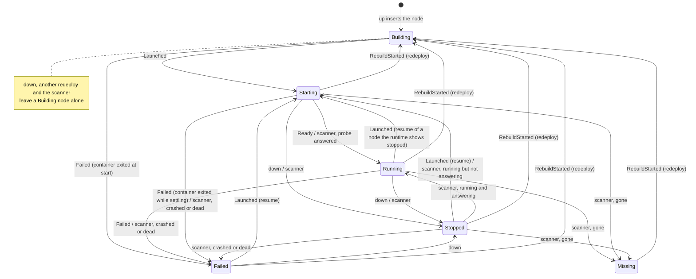

### 2. Lab phase and status (`LabPhase` and `LabState`)

*Made explicit by #499; the defects it had are recorded in the investigation note, M3.1, M6
and M7.*

A lab has two values. The **phase** is stored and says which operation owns the lab's record.
The **status** says how healthy its nodes are, and is derived from them each time it is read.

**Where.**

- `LabPhase` is in `crates/shared/src/data/lab_lifecycle.rs`: `Creating`, `Ready`, `Destroying`,
  `DestroyFailed`, `Interrupted` and `Unknown`. Every allowed move is in the same file, with a
  table test of every phase against every event:
  - `LabPhase::on_event(LabEvent) -> Result<LabTransition, LabRefused>`. A `LabTransition` is
    `To(phase)`, or `Removed` for a move that deletes the record.
  - `ensure_ready() -> Result<(), LabNotReady>`: only `Ready` takes operations on the lab's
    nodes. The refusal's message says what to do. `is_ready()` is the same test for the admin
    labs list.
- It is stored in `lab.phase TEXT NOT NULL` (migration `0015_lab_phase.sql`, which also dropped
  the old `lab.status`). Labs that existed before are `ready`. Text this build does not know
  decodes as `Unknown` (`#[serde(other)]`), which allows only destroy and clean.
- Writes are compare-and-sets: `db::update_lab_phase_from(lab_id, from, to)` (`UPDATE ... WHERE
  lab_id = ? AND phase = ?`) and `db::delete_lab_from(lab_id, from)`. `db::create_lab` inserts
  `Creating`.
- The only caller of those writes is `lab_lifecycle::record(db, hold, LabEvent)` in
  `crates/server/src/services/lab_lifecycle.rs`. `hold` is a `LabHold` (machine 3): an
  operation's `LabOperation` or a destroy's `StoppedLab`, so only code holding the lab's lease
  writes its phase, and only for that lab. `record` reads the lab, applies the event, and writes
  with the compare-and-set; a lost race reads the lab again.
- `LabState` is in `crates/shared/src/data/lab.rs`: `LabState::derive(&[NodeState])`, in
  priority order `Empty` (no nodes), `Running` (all), `Stopped` (all), `Failed` (any `Failed`
  or `Missing`), `Starting` (any `Starting` or `Building`), else `Partial`. Nothing stores it:
  `list_labs` reads every node state of the user's labs in one query
  (`db::list_node_states_by_user`), and `inspect` derives it from the nodes it reads. Unknown
  text decodes as `Unknown`.

**Phases and events.**

| Event | Sent by | From | To |
|---|---|---|---|
| (insert) | `up` phase 1, `reserve_lab` | | `Creating` |
| `Built` | `up`, once phase 13 is done | `Creating` | `Ready` |
| `Released` | `up`, when phase 2 fails | `Creating` | record removed |
| `DestroyStarted` | destroy, clean, a failed `up`'s rollback (`tear_down_lab`) | any | `Destroying` |
| `DestroyFailed` | `tear_down_lab`, when anything was left | `Destroying` | `DestroyFailed` |
| `Destroyed` | `tear_down_lab`, once resources and folder are gone | `Destroying` | record removed |
| `OwnerLost` | `recover`, at startup | `Creating` | `Interrupted` |
| `OwnerLost` | `recover`, at startup | `Destroying` | `DestroyFailed` |

Every other pair is refused with a `LabRefused`.

**Who sets and reads it.**

- `up` refuses a lab ID that has a record with a `Conflict` early in setup, before it connects
  to libvirt or reads the host, so the answer is the same on any host. It then reserves the lab
  by inserting its record (machine 6); two `up`s of one lab that both pass the early check race
  there, and the second fails with the same `Conflict`, before it creates anything.
- `down`, `resume` and redeploy call `lab_lifecycle::require_ready` under their lease, after
  their access check, and refuse a lab that is not `Ready` with a `Conflict`.
- Destroy and clean move it through `Destroying` (machine 7).
- At startup, `daemon/server.rs` calls `lab_lifecycle::recover` before the scanner starts and
  before any listener binds. Nothing runs then, so a lab still `Creating` or `Destroying` has
  lost its owner: `recover` takes each lab's lease and records `OwnerLost`, and records `Failed`
  for every node still `Building`. It removes nothing; the user destroys or redeploys. After it,
  no lab is `Creating` or `Destroying` and no node is `Building` without an operation.
- `list_labs` and `inspect` return the phase beside the status (`LabSummary.phase`,
  `InspectResponse.lab_phase`, both `ready` when a server before 0.5.27 sends none).
- The web UI shows the phase instead of the status while the lab is not ready, and then
  offers only Destroy (`labs-grid`, `lab-detail`, and the admin labs list). The handlers decide
  with `Badge::for_lab` and `LabActions::for_lab` (`crates/server/src/templates/`). `sherpa inspect` and
  `sherpa destroy` print the refusal message for a lab that is not ready.
- The scanner does not read or write the phase. It observes the nodes of any lab no operation
  holds; a lab whose destroy failed has its missing nodes recorded `Missing`.

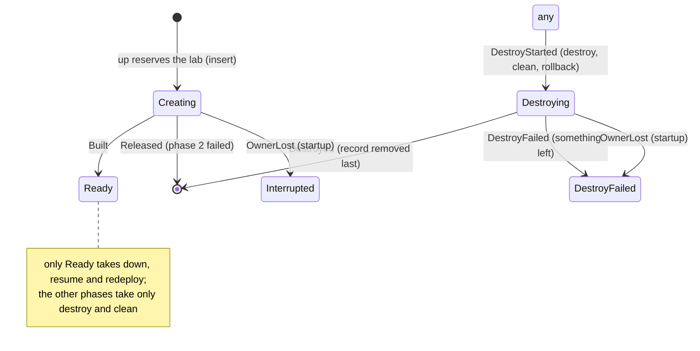

### 3. Lab operation leases and cancellation

**Where.** This machine is explicit, documented and tested. It lives in
`crates/server/src/services/lab_operations.rs`:

- `LAB_LEASES`: a per-lab `LeaseSlot`, an `Arc<RwLock<()>>` and a count of its users (`:36`,
  `:59`). An entry exists only while something holds or waits on the lab's lock (see "Entry
  lifetime" below).
- `LAB_CANCELLATIONS`: a `CancellationToken` with a first-wins `StopReason` (`:37`, `:53`).
- `PENDING_DESTROYS`: a count of waiting destroys (`:40`).
- The types are `LabOperation` (holds a read lease), `StoppedLab` (holds the write lease) and
  `ObservedLab` (the scanner's write lease). Each also holds a `LeaseEntry` (`:65`).

**Entry lifetime.** A `LeaseEntry` is one user's share of a lab's `LAB_LEASES` entry.

- `LeaseEntry::join` (`:166`) creates the entry if it is missing, adds one to its count and
  clones its lock, all under the entry's DashMap shard lock. `begin`, `stop` and `try_observe`
  join before they wait for or try the lock. So a waiter counts as a user, and a `begin` or
  `stop` future dropped while it waits gives its count back when its `LeaseEntry` drops.
- Dropping a `LeaseEntry` (`:181`) takes one off the count and removes the entry at zero. Both
  go through the entry API, under the same shard lock as `join`. A caller is either counted
  before the removal, or arrives after it and creates a fresh lock that nobody else holds or
  waits on. The drop holds no other reference into the map, so it cannot deadlock with
  another shard lock.
- In each holder, the guard is declared before the `LeaseEntry`. Fields drop in declaration
  order, so the lock is released before the entry can be removed. A swapped order would let a
  new caller create a fresh lock while the old guard is still held. Tests cannot catch a
  swapped order: while a waiter exists its own count keeps the entry, and with no waiter the
  window lies inside one `drop`.
- So the map holds the labs that have an operation, a destroy or a scan running or waiting.
  It no longer holds every lab the server has seen. `LAB_CANCELLATIONS` keeps a token from
  the first `begin` until a `StoppedLab` drops, which is bounded by the labs that exist.
- Tests: `released_leases_leave_the_map_and_a_held_one_stays`,
  `a_waiter_gets_the_lock_its_holder_released`,
  `a_waiter_cancelled_mid_wait_gives_up_its_count` and
  `racing_takes_and_releases_never_split_a_lab_across_two_locks`.

**Transitions.**

- `begin` (`:221`) takes a read lease. It then cancels at once if a destroy is pending. It is called by:
  - `up_lab` (`crates/server/src/services/up/lab.rs:145`);
  - `start_lab_nodes` (`resume.rs`);
  - `shutdown_lab_nodes` (`down.rs`);
  - `redeploy_node` (`redeploy/node.rs:59`).
- `try_observe` (`:247`) takes the write lease if it is free, for the scanner.
- `stop(reason)` (`:263`) cancels the token, then waits for the write lease. It is called by:
  - `destroy_lab` (`crates/server/src/services/destroy.rs:74`, `Destroy`);
  - `clean_lab` (`crates/server/src/services/clean.rs:33`, `Destroy`);
  - `cancel_lab_operations` (`crates/server/src/services/cancel.rs:23`, `Request`).
- Dropping `StoppedLab` (`:194`) removes the token, so later operations get a fresh one.
- Operations check for cancellation only at safe points:
  - `LabUp::start_phase` (`up/lab.rs:340`);
  - `LabOperation::sleep` in the readiness loops;
  - `ensure_active` (`redeploy/node.rs:88`).

**Who else takes part.**

- `shutdown_lab_nodes` (down) takes a read lease with `begin`, like the other operations.
- The scanner takes the write lease with `try_observe`, without waiting and without
  cancelling anything, and skips a lab an operation holds. It holds the lease only while it
  queries the runtimes, writes what it saw, and checks and repairs the lab's P2p links
  (machine 25); its SSH probes run before. An operation that starts meanwhile waits for it.
  So the repair never runs beside a `resume`, `redeploy` or `up` that makes link ends itself. A `stop` that finds the scanner holding the lease reports
  `was_running`, as if an operation had held it.

**Proof of the lease.** `LabHold` is a sealed trait implemented by `LabOperation` and
`StoppedLab`, with `lab_id()`. The lab lifecycle (machine 2) takes one to write a phase, so a
phase is written only under the lease of the lab it belongs to.

**Who does not take part.**

- `refresh_node_host_key` takes no lease.
- Read leases are shared, so two `up`s on the same lab, or an `up` and a `resume`, run at the
  same time. The lab phase (machine 2) keeps them apart: the second `up` fails to reserve the
  lab, and `resume` refuses a lab that is not `Ready`.
- Redeploys also hold a second, per-lab `Mutex` from `REDEPLOY_LOCKS`
  (`redeploy/node.rs:33, 62-63, 124-135`). It serializes redeploys with each other only.

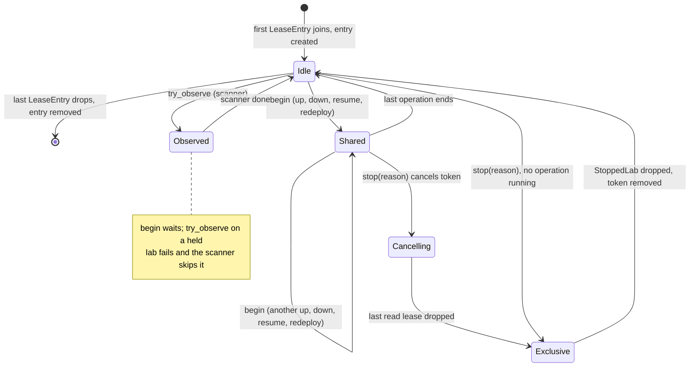

### 4. Runtime state mappings (libvirt and Docker)

*One table since #498 (M4).*

Sherpa reads libvirt's `VIR_DOMAIN_*` codes and Docker's container status, and maps them to
`shared::data::Runtime` in one place: `libvirt_runtime` and `container_runtime` in
`crates/server/src/services/node_lifecycle.rs`, each with a test of every value. The scanner
uses the mapping to observe nodes (machine 1), and `inspect` to report a container's state;
resume uses it, through `start_step` (`resume.rs`), to decide what to do with each node; `up`
uses it, through `check_started_container` (`up/readiness.rs`), to decide whether a started
container is ready.

| Runtime state | `Runtime` | Scanner records (machine 1) | Resume |
|---|---|---|---|
| libvirt RUNNING, Docker RUNNING | `Running` | `Running` once ready | already running |
| libvirt SHUTOFF, Docker EXITED, CREATED | `Stopped(Off)` | `Stopped` | boot (`create`, `start`) |
| libvirt PAUSED, Docker PAUSED | `Stopped(Paused)` | `Stopped` | `resume`, `unpause` |
| libvirt CRASHED, Docker DEAD | `Faulted` | `Failed` | refused: redeploy it |
| libvirt SHUTDOWN, BLOCKED, PMSUSPENDED, NOSTATE; Docker RESTARTING, REMOVING, EMPTY | `Transitional` | unchanged | refused: try again shortly |
| domain or container missing | `Absent` | `Missing` | refused: redeploy it |

- The scanner and `inspect` read Docker's listing through `node_lifecycle::container_states`;
  its states are converted to the inspection's `ContainerStateStatusEnum`, which resume and
  `up` read, so all go through `container_runtime`.
- Resume reports a container it cannot inspect, a missing one included, as "Failed to check the
  container".
- If a runtime query fails, the scanner keeps the recorded state of that runtime's nodes.
- `down` pauses containers, so a container that is down is `Stopped(Paused)`.
- The scanner's P2p link repair (machine 25) checks only nodes that are `Running` here and not
  `Building`; a `Stopped(Paused)` node, and any other, is left as it is.

### 5. Node readiness and host keys

**Where.** "Ready" is `NodeState::Running` (machine 1): every writer records it only after a
readiness check passed or for a node that has none. The host key is
`node.ssh_host_key: Option<String>`; `Some` means the key was captured from a running node.

**Readiness waits.** The readiness wait is written four times, each with its own timeout and
error policy:

| Wait | Where | On a timeout |
|---|---|---|
| `up` | `up/readiness.rs` | adds a non-critical error |
| `resume` | `resume.rs` `wait_for_cold_booted` | the node stays `Starting`; the message says so |
| `redeploy` VM | `redeploy/vm.rs` `poll_until_ready` | the node stays `Starting` |
| scanner | `scanner.rs` `probe_node` | the node stays `Starting`; probed again next cycle |

**Containers in `up`.** Containers have no readiness probe. `up` records a container
`Starting` once Docker reports it running after the start, and `Running` once it is still
running `CONTAINER_SETTLE` (5 seconds) after it was started: an image whose entrypoint fails,
such as `mysql` without a root password, exits about a second after Docker first reports it
running. While containers settle, the poll wakes when the next one is due, not after
`READINESS_SLEEP`. `check_started_container` decides from Docker's status:

| Docker status (`Runtime`) | Running for less than 5 s | 5 s or more |
|---|---|---|
| RUNNING (`Running`) | wait | `Ready`: `Running` |
| PAUSED, RESTARTING, REMOVING, EMPTY | wait | wait |
| EXITED, CREATED, DEAD, missing | `Failed` | `Failed` |

A container not running right after its start is `Failed` at once, with or without
`ready_check.skip`. With `ready_check.skip`, a container running after its start is `Running`
at once and not checked again. Every other container that is `Running` is checked once more
when polling ends, as VMs may have kept it going long after the container settled. Each
`Failed` container adds a critical error with its exit code and its last ten log lines
(`container::container_log_tail`).

`up` records a node not ready in time `Starting` too. A node left `Starting` by any of them is
recorded `Running` by the scanner once its probe answers (virtual machines with SSH) or as
soon as the runtime shows it running (other nodes).

**Host key transitions.**

| Transition | Function | file:line | Checked? |
|---|---|---|---|
| None → Some | `Readiness::record` (up) | `up/readiness.rs` | only when a key was read |
| None → Some or changed | `record_node_host_key`, from the scanner (`probe_node`), resume and `refresh_node_host_key` (`crates/server/src/services/host_keys.rs:63`) | `crates/server/src/services/ssh_config.rs:28-45` | a changed key is replaced with a warning |
| None → Some | redeploy VM | `redeploy/vm.rs:249` | only when a key was read |
| any → None | `redeploy_node`, after `RebuildStarted` is recorded | `redeploy/node.rs` | the node's state allowed the rebuild |

The scanner probes, and so reads a key, when `wants_probe` is true: a VM with SSH that the
runtime shows running and that is not yet `Running` or has no key. After recording a key it
rewrites the lab's SSH files. It does so after it has released its hold on the lab, and takes
no redeploy lock (M5.2).

**Not covered here.** `WatchdogAction` (`crates/shared/src/data/watchdog.rs`) configures the
guest's emulated hardware watchdog in the libvirt XML. It is not a Sherpa state machine.

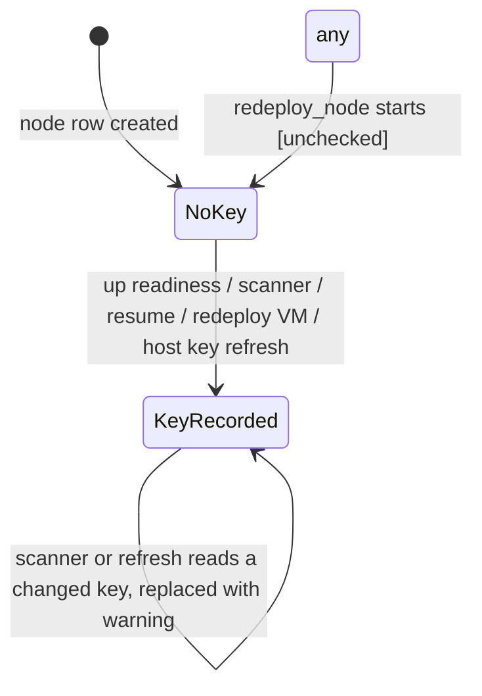

---

## Multi-step operations

### 6. `up` phases and rollback

**Where.** `crates/server/src/services/up/lab.rs`, with these types:

- `LabUp`, holding `phases_completed: Vec<String>` and `errors`;
- `UpPhase` labels (`crates/shared/src/data/up.rs`);
- `ReservedLab` (`up/networks.rs`): the lab's record and subnets. Only the `up` that inserted the
  record has one, and phase 3 consumes it.

The stage is the program counter; the lab phase (machine 2) says who owns the record.
`phases_completed` is reported in the response and never read back.

**Stages.**

| Phase | Function | Creates |
|---|---|---|
| 1 Setup | `set_up`, ending with `reserve_lab` (`up/networks.rs`) | the lab record, `Creating`, holding its subnets. A lab ID in use fails here with a `Conflict`, first right after the owner is loaded and before libvirt is connected, and again at the reservation for a concurrent `up`: "Lab already exists" (with the phase when it is not `ready`), or "rename the lab" for another owner's lab with the same ID. |
| 2 Validation | `validate`: `plan_lab`, `ensure_no_earlier_attempt` | image leases in memory. The earlier-attempt check looks at libvirt volumes and domains, and skips labs where every node is a container. |
| 3 DatabaseRecords | `create_node_records` (`up/records.rs`) | node rows (`Building`), VNC ports, per-node networks |
| 4 | `set_up_lab_network` | lab dir and files, libvirt NAT network, Docker bridge network, Tailscale gateway |
| 5 to 7 | `link_nodes`, `create_isolated_container_networks`, `create_shared_bridges` | link rows, Docker macvlan networks, host bridges, bridge rows |
| 8 | `configure_nodes` (`up/ztp.rs`) | ZTP files, lab CA, node certificates, management addresses |
| 9 | `start_boot_container` | dnsmasq files and container |
| 10 to 12 | disk clone, `create_vms`/`create_unikernels`, `attach_vm_links`, SSH files | volumes, domains, eBPF redirects, netem |
| 13 | `wait_for_nodes`, `start_lab_services`, then `Built` | containers, veths, node state and host keys, Talos, Vault, Keycloak; the lab `Ready` |

**Transitions out of the sequence.**

- **A failure in phase 1** returns. If it came from the reservation, nothing was created.
- **A failure in phase 2** records `Released`, which removes the record this `up` inserted.
- **A failure or a cancellation from phase 3 on** calls `roll_back_failed_up`:
  - for `StopReason::Destroy`, it does nothing: the destroy holds the lab next and removes it;
  - otherwise it calls `clean_lab_resources(state, operation)`, which runs `tear_down_lab`
    (machine 7): the lab goes `Destroying`, then is removed, or is left `DestroyFailed` when
    anything is left behind, where its owner can destroy it again.
- **The daemon stops mid-way**: startup recovery marks the lab `Interrupted` and its `Building`
  nodes `Failed` (machine 2).
- **Errors in phase 13** are collected in `errors`, and `up` returns `Ok` with the lab `Ready`.
  `success` is false when any is critical:
  - critical: a container that stopped running before it was ready (its node is `Failed`; the
    error has its exit code and last log lines, machine 5), and a lab service that did not
    come up: a Talos cluster not ready, a Keycloak realm or a Vault that failed to set up.
    Nothing sets them up again.
  - not critical: a node whose readiness wait timed out (it stays `Starting` and the scanner
    records it running once it answers), and Tailscale warnings.

  The client fails `sherpa up` with "only partly created" when `success` is false.

**Who sets and reads.**

- The RPC, REST and web handlers start `up` in detached tasks. None checks the lab first; the
  reservation does.
- The client reads `UpResponse.success` and `errors` (`crates/client/src/cmd/up.rs`).

```mermaid
stateDiagram-v2
    [*] --> Reserved : phase 1 inserts the record, Creating
    [*] --> [*] : phase 1 fails, lab ID in use (nothing created)
    Reserved --> Validated : phase 2
    Reserved --> [*] : phase 2 fails, Released
    Validated --> Building : phases 3 to 12 (cancellation checked between phases)
    Building --> Waiting : phase 13
    Waiting --> Up : Built, lab Ready (success false if any error is critical)
    Building --> RollingBack : error or Request stop
    Waiting --> RollingBack : error or Request stop
    Building --> LeftForDestroy : Destroy stop
    Waiting --> LeftForDestroy : Destroy stop
    RollingBack --> [*] : tear_down_lab removed everything
    RollingBack --> DestroyFailed : something left, record kept
    Building --> Interrupted : daemon stopped; marked at startup
    Up --> [*]
    LeftForDestroy --> [*]
```

### 7. Destroy and clean

**Where.**

- `crates/server/src/services/destroy.rs`: `destroy_lab`, `tear_down_lab`,
  `destroy_lab_resources`, `cleanup_lab_metadata`.
- `crates/server/src/services/clean.rs`: `clean_lab`, `clean_lab_resources`.

**State.** The lab phase (machine 2) holds where a destroy is: `Destroying` while it runs,
`DestroyFailed` when it left something. The response holds the detail: `DestroySummary` has
per-resource lists and the bools `database_records_deleted` and `lab_directory_deleted`, beside
`errors: Vec<DestroyError>`.

**Stages.** `tear_down_lab`, under the lab's lease:

1. if the lab has a record, record `DestroyStarted`: the lab is `Destroying`;
2. containers and secrets; VMs; disks (skipped after a VM error); Docker networks; libvirt
   networks; host interfaces. Each runs whether or not the ones before it failed;
3. `cleanup_lab_metadata`:
   - if `errors` is not empty, keep the folder and the record;
   - otherwise remove the lab folder; if that fails, keep the record;
   - then record `Destroyed`, which removes the record. The record goes last, so whatever is
     left is still reachable through it;
4. if `errors` is not empty and the lab has a record, record `DestroyFailed`.

**Entry checks.**

- `destroy_lab` calls `require_lab_access`, then `stop(Destroy)`, then reads the lab again. A lab
  another destroy removed while this one waited is reported as destroyed, with success.
- `clean_lab` requires an admin and the lease. It works on a lab with no record: the resources
  and the folder named for the lab ID are removed, and that is a success.
- `up`'s rollback calls `clean_lab_resources` under its own lease (machine 6).

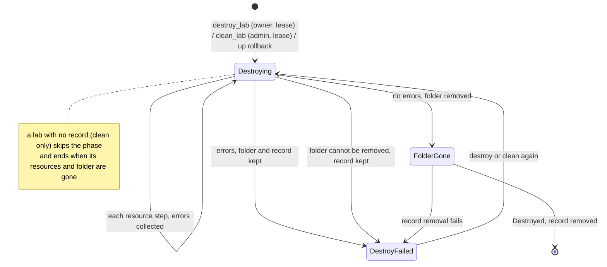

### 8. Down and resume

**Down.** `shutdown_lab_nodes` is in `down.rs`.

- It takes a read lease with `lab_operations::begin` and checks access again under it.
- A node whose state refuses `Stopped` (`Building`, `Missing`) is reported and not touched.
- VMs: ACPI, the Talos API, or power-off, depending on the model.
- Containers: paused.
- `Stopped` is recorded through the node lifecycle for each node whose action succeeded.
  "Already stopped" and "not running" count as success. A recording the state refuses makes
  that node's result a failure.
- A whole-lab down then stops the Tailscale gateway, which also logs it out (`down.rs`).

**Resume.** `start_lab_nodes` is in `resume.rs`.

- It takes a read lease and checks access again under it.
- It re-enrolls Tailscale before any node starts (M8.3).
- A node whose state refuses `Launched` (`Building`, `Missing`) is reported and not touched.
- It starts the nodes at the same time. `start_step` decides from the node's `Runtime`
  (machine 4); the result is a `StartOutcome`:
  - `ColdBooted`: recorded `Starting`;
  - `Resumed` (unpaused): recorded `Starting`, then `Running`;
  - `AlreadyRunning`: not recorded;
  - `Failed(reason)`: a crashed domain, dead container, one between states, a missing domain,
    or an error from libvirt or Docker.
- Every `ColdBooted` node has its P2p links re-attached (`reattach_cold_booted`, machine 25):
  VMs and unikernels have new taps; a container started from exited has its veths made again
  in its new namespace first. Each node's result carries its links' states; a link that is not
  attached does not fail the node.
- `ColdBooted` nodes are waited on for readiness (`wait_for_cold_booted`). Those that become
  ready, and those with no check (containers, `ready_check.skip`), are recorded `Running`; the
  others stay `Starting`.

```mermaid
stateDiagram-v2
    Running --> Stopped : down, action ok
    Starting --> Stopped : down, action ok
    Failed --> Stopped : down, action ok
    Stopped --> Starting : resume, ColdBooted / Resumed
    Failed --> Starting : resume, ColdBooted / Resumed
    Starting --> Running : resume, ready or unpaused
    note right of Starting : readiness wait timed out: stays Starting
    note left of Stopped : Building and Missing nodes are refused by both
```

### 9. Redeploy

**Where.** `crates/server/src/services/redeploy/` (`node.rs`, `context.rs`, `vm.rs`,
`container.rs`, `links.rs`, `teardown.rs`).

**Stages.**

1. `load_redeploy` runs every check and changes nothing.
2. Record `RebuildStarted` (node `Building`; refused if another operation is building it),
   then clear the host key (`node.rs`).
3. `rebuild` (`crates/server/src/services/redeploy/node.rs`):
   - `destroy_node`;
   - for VMs, `recreate_vm_networks`;
   - regenerate ZTP and certificates;
   - recreate the node (`redeploy_vm` or `redeploy_container`), recorded `Starting` once the
     VM is created or the container runs;
   - re-attach its P2p links with `reattach_node_links` (machine 25), making a container's
     veths first. The link states go in the response; a link that is not attached, such as
     one whose peer is down, does not fail the redeploy;
   - record `Running`:
     - containers: after Vault and Keycloak are restored (`ready_after_restore`,
       `container.rs`);
     - VMs: after the probe (`wait_until_ready`, `vm.rs`).
4. `ensure_active`, then `refresh_lab_ssh_files` (`node.rs`).

**Failures.**

- An error from `rebuild` records `Failed` (`mark_failed`, `node.rs`).
- Errors at stage 2, at `ensure_active`, or in the SSH file refresh return without
  `mark_failed`.
- A VM that does not become ready in time is left `Starting`, and redeploy succeeds
  (`vm.rs`). The scanner records it `Running` once its probe answers.

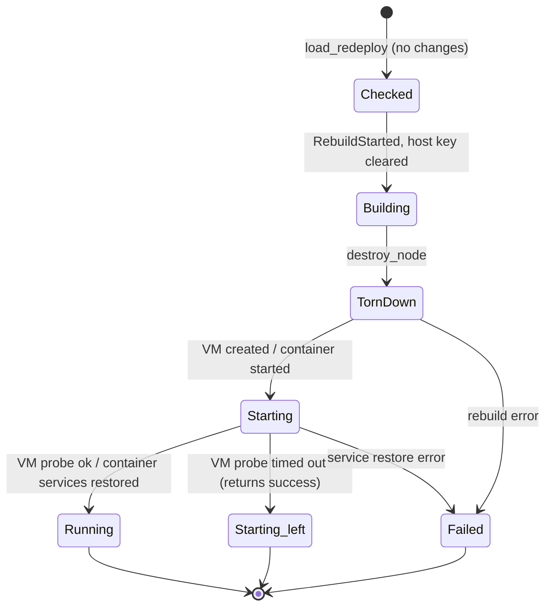

---

## Provisioning stages

### 10. Talos cluster bring-up

**Where.** `crates/server/src/services/talos/` (`lab.rs`, `bootstrap.rs`).

**Stages and their markers.**

| Stage | Marker | Where |
|---|---|---|
| Secrets | `<lab>/clusters/<name>/secrets.toml` | `talos/lab.rs:58-61` |
| Plan | `cluster.toml` | `talos/lab.rs:62-64` |
| Machine configs | none (memory). Regenerated from plan and secrets on a worker redeploy. | `redeploy/context.rs` |
| Credentials | `talosconfig`, `kubeconfig` | `talos/lab.rs:321-343` |
| Bootstrap | none in Sherpa. Talos answers `ALREADY_EXISTS` when bootstrapped. | `talos/bootstrap.rs:131-135` |
| Ready | Kubernetes node list | `talos/bootstrap.rs:143-194` |

**Who runs it.**

- `bring_up_clusters` is called only from `up` (`up/services.rs:55`).
- A cluster that does not become ready is a non-critical `up` error.
- Nothing retries the bootstrap later.
- Redeploy refuses control-plane nodes (`talos/lab.rs:88-99`).

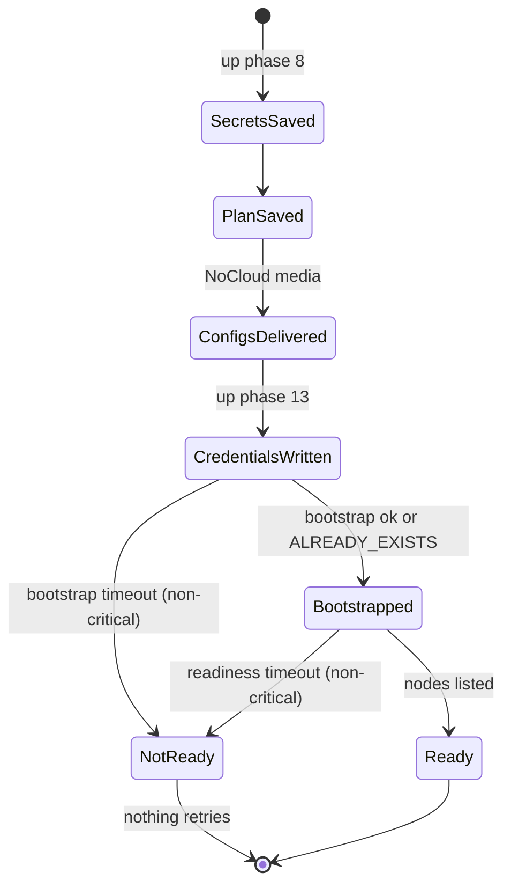

### 11. Vault init and unseal

**Where.** `ensure_vault_unsealed` and `unseal_with_client`, at
`crates/server/src/services/vault/lab.rs:99-148`, and `initialise` at `:165-217`.

**States.** Vault holds one state and Sherpa holds another:

- Vault: uninitialized, initializing (seal status answers 500), initialized and sealed,
  unsealed, active.
- Sherpa: whether `<lab>/vault/<node>.toml` exists, and whether it sent an init in this
  operation.

**Transitions.** All of them are checked against Vault's status.

- Uninitialized → `init()` (`:174`) → credentials saved (`:185`) → unseal.
- Init fails → seal status polled again (`:193`), then `after_failed_init` (`:221`):
  uninitialized → init again (two attempts in all); initialized → "Sherpa lost the init
  response", with the reset (`sherpa redeploy --node <node>`); no status → "cannot tell", with
  the same reset.
- Initialized at the first status read → credentials loaded. If no file exists, it fails with
  "initialised outside Sherpa" (`saved_credentials`).
- Sealed → unseal with the saved key.
- Then `wait_until_active`.

The init and the save are two separate steps. A lost init response, or a failed save, leaves
Vault initialised with no saved credentials; Sherpa does not reset Vault data itself, and
`redeploy` is the way out.

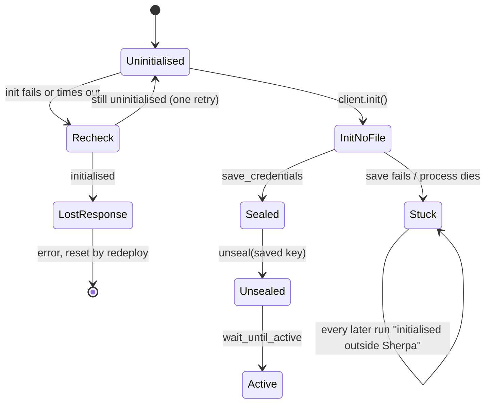

### 12. Keycloak realm

**Where.** `crates/server/src/services/keycloak/lab.rs`.

**Markers.**

- `<lab>/keycloak/<node>.toml`, holding the users and passwords. `realm_credentials` writes it
  before Keycloak hears of the users (`:73-97`), and returns it unchanged when it already
  exists (`:80-82`).
- Existence on the Keycloak server. HTTP 409 maps to `AlreadyExists`
  (`keycloak/api.rs:136-138`).

**Transitions.** The realm, client, groups and users are created in that order. Each create
is idempotent, because an existing object counts as done. An existing user keeps its
password.

### 13. Tailscale gateway

**Where.**

- `crates/server/src/services/tailscale.rs`;
- `crates/container/src/tailscale.rs`;
- the stored flag `DbLab.tailscale_container_id: Option<String>`.

The live connection state, `TailnetState` (`crates/shared/src/data/tailscale.rs:35-40`), is
computed from the daemon and never stored.

**Stages.** In `up` phase 4:

1. Create the volume. This refuses if the volume exists (`crates/container/src/tailscale.rs:135-141`).
2. Create the container.
3. Save the container ID (`services/tailscale.rs:54-58`).
4. Start and enroll.

**Later transitions.**

- `down` stops and logs out, but only if the ID is set (`down.rs:172-176`).
- `resume` starts and enrolls again, with a new key (`services/tailscale.rs:128-148`).
- `destroy` finds the gateway by name and labels, whether or not the ID is set (`destroy.rs:536`).

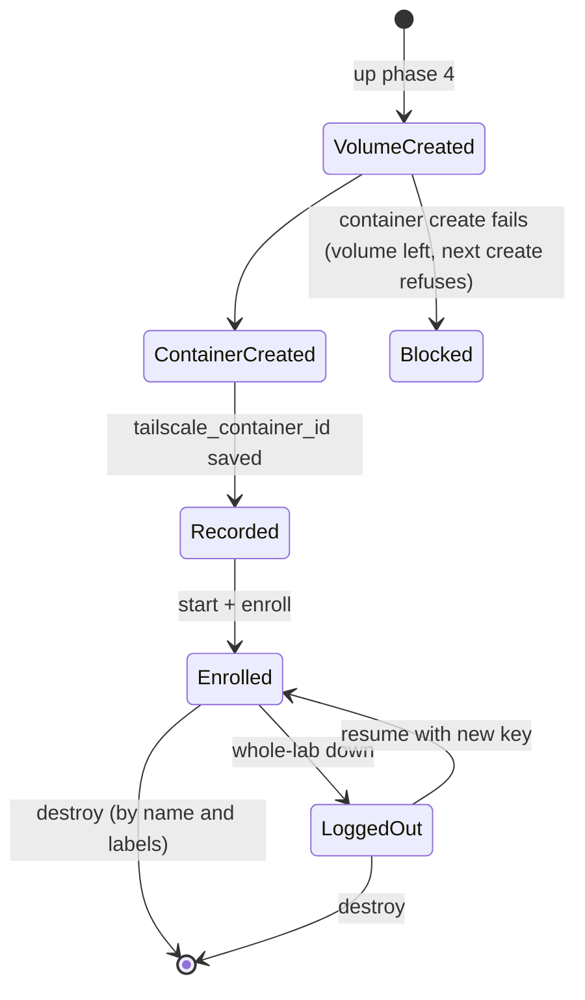

---

## Server sessions, transports and process

### 14. Sessions and tokens (server)

*Made explicit by #501; the defects it had are recorded in the investigation note, M14.*

**Where.**

- `SessionState`, `SessionEvent`, `transition` and `state_of` in `crates/server/src/auth/session.rs`,
  with the operations behind each event in the same file. Its module doc has the transition table.
- One row per session in the `session` table (`crates/db/sql/migrations/0012_session.sql`,
  `crates/db/src/session/`).
- JWT claims `{sub, sid, is_admin, iat, exp}` (`crates/shared/src/auth/jwt.rs`); `sid` names the row.
- The secret, in `crates/server/src/auth/jwt.rs` (`load_or_generate_secret`).

**States** *(explicit, `SessionState`)*:

- `Active`: the row exists and `expires_at` is in the future. The only state whose token is
  accepted.
- `Expired`: the row exists, `expires_at` has passed. Refused; the sweep deletes the row.
- `Ended`: no row. Logged out, ended by a password change or user deletion, or swept.

A token that fails its signature or `exp` check, or names no session (issued before 0.5.23), is
refused before the session is looked at.

**Transitions.**

| Transition | Function | Checked? |
|---|---|---|
| none → `Active` | `session::start`, from every login route and signup | checks the password |
| `Active` → `Active` (use) | `session::lookup`, from every extractor, `authenticate_request`, `auth.validate` and web job start | `transition(state, Use)` refuses `Expired` and `Ended` |
| `Active`, `Expired` → `Ended` (logout) | `session::logout`, from web `/logout`, REST `auth/logout`, RPC `auth.logout` | idempotent: ending an ended session is not an error |
| `Active`, `Expired` → `Ended` (password changed) | `db::change_user_password`, from `services::user_password` | every session of the user but the caller's own; one transaction with the new hash |
| `Active`, `Expired` → `Ended` (user deleted) | `db::delete_user`; `session.user` is `ON DELETE CASCADE` | — |
| `Active` → `Expired` | time passes `expires_at` | read from the clock by `state_of` |
| `Expired` → `Ended` (sweep) | `session::sweep`, from `session::run_sweeper` at startup and hourly | deletes `expires_at <= now`, the rows `state_of` calls `Expired`; a test checks they agree |
| startup refused | `load_or_generate_secret` with a secret file of the wrong length | the server does not start, so no session ends silently |

**Readers.**

- `AuthenticatedUser`, `AuthenticatedUserFromCookie` and `AdminUser` (`crates/server/src/api/extractors.rs`)
  and `authenticate_request` (RPC) build `AuthContext` from `session::lookup`: the user's current
  name and `is_admin`, and the `session_id`.
- `Job::resolve_requester` (`crates/server/src/daemon/state.rs`) presents the requester's session
  again when a web job starts.

```mermaid
stateDiagram-v2
    [*] --> Active : login (password checked)
    Active --> Active : use
    Active --> Expired : expires_at passes
    Active --> Ended : logout / password changed (other sessions) / user deleted
    Expired --> Ended : sweep / logout / password changed / user deleted
    Ended --> [*]
    note right of Expired : use refused (expired)
    note right of Ended : use refused (ended); a re-created user gets new sessions only
```

### 15. Web jobs

**Where.**

- `AppState.pending_jobs: DashMap<String, Job>` (`crates/server/src/daemon/state.rs:69`).
- `Job` holds the request and the requester's `AuthContext` (`state.rs:20-40`).

**Transitions.**

| Transition | Function | file:line | Checked? |
|---|---|---|---|
| absent → pending | destroy and create POST handlers | `crates/server/src/api/handlers/labs_web.rs:645`, `:869` | destroy checks lab access first; create leaves it to `up` |
| pending → consumed | `job_stream_handler` removes the entry once, after an ownership check | `labs_web.rs:729-745` | checked |
| consumed → running | `tokio::spawn` | `labs_web.rs` | the requester's session must still be active |

The job runs as its requester's session presented again when it is consumed
(`Job::resolve_requester`, see [14](#14-sessions-and-tokens-server)): a session that ended or expired
while the job was pending stops it from running, and a changed admin flag applies.

Nothing removes a pending job except the stream handler. There is no expiry. A consumed job
cannot be re-attached: a reload shows "Job not found or already completed"
(`labs_web.rs:678`).

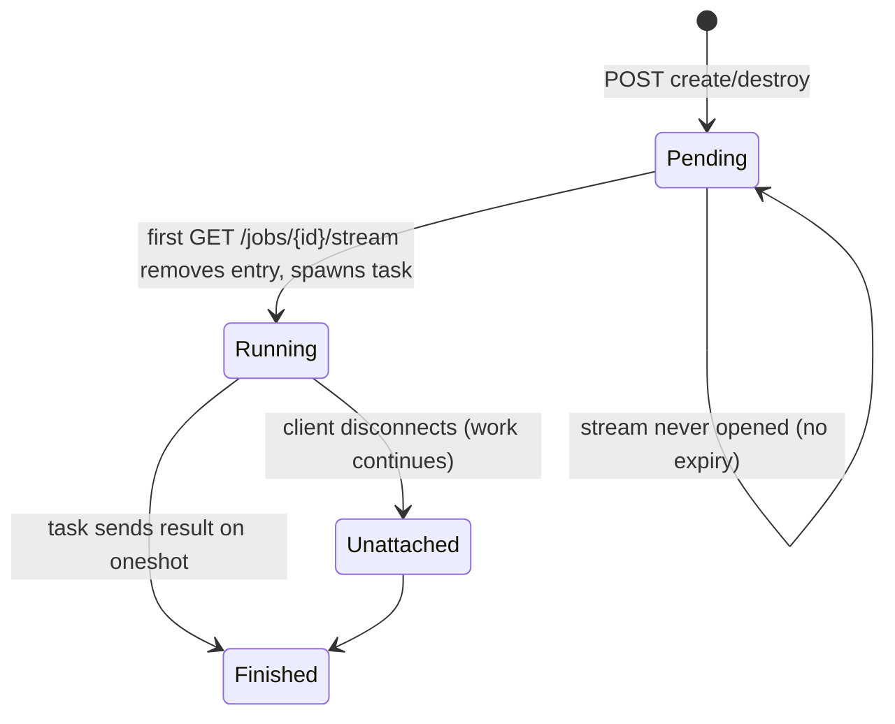

### 16. WebSocket RPC and SSE streams

**Server WebSocket.** In `crates/server/src/api/websocket/handler.rs`:

- The upgrade is not authenticated. Every RPC carries its own token.
- The connection is registered in `state.connections` and counted in a gauge. It is removed
  when the loop ends (`handler.rs:98-99`).
- Each RPC is spawned (`handler.rs:132-137`), so it outlives the socket.
- When the client has gone, progress messages and the final response are dropped with a debug
  log (`crates/server/src/api/websocket/rpc/dispatch.rs:296-298`, `:307-308`).

**SSE.** In `crates/server/src/api/sse.rs`:

- A stream drains progress until every `ProgressSender` clone is dropped, then waits for the
  `oneshot` result.
- A dropped result sender turns into "Lost connection to operation" (`sse.rs:129-132`).
- Progress text is decoded back into a `StatusMessage`. Lines that do not decode are dropped
  (`sse.rs:19-25`).

**Client.** `RpcClient` is in `crates/client/src/ws_client/client.rs`.

- `connect` (`:50-113`) runs TLS (machine 21) and then reads an optional "connected" banner.
  If the banner is missing or does not parse, the client only warns.
- `call` and `call_streaming` discard responses whose id does not match.
- A Close frame is an error.
- `close(self)` consumes the client.
- There is no reconnect.
- The `up`, `redeploy` and `resume` commands handle Ctrl-C through
  `call_streaming_or_interrupt`. `destroy` and `down` do not.

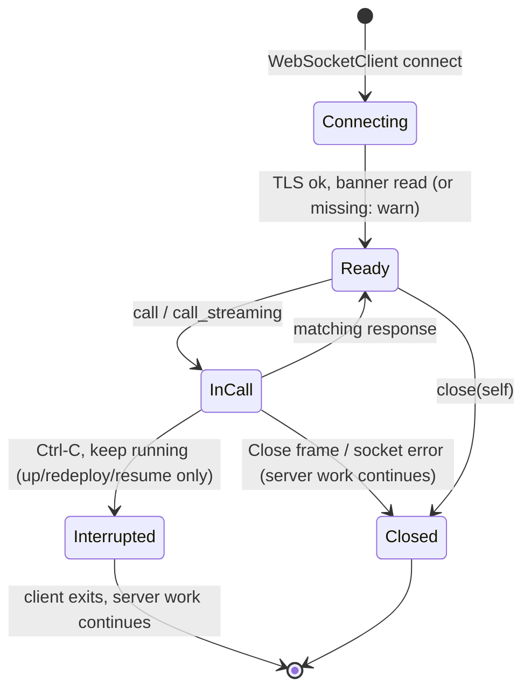

### 17. Daemon process

**Where.** `crates/server/src/daemon/manager.rs` and `pidfile.rs`.

**States** *(implicit)*:

- stopped: no PID file;
- running: a PID file whose process is alive (`kill(pid, 0)`, `pidfile.rs:67-70`);
- stale: a PID file whose process is dead;
- shutting down.

**Transitions.**

- **Foreground start** (`manager.rs:30-40`): `verify_not_running`, then `write_pid`, then
  `run_server`, then `remove_pid`.
  - `verify_not_running` (`pidfile.rs:73-83`) removes a stale file.
  - `write_pid` is a plain `fs::write` (`pidfile.rs:32-36`), so nothing stops two processes
    from both writing.
- **Background start**: the parent checks, and the child writes its own PID later
  (`manager.rs:59-69`, `:97-107`).
- **Stop** (`manager.rs:115-178`): SIGTERM, poll for 10 s, then optionally SIGKILL.

**Startup inside `run_server`** (`crates/server/src/daemon/server.rs:193-285`):

1. config;
2. telemetry;
3. signals;
4. `AppState::new`: database, schema, admin account, libvirt and Docker clients;
5. the scanner is spawned (`server.rs:240-245`);
6. the address is parsed;
7. TLS certificates;
8. bind.

The scanner can therefore act before the server is listening.

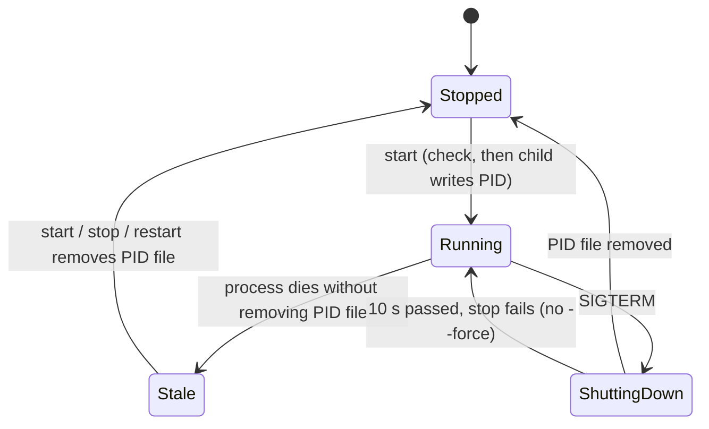

### 18. Server TLS certificate

**Where.** `CertificateManager::ensure_certificates`
(`crates/server/src/tls/certificate_manager.rs:41-67`), and the generator
(`crates/server/src/tls/generator.rs`).

**States.** Defined by which files exist: both, neither, or only one.

**Transitions.**

- Both files exist: they are used as they are. Expiry, SANs and whether the key matches the
  certificate are not checked (`:45-50`).
- Either file missing:
  - with `auto_generate_cert`, both are regenerated (`:52-55`), overwriting whichever file
    was there;
  - otherwise startup fails.
- There is no reload or renewal. The configuration is built once at startup
  (`crates/server/src/daemon/server.rs:476-484`).

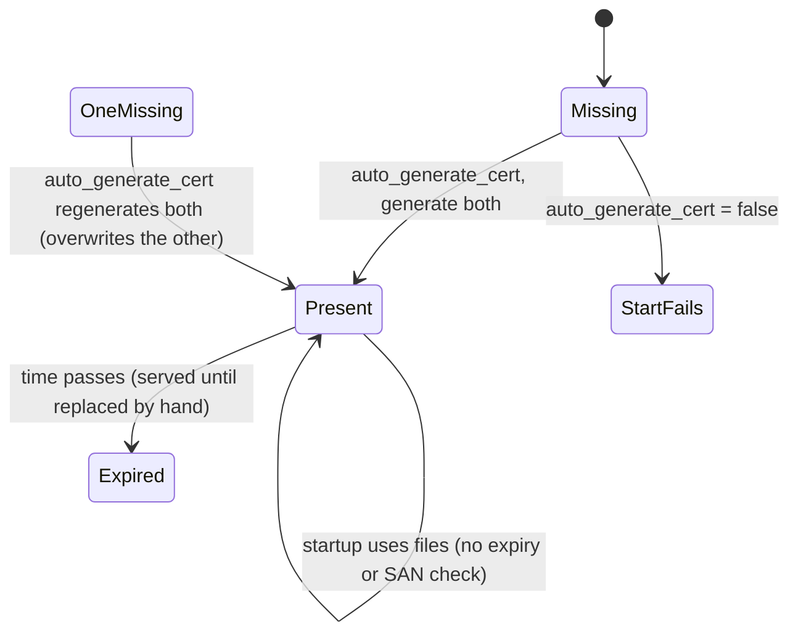

### 19. Lab CA and node certificates

**Where.** `crates/server/src/tls/lab_ca.rs`. The files live in `<lab>/certs/`.

**Transitions.**

- `create_lab_ca` (`lab_ca.rs:67-85`) writes the CA certificate, then the key. `up` phase 8
  calls it unconditionally (`up/ztp.rs:89`).
- `load_lab_ca` (`:89-101`) reads both files, for redeploy (`redeploy/context.rs`). It does not
  check validity.
- `issue_node_certificate` (`:121-154`) writes `<node>.crt`, then `<node>.key`, overwriting
  earlier ones.
- `up` refuses an existing lab row and `destroy` removes the directory, so a lab's CA is
  created once per lab lifetime.

### 20. `sherpad init`

**Where.** `crates/server/src/init.rs:35-123`.

**Stages:**

1. directories;
2. config, skipped if the file exists and `--force` is not set (`:76`);
3. libvirt network (`:99`) and storage pool (`:107`);
4. database;
5. admin account;
6. first user, guarded by a lookup (`:161-215`).

No step is undone on failure. Re-running is the recovery: the doc comment at `:127-128`
says it is safe to re-run.

---

## Client

### 21. Client TLS trust

**Where.**

- `ServerConnection` (`crates/shared/src/data/config.rs:37-66`). Its fields are `url`,
  `validate_certs`, `ca_cert_path` and `insecure`.
- `ClientConfig.tls.enabled` (`config.rs:138-151`).
- The URL scheme.
- The trust store: one PEM per `host:port` in `~/.sherpa/trusted_certs`
  (`crates/shared/src/tls/trust_store.rs`).
- The `--insecure` flag, applied by `apply_insecure_override` (`crates/client/src/cmd/cli.rs:55-60`).

**How the mode is chosen.** No enum names the modes. `build_with_trust_flow`
(`crates/shared/src/tls/config.rs:69-123`) picks one through a fixed chain:

1. **Plain WebSocket.** The scheme is `ws://` (`crates/client/src/ws_client/client.rs:82-95`).
   No TLS setting is read.
2. **Insecure.** `insecure` is set (`crates/shared/src/tls/config.rs:70-76`).
3. **Custom CA only.** `ca_cert_path` is set (`:78-93`). Neither the trust store nor
   `validate_certs` is read.
4. **Pinned.** The trust store has an entry for the server (`:95-103`).
5. **Public CAs, with trust on first use as the fallback.** `validate_certs` is true
   (`:105-117`). When the handshake fails with an unknown issuer, the caller runs
   `trust_on_first_use` and reconnects (`client.rs:66-80`).
6. **Trust on first use now.** `validate_certs` is false (`:119-122`).

`trust_on_first_use` (`crates/shared/src/tls/config.rs:131-168`) fetches the certificate over plain HTTP, asks the
user, and saves it, which moves the server to mode 4. Removing the file, or replacing it with
`sherpa cert trust`, moves it back.

**URL.** `build_client_websocket_url` (`crates/shared/src/util/config.rs:47-56`) returns
`server_connection.url` when it is set. It reads `tls.enabled` only when the URL is unset.

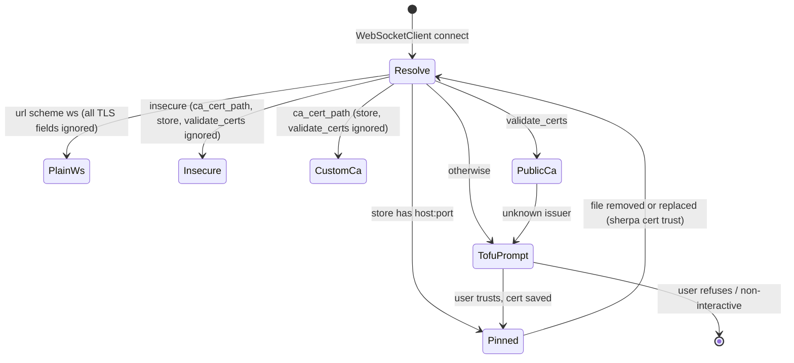

### 22. Client token

**Where.** `~/.sherpa/token` (`crates/client/src/token.rs:1-90`), readable only by the user. It holds one
raw JWT for whichever server the user last logged in to. The expiry is not stored locally.

**States.** absent, present and valid, present but expired or revoked or for another server.
The client can tell only absent from present.

**Transitions.**

- `login` saves the token and overwrites any earlier one (`crates/client/src/cmd/login.rs:67`).
- `logout` asks the server to end the session (`auth.logout`), then deletes the file
  (`crates/client/src/cmd/login.rs`). If the server cannot be reached it still deletes the file
  and warns that the session stays active on the server.
- Expiry is learned only from the server's `AuthRequired` error
  (`crates/client/src/ws_client/messages.rs:72-74`).
- `whoami` asks the server to validate the token and prints the expiry it reports
  (`crates/client/src/cmd/login.rs:106-156`).

### 23. Client operation outcome and local lab files

**Where.** `crates/client/src/cmd/up.rs`, `destroy.rs` and `lab_files.rs`.

The client keeps its own picture of a lab in the lab folder: SSH config, key, lab info,
`known_hosts`, and the include in `~/.ssh`.

**Transitions.**

- **`up` success or partial success** saves the files (`crates/client/src/cmd/up.rs:140-147`), then provisions, then
  fails if `!success` (`crates/client/src/cmd/up.rs:167-173`). `save_lab_files` stops at the first file that fails.
- **`up` interrupted with "keep running"** returns `bail!("Lab creation interrupted")`
  (`crates/client/src/cmd/up.rs:131`). The files are not saved and provisioning does not run.
- **`destroy`** removes local state only when `summary.database_records_deleted` is true
  (`destroy.rs:111-121`).
- **A connection that drops** before the response leaves the local files as they were.
- `sherpa download` and `sherpa provision` are the manual ways to catch up.

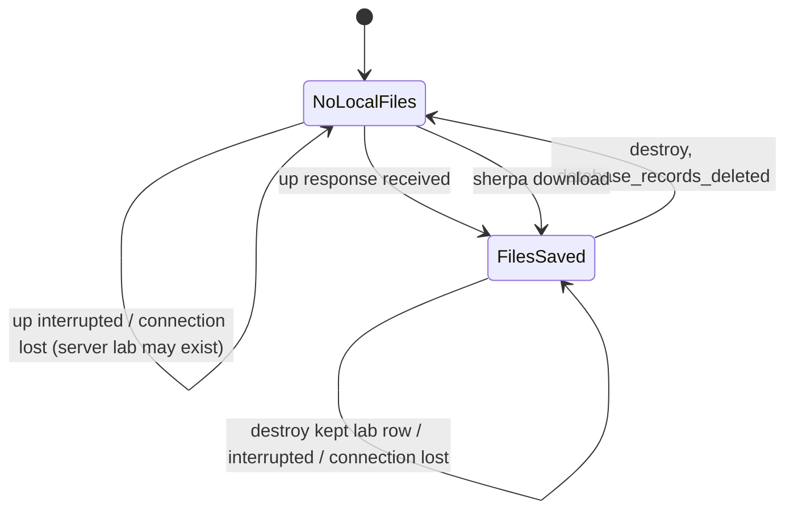

### 24. CLI provisioners

**Where.**

- `crates/client/src/provision/run.rs`, `ssh.rs` and `container.rs`;
- `crates/client/src/cmd/provision.rs`.

`ProvisionStatus` (Provisioned, Failed, Skipped) is the result of one run. It is never
persisted, so "provisioned" is not recorded anywhere.

**When provisioners run.**

| Command | When | file:line |
|---|---|---|
| `up` | after the response, for the nodes with an SSH port at that moment | `up.rs:152-163`, `:183` |
| `redeploy` | for the one node, after `download` | `crates/client/src/cmd/redeploy.rs:117-134` |
| `provision` | every provisioner on every node, again | `provision.rs:41-118` |

Per node, the steps are: wait for SSH, wait for cloud-init, then each step in order. A
failure stops at that step (`run.rs:154-166`), and nothing records how far it got.

Container provisioners are reported as provisioned from the request payload, not from a
confirmation from the server (`container.rs:32-42`).

---

## Networking and images

### 25. P2p link attachment

**Where.**

- `crates/server/src/services/p2p_links/`:
  - `transition.rs`: the states and the one transition, `step`, a pure function;
  - `reattach.rs`: `reattach_node_links`, the one function every event that makes a link end
    again calls, and `attach_link`, the per-link kernel step that `up` uses too;
  - `host.rs`: the `LinkHost` trait (look up an end, tell whether it has its redirect, attach
    a redirect, set netem, make a container's veths) and `KernelHost`, its implementation over `network` and Docker. Tests
    use a fake (`fake.rs`);
  - `veths.rs`: a container's veth plan from the database rows;
  - `plan.rs`: how a node's ends are made again (`recreated_end`), for resume and the scanner;
  - `repair.rs`: the scanner's check of a lab's links in the kernel (`check_lab_links`) and
    its repair of a node (`repair_node`).
- `crates/server/src/services/scanner.rs`: `repair_links`, which runs the check and the repair
  under the scanner's hold.
- `crates/server/src/daemon/link_states.rs`: `LinkStates`, each link's last state in memory.
- `crates/network/src/ebpf.rs` (`attach_p2p_redirect`, `has_p2p_redirect`), `tap.rs` and
  `tc.rs`.

`DbLink` has `tap_a` and `tap_b`, and no status field: the link's state is in the kernel
(whether each end's tap or veth exists, and the peer ifindex in each end's BPF map,
`ebpf.rs`), and the database holds what the link should be (its ends and impairments). During
`up`, `P2pAttachment { ready_ends, attached }` (`up/links.rs`) tracks which links are attached
so far.

**States per link** (`shared::data::LinkState`, reported to the user):

- `Attached`: both ends exist and redirect to each other, with the link's impairments;
- `PeerDown { peer }`: the node's end exists and the peer's does not, because the peer is
  down. Nothing is touched. This is expected, not a failure;
- `Failed { reason }`: the node's own end does not exist, an end could not be made or looked
  up, or the kernel refused the redirect or the qdisc.

Between an event and its re-attach the link is *stale*: one end has a new ifindex and the other
end's redirect still points at the old one. Stale is never reported. Every event Sherpa makes
re-attaches at once; an event outside Sherpa is repaired by the next scan (see "Repair by the
scanner" below), and until then the link shows the state it had at the last scan.

**The transition.** `step(side, a, b, peer)` looks at the two ends, as `End::Present(ifindex)`,
`Absent` or `Broken(reason)`:

| Node's own end(s) | Peer's end | Step | Result |
|---|---|---|---|
| present | present | `Attach` | `Attached`, or `Failed` if the kernel refuses |
| present | absent | `Leave` | `PeerDown` |
| absent or broken | any | `Leave` | `Failed` (the node's own end is reported first) |
| present | broken | `Leave` | `Failed` |

A link whose two ends are on one node (`Side::Both`) needs both.

**Events.** `reattach_node_links(host, lab_links, node, end)` runs the transition for every link
of `node`, in index order, each on its own: one link's failure never stops the next. `end`
(`RecreatedEnd`) says how the node's ends were made again:

| Event | Caller | `RecreatedEnd` |
|---|---|---|
| VM or unikernel cold boot by resume | `resume::reattach_cold_booted` | `Domain` (libvirt made the taps) |
| container started from exited by resume | `resume::reattach_cold_booted` | `Container { veths }`: every data interface planned again from the database rows (links, bridges) and the saved manifest's interface count, made in the new namespace first |
| VM redeploy | `redeploy/vm.rs` | `Domain` |
| container redeploy | `redeploy/container.rs` | `Container { veths }` |
| the container's plan failed | resume, scanner | `Unplanned(reason)`: each link `Failed` |
| an end made again outside Sherpa (`virsh start`, `docker start` or `restart`, a restart policy) | `scanner::repair_links`, through `repair_node` | `Domain`, or `Container { veths }` with only the veths that do not exist |

A container on no link has Docker networks, which Docker connects again; it is not
re-attached. A paused container or VM keeps its ends, so unpausing re-attaches nothing.

Attaching (`attach_link`) points each end's redirect at the other and *syncs* each direction's
impairment from the database onto the end it leaves through: set, or removed when clear. So a
re-attach also clears a qdisc a direction recorded clear should not have (machine 26).

**Peer down, then up.** When a node is re-attached while its peer is down, its links to that
peer are `PeerDown`. When the peer starts (resume cold boot, or redeploy), the peer's own
re-attach finds both ends and sets both directions, so the surviving end's redirect moves to the
peer's new ifindex. No state is kept between the two events: the kernel and the rows decide.

**Repair by the scanner.** Each scan of a `Ready` lab, under the scanner's hold (machine 3),
runs `check_lab_links` over every link and remembers nothing from the scan before, so the
first scan after sherpad starts catches up on whatever changed while it was down. Only the
ends of nodes whose runtime is `Running` and that are not `Building` are checked:

| The running node's end | The other end | Fault | What the scan does |
|---|---|---|---|
| does not exist | any | `Missing` | repair the node (a restarted container's veths went with its namespace) |
| exists, no `p2p_redirect` filter on ingress | exists | `NoRedirect` | repair the node (libvirt made a bare tap) |
| exists, no filter | does not exist | none | nothing: the link is `PeerDown`, and is repaired when the peer's end comes back |
| exists, with the filter | any | none | nothing |
| cannot be read | any | none | nothing: the link is `Failed` with the reason |

A link with no fault is `Failed` if an end could not be read, `PeerDown` naming the first of
its nodes that is not running (stopped, paused, faulted or absent), and `Attached` otherwise.
`repair_node` runs `reattach_node_links` for each node with a fault; for a container it makes
only the veths that do not exist, because making a veth deletes its host end first and would
take a working interface down. Every repaired link is logged at info, every failure at warn.
A repair that fails half-way leaves an end without its filter (the attach removes the old
program before it loads the new one), which the next scan finds again. The scanner never
starts, stops or unpauses a node; when it repairs a running node, the redirect on a paused
peer's end is pointed at the new end too, as a resume would.

The check cannot see an end whose filter survived but whose peer index is stale: a filter on
an end that was not made again, whose peer's end was made again and attached by something
other than Sherpa. Reading the index back from the BPF map would; it is not done.

**Reporting.** The function returns a `LinkReport` per link and fails nothing. Resume puts them
in the node's `NodeActionResult.links`, redeploy in `RedeployResponse.links`, and both stream a
status line per link that is not attached. The CLI prints those under the node's line, and the
web UI adds them to its notification. A link that is not attached does not mark the node
`Failed` and does not make the command fail: the node is up.

Each link's last state is kept in memory in `AppState::link_states` (`LinkStates`), by lab and
link index: the scanner replaces a lab's states on each scan it makes of the lab, resume and
redeploy record the links they re-attached (`report_links`), and a destroy or clean forgets
the lab. `inspect` returns it as `LinkInfo.state`. Nothing is stored in the database: the
kernel holds the state and one scan rebuilds it. After sherpad starts, and while the scanner
is disabled, a lab's links have no state until a scan, resume or redeploy, and `inspect`
reports them as not checked (`state` absent).

`up` does not use `reattach_node_links`. It attaches each link once both ends exist (VM links
in phase 11b, links with a container end as each container starts), with `attach_link`, and a
failure there fails `up`, which rolls back.

`attach_p2p_redirect` detaches and then attaches again (`ebpf.rs`), so attaching is idempotent:
a link both of whose nodes cold-booted in one resume is attached twice, the same way.

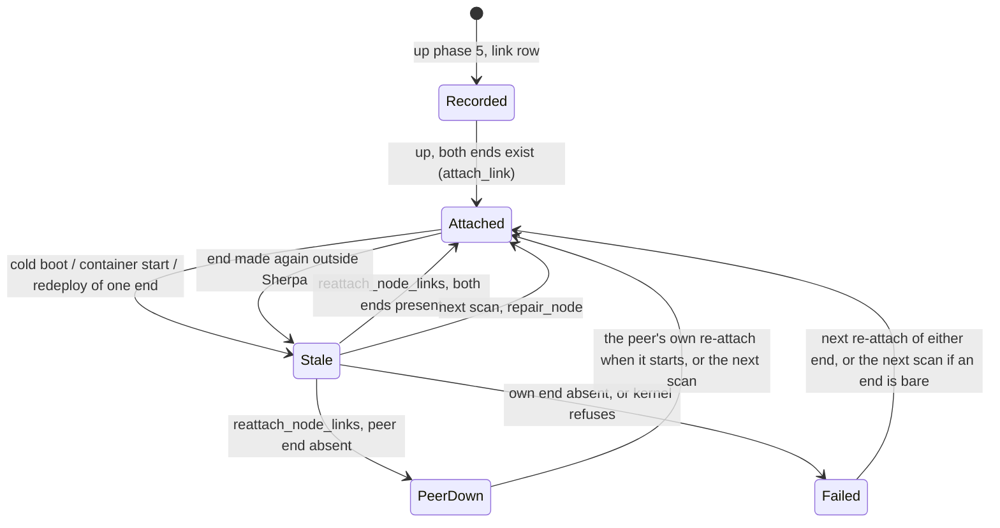

### 26. Link impairment

**Where.**

- `crates/server/src/services/impairment.rs`;
- `crates/network/src/tc.rs`;
- the columns `link.impairment_a_to_b` and `link.impairment_b_to_a`.

**States per direction.** Clear (`LinkImpairment::is_clear`) or set. The value is held twice:
in the database and in the kernel qdisc. The database is the source: every re-attach (machine
25) syncs the kernel to it, removing the qdisc of a clear direction.

**Transitions.** `update_impairment` checks lab access, that the link exists and that it is a
P2p link, then calls `change_impairment`:

- It changes the kernel first, then records the link in the database.
- If the second direction fails in the kernel, it puts the first back.
- If the database write fails, it puts every direction it changed back to the old value in the
  kernel. The request fails, and the kernel and the database keep the old value together. If
  putting the kernel back fails as well, the error says so; the next re-attach of the link
  syncs the kernel to the old value in the database.
- Clearing a direction removes its netem qdisc with `network::remove_netem`, which returns
  `NetemRemoval::NothingToRemove` only when the interface has no root netem qdisc with handle
  `1:` (it lists the qdiscs; the kernel's error for a missing qdisc is the same `EINVAL` as for
  a bad request). Any other failure fails the request, and the database keeps the value.

Why the kernel first: the request fails when the kernel refuses (the usual failure) without
touching the database, and the compensations all move toward the value the user was told
remains.

```mermaid
stateDiagram-v2
    [*] --> FromManifest : up, both directions
    FromManifest --> Set
    FromManifest --> Clear
    Set --> Set : update (kernel, then DB; kernel put back if the DB fails)
    Set --> Clear : update clear (removed, or nothing to remove)
    Clear --> Set : update
    Set --> Set : re-attach syncs from DB
    Clear --> Clear : re-attach removes any leftover qdisc
```

### 27. Bridges and management networks

**Where.**

- `crates/server/src/services/up/networks.rs`: `create_management_networks` at `:74-106` and
  `create_shared_bridges` at `:329-410`;
- `up/records.rs:272-301` for the per-node networks;
- `crates/libvirt/src/network.rs`, `crates/container/src/network/create.rs`,
  `crates/network/src/linux.rs`.

**State.** None is stored apart from the `bridge` rows. Each bridge exists as a Linux bridge,
libvirt or Docker networks, and a DB row, all created in sequence.

**How each create behaves when the object already exists.**

- `network::create_bridge` fails.
- libvirt `ensure_network` is idempotent: it defines the network if it is absent and starts it
  if it is inactive.
- Docker `create_docker_bridge_network` treats 409 as success (`crates/container/src/network/create.rs:62-65`) and does not
  compare the network's settings.
- `create_docker_macvlan_bridge_network` has no conflict handling (`:101-108`).

**Teardown.** Done by name: Docker networks, then libvirt networks, then host interfaces
(`destroy.rs:226-305`).

### 28. Node images

**Where.**

- `crates/server/src/services/image_store.rs`: the disk image file's states.
- `crates/db/src/node_image/default.rs`: the default rule.
- `crates/server/src/services/import.rs`, `image_lifecycle.rs`, `delete.rs` and
  `container_pull.rs`: the operations that use them.
- `crates/db/src/node_image/`.

**State.** There is no status column. An image's state is three things together:

- the `node_image` row, unique on `(model, kind, version)`;
- the `default` flag;
- the disk file or Docker tag.

**The file.** `image_store` has one type per state:

- `StagedDisk`: bytes are written to `<file>.partial`. Dropping it removes the partial file.
- `PlacedDisk`: the file was renamed into place. If the row cannot then be written,
  `discard` removes the file when this import added it. A file that replaced another is kept.
- After that, the row is written in one transaction.

Disk import copies through `StagedDisk` (in `spawn_blocking`), and download streams into one.

The invariant: **a row always names a complete file**. A complete file with no row is allowed.
A crash between the rename and the row leaves one, and the scan adopts it.

When an import finds a file already at the destination (`ExistingDisk`):

- same size as the source: kept, and the copy is skipped;
- different size: replaced through staging;
- different size with lab overlays built on it (`libvirt::ensure_no_overlay_dependencies`):
  the import is refused.

Download skips the download when the file exists, since only a rename puts it there.

**The default.** Each `(model, kind)` that has rows has exactly one default:

- At most one: the partial unique index in
  `crates/db/sql/migrations/0006_one_default_node_image.sql`.
- At least one: every write that touches the flag decides it with `resolve_default`, inside
  the transaction that writes the row (`claim_default`). A write asks for `DefaultRequest`:
  - `Make`: take the default.
  - `Keep`: keep the flag, and take the default if the model has none. Used by import,
    download and pull without `--default`, and by the scan.
  - `Unset`: give up the default. Used by the admin form when the box is unticked. Refused
    with `LastDefaultImage` on the current default.
- `upsert_node_image` keeps an existing row's settings, so an import does not undo admin
  edits. Only the flag changes. Pull also refreshes the row's `repo`.
- `update_node_image` keeps the stored model, kind and version. The form cannot rename an image.
- `delete_node_image` promotes the remaining version with the highest `rowid`, in the same
  transaction, when the deleted row was the default. The response carries `new_default`.
- Migration `0014_promote_missing_default_image.sql` gives any model left without a default
  by an earlier release its newest image.

Scan results are strings ("already_exists", "would_import", "imported (default)" and so on).

**Locking.** `image_lifecycle.rs` keeps a per-`model/version` `RwLock`.

- Import, download, pull, delete, set-default, the admin form, and the scan (per version)
  take the write side.
- The scan checks the file again under the lock, so a scan that waited for a delete does not
  record the deleted version again.
- `up` and `redeploy` take read leases.

```mermaid
stateDiagram-v2
    [*] --> Absent
    Absent --> Staging : import or download starts
    Staging --> Absent : copy fails or is cancelled (partial removed)
    Staging --> Placed : rename
    Placed --> Absent : row write fails (new file removed)
    Placed --> Recorded : row written (Make, or Keep on a model with no default)
    Absent --> Recorded : scan finds a complete file
    Recorded --> Recorded : another version made default / re-import (settings kept)
    Recorded --> Absent : delete (unused): row, then files; newest remaining becomes default
```

---

## Configuration combinations

### 29. ZTP setting

**Where.** `shared::data::Ztp` (`crates/shared/src/data/node.rs`), held by the image as
`ZtpSettings.method` (column `ztp`, JSON field `ztp.method`) and optionally by a manifest node
as `topology::Node.ztp.method`. The full description, with the per-model table, is in
[`ZTP.md`](ZTP.md).

**States.** Ten values: `disabled` and nine methods. There is no flag beside the method, so the
22 combinations the `ztp_enable` and `ztp_method` pair had are gone, and with them "off with a
method" and "on with no method". Which methods a model takes is `NodeModel::ztp_methods`.

**Writers.** Every one is checked by `shared::validators::check_ztp`.

- The code defaults, `NodeConfig::get_model`: a unit test holds each to `disabled` or a method
  its model lists.
- Import, scan, download, pull and set-default write through `db::upsert_node_image`, and the
  admin web form through `db::update_node_image`; both refuse a setting the model does not take.
  An existing row keeps its settings on a re-import (see [Node images](#28-node-images)).
- A manifest node's `ztp.method`, checked by `topology::validate::check_node_ztp` and again by the
  server before `up` or redeploy changes anything.
- Migration 0016 folded the old pair into the one column, once.

**Readers.** All take `shared::validators::effective_ztp` (the manifest's, or else the
image's), and each is one `match` with `Disabled` as a case.

| Reader | Where |
|---|---|
| VM media | `node_ops::generate_vm_ztp_media` |
| Container setup and manifest volumes | `node_ops::container_model_setup`, `add_container_volumes` |
| DHCP boot options | `template::DnsmasqTemplate::boot_options`, from `ZtpRecord.ztp` |
| Owner account | `guest_account::supports_guest_account` |
| Plan-time checks | `server::validate::validate_node_ztp`, from `plan_lab` and redeploy's `load_node` |

The `username`, `password` and `password_auth` fields are read only for display
(`crates/shared/src/util/table.rs`).

```mermaid
stateDiagram-v2
    [*] --> ModelDefault : get_model(model)
    ModelDefault --> Stored : upsert_node_image (check_ztp)
    Stored --> Stored : web form, update_node_image (check_ztp)
    state Stored {
        [*] --> Disabled
        Disabled --> Method : a method the model lists
        Method --> Disabled
        Method --> Method : another listed method
    }
    Stored --> Effective : effective_ztp(node.ztp, image)
    Effective --> Refused : validate_node_ztp fails, before anything is created
    Effective --> Generated : one match per reader
```

### 30. The `ztp.config` field

**Where.** `topology::Node.ztp.config` and `NodeExpanded.ztp.config`, both `Option<String>` in
`topology::NodeZtp` (`crates/topology/src/node.rs`).

**States.** The same field holds a different thing at each stage, and nothing in the value
says which:

1. a path in the manifest;
2. base64 contents, set by the client (`crates/client/src/cmd/up.rs:195-227`);
3. decoded text, on the server (`up/ztp.rs:458-463`, `redeploy/context.rs`);
4. a generated Talos config, for cluster members;
5. `None` once it has been taken (`take_custom_ztp_config`, `node_ops.rs:350-363`).

**Ordering.** `provisions_owner` reads `ztp.config.is_none()` to mean "no custom config"
(`guest_account.rs:181-182`). It is evaluated (`node_ops.rs:991`) before the field is taken
(`:1096`), and the result depends on that order.

```mermaid
stateDiagram-v2
    [*] --> Path : manifest
    Path --> Base64 : client resolve_ztp_configs
    Base64 --> Text : server decode_ztp_config
    Text --> TalosGenerated : cluster member
    Text --> Taken : take_custom_ztp_config
    Path --> Text : manifest sent without the client (decode of a path)
    Taken --> [*]
    TalosGenerated --> [*]
```

### 31. Node resource reservation

**Where.** `reserve_node_resources`
(`crates/server/src/services/node_resources.rs:182-235`). It reserves `vnc_port`,
`cpu_count`, `memory`, `cpu_pinning` and `qemu_thread_cpus` on the node row, and
`update_node_resources` writes all five together. Before that, the node is admitted by
`services/admission.rs`, which holds its memory and pins in an in-memory ledger.

**Transitions.**

- **Admit.** `admit_lab_nodes` (`admission.rs:93`, for `up` and redeploy) and
  `admit_stopped_nodes` (`admission.rs:134`, for resume and node start) wait on a fair, FIFO
  Tokio mutex (`admission.rs:35`). Under it they check the pins
  (`check_cpu_pins_on_server`, `node_resources.rs:79-123`) against the stored nodes and the
  ledger, and the memory against the server (`validate::check_memory_fits`, limited by
  `host_memory.reserve_mib` and `host_memory.overcommit_percent`), then add the nodes
  to the ledger (`admission.rs:37`). Memory counts against the whole server, and that of a VM
  held strictly on a NUMA node also against that node. A VM with
  `numa_memory_mode = "preferred"` counts against the server only, requested or running. A
  container counts its Docker memory limit, and nothing without one.
  Checked: a request that does not fit is refused before anything is created.
- **Reserve.** A VM that already has a port keeps it. Otherwise the code picks a free port,
  retrying when the unique index loses a race.
- **Release from the ledger.** Dropping the `Admission` (`admission.rs:66`) when the operation
  returns, whether it succeeded or failed. Running domains are then counted from libvirt, and
  running containers' memory limits from Docker.
- **Release.** Only by deleting the node row.

A stopped lab keeps its ports and pins. Before admission, `up` checked pins in its planning
phase and stored them in phase 3 with no lock between, so two concurrent `up`s could both pass
(#413); the ledger closes that window for pins and memory. A stored node that is also pending
counts once, with its pending pins, and the node a redeploy replaces does not count against
itself (matched by domain name, `<node>-<lab id>`). The ledger does not survive a restart,
which also ends the operations it held entries for.

### 32. Database schema version

**Where.** `apply_schema` (`crates/db/src/schema/apply.rs:23-76`), using `PRAGMA user_version`.

**Transitions.** Version 0 or any older version → `SCHEMA_VERSION`. All pending migrations run
in one transaction under the write lock. A version newer than the build is refused
(`apply.rs:50-55`). This is explicit, atomic and tested. See [`DATABASE.md`](DATABASE.md).
