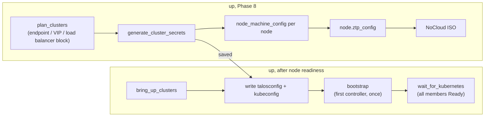

# Talos Linux and Kubernetes clusters

How Sherpa runs Talos Linux nodes and builds Kubernetes clusters from them. User-facing
behaviour is documented in `../sherpa-docs` (Talos Linux node page, manifest `clusters`).
The research behind these choices is in `docs/investigations/talos-linux.md`.

## Node model

`NodeModel::TalosLinux` (`crates/shared/src/data/node.rs`) is a Q35 virtio VM: 2 vCPU, 4 GiB,
SATA CD-ROM, `host-model` CPU (Talos needs x86-64-v2).

- **Disk.** `NodeModel::default_boot_disk_size()` returns 20 GB for Talos; the NoCloud image is
  about 4 GB virtual and Talos needs at least 10. `process_manifest_nodes` (`up.rs`) applies it
  when the manifest sets no `boot_disk_size`.
- **Readiness.** `NodeModel::ready_port()` returns the Talos API port (50000); every other VM
  model returns SSH (22). `node_ops::vm_ready_port` prefers a manifest `ready_port`. `up`,
  `resume` and `redeploy` all probe this port with `node_ops::check_vm_ready`: a TCP connection
  for the Talos API, an SSH handshake for SSH.
- **No SSH.** `NodeModel::has_ssh()` is false. `ZtpRecord::ssh_port` is `None` for such nodes,
  so `build_ssh_config` leaves them out, and `NodeInfo::ssh_port` is `None`.
- **Image.** `resolve_download_url` posts the vanilla schematic (`customization: {}`) to the
  Image Factory's `/schematics` endpoint, reads the returned ID, and downloads
  `/image/<id>/v<version>/nocloud-amd64.qcow2`. The ID is derived from the schematic's
  content, so Sherpa asks for it rather than storing it. `--url` skips the lookup.

## NoCloud delivery

`ZtpMethod::NoCloud` (`node_ops::generate_nocloud_ztp`) builds a `cidata` ISO from:

- `meta-data`: instance ID and hostname;
- `network-config`: Sherpa's netplan v2 document (`CloudInitNetwork::ztp_interface`), a static
  management address, gateway and DNS server — Talos applies it with no DHCP;
- `user-data`: the node's machine config, written byte for byte, when there is one. Without
  it any earlier `user-data` is removed and Talos waits in maintenance mode.

The machine config comes from the node's `ztp_config`: the user's file, or the config Sherpa
generates for cluster nodes (validation forbids users setting `ztp_config` on those).

## Clusters

Manifest `talos_clusters` (`topology::TalosCluster`): each cluster names its member nodes in
`controllers` (the Talos control plane, in bootstrap order) and `workers`, its `cni`
(`shared::data::ClusterCni`: Flannel by default, or Cilium), and optionally the
`keycloak_server` node users log in through (`oidc`) and the `hashicorp_vault` node workloads
read secrets from (`vault`). Nodes carry no cluster
fields; `topology::find_talos_cluster` looks up a node's cluster and role (`ClusterRole`, which
keeps the Talos term `ControlPlane` internally). `topology::validate::validate_talos_clusters` enforces the
rules (names, one or three controllers, members are defined `talos_linux` nodes listed once
without a user `ztp_config`, VIP capacity, load balancer capacity for Cilium clusters, `oidc` and
`vault` naming nodes of the right model, and a `vault` node without its own `ztp_config`). Two controllers are refused: etcd needs a majority,
so two members tolerate no failure and are less available than one.

Code: `crates/server/src/services/talos/` (`plan`, `secrets`, `bootstrap`, and the lab
integration in `lab`); document rendering in `crates/template/src/talos.rs`.

### Plan

`plan::plan_clusters` lists each cluster's control planes and workers with their management
addresses (`.20 + node index`, as Phase 8 assigns them; see "Lab management addressing" in
`SERVER.md`). A cluster with one control plane uses its address as the Kubernetes endpoint. A
cluster with three gets a shared address from `TALOS_VIP_HOST_OFFSETS` (`.11`–`.12`, in the lab
control-plane block, outside the dnsmasq DHCP range), in manifest order, and a `Layer2VIPConfig`
on its control planes.

A Cilium cluster also gets a block of `TALOS_LOAD_BALANCER_BLOCK_SIZE` (4) load balancer
addresses from `TALOS_LOAD_BALANCER_HOST_OFFSETS` (`.13`–`.20`, after the VIPs in the same
block), in manifest order: `.13`–`.16` for the first, `.17`–`.20` for the second. The first is
the cluster's Gateway, the second Hubble UI, the rest are left for the user's `LoadBalancer`
services. Plans saved before the CNI choice deserialize as Flannel clusters with no block.

The plan also records the cluster's Keycloak and Vault nodes with their addresses
(`ClusterPlan::oidc`, `ClusterPlan::vault`), which `up` passes to `plan_clusters` as
`services`. Plans saved before these fields deserialize without them.

### Cilium

Talos 1.14 deploys Flannel while the `KubeFlannelCNIConfig` document is present and kube-proxy
unless `KubeProxyConfig.enabled` is false; the legacy `cluster.network.cni` and
`cluster.proxy` fields are dropped by the typed documents. A Cilium cluster's control planes
leave the Flannel document out, disable kube-proxy, and carry, in the legacy document's
`cluster` section:

- `extraManifests`: the Gateway API standard CRDs, pinned to the Gateway API release the Cilium
  release supports. Cilium enables its Gateway controller only if they exist when it starts.
- `inlineManifests`:
  - `cilium-install`: a Job on a control plane's host network (no pod network yet; DNS from the
    node, tolerating not-ready nodes) running the pinned `cilium-cli` image's `cilium install`,
    with the Talos values from Cilium's Talos guide (KubePrism `localhost:7445` as the API
    server, Talos's cgroup mount, no `SYS_MODULE`, `bpf.hostLegacyRouting` for Talos's host DNS
    forwarding), kube-proxy replacement, Gateway API, L2 announcements and Hubble.
  - `cilium-load-balancer`: a `CiliumLoadBalancerIPPool` with the cluster's block and a
    `CiliumL2AnnouncementPolicy` answering ARP for it on the management link.
  - `cilium-gateway`: the `sherpa` Gateway (`default` namespace, HTTP on 80, routes from all
    namespaces) at the first address, and a `LoadBalancer` Service for Hubble UI at the second.

Talos's manifest controller skips resources whose CRDs are not served yet and retries the set
with backoff, and creates only resources that do not exist. So the Cilium and Gateway API
resources apply once the CRDs exist, and nothing Sherpa installs is updated afterwards.
`wait_for_kubernetes` is unchanged: nodes turn Ready when the Cilium agent runs on them.

Workers' configs are the same for both CNIs.

### Keycloak login and Vault secrets

A cluster with `oidc` accepts tokens from its Keycloak node's `sherpa` realm (see "Keycloak" in
`LAB_CA.md` for the realm Sherpa makes). Its control planes carry:

- a JWT authenticator in `KubeAuthenticationConfig`: issuer
  `https://<keycloak>:8443/realms/sherpa`, audience `kubernetes`, the lab CA as its
  `certificateAuthority`, usernames from `preferred_username` and groups from `groups`, both
  prefixed `oidc:`. The API server fetches the issuer's discovery document in the background
  and retries every 10 seconds while Keycloak or the realm is missing, staying ready meanwhile
  (checked on Kubernetes 1.37), so there is no start order between Keycloak and the cluster.
- inline manifest `sherpa-oidc-rbac`: `ClusterRoleBinding`s of `oidc:cluster-admins` to
  `cluster-admin` and `oidc:cluster-viewers` to `view`.

The kubeconfig gets a second context, `oidc@<cluster>`, whose user runs
`kubectl oidc-login get-token` (the kubelogin plugin) with the issuer, client ID and the lab
CA as `--certificate-authority-data`. `admin@<cluster>` stays the current context.

A cluster with `vault` gets inline manifest `vault-secrets-operator-install`: the
`vault-secrets-operator-system` namespace, a `sherpa-lab-ca` Secret with the lab CA as
`ca.crt`, and a Job running the pinned `helm` image with `helm upgrade --install` of the pinned
Vault Secrets Operator chart from HashiCorp's repository. The chart's default
`VaultConnection` points at the Vault node and trusts `sherpa-lab-ca`; its default `VaultAuth`
uses the `jwt` method on the cluster's mount with role `workload`, the `default` service account
of the namespace a secret is synced to, audience `vault`, and is allowed in every namespace.

On the Vault side, after `up` unseals the node, `talos::grant_vault_access` calls
`vault::configure_cluster_access` for each cluster using it (`crates/server/src/services/vault/cluster.rs`):

- the KV version 2 engine at `secret/`, if missing;
- a `jwt` auth method at `kubernetes-<cluster>`, if missing, configured with the public half of
  the cluster's service account signing key (`secrets::service_account_public_key`) as
  `jwt_validation_pubkeys` and the cluster's endpoint URL as `bound_issuer`. Vault checks
  tokens offline, so it never calls the cluster and needs no token reviewer or RBAC;
- policy `kubernetes-<cluster>`: read `secret/data/<cluster>/*`, read and list
  `secret/metadata/<cluster>/*`;
- role `workload`: audience `vault`, any service account (`sub` glob
  `system:serviceaccount:*`), that policy, 1 hour tokens.

The operator keeps retrying until Vault is configured, so the cluster does not wait for Vault.

### Secrets

`secrets::generate_cluster_secrets`, using the generic helpers in `tls/generator.rs`:

| Secret | Kind |
|---|---|
| Talos OS CA | Ed25519, `O=talos` |
| etcd, Kubernetes, aggregator CAs | ECDSA P-256 (`O=etcd`, `O=kubernetes`, empty) |
| Service account key | ECDSA P-256 |
| Bootstrap and trustd tokens | `[a-z0-9]{6}.[a-z0-9]{16}` |
| Secretbox key | 32 random bytes, base64 |

All private keys are PKCS#8. Client certificates are issued from a CA rebuilt from its saved key
(`issue_client_certificate`): a child certificate only needs the issuer's subject and key.
The talosconfig carries an `O=os:admin` certificate (OS CA); the kubeconfig an
`O=system:masters` certificate (Kubernetes CA).

Saved per cluster under `/opt/sherpa/labs/<lab>/clusters/<cluster>/`, mode 0600:
`secrets.toml`, `cluster.toml` (the plan), `talosconfig`, `kubeconfig`. `redeploy` and
`download` read them; `destroy` removes them with the lab directory.

### Machine configs

`template::talos_machine_config` writes the Talos 1.14 multi-document config as a
`---`-separated stream of JSON documents (JSON is valid YAML). Talos decodes strictly — an
unknown key or a legacy `v1alpha1` field that a typed document now owns is fatal — so the
documents follow `talosctl gen config` for the pinned version exactly, except: no
`UnattendedInstallConfig` (the NoCloud image is installed), no discovery documents, a static
`HostnameConfig`, `KubeNodeConfig.nodeIP.validSubnets` set to the management subnet, and no
control-plane taint when the cluster has no workers.

`TALOS_SUPPORTED_MINOR_VERSION` pins the generator to Talos 1.14; `ensure_supported_version`
refuses cluster nodes on other minor versions. Supporting a new Talos minor release means
regenerating the reference with `talosctl gen config`, updating the documents and the template
tests, and moving the pin.

### Bootstrap

Talos has no config field that bootstraps etcd: one API call does. `bootstrap::bootstrap` sends
`machine.MachineService/Bootstrap` (an empty gRPC frame) over HTTP/2 with `reqwest`, trusting
only the OS CA and presenting the `os:admin` certificate. The gRPC status is read from the
headers (a trailers-only refusal) or the trailers (success), through `http-body-util`.

Talos accepts a second bootstrap while the first is still running, so Sherpa sends it to one
controller per cluster only — the first in its `controllers` list — and retries only that node.
Once etcd has data Talos answers `ALREADY_EXISTS`, which counts as done.

`wait_for_kubernetes` then polls `/api/v1/nodes` with the admin kubeconfig credentials until
every member is Ready, within the lab's `ready_timeout`. A cluster that is not ready is
reported as a non-critical `UpError`, like node readiness.

Cluster workers are not waited for on port 50000 during `up`'s node readiness phase
(`talos::readiness_waits_for_kubernetes`); `wait_for_kubernetes` checks them instead. A
worker's Talos API starts only after trustd on a controller issues its certificate, and the
worker reaches trustd through the cluster endpoint. With three controllers that endpoint is
the VIP, which Talos assigns only once etcd runs, after the bootstrap, and the bootstrap
follows node readiness: waiting on workers' API ports deadlocked every HA cluster.
Controllers keep the port check; their API does not depend on etcd. `redeploy` and `resume`
still probe workers' API port, which works because the VIP is up in an existing cluster.

### Lifecycle

| Operation | Behaviour |
|---|---|
| `down` | Talos ignores the ACPI power button, so cluster nodes get a graceful `machine.MachineService/Shutdown` over the Talos API (`bootstrap::shutdown`, same HTTP/2 client as the bootstrap, saved admin credentials; Talos cordons, drains and powers off). Workers stop before controllers, because draining needs the Kubernetes API. `down` waits for the VM to stop and forces it off after `VM_SHUTDOWN_TIMEOUT`. Talos nodes outside a Sherpa-built cluster are powered off directly. |
| `resume` | Unchanged; Talos keeps its state on disk. |
| `redeploy` worker | Config regenerated from the saved secrets and plan; the node rejoins. |
| `redeploy` Vault | A new, empty Vault: initialised and unsealed again, then `grant_vault_access` sets up every saved cluster that uses it. Secrets written to the old Vault are gone. |
| `redeploy` Keycloak | A new, empty Keycloak: the realm is made again with the saved users and passwords. |
| `redeploy` controller | Refused (`talos::ensure_redeployable`): its etcd member would have to be removed first. |
| `download` | Returns each cluster's talosconfig and kubeconfig (`DownloadLabResponse::clusters`). |
| `destroy` | Stops an `up` still bootstrapping or waiting for the cluster first (`lab_operations`), so credentials are never written after the cluster directory is removed with the lab directory. |

The client writes `kubeconfig-<cluster>` and `talosconfig-<cluster>` (owner only) on `up` and
`download` (`crates/client/src/cluster_credentials.rs`).

## Limits

- Nodes need internet access for Kubernetes images; there is no image cache or registry mirror.
- One Talos minor version at a time.
- No control-plane redeploy or upgrades.
- Cilium settings are fixed; at most two Cilium clusters per lab (load balancer blocks).
- One realm (`sherpa`), one Kubernetes client, two groups; Vault roles and policies are fixed.
- The Vault Secrets Operator Job needs internet access to HashiCorp's Helm repository.
