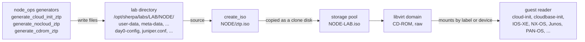
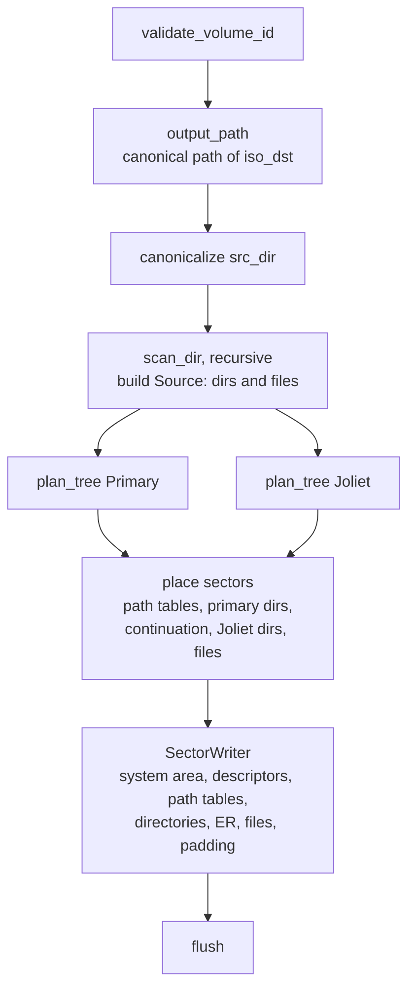
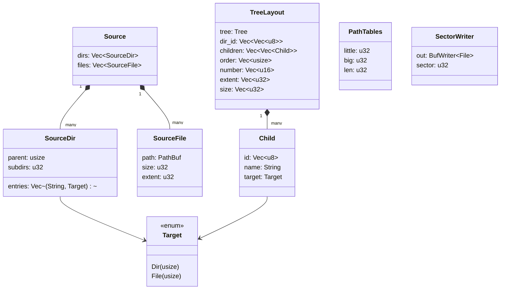
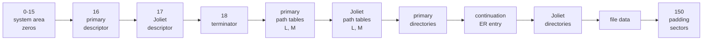
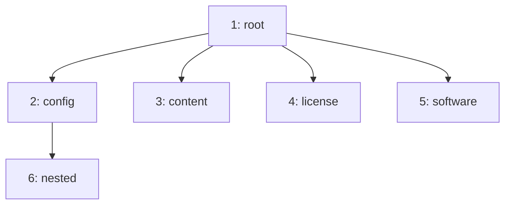

# ZTP ISO images

How Sherpa builds the CD-ROM images that carry a VM node's first-boot configuration: NoCloud
seeds for cloud-init, cloudbase-init and Talos, the config ISOs network operating systems read
at zero-touch provisioning, and the PAN-OS bootstrap ISO.

The writer is the `iso` crate, `crates/iso`: `create_iso` in `src/writer.rs` and its error type,
`IsoError`, in `src/error.rs`. It writes the subset of ISO 9660 (ECMA-119) these readers need,
with the Rock Ridge (RRIP 1.09, over SUSP) and Joliet extensions, in plain Rust with no ISO crate
and no external command. It replaced a call to `genisoimage` and writes the same structure, so
the server needs no ISO tooling. Its constants are private to `writer.rs`. The two volume labels
callers pass in are in `crates/shared/src/konst.rs`.

The crate depends on nothing in Sherpa: only `jiff`, `thiserror` and `tracing`. `server` is its
only dependent, so the `sherpa` CLI, which never builds an ISO, does not compile it.

- [From config files to the guest](#from-config-files-to-the-guest)
- [Callers](#callers)
- [The function](#the-function)
- [Errors](#errors)
- [Pipeline](#pipeline)
- [Data model](#data-model)
- [Names in the three views](#names-in-the-three-views)
- [Image layout](#image-layout)
- [Volume descriptors](#volume-descriptors)
- [Path tables](#path-tables)
- [Directory records](#directory-records)
- [Rock Ridge](#rock-ridge)
- [Joliet](#joliet)
- [Writing](#writing)
- [Limits and errors](#limits-and-errors)
- [Differences from genisoimage](#differences-from-genisoimage)
- [Tests and verification](#tests-and-verification)
- [Changing the writer](#changing-the-writer)

## From config files to the guest



1. A generator in `crates/server/src/services/node_ops.rs` writes the node's config files into
   its lab directory and calls `iso::create_iso` with that directory as the source and
   `ztp.iso` inside it as the destination.
2. `create_iso` writes the image. It leaves `ztp.iso` itself out of the tree it reads.
3. The node's disk plan (`node_ops`, the CD-ROM block of the VM build) adds a `CloneDisk` that
   copies `ztp.iso` into the storage pool as `<node>-<lab>.iso`, and a `NodeDisk` that attaches
   it as a raw CD-ROM on the model's CD-ROM bus.
4. The guest finds the medium: cloud-init's NoCloud source by the `cidata` label, network
   operating systems by looking for their config file on the CD-ROM, PAN-OS by the
   `bootstrap` label and its folder layout.

The files in the lab directory and the ISO in the pool are readable by `sherpa`, the `sherpa`
group and QEMU; see "Lab storage permissions" in [`SERVER.md`](SERVER.md). They are not for
secrets.

## Callers

| Generator | Models | Files in the source | Label |
|---|---|---|---|
| `generate_cloud_init_ztp` | Linux cloud images, NixOS, server appliances, FreeBSD, OpenBSD; Alpine in its own branch | `user-data`, `meta-data`, `network-config` | `cidata` |
| `generate_cloud_init_ztp` | Windows Server, Windows devbox (cloudbase-init) | cloudbase-init `user-data`, `meta-data`, `network-config` | `cidata` |
| `generate_nocloud_ztp` | Talos Linux; see [`TALOS.md`](TALOS.md) | `user-data` (machine config, when there is one), `meta-data`, `network-config` | `cidata` |
| `generate_cdrom_ztp` | IOS-XE (CSR1000v, Cat8000v, Cat9000v), ASAv, NX-OS 9300v, IOS-XRv 9000, FTDv, vMX, vQFX | the model's config file: `iosxe_config.txt`, `day0-config`, `nxos_config.txt`, `iosxr_config.txt`, `juniper.conf` | `cidata` |
| `generate_cdrom_ztp`, custom config | any CD-ROM model whose manifest node supplies its own ZTP config, PAN-OS included | that config alone, under the model's file name (`ztp_config_filename`) | `cidata` |
| `generate_cdrom_ztp` | PAN-OS, generated config | `config/init-cfg.txt`, `config/bootstrap.xml`, and empty `content/`, `license/`, `software/` | `bootstrap` |

The labels are `ZTP_ISO_VOLUME_ID` and `PALOALTO_BOOTSTRAP_VOLUME_ID`. Models that take their
config over TFTP, HTTP, a USB or FAT disk, or Ignition do not use this writer.

## The function

```rust
pub fn create_iso(iso_dst: &str, src_dir: &str, volume_id: &str) -> Result<(), IsoError>
```

- Writes an image of everything under `src_dir` to `iso_dst`, labelled `volume_id`.
- `iso_dst` may be inside `src_dir`; that file is left out, whether or not it already exists.
- Fails with an `IsoError` naming the path or name on anything it cannot represent faithfully
  (see [Limits and errors](#limits-and-errors)). Checks that need only the label or the source tree
  run before `iso_dst` is created, so a refused source leaves no file behind.
- `#[instrument(level = "debug")]`; a debug event records the path, source, label and size in
  sectors.
- The build time (`Timestamp::now()`, UTC) is used for every date in the image.

## Errors

`IsoError` is a `thiserror` enum. Each variant carries what the message needs (the path, the
name, the limit), and the I/O variants keep the `io::Error` as their `source()`:

| Variant | Raised when |
|---|---|
| `InvalidVolumeId` | the label is empty, too long or not printable ASCII |
| `NoFileName`, `OutputDir` | `iso_dst` has no file name, or its directory cannot be resolved |
| `SourceDir` | `src_dir` cannot be resolved |
| `Read` | a directory or a file's metadata or data cannot be read |
| `NotRegularFile`, `NotUtf8` | the source holds a symlink or special file, or a name that is not UTF-8 |
| `NameTooLong`, `NameClash`, `TooDeep` | a name breaks a tree's limit, two names convert alike, nesting is too deep |
| `FileTooLarge`, `TooManyDirectories`, `TooLarge`, `RecordTooLong` | a size does not fit its ISO 9660 field |
| `Create`, `Copy`, `Write` | the image cannot be created or written, or a file cannot be copied into it |
| `ChangedSize` | a source file changed size between the scan and the copy |
| `Layout` | the writer is not at the sector the layout gave the next part (a bug in the writer) |

Callers in `server` return `anyhow::Result`, so `?` converts an `IsoError` into an
`anyhow::Error` with its message and source chain. Nothing in Sherpa branches on the variant
today; the tests do.

## Pipeline



1. **Validate the label** (`validate_volume_id`).
2. **Resolve the output** (`output_path`): the canonical parent directory of `iso_dst` joined
   with its file name, so it can be compared with the canonical paths the scan produces.
3. **Scan the source** (`scan_dir`): read each directory, sort its entries by file name, refuse
   anything that is not a regular file or directory, skip the output, and record directories and
   files in a `Source`.
4. **Plan each tree** (`plan_tree`): compute every entry's identifier for that tree, sort and
   check for clashes, order the directories for the path table, number them, and size each
   directory's records.
5. **Place sectors** (`place_path_tables`, `place_dirs`, `place_files`): walk the layout in
   writing order and give each part its first sector. Sizes do not depend on positions, so one
   planning pass and one placing pass are enough.
6. **Write** with `SectorWriter`, checking before each part that the writer is at the sector the
   layout gave it.

## Data model



- **`Source`** is the tree as read from disk. Directories and files live in two vectors and refer
  to each other by index (`Target`); the root is `dirs[0]` and is its own parent. A file's
  `extent` is filled in when sectors are placed and is shared by both trees.
- **`TreeLayout`** is one tree's view of the same directories, indexed like `Source::dirs`:
  - `dir_id`: each directory's identifier in this tree (`[0]` for the root);
  - `children`: each directory's entries as this tree records them, sorted by identifier;
  - `order`: the directories in path-table order;
  - `number`: each directory's 1-based path-table number;
  - `extent` and `size`: where its records sit and how many bytes they take.
- **`Tree`** is `Primary` (relaxed names plus Rock Ridge) or `Joliet`. Everything that differs
  between the trees branches on it: identifiers, system use fields, descriptor type and text.
- **`PathTables`** is where a tree's two path tables sit.
- **`SectorWriter`** writes the image and counts sectors.

## Names in the three views

One image carries each name three times. Readers pick the view they understand: Linux uses Rock
Ridge, then Joliet, then the primary names; Windows uses Joliet. Which view a network operating
system reads is not documented by the vendors; carrying all three lets each find its file.

| Source name | Primary identifier | Rock Ridge `NM` | Joliet identifier |
|---|---|---|---|
| `meta-data` | `meta-data.;1` | `meta-data` | `meta-data` (UTF-16) |
| `init-cfg.txt` | `init-cfg.txt;1` | `init-cfg.txt` | `init-cfg.txt` |
| `config` (directory) | `config` | `config` | `config` |
| `a b` | `a_b.;1` | `a b` | `a b` |
| `x;y.txt` | `x_y.txt;1` | `x;y.txt` | `x_y.txt` |

**Primary identifiers** (`identifier`, `Tree::Primary`) follow `genisoimage -l
-allow-lowercase -allow-multidot -relaxed-filenames`:

- every printable ASCII character is kept except `;` and `/`, so case, hyphens and extra dots
  survive;
- any other character (space, control, non-ASCII) becomes one `_`;
- the result may be at most 31 characters;
- a file gets `.` appended if it has no dot, then the version `;1`; directories get neither.

**Joliet identifiers** (`Tree::Joliet`) are the name in UTF-16 big-endian, with
`* / : ; ? \` replaced by `_`, at most 64 code units, without a version.

**Rock Ridge** carries the name byte for byte in `NM`.

Within a directory each tree sorts its entries by identifier bytes. Two names that convert to
the same identifier in either tree are refused (`tree_children`), rather than one being renamed.

## Image layout

The image is a sequence of 2048-byte sectors, written in this order:



A NixOS cloud-init seed built by Sherpa (`user-data` of 3877 bytes):

| Sectors | Content |
|---|---|
| 0–15 | System area, zeros |
| 16 | Primary volume descriptor |
| 17 | Joliet supplementary volume descriptor |
| 18 | Volume descriptor set terminator |
| 19, 20 | Primary path table, little- then big-endian (10 bytes each) |
| 21, 22 | Joliet path table, little- then big-endian |
| 23 | Primary root directory |
| 24 | Rock Ridge continuation area (`ER`) |
| 25 | Joliet root directory |
| 26 | `meta-data` |
| 27 | `network-config` |
| 28–29 | `user-data` |
| 30–179 | Padding |

A PAN-OS bootstrap puts the primary root and its four subdirectories in 23–27, the continuation
area in 28, the Joliet directories in 29–33, `config/bootstrap.xml` in 34–39 and
`config/init-cfg.txt` in 40, then pads to 191 sectors. Both trees' records for a file point at
the same sectors.

Rules:

- Every part starts on a sector boundary and is zero-padded to a whole number of sectors.
- Directories are placed in path-table order, so a directory's sectors follow its parent's.
- Files are placed in primary-tree order (directories in path-table order, entries by
  identifier). Empty files take no sectors and keep extent 0.
- The 150 padding sectors match `genisoimage`'s default, for drives that read ahead past the
  end of the data.
- The volume size in the descriptors is the total, padding included.

## Volume descriptors

`volume_descriptor` builds both, from the tree's layout and path tables. Both-endian fields hold
the value little-endian then big-endian.

| Offset | Length | Field | Primary (type 1) | Joliet (type 2) |
|---|---|---|---|---|
| 0 | 1 | Type | 1 | 2 |
| 1 | 5 | Standard identifier | `CD001` | `CD001` |
| 6 | 1 | Version | 1 | 1 |
| 8 | 32 | System identifier | `LINUX`, space-padded | `LINUX`, UTF-16 |
| 40 | 32 | Volume identifier | the label, space-padded | the label, UTF-16, space-padded |
| 80 | 8 | Volume space size | sectors, both-endian | same |
| 88 | 32 | Escape sequences | zero | `%/E` (UCS-2 level 3) |
| 120 | 4 | Volume set size | 1 | 1 |
| 124 | 4 | Volume sequence number | 1 | 1 |
| 128 | 4 | Logical block size | 2048 | 2048 |
| 132 | 8 | Path table size | bytes, both-endian | Joliet table size |
| 140 | 4 | L path table location | little-endian | Joliet L table |
| 148 | 4 | M path table location | big-endian | Joliet M table |
| 156 | 34 | Root directory record | primary root | Joliet root |
| 190–812 | | Volume set, publisher, preparer, application, copyright, abstract, bibliographic ids | blank, application `SHERPA` | same, UTF-16 |
| 813 | 17 | Creation date | build time | build time |
| 830 | 17 | Modification date | build time | build time |
| 847 | 17 | Expiration date | `0000000000000000`, offset 0 | same |
| 864 | 17 | Effective date | build time | build time |
| 881 | 1 | File structure version | 1 | 1 |

Optional path table locations stay zero. Descriptor dates (`volume_date`) are
`YYYYMMDDHHMMSS00` in ASCII followed by a GMT offset byte of 0. Joliet text fields
(`put_text`) are filled with UTF-16 spaces (`00 20`) before the value is written; a field of
odd length ends with a zero byte.

The terminator (`terminator`) is type 255, `CD001`, version 1.

## Path tables

Each tree has a path table listing its directories, written twice: little-endian (L) and
big-endian (M). Readers use it to find a directory without walking the tree.



- **Order** (`plan_tree`): breadth first from the root, each directory's subdirectories in
  identifier order. That gives ECMA-119's required order: by level, then by parent number, then
  by identifier.
- **Numbers** are 1-based positions in that order; the root is 1 and is its own parent.
- **Entry** (`path_table`): identifier length, extended attribute length 0, the directory's
  first sector (4 bytes), its parent's number (2 bytes), the identifier (`00` for the root), and
  a pad byte when the identifier length is odd.
- The Joliet table has the same structure with UTF-16 identifiers, so it is longer (98 bytes
  against 72 for a PAN-OS bootstrap).
- More than 65 535 directories is refused, since numbers are 16-bit.

## Directory records

Each directory's extent (`dir_extent`) holds `.`, `..` and then its children in identifier order.
`record` builds one record:

| Offset | Length | Field |
|---|---|---|
| 0 | 1 | Record length |
| 1 | 1 | Extended attribute length, 0 |
| 2 | 8 | First sector, both-endian |
| 10 | 8 | Data length in bytes, both-endian |
| 18 | 7 | Recording date (`record_date`) |
| 25 | 1 | Flags: 2 for a directory, 0 for a file |
| 26 | 2 | Unit size, gap size: 0 |
| 28 | 4 | Volume sequence number 1, both-endian |
| 32 | 1 | Identifier length |
| 33 | n | Identifier: `00` for `.`, `01` for `..`, otherwise the tree's identifier |
| 33+n | 0 or 1 | Pad byte when n is even |
| | m | System use (Rock Ridge, primary tree only) |
| | 0 or 1 | Pad to an even record length |

- A record longer than 255 bytes is refused. Sherpa's names stay well under it.
- **Packing:** records are appended in order. A record that would cross a sector boundary starts
  the next sector instead, and the rest of the current sector stays zero, which readers read as
  "continue in the next sector". The extent is padded to whole sectors, and the directory's
  recorded data length is that padded size.
- **`..`** of the root points at the root.
- **Dates** (`record_date`) are years since 1900, month, day, hour, minute, second, and a GMT
  offset of 0.
- **Two passes:** `plan_tree` builds each directory's extent once with zero positions to learn
  its size, and `write_dirs` builds it again with the real positions. The size cannot change
  between the two: positions do not affect any length.

## Rock Ridge

Rock Ridge adds POSIX names, modes and times to the primary tree through System Use Sharing
Protocol entries in each record's system use area. Every entry (`su_entry`) is a two-letter
signature, a length byte (the entry's total length), version 1, then its data.

| Record | Entries |
|---|---|
| Root `.` | `SP`, `RR`, `PX`, `TF`, `CE` |
| Other `.` | `RR`, `PX`, `TF` |
| `..` | `RR`, `PX`, `TF` (the parent's mode and links) |
| Named entries | `RR`, `NM`, `PX`, `TF` |
| Continuation sector | `ER` |

| Entry | Length | Data |
|---|---|---|
| `SP` | 7 | `BE EF`, skip 0. Marks SUSP in use; only on the root's `.` |
| `RR` | 5 | Flags: `0x81` (`PX`, `TF`) on `.` and `..`; `0x89` (`PX`, `NM`, `TF`) on named entries. RRIP 1.09 marker, which Linux and BSD readers still accept |
| `NM` | 5 + name | Flags 0, then the name bytes |
| `PX` | 36 | Mode, links, uid, gid, each both-endian (`px_entry`). Directories `040555` with 2 + subdirectories links, files `100444` with 1 link, uid and gid 0 |
| `TF` | 26 | Flags `0x0E` (modify, access, attributes), then three 7-byte dates, all the build time (`tf_entry`) |
| `CE` | 28 | Continuation: sector, offset 0, length, each both-endian. Points at the `ER` entry |
| `ER` | 237 | Identifier, descriptor and source lengths, extension version 1, then `RRIP_1991A`, its descriptor and its source text (`er_data`) |

The root's `.` record of a NixOS seed, as written:

```text
SP 07 01  be ef 00
RR 05 01  81
PX 24 01  6d410000 0000416d  02000000 00000002  00000000 00000000  00000000 00000000
TF 1a 01  0e  7e0b0301160000 7e0b0301160000 7e0b0301160000
CE 1c 01  18000000 00000018  00000000 00000000  ed000000 000000ed
```

`PX` mode `0x416d` is `040555`, two links. `CE` points at sector 24 (`0x18`), offset 0,
length 237 (`0xed`). `ER` goes in its own sector rather than in the root record because the
record would otherwise exceed 255 bytes.

## Joliet

The Joliet tree is a second directory hierarchy, reached through the supplementary descriptor in
sector 17:

- its own path tables and directory extents, built by the same functions with `Tree::Joliet`;
- the same files: a Joliet record points at the same sectors as the primary record;
- identifiers in UTF-16 big-endian ([Names](#names-in-the-three-views));
- no system use fields;
- the escape sequence `%/E` in the descriptor marks UCS-2 level 3.

## Writing

`SectorWriter` wraps a `BufWriter<File>` and a count of sectors written.

| Method | Writes |
|---|---|
| `zero_sectors(n)` | `n` zeroed sectors (the system area and the padding) |
| `padded(data)` | `data`, zero-padded to whole sectors (descriptors, path tables, directory extents, the `ER` sector) |
| `file(source_file)` | the file streamed from disk with `io::copy`, zero-padded; fails if the bytes copied differ from the size the scan saw |
| `check_sector(n)` | nothing; fails unless the next sector written is `n` |

`create_iso` calls `check_sector` before every path table, directory, the continuation sector,
every file and the final total. A mismatch means the placing and writing passes disagree and
is reported as an ISO layout error rather than producing a corrupt image.

File data is never held in memory. Directory extents and path tables are built in memory and are
a few sectors each.

## Limits and errors

| Refused | Limit | Variant |
|---|---|---|
| Volume label | 1–16 printable ASCII characters (32 bytes primary, 16 UTF-16 units Joliet) | `InvalidVolumeId` |
| Missing or unreadable source | | `SourceDir` |
| Symlinks, sockets, devices, FIFOs | regular files and directories only | `NotRegularFile` |
| Non-UTF-8 names | | `NotUtf8` |
| Long names | 31 characters primary, 64 UTF-16 units Joliet | `NameTooLong` |
| Names that convert alike | in either tree | `NameClash` |
| Deep nesting | 8 levels, the root included | `TooDeep` |
| Large files | under 4 GiB (32-bit data length) | `FileTooLarge` |
| A file that changes while written | | `ChangedSize` |
| Path table numbers | 65 535 directories | `TooManyDirectories` |
| Long records | 255 bytes | `RecordTooLong` |

None of these comes near what Sherpa generates. They exist so a future caller gets an error
instead of an image a guest cannot read. Deep directories are refused rather than relocated
(Rock Ridge `RE`/`CL`), files over 4 GiB rather than split into multiple extents, and clashing
names rather than renamed.

## Differences from genisoimage

The writer reproduces what `genisoimage` wrote for Sherpa's two sets of flags, except:

| | `genisoimage` | `create_iso` |
|---|---|---|
| PAN-OS primary names | `init_cfg.txt;1` (no `-relaxed-filenames`) | `init-cfg.txt;1`, relaxed like every other ISO |
| ZTP Rock Ridge owner and mode | the `sherpa` user's uid, gid and mode (`-rock`) | root, files 0444, directories 0555 (as `-r`) |
| File and directory dates | each file's modification time | the build time |
| Spare sector 19, two-sector path tables | present | absent; the image is a few sectors smaller |
| Application identifier | the `genisoimage` banner | `SHERPA` |
| `-iso-level 3` for PAN-OS | allows files split over several extents | not needed: every file is under 4 GiB and has one extent |

Every model that boots from these images was boot-tested with them; see below.

## Tests and verification

Unit tests at the bottom of `crates/iso/src/writer.rs` build images in temporary directories and read them back
with a small parser in the test module (`parse_record`, `records`, `su_entries`, `walk`). It
checks both-endian fields agree and that no record crosses a sector boundary.

| Test | Checks |
|---|---|
| `test_create_iso_writes_labelled_volume_descriptors` | Descriptor types, `CD001`, the label in both descriptors, volume size equals the file size, block size, Joliet escape, terminator, zero padding |
| `test_create_iso_keeps_relaxed_primary_names` | Primary identifiers for the ZTP and PAN-OS layouts |
| `test_create_iso_rock_ridge_names_and_modes` | `SP`, `CE` pointing at `ER` with `RRIP_1991A`, `PX` modes and links, `NM` names |
| `test_create_iso_joliet_tree_matches_rock_ridge` | Joliet and Rock Ridge give the same paths and contents |
| `test_create_iso_round_trips_file_contents` | Contents through both trees, including an empty file and a multi-sector file |
| `test_create_iso_directory_spans_sectors` | 300 entries in one directory |
| `test_create_iso_path_tables_list_directories` | L and M tables agree; order, parent numbers and the root extent |
| `test_create_iso_leaves_out_its_own_output` | Writing into the source twice never includes the ISO |
| `test_create_iso_rejects_*`, `test_create_iso_limits_nesting_to_eight_levels` | Each refusal, by its `IsoError` variant; the missing source keeps its `io::Error` as the source, and a refused symlink is named in the message |

There is no `#[ignore]` test against `isoinfo` or a kernel mount: `isoinfo` ships with the
`genisoimage` package the server no longer installs, and mounting needs root.

When the writer was introduced, images built by `sherpad` in the dev server, with `genisoimage`
uninstalled, were checked with:

- Linux loop mounts using Rock Ridge (default), Joliet (`norock`) and the primary names
  (`norock,nojoliet`), with every file compared to its source;
- `xorriso -indev`;
- `blkid` for the label;
- boots in labs: Ubuntu 24.04 and 26.04, Fedora 43, FreeBSD 14.2, OpenBSD 7.8, NixOS 26.05,
  Windows Server 2022 and the Windows 11 devbox, ASAv and PAN-OS, each logging in with the
  lab's SSH key (which only the ISO carries);
- `tests/labs/talos-linux`: a single-node and a three-control-plane Talos 1.14.4 cluster built
  from the NoCloud seeds, through Kubernetes health, a workload, down, resume and redeploy.

The research spike, with `isoinfo` comparisons against `genisoimage` and boots of every network
OS that takes a config ISO, is recorded on issue #2.

## Changing the writer

- **New caller:** depend on the `iso` crate, write the files into a directory and call
  `create_iso` with a label. Add a label constant to `konst.rs` if it is new.
- **New refusal:** add an `IsoError` variant with the fields its message needs, and a test that
  matches it.
- **New name rule:** change `identifier`; update the table in
  [Names](#names-in-the-three-views) and `test_create_iso_keeps_relaxed_primary_names`.
- **New Rock Ridge entry:** add a builder next to `px_entry` and `tf_entry`, emit it in
  `dir_extent`, and set the matching bit in the `RR` flags. Check the root `.` record stays under
  255 bytes, or move the entry to the continuation area.
- **Layout change:** keep `place_*` and the writing order in `create_iso` in step; the
  `check_sector` calls catch a mismatch at the first part that moves.
- Run `tests/labs/nixos-linux` after any change; it boots cloud-init from the image end to end.
