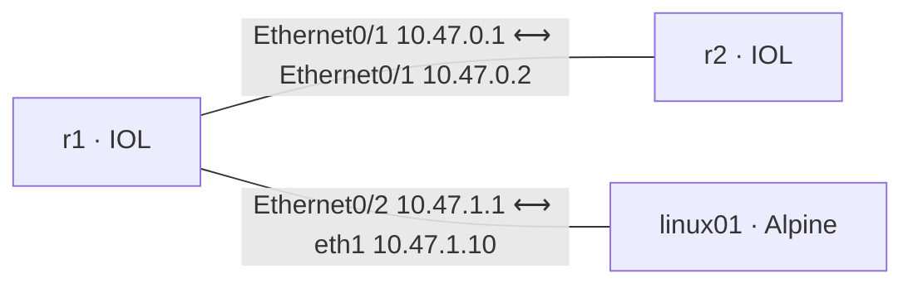

# Cisco IOL lab test

Tests `cisco_iol` container nodes end to end through the `sherpa` CLI: the generated startup
config and SSH on the management address, P2p links, TCP into IOL across the links, and a config
saved with `write memory` surviving a cold boot.

| Node | Model | Role |
|---|---|---|
| `r1` | `cisco_iol` 17.18.02 | Router: Ethernet0/1 10.47.0.1/30 to r2, Ethernet0/2 10.47.1.1/24 to the host |
| `r2` | `cisco_iol` 17.18.02 | Router: Ethernet0/1 10.47.0.2/30 to r1, a static route to 10.47.1.0/24 through r1 |
| `linux01` | `generic_container` (`alpine` 3.22) | Host: eth1 10.47.1.10/24 at MTU 1500, a route to 10.47.0.0/30 through r1 |



## What it checks

1. `sherpa up`, then, for each router: SSH as `sherpa` answers on the management address, and
   the running config has the generated hostname, the `sherpa` login and the management
   interface. The link addresses are then configured over SSH.
2. Pings: each router to its peer and to the host, and the host to both routers, across a link
   and routed through r1.
3. TCP: the host reads both routers' SSH banners across the links. This fails if transmit
   checksum offload is on at the host end of IOL's veths, while ping still works.
4. `write memory` on r1, then a cold boot of both routers: `sherpa down`, the containers stopped
   (`sherpa down` pauses containers, so it alone is not a cold boot), and `sherpa resume`. r1
   must come back with its saved config and r2, which saved nothing, with its startup config.
   r2 is configured again and the pings and TCP checks run again.
5. `sherpa destroy`, and no container, Docker network or host interface of the lab is left.

## Running it

It runs on the Sherpa server, with the CLI logged in: the Alpine host is not privileged, so the
runner addresses and tests its interface from a throwaway `alpine:3.22` container in its network
namespace, through Docker. The IOL image is built from your own CML image, so the test needs it first:

1. Build `localrepo/cisco_iol:17.18.02` with
   [docker-cisco-iol](https://github.com/bwks/docker-cisco-iol) and record it with
   `sherpa server image scan --container`.
2. Pull the host image: `sherpa server image pull --model generic_container --repo alpine:3.22`,
   or `docker pull alpine:3.22` and a scan.

```
uv run tests/labs/cisco-iol/cisco_iol_lab_test.py
uv run tests/labs/cisco-iol/cisco_iol_lab_test.py --keep-failed   # leave a failed lab for debugging
uv run tests/labs/cisco-iol/cisco_iol_lab_test.py --self-test     # the runner's own unit tests
```

The preflight stops with a message when either image is missing. Logs are under
`.tmp/lab-tests/cisco-iol-<run>/`. A run takes about 3–5 minutes.
