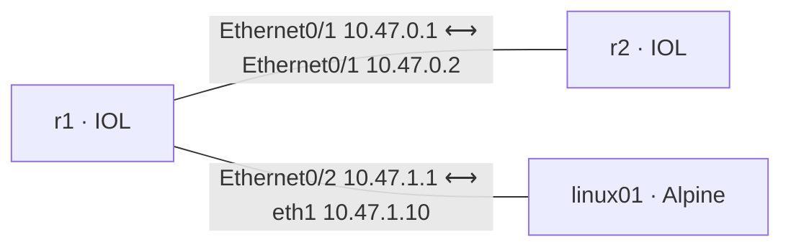

# Cisco IOL lab test

Tests `cisco_iol` container nodes end to end through the `sherpa` CLI: the generated startup
config and SSH on the management address, P2p links, TCP into IOL across the links, and a config
saved with `write memory` surviving a cold boot.

| Node | Model | Role |
|---|---|---|
| `r1` | `cisco_iol` 17.18.02 | Router: Ethernet0/1 10.47.0.1/30 to r2, Ethernet0/2 10.47.1.1/24 to the host |
| `r2` | `cisco_iol` 17.18.02 | Router: Ethernet0/1 10.47.0.2/30 to r1, a static route to 10.47.1.0/24 through r1 |
| `linux01` | `generic`, kind `container` (`alpine` 3.22) | Host: eth1 10.47.1.10/24 at MTU 1500, a route to 10.47.0.0/30 through r1 |



## Running it

It runs on the Sherpa server, with the CLI logged in and a device password set
(`sherpa server user device-password`; the run stops early without one): the Alpine host is not privileged, so the
runner addresses and tests its interface from a throwaway `alpine:3.22` container in its network
namespace, through Docker. The IOL image is built from your own CML image, so the test needs it first:

1. Build `localrepo/cisco_iol:17.18.02` with
   [docker-cisco-iol](https://github.com/bwks/docker-cisco-iol) and record it with
   `sherpa server image scan --container`.
2. Pull the host image: `sherpa server image pull --model generic --kind container --repo alpine:3.22`,
   or `docker pull alpine:3.22` and a scan.

The runner is a pytest module; `uv run` installs the pytest version pinned in its script header
and runs pytest on it, passing on any other arguments:

```sh
uv run tests/labs/cisco-iol/cisco_iol_lab_test.py
uv run tests/labs/cisco-iol/cisco_iol_lab_test.py --keep-failed   # leave a failed lab for debugging
uv run tests/labs/cisco-iol/cisco_iol_lab_test.py -k config_delivery_002
uv run tests/labs/cisco-iol/cisco_iol_lab_test.py --self-test     # the runner's own unit tests, seconds
```

pytest runs it directly too, for example `uvx --python 3.15 pytest==9.2.0
tests/labs/cisco-iol/cisco_iol_lab_test.py`. `--keep-failed` is defined in `conftest.py` next to
the runner. What the lab runners share, such as running and logging a command, is in
[`../labkit.py`](../labkit.py).

The module-scoped `prepared` fixture checks the requirements and writes the run's manifest under a
unique lab name; the `lab` fixture brings the lab up once and destroys it at the end, even when a
case fails, unless `--keep-failed` is given and something failed. Its teardown also checks that
`sherpa inspect` no longer finds the lab and that no container, Docker network or host interface
whose name holds the lab's ID is left. The `configured` fixture configures both routers' link
addresses over SSH and addresses the host; the `cold_booted` fixture saves r1's config with
`write memory` and cold-boots both routers: `sherpa down`, the containers stopped (`sherpa down`
pauses containers, so it alone is not a cold boot) and `sherpa resume`. The `reconfigured` fixture
then configures r2, which saved nothing, again. Each runs once for the module. The cases are the
functions named `test_<case_id>_*`, in the order below, the order the lab goes through; every
case runs even when one fails. The runner's own unit tests, under `--self-test`, are not
collected by pytest.

The preflight stops with a message when either image is missing. Logs are under
`.tmp/lab-tests/cisco-iol-<run>/`. A run takes about 3–5 minutes.

## What it checks

| Case | Check |
|---|---|
| [`config_delivery_002`](../../specs/ztp.md) | After up, each router's SSH answers the lab owner on its management address, and its running config has the generated hostname, the management interface and the owner's `username <owner> privilege 15` login |
| [`veth_checksums_001`](../../specs/links-and-bridges.md) | After up, the host reads both routers' SSH banners across the links; after the cold boot, r1's, retrying while it boots. This fails if transmit checksum offload is on at the host end of IOL's veths, while ping still works, so the case first checks the pings of `link_reattach_026` after up: each router to its peer and to the host, and the host to both routers, across a link and routed through r1 |
| [`node_resume_004`](../../specs/nodes.md) | After the cold boot, `sherpa resume` has started both stopped routers and each answers the owner's SSH again |
| [`node_resume_006`](../../specs/nodes.md) | After the cold boot, r1 has the link addresses it saved with `write memory`, and r2, which saved nothing, has none of them |
| [`link_reattach_026`](../../specs/links-and-bridges.md) | Once r2 is configured again after the cold boot, every ping above passes again across both links |
