# P2p containers lab test

Tests `p2p = true` links on container nodes end to end through the `sherpa` CLI. Every link is
P2p, and several hosts have no `ip` command or no shell, so their interfaces must come up
without anything running in the image.

| Node | Model | Role |
|---|---|---|
| `sw01` | `arista_ceos` 4.35.1F | Router on the core triangle, and the access switch: VLAN 10 on eth3–eth15, gateway 10.46.10.1 |
| `srl01` | `nokia_srlinux` 25.10.1 | Router on the core triangle |
| `frr01` | `frr_linux` 10.5.2 | Router on the core triangle |
| `mongo01` | `mongo_db` 8.2.7-rc0 | Host; the image has no `ip` |
| `surreal01` | `surreal_db` v3.0.0 | Host; the image has no shell |
| `vault01`, `nats01`, `forgejo01`, `gitlab01` | `hashicorp_vault`, `nats_bus`, `forgejo_forge`, `gitlab_ce` | Hosts; nats01 sets `skip_ready_check`, which must still start it |
| `mysql01`, `postgres01` | `mysql_db` 8.4, `postgresql_db` 17 | Hosts |
| `alpine01`, `ubuntu01`, `debian01`, `busybox01`, `rocky01` | `generic_container` | Hosts; debian01 and busybox01 set no `image`, so they run the repo recorded when the image was pulled |

The core links are routed /31s in 10.46.0.0/24, with static routes back to the host VLAN.

Every line below is a P2p link: a veth per container end, joined by the eBPF redirect.

```mermaid
flowchart TB
    subgraph core["Routed core: 10.46.0.0/24, static routes to 10.46.10.0/24"]
        direction LR
        sw01["sw01 · cEOS<br/>Vlan10 10.46.10.1/24"]
        srl01["srl01 · SR Linux"]
        frr01["frr01 · FRR"]
        sw01 ---|"eth1 10.46.0.0 ⟷ ethernet-1/1 10.46.0.1"| srl01
        sw01 ---|"eth2 10.46.0.2 ⟷ eth1 10.46.0.3"| frr01
        srl01 ---|"ethernet-1/2 10.46.0.4 ⟷ eth2 10.46.0.5"| frr01
    end

    subgraph apps["Application hosts: eth1 in VLAN 10, gateway 10.46.10.1"]
        mongo01["mongo01 · .11<br/>no ip"]
        surreal01["surreal01 · .12<br/>no shell"]
        vault01["vault01 · .13"]
        nats01["nats01 · .14"]
        forgejo01["forgejo01 · .15"]
        gitlab01["gitlab01 · .16"]
        mysql01["mysql01 · .17"]
        postgres01["postgres01 · .18"]
    end

    subgraph os["OS hosts (generic_container): eth1 in VLAN 10"]
        alpine01["alpine01 · .19"]
        ubuntu01["ubuntu01 · .20"]
        debian01["debian01 · .21<br/>pulled repo"]
        busybox01["busybox01 · .22<br/>pulled repo"]
        rocky01["rocky01 · .23"]
    end

    sw01 ---|eth3| mongo01
    sw01 ---|eth4| surreal01
    sw01 ---|eth5| vault01
    sw01 ---|eth6| nats01
    sw01 ---|eth7| forgejo01
    sw01 ---|eth8| gitlab01
    sw01 ---|eth9| mysql01
    sw01 ---|eth10| postgres01
    sw01 ---|eth11| alpine01
    sw01 ---|eth12| ubuntu01
    sw01 ---|eth13| debian01
    sw01 ---|eth14| busybox01
    sw01 ---|eth15| rocky01
```



Host addresses are 10.46.10.x/24, numbered in manifest order. sw01's eth16 and up have no
link. Each host reaches srl01 and frr01 through sw01, over a route to 10.46.0.0/24 the test
adds.

## Requirements

- Run on the Sherpa server, as a user who can use Docker. Unlike other lab tests, this one
  reaches nodes through Docker: some hosts have no shell and the FRR image has no SSH server.
  Hosts are checked and addressed from a throwaway `alpine:3.22` container that shares the
  node's network namespace; routers are configured with `docker exec` into their CLI.
- The node images above, pulled with `sherpa server image pull` (for models without a built-in
  repo, with `--repo`), and `alpine:3.22` in Docker. The run fails early if any is missing.
- The `sherpa` CLI logged in.

## Running

```sh
python3 tests/labs/p2p-containers/p2p_containers_lab_test.py
python3 tests/labs/p2p-containers/p2p_containers_lab_test.py --keep-failed
python3 tests/labs/p2p-containers/p2p_containers_lab_test.py --self-test  # runner unit tests, seconds
```

Each run logs every command and its output under
`.tmp/lab-tests/p2p-containers-<id>/lab/commands.log`. A run takes about 2–5 minutes.

## What it checks

- every host's eth1 is named, up, promiscuous, has carrier and MTU 9600, and an unused sw01
  interface has no carrier;
- every host pings the gateway, every other host, and srl01 and frr01 routed through sw01, and
  each router pings its peer across each core link;
- the same after redeploying surreal01 (no shell), mongo01 (no `ip`) and frr01 (a router; it
  pings its link peers first, so they learn its new MAC addresses);
- `sherpa destroy` cleans up everything: no container, Docker network or host interface of the
  lab is left.
