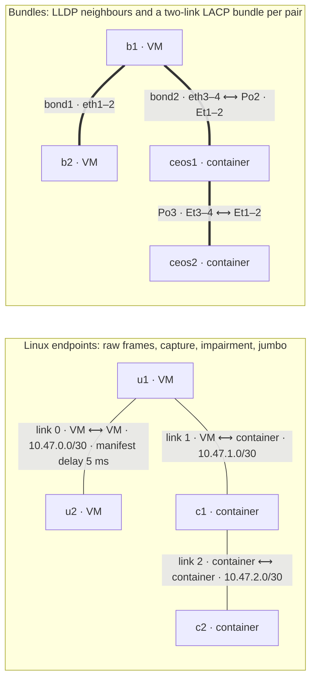

# P2p links lab test

Checks the requirements of #391 for P2p (eBPF) links on each pair of node kinds, VM ⟷ VM,
VM ⟷ container and container ⟷ container, end to end through the `sherpa` CLI.

| Node | Model | Role |
|---|---|---|
| `u1`, `u2` | `ubuntu_linux` 24.04 | Linux VM endpoints |
| `c1`, `c2` | `generic`, kind `container`, alpine 3.22 | Linux container endpoints |
| `b1`, `b2` | `ubuntu_linux` 24.04 | VM bundle ends: Linux 802.3ad bonds, LLDP from `lldp.py` |
| `ceos1`, `ceos2` | `arista_eos`, kind `container`, 4.35.1F | Container bundle ends: port-channels and LLDP |

There is no network-OS VM. The tests run in the dev servers, which are VMs, so every VM a lab
boots there is nested, and a network-OS VM such as vEOS takes many minutes to boot. The VM ends
of the bundles are Ubuntu VMs with Linux bonds instead.



Every link is P2p. On each Linux link the src end is `.1` and the dst end `.2`.

## Requirements

- Run on the Sherpa server, as a user who can use Docker. Like p2p-containers, this test reaches
  container nodes through Docker: a throwaway `nicolaka/netshoot:v0.14` container shares a node's
  network namespace to send and receive frames, and another on the host network captures on a
  link's host end and reads its qdiscs. Host ends are named as `sherpad` names them (`tpa<link>`
  for the src end, `tpb<link>` for the dst end); the test reads them to check MTU, capture and
  netem. The VM interfaces are found by MAC, from the tap's. The Ubuntu VMs have no LLDP agent,
  so `lldp.py`, copied to each VM with `l2frames.py`, sends LLDP on the bond members and reports
  what it hears; its run must cover a cEOS LLDP interval, which the runner sets to 5 s.
  A VM's virtio interfaces report unknown speed and duplex, and a Linux 802.3ad bond sends no
  LACPDU from a member that is not full duplex, so the runner sets each bond member to
  `speed 10000 duplex full` with `ethtool` before bonding it.
- The node images above, pulled or imported on the server, and
  `docker pull nicolaka/netshoot:v0.14`. The run fails early if any is missing.
- The `sherpa` CLI logged in, with a device password set (`sherpa server user device-password`), and `virsh` for the leftover check.

## Running

```sh
uv run tests/labs/p2p-links/p2p_links_lab_test.py
uv run tests/labs/p2p-links/p2p_links_lab_test.py --keep-failed
uv run tests/labs/p2p-links/p2p_links_lab_test.py --sherpad-restart 'sudo systemctl restart sherpad'
uv run tests/labs/p2p-links/p2p_links_lab_test.py --self-test  # runner unit tests, seconds
```

Each run logs every command and its output, and keeps the captures, under
`.tmp/lab-tests/p2p-links-<id>/lab/`.

## What it checks

| Requirement | How |
|---|---|
| L2 transparency | `l2frames.py` sends LLDP, STP, pause, LACP, 802.1X, GARP-range, CDP, 802.1Q, QinQ and 9000-byte frames each way on every Linux link; all must arrive, tags intact. Each bundle's ends must be LLDP neighbours on both ports and bundle both: into the port-channel on cEOS, into the bond's active aggregator, in sync, collecting and distributing at both ends, on a VM. Every cEOS node must save its configuration with `write memory`. |
| Packet capture | `tcpdump` on each Linux link's src host end must see every frame from both ends. |
| Impairment | `sherpa link impair` sets `src-to-dst`, then `dst-to-src`, then both with reorder and corruption, then clears, on every Linux link. Each step checks the netem delay on the host end each direction leaves through, and the round-trip time. The manifest's impairment on link 0 is checked after `up`. |
| Jumbo frames | Every host end, taps included, is MTU 9600, and unfragmented 8972-byte pings pass each way. |
| Lifecycle | Pings each way on every Linux link after `up`, after redeploying u1 (VM end of two links) and c1 (container end of two links), after rebooting u2 from inside the guest, after `down`/`resume` and, with `--sherpad-restart`, after a `sherpad` restart. Impairment must be as it was set after each, except the reboot. Frames, capture and the bundles are checked again after `resume`; the VMs cold boot, so the runner makes their bonds again. |
| Destroy | Nothing of the lab is left: no container, Docker network, host interface or libvirt domain. |

Not checked by this lab yet: link state when a node goes down, and a VM cold boot or container
restart made outside Sherpa. Sherpa handles both. Each scan of the scanner (every 30 seconds
unless `[scanner]` in `sherpa.toml` says otherwise) gives each link a state, shown by
`sherpa inspect`: attached, waiting for a peer that is down, or failed (`link_state`). When a
node stops, its peer's end loses carrier, inside a VM's guest or on a container's interface,
and gets it back when the link is attached again (`link_carrier`). A VM destroyed and started
with `virsh`, or a container restarted with `docker restart` or `docker stop` and `start`, has
its interfaces and links back within one scan (`link_reattach` 016 to 019). The server's
integration and unit tests show those. The end-to-end cases that would belong in this lab have
no test yet: `link_state_009`, a link shown waiting after `sherpa down --node` of one end and
attached again after the resume, and `link_carrier_016`, a redeployed node's peers keeping their
carrier while it is replaced.
