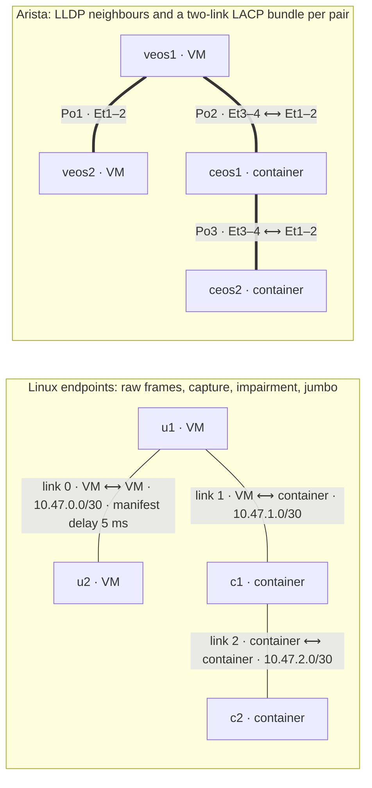

# P2p links lab test

Checks the requirements of #391 for P2p (eBPF) links on each pair of node kinds, VM ⟷ VM,
VM ⟷ container and container ⟷ container, end to end through the `sherpa` CLI. The results
that led to it are in `docs/investigations/p2p-ebpf-requirements.md`.

| Node | Model | Role |
|---|---|---|
| `u1`, `u2` | `ubuntu_linux` 24.04 | Linux VM endpoints |
| `c1`, `c2` | `generic_container` alpine 3.22 | Linux container endpoints |
| `veos1`, `veos2` | `arista_veos` 4.35.3F | VM NOS: LLDP and LACP |
| `ceos1`, `ceos2` | `arista_ceos` 4.35.1F | Container NOS: LLDP and LACP |



Every link is P2p. On each Linux link the src end is `.1` and the dst end `.2`.

## Requirements

- Run on the Sherpa server, as a user who can use Docker. Like p2p-containers, this test reaches
  container nodes through Docker: a throwaway `nicolaka/netshoot:v0.14` container shares a node's
  network namespace to send and receive frames, and another on the host network captures on a
  link's host end and reads its qdiscs. Host ends are named as `sherpad` names them (`tpa<link>`
  for the src end, `tpb<link>` for the dst end); the test reads them to check MTU, capture and
  netem. The VM interfaces are found by MAC, from the tap's.
- The node images above, pulled or imported on the server, and
  `docker pull nicolaka/netshoot:v0.14`. The run fails early if any is missing.
- The `sherpa` CLI logged in, and `virsh` for the leftover check.

## Running

```sh
python3 tests/labs/p2p-links/p2p_links_lab_test.py
python3 tests/labs/p2p-links/p2p_links_lab_test.py --keep-failed
python3 tests/labs/p2p-links/p2p_links_lab_test.py --sherpad-restart 'sudo systemctl restart sherpad'
python3 tests/labs/p2p-links/p2p_links_lab_test.py --self-test  # runner unit tests, seconds
```

Each run logs every command and its output, and keeps the captures, under
`.tmp/lab-tests/p2p-links-<id>/lab/`.

## What it checks

| Requirement | How |
|---|---|
| L2 transparency | `l2frames.py` sends LLDP, STP, pause, LACP, 802.1X, GARP-range, CDP, 802.1Q, QinQ and 9000-byte frames each way on every Linux link; all must arrive, tags intact. Each Arista bundle's ends must be LLDP neighbours on both ports and bundle both into the port-channel. Every Arista node, cEOS included, must save its configuration with `write memory`. |
| Packet capture | `tcpdump` on each Linux link's src host end must see every frame from both ends. |
| Impairment | `sherpa link impair` sets `src-to-dst`, then `dst-to-src`, then both with reorder and corruption, then clears, on every Linux link. Each step checks the netem delay on the host end each direction leaves through, and the round-trip time. The manifest's impairment on link 0 is checked after `up`. |
| Jumbo frames | Every host end, taps included, is MTU 9600, and unfragmented 8972-byte pings pass each way. |
| Lifecycle | Pings each way on every Linux link after `up`, after redeploying u1 (VM end of two links) and c1 (container end of two links), after rebooting u2 from inside the guest, after `down`/`resume` and, with `--sherpad-restart`, after a `sherpad` restart. Impairment must be as it was set after each, except the reboot. Frames, capture and the Arista bundles are checked again after `resume`. |
| Destroy | Nothing of the lab is left: no container, Docker network, host interface or libvirt domain. |

Not covered: link state when a node goes down, and a VM cold boot or container restart made
outside Sherpa. Sherpa does not handle those yet (#394).
