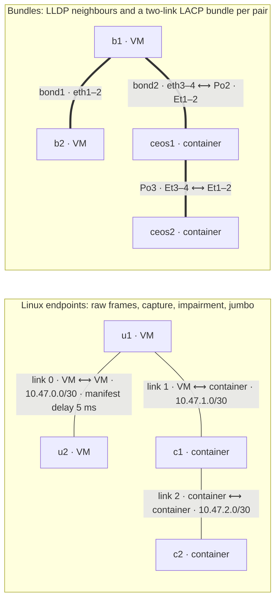

# P2p links lab test

Checks the requirements of #391 for P2p (eBPF) links on each pair of node kinds, VM ⟷ VM,
VM ⟷ container and container ⟷ container, end to end through the `sherpa` CLI.

| Node | Model | Role |
|---|---|---|
| `u1`, `u2` | `ubuntu_linux` 24.04 | Linux VM endpoints |
| `c1`, `c2` | `generic`, kind `container`, alpine 3.22 | Linux container endpoints |
| `b1`, `b2` | `ubuntu_linux` 24.04 | VM bundle ends: Linux 802.3ad bonds, LLDP from `lldp.py` |
| `ceos1`, `ceos2` | `arista_eos`, kind `container`, 4.35.1F | Container bundle ends: port-channels and LLDP |

There is no network-OS VM. The tests run in the dev servers, which are VMs, so every VM a lab
boots there is nested, and a network-OS VM such as vEOS takes many minutes to boot. The VM ends
of the bundles are Ubuntu VMs with Linux bonds instead.



Every link is P2p. On each Linux link the src end is `.1` and the dst end `.2`.

## Requirements

- Run on the Sherpa server, as a user who can use Docker. Like p2p-containers, this test reaches
  container nodes through Docker: a throwaway `nicolaka/netshoot:v0.14` container shares a node's
  network namespace to send and receive frames, and another on the host network captures on a
  link's host end and reads its qdiscs. Host ends are named as `sherpad` names them (`tpa<link>`
  for the src end, `tpb<link>` for the dst end); the test reads them to check MTU, capture and
  netem. The VM interfaces are found by MAC, from the tap's. The Ubuntu VMs have no LLDP agent,
  so `lldp.py`, copied to each VM with `l2frames.py`, sends LLDP on the bond members and reports
  what it hears; its run must cover a cEOS LLDP interval, which the runner sets to 5 s.
  A VM's virtio interfaces report unknown speed and duplex, and a Linux 802.3ad bond sends no
  LACPDU from a member that is not full duplex, so the runner sets each bond member to
  `speed 10000 duplex full` with `ethtool` before bonding it.
- The node images above, pulled or imported on the server, and
  `docker pull nicolaka/netshoot:v0.14`. The run fails early if any is missing.
- The `sherpa` CLI logged in, with a device password set (`sherpa server user device-password`), and `virsh` for the leftover check.

## Running

The runner is a pytest module; `uv run` installs the pytest version pinned in its script header
and runs pytest on it, passing on any other arguments:

```sh
uv run tests/labs/p2p-links/p2p_links_lab_test.py
uv run tests/labs/p2p-links/p2p_links_lab_test.py --keep-failed
uv run tests/labs/p2p-links/p2p_links_lab_test.py --sherpad-restart 'sudo systemctl restart sherpad'
uv run tests/labs/p2p-links/p2p_links_lab_test.py -k link_impair_
uv run tests/labs/p2p-links/p2p_links_lab_test.py --collect-only -q
uv run tests/labs/p2p-links/p2p_links_lab_test.py --self-test  # runner unit tests, seconds
```

pytest runs it directly too, for example `uvx --python 3.15 pytest==9.2.0
tests/labs/p2p-links/p2p_links_lab_test.py`. `--keep-failed` and `--sherpad-restart` are defined
in `conftest.py` next to the runner. What the lab runners share, such as running and logging a
command, is in [`../labkit.py`](../labkit.py).

The module-scoped `prepared` fixture checks the requirements and writes the run's manifest under a
unique lab name; the `lab` fixture brings the lab up once and destroys it at the end, even when a
case fails, unless `--keep-failed` is given and something failed; the `ready` fixture configures
cEOS, addresses every Linux link end, makes the VMs' bonds and runs one ping round so the ends
know each other's MAC addresses; `frames_after_up` sends the frame set each way on every Linux
link with a capture on its src host end, for the three cases that check it.

Each lifecycle step is a fixture of its own that does the step and records what the links look
like straight after it, asserting nothing: `redeployed_vm` (u1), `redeployed_container` (c1),
`resumed` (down and resume), `rebooted` (u2 from inside the guest) and `sherpad_restarted`. The
cases assert on those records, so `link_impair_005` sees the impairments as they were straight
after each step. `lifecycle_impairment` sets the impairments the steps are checked against before
the first of them.

The cases are the functions named `test_<case_id>_*`, in the order below; every case runs even
when one fails. The last one destroys the lab itself; when it does not run, the `lab` fixture's
teardown destroys it and checks only that `sherpa inspect` no longer finds it. The runner's own
unit tests, under `--self-test`, are not collected by pytest.

Each run logs every command and its output, and keeps the captures, under
`.tmp/lab-tests/p2p-links-<id>/lab/`. A run takes about 15–20 minutes.

## What it checks

It holds the P2p link cases of [`tests/specs/links-and-bridges.md`](../../specs/links-and-bridges.md).
The Linux links are VM ⟷ VM (link 0), VM ⟷ container (link 1) and container ⟷ container (link 2);
the bundles join two VMs, a VM and cEOS, and two cEOS nodes.

| Case | Check |
|---|---|
| `p2p_link_001` | After up, `l2frames.py` sends LLDP, STP, pause, LACP, 802.1X, GARP-range, CDP, 802.1Q and QinQ frames each way on every Linux link; all arrive, tags intact |
| `p2p_link_002` | Each bundle's ends are LLDP neighbours on both ports and bundle both: into the port-channel on cEOS, into the bond's active aggregator, in sync, collecting and distributing at both ends, on a VM. The `ready` fixture configures cEOS and saves its configuration with `write memory`, and stops the run if either fails |
| `p2p_link_003` | Every host end, taps included, is MTU 9600; pings and unfragmented 8972-byte pings pass each way on every Linux link; the 9000-byte frame of `p2p_link_001`'s exchange arrives each way at full length |
| `p2p_link_005` | `tcpdump` on each Linux link's src host end, `tpa<link>-<lab>`, sees every frame of the exchange from both ends |
| `link_impair_001` | The manifest's 5 ms on link 0 is the netem delay on both host ends after up, with none on the other links, and each link's round-trip time is the sum of its directions |
| `link_impair_002` | On every Linux link, `--direction src-to-dst --delay 20`, then `--direction dst-to-src --delay 10`, each change only the netem delay on the host end that direction leaves through, and the round-trip time follows |
| `link_impair_003` | On every Linux link, a 10 ms delay with 25% reorder and 5% corruption on both directions is on both host ends, and pings still pass |
| `link_impair_004` | `--clear` leaves no netem on either host end of every Linux link, and the round-trip time is as without one |
| `link_reattach_001` | After redeploying u1, the VM end of links 0 and 1, pings and jumbo pings pass each way on every Linux link |
| `link_reattach_002` | After redeploying c1, the container end of links 1 and 2, the same |
| `link_reattach_003` | After `sherpa down` and `sherpa resume`, and the VMs' link ends addressed and bonds made again after their cold boot: the host ends' MTU, the pings and jumbo pings, every frame each way, the capture and the bundles are as after up |
| `link_reattach_004` | After rebooting u2 from inside the guest, pings and jumbo pings pass each way on every Linux link |
| `p2p_link_009` | With `--sherpad-restart`, after running its command: pings, jumbo pings and the bundles work, with nothing attached again by the runner. Skipped without the option |
| `link_impair_005` | The impairments set before the steps (link 0 the manifest's 5 ms, link 1 15 ms `dst-to-src` only, link 2 none) are on the host ends, and the round-trip times follow, straight after each redeploy, the resume and, with `--sherpad-restart`, the sherpad restart. Without the option it is skipped after the other steps pass, naming the step not checked |
| `link_cleanup_001` | `sherpa destroy` succeeds, `sherpa inspect` no longer finds the lab, and no container, Docker network, host interface or libvirt domain or network whose name holds the lab's ID is left. It is skipped when `--keep-failed` is given and an earlier case failed |

Not checked by this lab yet: link state when a node goes down, and a VM cold boot or container
restart made outside Sherpa. Sherpa handles both. Each scan of the scanner (every 30 seconds
unless `[scanner]` in `sherpa.toml` says otherwise) gives each link a state, shown by
`sherpa inspect`: attached, waiting for a peer that is down, or failed (`link_state`). When a
node stops, its peer's end loses carrier, inside a VM's guest or on a container's interface,
and gets it back when the link is attached again (`link_carrier`). A VM destroyed and started
with `virsh`, or a container restarted with `docker restart` or `docker stop` and `start`, has
its interfaces and links back within one scan (`link_reattach` 016 to 019). The server's
integration and unit tests show those. The end-to-end cases that would belong in this lab have
no test yet: `link_state_009`, a link shown waiting after `sherpa down --node` of one end and
attached again after the resume, and `link_carrier_016`, a redeployed node's peers keeping their
carrier while it is replaced.
